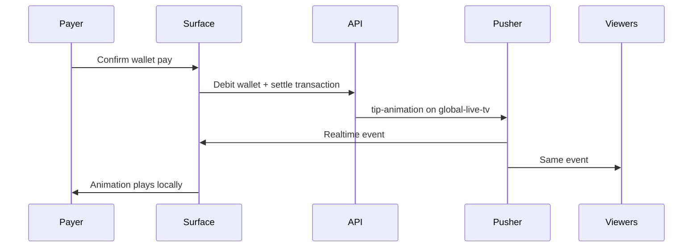
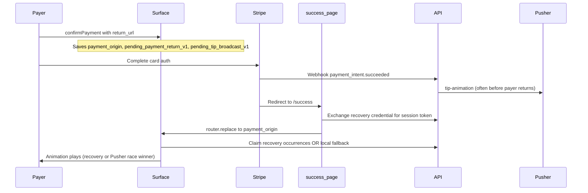

# Payment Animation — Product Behavior Guide

This document describes how tip payment animations work in Tipmanna: what payers and viewers should experience, how realtime delivery is architected, how payments integrate, and how feature flags control behavior.

**Audience:** Product, design, and engineering teams planning features or diagnosing payer experience issues.

**Related ops docs:**

- [payment-animation-operator-runbook.md](./payment-animation-operator-runbook.md) — incident response and grep patterns
- [payment-animation-overload-policy.md](./payment-animation-overload-policy.md) — queue caps and burst handling

---

## Product promise

1. **Every payer** who completes a tip on a supported surface should see their own tip animate on the **same surface they paid from** (Explore feed, TV, channel, content page, event room).
2. **Every other viewer** of that event (on any subscribed surface) should see the tip animate **exactly once** — no duplicates, no replays after Screen Display closes.
3. **Financial counters** (event amount raised, event tip count, per-video tip count) should update in realtime alongside the animation.

Wallet tips (no Stripe redirect) animate via the normal realtime path. Card tips that redirect to Stripe use a recovery path because the webhook often broadcasts the animation while the payer is still on `/success`.

---

## End-to-end payment flows

### Wallet tip (no redirect)

- No `/success` page, no recovery credential, no payer-origin hook required.
- Animation is driven by Pusher `tip-animation` on channel `global-live-tv`.

### Stripe card tip (redirect)

**Why recovery exists:** The Stripe webhook frequently settles and broadcasts before the payer lands back on their surface. The payer misses the live Pusher event. Recovery replays the canonical animation bundle for the payer only, without re-broadcasting globally.

**Race with useAutoDropTip:** After return, surfaces may POST `/messages` via `useAutoDropTip`. If the webhook already created the message, the POST is deduped on `transactionId` and does **not** re-broadcast. Recovery (or local fallback) is the payer's animation path for redirect flows.

---

## Realtime architecture

### Channels and events

| Channel           | Event                  | Purpose                                                                                  |
| ----------------- | ---------------------- | ---------------------------------------------------------------------------------------- |
| `global-live-tv`  | `tip-animation`        | Canonical animation payload for all surfaces (includes `transactionId` for payer dedupe) |
| `global-live-tv`  | `live-tip`             | Secondary notification (legacy companion)                                                |
| `event-{eventId}` | `event-amount-updated` | Amount raised, event tip count, optional per-video tip count                             |
| `event-{eventId}` | `live-tip`             | Event-scoped tip notification                                                            |

### Single-stream broker

When `NEXT_PUBLIC_SINGLE_TIP_STREAM_BROKER` is enabled (default):

- One Pusher bind to `global-live-tv` / `tip-animation` per page.
- One shared monotonic guard (`seq` / `serverTs`) rejects stale or duplicate bundles.
- One `validated-tip` DOM event per accepted bundle; surfaces enqueue playback from that event.

Set `NEXT_PUBLIC_SINGLE_TIP_STREAM_BROKER=false` only for legacy dual-bind debugging.

### Playback deduplication

Each character in a tip bundle gets a **playback key**:

- Format: `{prefix}{bundleId}-{occurrenceIndex}-{characterName}`
- **Alias:** when `transactionId` is on the payload, realtime/recovery also reserve `tx:{transactionId}-...` so local fallback cannot double-play
- States: `unseen` → `reserved` → `committed`
- Recovery and realtime paths share keys so the first path to play wins; the other skips.

Screen Display uses prefix `screen-` and is independent of payer-origin recovery.

---

## Broadcast integrity (backend outbox)

When `TIP_ANIMATION_OUTBOX_ENABLED` is on (backend default):

1. On successful settlement, a `TipAnimationDelivery` row is created (one per `transactionId`).
2. Occurrence rows track each character (`PENDING` → `CLAIMED` → `COMPLETED`).
3. Emission uses a lease (`PENDING` / `EMITTING` / `EMITTED`) with advisory lock on `transactionId`.
4. Pusher fires once per delivery; retries are idempotent.

Recovery **claim** reads from `TipAnimationDelivery`. If the outbox is off, no delivery row exists and claim returns 404 — the frontend local fallback may still play an animation from the saved cart.

---

## Payer-origin recovery (redirect card tips)

### What gets saved before redirect

| Storage        | Key                         | Contents                                                     |
| -------------- | --------------------------- | ------------------------------------------------------------ |
| localStorage   | `payment_origin`            | Full URL of paying surface (for redirect back)               |
| sessionStorage | `pending_payment_return_v1` | Transaction id, event id, surface label, recovery credential |
| localStorage   | `pending_tip_broadcast_v1`  | Cart snapshot for message POST and local fallback            |

### Exchange on `/success`

1. Client sends recovery credential + ownership (`tipperId`, `visitorId`, or `clientSessionId`).
2. Backend validates transaction succeeded, event/PI match, credential hash, ownership.
3. Credential is burned (`exchangedAt` set); JWT session token returned.
4. Client redirects to `payment_origin` once (idempotent guard keyed by `paymentIntentId`).
5. **Do not** call `history.replaceState("/success")` on the redirect path — it cancels the in-flight Next.js `router.replace` transition and strands the payer.
6. A ~1200ms watchdog hard-navigates via `window.location.assign` if the browser is still on `/success`.
7. If exchange fails, `pending_payment_return_v1.recoveryUnavailable` is set so the surface can run local fallback without a session token.

### Recovery on payment surface

Hook: `usePayerOriginAnimationRecovery` — mounted on:

| Surface component        | `paymentSurface` label             |
| ------------------------ | ---------------------------------- |
| explore-feed-client      | `explore_feed`, `community_feed`   |
| explore-tv-schedule-feed | `explore_feed`                     |
| tv-looper / home / web   | `tv_looper`, `community_tv_looper` |
| channel-client           | `channel_client`                   |
| content-client           | `content_client`                   |
| tiplink landing          | `tiplink`                          |
| room-messages            | (dynamic)                          |

Guards (all must pass):

- Recovery flag on
- Pending return + session token present
- `paymentSurface` matches
- `eventId` matches active content
- **Payment origin intent matches** (origin + pathname + identity query params; ignores surface-managed params like `?community=`, `feedTab=`)

Then: claim occurrences → enqueue local playback → report progress to backend.

### Local fallback (last resort)

When claim fails definitively (404, 403, etc.) or session token missing:

- `tryPayerLocalAnimationFallback` builds animation from `pending_tip_broadcast_v1`
- Uses playback keys `tx:{transactionId}` to avoid double-play with realtime
- One-shot marker in localStorage per transaction
- Controlled by `NEXT_PUBLIC_PAYER_LOCAL_ANIMATION_FALLBACK` (default on)

---

## Payment integration highlights

### Cart total → Stripe

- Shared helper: `frontend/src/lib/tip-cart-total.ts`
- Stripe Elements amount updates when cart changes; PaymentIntent reuse is skipped when amount differs.

### Return URL

- `getStripeReturnUrl()` → `{NEXT_PUBLIC_FRONTEND_APP_URL}/success`
- Post-success redirect uses `payment_origin` if allowed by origin allowlist.

### Tip counts

- **Event tips:** `Event.numOfTips` — incremented on every succeeded tip for the event.
- **Video tips:** `EventChannel.numOfTips` — incremented when `paymentContentId` is set on the transaction.
- Realtime: `event-amount-updated` may include `paymentContentId` + `channelNumOfTips` for scoped UI updates.

---

## Feature flags reference

### Frontend (NEXT*PUBLIC*\*)

| Flag                                          | Default       | When ON                                                  | When OFF                                                   |
| --------------------------------------------- | ------------- | -------------------------------------------------------- | ---------------------------------------------------------- |
| `NEXT_PUBLIC_PAYER_ORIGIN_RECOVERY`           | on            | Exchange + recovery APIs used on `/success` and surfaces | No recovery; payer relies on being present for Pusher only |
| `NEXT_PUBLIC_PAYER_LOCAL_ANIMATION_FALLBACK`  | on            | Local cart animation if server recovery fails            | No fallback animation for payer                            |
| `NEXT_PUBLIC_SINGLE_TIP_STREAM_BROKER`        | on            | Single bind, shared guard                                | Legacy dual-bind path                                      |
| `NEXT_PUBLIC_PAYMENT_ANIMATION_TRACE_ENABLED` | off in prod   | Verbose browser trace logs                               | Silent (failures still logged at key stages)               |
| `NEXT_PUBLIC_PAYMENT_ORIGIN_ALLOWLIST`        | —             | Extra origins allowed for post-payment redirect          | Only `window.origin` + `NEXT_PUBLIC_FRONTEND_APP_URL`      |
| `NEXT_PUBLIC_FRONTEND_APP_URL`                | required prod | Canonical Stripe return_url base                         | Falls back to window.origin / site URL                     |

### Backend

| Flag                                | Default     | When ON                                          | When OFF                                                |
| ----------------------------------- | ----------- | ------------------------------------------------ | ------------------------------------------------------- |
| `TIP_ANIMATION_OUTBOX_ENABLED`      | on          | Delivery rows, leased emit, recovery claim works | Legacy direct Pusher; **no recovery claim data**        |
| `PAYER_ORIGIN_RECOVERY_API_ENABLED` | on          | Recovery endpoints + credentials at PI creation  | 404 on recovery APIs; no `recoveryState` in PI response |
| `PAYMENT_ANIMATION_TRACE_ENABLED`   | off in prod | Backend animation trace                          | Silent                                                  |

**Important:** Backend flags must live in `backend/.env` / deployment env — not in `frontend/.env`.

---

## Failure modes and payer experience

| Condition                            | Payer sees                                             | Others see                          |
| ------------------------------------ | ------------------------------------------------------ | ----------------------------------- |
| Normal redirect + recovery OK        | Animation on return surface                            | Animation via Pusher                |
| Pusher wins before recovery          | Animation via realtime (recovery skips duplicate keys) | Animation                           |
| Claim 404 (outbox off / no delivery) | Local fallback if cart saved (`recoveryUnavailable`)   | Animation via Pusher if webhook ran |
| Exchange failed (no session)         | Local fallback on surface if `recoveryUnavailable`     | Animation via Pusher if webhook ran |
| Stranded on /success                 | Watchdog hard-nav after ~1.2s                          | N/A                                 |
| Wrong redirect (second redirect bug) | Fixed: no replaceState on redirect path                | Animation                           |
| Recovery flag off                    | No recovery; may miss animation if absent for Pusher   | Animation                           |
| Queue full                           | May drop batch; logged as `queue_batch_rejected_full`  | Same                                |

---

## Surfaces and URL behavior

Surfaces that **rewrite URL after mount** (recovery uses intent matching to tolerate):

- **TV:** may append `?community=` from localStorage
- **Explore:** may append `feedTab=trends` on video handoff

Surfaces with **stable URLs:** channel, content, event room (unless restricted redirect).

---

## Deployment checklist

1. Confirm migration `20260804120000_tip_animation_delivery_recovery` applied.
2. Set `TIP_ANIMATION_OUTBOX_ENABLED=true` and `PAYER_ORIGIN_RECOVERY_API_ENABLED=true` in **backend** env.
3. Rebuild backend from source (`npm run build`) so compiled flags match opt-out defaults.
4. Set `PAYMENT_ANIMATION_TRACE_ENABLED=false` and `NEXT_PUBLIC_PAYMENT_ANIMATION_TRACE_ENABLED=false` in production.
5. Run `backend/scripts/backfill-event-channel-num-of-tips.ts` once for historical per-video counts.
6. Smoke: Stripe tip from Explore + TV; confirm payer return surface and single animation.

---

## Change guidance

- Do **not** mount payer recovery on Screen Display (`screen-` prefix is excluded).
- Do **not** clear `pending_tip_broadcast_v1` or `amount` on `/success` before the surface consumes them.
- Adding a new payment surface: wire `writePendingPaymentReturn` with a unique `paymentSurface` label, mount `usePayerOriginAnimationRecovery` with matching label(s), and add to product matrix above.
- Tightening origin matching: prefer extending `IDENTITY_QUERY_PARAMS` over exact full-URL equality.
