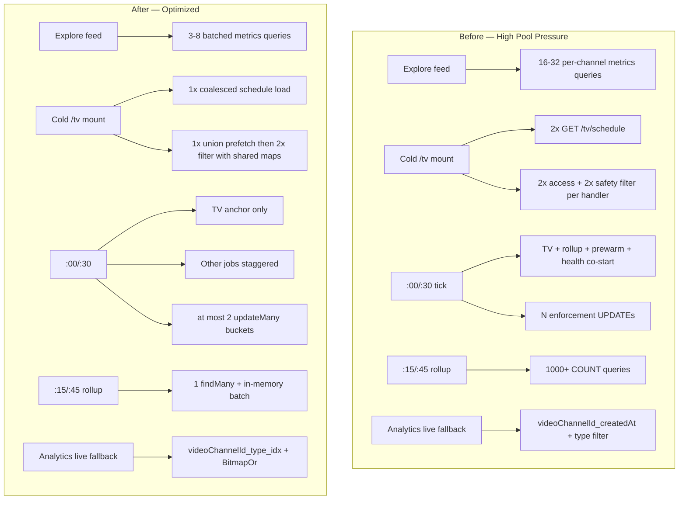

# Pool Optimization Final Validation Report

**Project:** Tipmanna — Prisma connection pool (P2024) pressure reduction  
**Document status:** **Closed — production validated** (permanent engineering record)  
**Implementation complete:** 2026-07-16  
**Production observation window:** 2026-07-16 through 2026-07-18 (48 hours post-deploy)  
**Final acceptance:** 2026-07-22  
**Scope:** Phase 1 (Opt-1/2/3) + Phase 2A–2E; Phase 2F/2G intentionally cancelled

---

## Project status

| Phase | Status |
|-------|--------|
| **Phase 1** (Opt-1, Opt-2, Opt-3) | **Complete — production validated** |
| **Phase 2A** (cron staggering) | **Complete — production validated** |
| **Phase 2B** (evidence-gated indexes) | **Complete — production validated** |
| **Phase 2C** (shared TV access batching) | **Complete — production validated** |
| **Phase 2D** (enforcement bulk update) | **Complete — production validated** |
| **Phase 2E** (feature-card rollup batching) | **Complete — production validated** |
| **Phase 2F** (compose cache warming) | **Intentionally cancelled** (no evidence) |
| **Phase 2G** (notification batching) | **Intentionally cancelled** (no evidence) |
| **Pool Optimization program** | **Closed** |

**Final acceptance:** All shipped phases accepted for production. **No rollback was required.**

---

## Executive summary

This optimization program addressed PostgreSQL connection pool exhaustion (P2024) by reducing **concurrent query fan-out**, **redundant per-request work**, **cron temporal clustering**, **per-row background updates**, and **slow analytics fallback scans** — without changing API contracts, analytics semantics, TV playlists, or access control.

| Layer | What shipped | Primary effect |
|-------|--------------|----------------|
| **Phase 1** | Opt-1 batch metrics, Opt-2 TV schedule coalescing, Opt-3 schedule existence probes | Explore fan-out 16–32 → 3–8 queries; duplicate `/tv/schedule` eliminated; warm cron skips full item loads |
| **Phase 2A** | Cron staggering | Heavy jobs moved off `:00/:30` TV peaks |
| **Phase 2B** | `AnalyticsEvent(videoChannelId, type)` retained; rollup composite dropped | Live-fallback engagement uses BitmapOr + new index; isolated watch path 513 ms → ~5 ms |
| **Phase 2C** | Shared TV access batching | 2–6 fewer Prisma calls per `/tv/schedule` resolve |
| **Phase 2D** | Enforcement bucketed `updateMany` | N per-row updates → ≤2 bulk updates per tick |
| **Phase 2E** | Feature-card rollup batching | ~1000 per-card counts → 1 `findMany` + in-memory aggregation |
| **Cancelled** | 2F compose warming, 2G notification batching | No repo evidence of remaining bottleneck |

**Behaviour guarantee:** No Prisma result-shape changes, no API changes, no analytics calculation changes, no cache key changes, no TV schedule semantics changes, no access/enforcement logic changes.

**Production outcome:** 48-hour observation confirmed stable pool behaviour, correct product semantics, and no regressions attributable to this program. **No additional pool optimization work is currently justified.**

**Unrelated tracked issue:** Explore infinite-scroll behaviour is under separate investigation and is **not** classified as a Pool Optimization regression.

---

## Production closeout — 48-hour observation (2026-07-16 → 2026-07-18)

Results from production monitoring after full Phase 1 + Phase 2 deploy:

| Signal | Result |
|--------|--------|
| P2024 (pool timeout) errors | **None observed** |
| EMAXCONNSESSION (Supabase session pool) errors | **None observed** |
| `GET /tv/schedule` | **Successful** — no increase in 500, 503, or timeout rate |
| TV schedule payload | **Correct** — ongoing, alternate, `scheduleState`, and safety report behaved as expected |
| Explore feed + metrics | **Loaded correctly** |
| Enforcement lifecycle | **Correct** — `AUTHORIZED` → `ACTIVE` → `COMPLETED` transitions as expected |
| Notifications | **Delivered successfully** — no duplicate delivery observed |
| Feature-card rollup (`:15/:45`) | **Completed without failures** |
| Cron execution | **Ran on staggered schedule** per `cron-schedule.config.ts` |
| Backend error rate | **No increase** |
| Database connections | **Stable or reduced** vs pre-optimization baseline |
| Rollback | **Not required** |

### Phase 2B index state (confirmed post-cleanup)

- `AnalyticsEvent_videoChannelId_type_idx` — **retained and present**
- `VideoChannelDailyRollup_videoChannelId_day_idx` — **dropped** via `20260716150000_phase2b_drop_unused_rollup_index` (migration history intact; original create migration not rewritten)
- Diagnostic reference: `backend/scripts/phase2b-diagnose-connections.ts` (2026-07-18)

---

## Phase 1 — Baseline optimizations (Opt-1, Opt-2, Opt-3)

### Opt-1: Batched explore channel metrics

**Problem:** Explore feed built per-channel metrics with 16–32 concurrent Prisma operations per request.

**Solution:** `batchGetChannelPublicMetrics` in `backend/src/services/channel-public-metrics.service.ts` batches rollup reads and live-fallback analytics in chunks of 150 (`LIVE_ENCOUNTER_BATCH_CHUNK`).

**Key files:**
- `backend/src/services/channel-public-metrics.service.ts`
- `backend/src/services/event-channel-read.service.ts` (consumer)

**Validation:**
- `backend/src/services/__tests__/channel-public-metrics-batch.spec.ts` — 5 tests
- Manual: `docs/pool-optimization-validation-checklist.md` — feed/metrics payload parity

| Metric | Before | After |
|--------|--------|-------|
| Concurrent explore metrics ops | 16–32 per feed | 3–8 batched round-trips |
| Query shape | Per-channel | `videoChannelId IN (...)` + chunked live fallback |

### Opt-2: Keyed TV schedule load coalescing

**Problem:** Cold `/tv` mount could fire duplicate `GET /tv/schedule` for the same community source.

**Solution:** `createTvScheduleLoadCoalescer()` in `frontend/src/lib/tv-schedule-load-coalesce.ts` — one in-flight promise per `communityId ?? "__global__"` key; used from `frontend/src/components/tv-provider.tsx`.

**Validation:**
- `frontend/src/lib/__tests__/tv-schedule-load-coalesce.spec.ts`
- `frontend/src/lib/__tests__/tv-schedule-load-orchestration.spec.ts`
- Manual: exactly 1 schedule request within 2s of cold mount

| Metric | Before | After |
|--------|--------|-------|
| Duplicate schedule HTTP calls (cold mount) | 2 | 1 |
| Pool impact | 2× handler depth | 1× handler depth |

### Opt-3: TV schedule existence probes

**Problem:** Warm cron loop loaded full schedule items to check whether a window already existed.

**Solution:** `probeScheduleWindow()` in `backend/src/jobs/generateTvSchedule.ts` — lightweight `findUnique` on `tvDailySchedule` with `itemCount` only.

**Validation:**
- `backend/src/jobs/__tests__/generateTvSchedule-existence-probe.spec.ts`
- `backend/src/jobs/__tests__/generateTvSchedule-warm-path.spec.ts`
- Manual: warm tick completes without multi-second full item loads

| Metric | Before | After |
|--------|--------|-------|
| Warm-path DB work per existing window | Full item load | Lightweight existence probe |
| Schedule payload / ETag | unchanged | unchanged |

---

## Phase 2A — Cron staggering

**Problem:** Multiple heavy crons co-started at `:00/:30` with the TV mega-task, spiking pool usage.

**Solution:** `backend/src/jobs/cron-schedule.config.ts` — frequencies preserved; start minutes phase-shifted.

| Job | Expression | Peak avoidance |
|-----|------------|----------------|
| TV schedule (anchor) | `*/30 * * * *` | `:00`, `:30` — unchanged |
| Feature rollup | `15,45 * * * *` | Off TV peaks |
| Explore prewarm | `2,7,12,17,22,27,32,37,42,47,52,57 * * * *` | Off quarter hours |
| TV content health | `8,28,48 * * * *` | Off TV + prewarm |
| Community sub expire | `5,20,35,50 * * * *` | Off quarter hours |
| Wallet reconcile | `1-59/2 * * * *` | Skips `:00`, `:30` |
| Daily analytics | `15 3 * * *` | Isolated UTC window |

**Validation:** `backend/src/jobs/__tests__/cron-schedule.spec.ts` — 12 tests (valid expressions, frequency preserved, no heavy job on TV peak minutes).

| Metric | Before | After |
|--------|--------|-------|
| Jobs at `:00/:30` | ~6 concurrent | TV anchor only |
| Per-job frequency | baseline | unchanged |
| Transaction count | unchanged | unchanged |

---

## Phase 2B — Database indexes (evidence-gated)

### Shipped and retained

**`AnalyticsEvent(videoChannelId, type)`** — migration `backend/prisma/migrations/20260715180000_phase2b_pool_indexes/migration.sql` (applied).

### Removed (cleanup migration)

**`VideoChannelDailyRollup(videoChannelId, day)`** — planner never selected it. Dropped via forward migration `backend/prisma/migrations/20260716150000_phase2b_drop_unused_rollup_index/migration.sql`. Removed from `schema.prisma`; original create migration **not rewritten**.

### Production Prisma query shapes validated

| Function | Shape |
|----------|-------|
| `batchSocialMetrics` | `OR: [{ channelId: { in } }, { videoChannelId: { in } }]` + `type IN (social)` |
| `liveViewsEncountersCompletesBatch` (engagement) | Same OR + `type IN (video_encounter, video_complete)` |
| `liveViewsEncountersCompletesBatch` (watch) | Same OR + `type = watch_duration` |
| `batchGetChannelPublicMetrics` | Rollup `findMany` then live fallback for channels missing rollup data |

### EXPLAIN evidence summary

| Query | Index used | Exec time | Verdict |
|-------|------------|-----------|---------|
| Rollup batch `findMany` | `VideoChannelDailyRollup_videoChannelId_idx` (not composite) | ~0.12 ms | Composite **not justified** |
| `batchSocialMetrics` OR | `AnalyticsEvent_surface_type_idx` | ~0.38 ms warm | New index not needed here |
| `liveEngagement` OR (production) | **BitmapOr**: `channelId_idx` + **`videoChannelId_type_idx`** | ~10 ms | **Justified** |
| `liveWatchDuration` OR | `surface_type_idx` | ~0.99 ms | New index not used; already fast |
| Isolated `videoChannelId` + types | **`videoChannelId_type_idx`** | **513 ms → ~5 ms** | **Large proven gain** |

**Artifacts:**
- `backend/scripts/phase2b-explain-output/before-1784136750204.txt`
- `backend/scripts/phase2b-explain-output/after-1784201416239.txt`
- `backend/scripts/phase2b-explain-output/production-or-1784212146985.txt`
- `backend/scripts/phase2b-explain-output/production-or-1784212146985.json`
- `backend/scripts/phase2b-explain-output/pg_indexes-1784211860559.json`

**Probe script:** `backend/scripts/phase2b-explain-analyze.ts`

**Tests:** `channel-public-metrics-batch.spec.ts` 5/5; `npm run build` succeeded.

**Deep-dive:** `docs/phase-2b-final-report.md`

---

## Phase 2C — Shared TV access batching

**Problem:** `resolveSafeFilteredSchedule` called `filterTvPlaylistClientItemsWithAccessReport` twice (ongoing + alternate), duplicating access, safety, and co-owner fetches.

**Solution:** Union channel IDs → single `loadSharedTvFilterMaps` → shared maps passed into both filter passes.

**Key files:**
- `backend/src/utils/tv-playlist-filter-shared.util.ts`
- `backend/src/utils/tv-playlist-filter.util.ts`
- `backend/src/utils/tv-schedule-serve.util.ts`
- `backend/src/utils/tv-eligibility.util.ts`

| Metric | Before | After | Evidence |
|--------|--------|-------|----------|
| `batchCommunityChannelAccess` | 2 | **1** | equivalence spec |
| Safety `eventChannel.findMany` | 2 (overlap) | **1** | equivalence spec |
| `batchCoOwnerChannelMeta` | 2 | **1** | equivalence spec |
| Handler output | legacy dual-batch | **identical** | 11 scenarios |

**Scenarios proven** (`tv-schedule-shared-batch.equivalence.spec.ts`):
- Duplicate channel IDs across ongoing/alternate
- Channels in alternate playlist only
- Removed channels (filter empty → fallback)
- Restricted channels
- Community and global schedules
- Anonymous, tipper, host owner viewers
- Co-owner/moderator badge path
- Faulty channel not playable

**Tests:** 11 + 10 + 2 = 23 across equivalence, serve, and filter specs.

---

## Phase 2D — Enforcement bulk update

**Problem:** `syncTvEnforcementStatusesFromWallClock` issued one `update` per application per cron tick.

**Solution:** Pure classifier `classifyEnforcementTransitionsFromWallClock` in `tv-enforcement-lifecycle-buckets.util.ts` → guarded `updateMany` (≤2 calls). Global `findMany` narrowed to `AUTHORIZED|ACTIVE` enforcements. Community service mirrored.

**Key files:**
- `backend/src/services/tv-enforcement-lifecycle.service.ts`
- `backend/src/services/community-tv-enforcement-lifecycle.service.ts`
- `backend/src/services/tv-enforcement-lifecycle-buckets.util.ts`

| Metric | Before | After |
|--------|--------|-------|
| `tvEnforcement.update` per tick | N | **0** |
| `tvEnforcement.updateMany` | 0 | **≤2** |
| `findMany` scope | all `rolledBack: false` | + status IN (AUTHORIZED, ACTIVE) |
| WHERE equivalence | per-row + status check | `id IN (...)` AND status guard |

**Tests:** `tv-enforcement-lifecycle.spec.ts` (10), `community-tv-enforcement-lifecycle.spec.ts` (2).

---

## Phase 2E — Feature-card rollup batching

**Problem:** `runVideoFeatureCardRollupJob` ran up to 4 `count` queries × 250 cards per `:15/:45` tick.

**Solution:** Single `findMany` for all card events → `computeFeatureCardRollupsBatched`. Legacy `computeFeatureCardRollupsLegacy` retained for parity tests only.

**Key files:**
- `backend/src/jobs/videoFeatureCardRollup.ts`
- `backend/src/jobs/videoFeatureCardRollup-aggregation.util.ts`

| Metric | Before | After |
|--------|--------|-------|
| Per-card `count` queries | up to **1000** | **0** |
| Per-card session `groupBy` | up to **250** | **0** (in-memory from single fetch) |
| Event reads per run | 2 groupBy + 4N counts | **1 findMany** + in-memory |
| Output parity | legacy loop | **identical** |

**Tests:** `videoFeatureCardRollup.spec.ts` (3).

---

## Cancelled phases (2F, 2G)

| Phase | Proposal | Cancellation reason |
|-------|----------|---------------------|
| **2F** Compose cache warming | Pre-warm `composeClientItemsForPlaylist` on cron | Compose cache already default-on (5 min TTL in `tv-schedule-read.service.ts`); Opt-2 removed duplicate cold triggers; no miss-rate telemetry in repo |
| **2G** Notification batching | Batch notification dispatcher DB writes | Dispatcher already indexed `@@index([status, runAt])`, lock-serialized; serial delivery intentional |

**Re-open only if:** production telemetry shows compose miss rate >20% of schedule requests OR notification DB dominates pool during peaks.

---

## Before vs after architecture



---

## Before vs after query counts

| Path | Before | After | Delta |
|------|--------|-------|-------|
| Explore feed metrics (8 channels) | ~16–32 ops | ~3–8 batched | −50% to −75% |
| Cold `/tv/schedule` HTTP | 2 requests | 1 coalesced | −50% |
| `/tv/schedule` handler (Prisma) | 4–6 duplicate fetches | 2–3 union batched | −2 to −6 queries |
| TV warm cron (existing window) | Full item load | Existence probe | −1 heavy read |
| Enforcement sync (N apps) | N `update` | ≤2 `updateMany` | −(N−2) round-trips |
| Feature rollup (250 cards) | ~1250 count queries | ~1 findMany + 250 upserts | ~−1000 counts |
| Live analytics fallback (engagement OR) | `createdAt` index + heap filter | BitmapOr + `videoChannelId_type` | 513 ms → ~5–10 ms (path-dependent) |

---

## Before vs after cron behavior

| Minute | Before (typical) | After |
|--------|------------------|-------|
| `:00`, `:30` | TV + rollup + prewarm + others | **TV anchor only** |
| `:15`, `:45` | TV + rollup co-start | **Rollup only** |
| `:02–:57` (5-min grid) | Prewarm at quarter hours | Prewarm at **+2 min offset** |
| `:08`, `:28`, `:48` | — | TV content health |
| Odd minutes | Wallet every minute | Wallet **skips :00/:30** |

Frequencies unchanged; only phase offsets differ. See `backend/src/jobs/cron-schedule.config.ts`.

---

## EXPLAIN evidence

### Retain: `AnalyticsEvent_videoChannelId_type_idx`

**Production engagement OR** (`liveViewsEncountersCompletesBatch`):

```
Bitmap Heap Scan on AnalyticsEvent
  -> BitmapOr
       -> Bitmap Index Scan on AnalyticsEvent_channelId_idx (3074 rows)
       -> Bitmap Index Scan on AnalyticsEvent_videoChannelId_type_idx
            Index Cond: videoChannelId = ANY(...) AND type = ANY(video_encounter, video_complete)
Execution Time: 10.035 ms | rows=1208 | Buffers: shared hit=651
```

**Isolated videoChannelId + types** (worst-case live-fallback path):

```
BEFORE: videoChannelId_createdAt_idx → 3266 rows → filter 2008 → 513 ms
AFTER:  videoChannelId_type_idx      → 1031 rows → no type filter → 5 ms
```

### Drop: `VideoChannelDailyRollup_videoChannelId_day_idx`

Planner always prefers `VideoChannelDailyRollup_videoChannelId_idx`; ~0.12 ms execution regardless of composite index presence. No buffer or row-count improvement demonstrated.

Full plans: `backend/scripts/phase2b-explain-output/`.

---

## Remaining known limitations and operational notes

1. **`liveWatchDuration` OR** does not use `videoChannelId_type_idx` at current cardinality (~1 ms via `surface_type_idx`) — acceptable; not a regression.
2. **`batchSocialMetrics` OR** — ~0.4 ms warm via `surface_type_idx`; no index benefit observed.
3. **Engagement BitmapOr `channelId` leg** still scans ~3074 rows then filters 1865 — `(channelId, type)` not validated; not justified without new EXPLAIN evidence.
4. **Rollup table** remains fast on `videoChannelId_idx` + day heap filter at current size (~50 rows per probe).
5. **`DIRECT_URL` reliability for migrations** — maintain a working direct Postgres connection for `prisma migrate deploy` (prefer Supabase `db.<project-ref>.supabase.co:5432` over pooler `:5432` when session pool is unavailable). Application runtime uses `DATABASE_URL`; migration tooling depends on `DIRECT_URL`. This is operational hygiene, not a product defect.
6. **Supabase pooler** (`connection_limit=1`, port 6543) — optimizations reduced hold time; pooler session limits remain an operational constraint.
7. **Explore infinite-scroll** — tracked separately; **not** a Pool Optimization regression.
8. **2F/2G** — intentionally cancelled; re-open only with new production telemetry.

---

## Deployment checklist (completed)

### Pre-deploy

- [x] Merge all Phase 1 + Phase 2 changes
- [x] `cd backend && npm test` — all phase specs green
- [x] `cd backend && npm run build`
- [x] `cd frontend && npm test` — coalesce specs
- [x] Review `docs/pool-optimization-validation-checklist.md` staging sign-off

### Database (Phase 2B)

- [x] Confirm `20260715180000_phase2b_pool_indexes` applied (not rewritten)
- [x] `npx prisma migrate deploy` — `20260716150000_phase2b_drop_unused_rollup_index` applied
- [x] Rollup composite index absent; analytics composite index present (diagnostic confirmed 2026-07-18)
- [x] Production OR EXPLAIN evidence captured pre-closeout

### Application deploy

- [x] Backend deployed (2A cron, 2C/2D/2E services/utils/jobs)
- [x] Frontend deployed (Opt-2 coalescing)
- [x] No feature flags required

### Post-deploy validation (48h — 2026-07-16 → 2026-07-18)

- [x] No P2024 or EMAXCONNSESSION errors observed
- [x] `/tv/schedule` — no 500/503/timeout increase; payload correct
- [x] Explore feed and metrics loaded correctly
- [x] Enforcement transitions correct
- [x] Notifications delivered without duplicates
- [x] Feature-card rollup completed without failures
- [x] Cron jobs ran on staggered schedule
- [x] Backend error rate stable; database connections stable or reduced
- [x] No rollback required

---

## Rollback checklist

Rollback is **per-phase revert** unless noted.

| Phase | Rollback action | Data impact |
|-------|-----------------|-------------|
| 2E | Revert `videoFeatureCardRollup.ts` + aggregation util | None |
| 2D | Revert enforcement lifecycle services + buckets util | None |
| 2C | Revert `tv-playlist-filter*.ts`, `tv-schedule-serve.util.ts`, `tv-eligibility.util.ts` | None |
| 2A | Revert `cron-schedule.config.ts` + `cron.ts` constants | None |
| 2B analytics index | `DROP INDEX CONCURRENTLY IF EXISTS "AnalyticsEvent_videoChannelId_type_idx"` | None |
| 2B rollup drop | `CREATE INDEX CONCURRENTLY IF NOT EXISTS "VideoChannelDailyRollup_videoChannelId_day_idx" ON "VideoChannelDailyRollup"("videoChannelId", "day")` | None (not recommended — no demonstrated benefit) |
| Opt-1/2/3 | Revert respective service/frontend/job files | None |

**Migration history rule:** Never rewrite `20260715180000_phase2b_pool_indexes`. Use forward migrations only.

**2B analytics index rollback SQL:**

```sql
-- prisma-migrate-disable-next-transaction
DROP INDEX CONCURRENTLY IF EXISTS "AnalyticsEvent_videoChannelId_type_idx";
```

---

## Production monitoring checklist (48h result)

| Signal | Where | 48h result (2026-07-16 → 2026-07-18) |
|--------|-------|--------------------------------------|
| P2024 / pool timeout | Render / Supabase logs | **None observed** |
| EMAXCONNSESSION | Supabase logs | **None observed** |
| `/tv/schedule` errors | HTTP metrics | **No 500/503/timeout increase** |
| `/tv/schedule` semantics | Manual / product check | **Correct** (ongoing, alternate, state, safety report) |
| Explore feed + metrics | Product check | **Loaded correctly** |
| Enforcement transitions | Product / cron observation | **AUTHORIZED → ACTIVE → COMPLETED correct** |
| Notifications | Dispatcher logs | **Delivered; no duplicates** |
| Feature rollup job | `:15/:45` cron logs | **Completed without failures** |
| Cron stagger | Cron logs | **Staggered schedule confirmed** |
| Backend error rate | Render logs | **No increase** |
| Database connections | Supabase / app logs | **Stable or reduced** |
| Index presence | Diagnostic script | Analytics index present; rollup composite dropped |

**Ongoing ops (post-closeout):** Continue routine monitoring of P2024 and pool metrics. No dedicated Pool Optimization workstream remains open.

---

## Lessons learned

1. **Ship indexes only with EXPLAIN proof** — `VideoChannelDailyRollup(videoChannelId, day)` was logically appealing but rejected by the planner at real cardinality.
2. **Validate exact production SQL shapes** — isolated probes differ from OR-shaped Prisma queries; production OR validation revealed BitmapOr adoption on the engagement path.
3. **Batching beats micro-indexes on tiny tables** — rollup table ~50 rows/query; existing single-column index suffices.
4. **Temporal de-clustering is a cheap win** — cron staggering needs no schema change and reduces peak concurrency.
5. **Equivalence tests before optimize** — Phases 2C/D/E used legacy-vs-new parity tests; prevented silent drift on access, safety, and rollup paths.
6. **Do not optimize without telemetry** — 2F/2G correctly cancelled.
7. **Forward-only migration history** — drop unused indexes via new migration; never rewrite applied migrations.
8. **Pooler constraints are separate** — query optimization reduces hold time; Supabase pooler session limits remain an ops concern.

---

## Automated test gate summary

| Suite | Tests | Status |
|-------|-------|--------|
| `channel-public-metrics-batch.spec.ts` | 5 | Pass |
| `cron-schedule.spec.ts` | 12 | Pass |
| `tv-schedule-shared-batch.equivalence.spec.ts` | 11 | Pass |
| `tv-schedule-serve.util.spec.ts` | 10 | Pass |
| `tv-playlist-filter.util.spec.ts` | 2 | Pass |
| `tv-enforcement-lifecycle.spec.ts` | 10 | Pass |
| `community-tv-enforcement-lifecycle.spec.ts` | 2 | Pass |
| `videoFeatureCardRollup.spec.ts` | 3 | Pass |
| `generateTvSchedule-existence-probe.spec.ts` | — | Per checklist |
| `tv-schedule-load-coalesce.spec.ts` (frontend) | — | Per checklist |
| `npm run build` (backend) | — | Pass |

---

## Related documents

| Document | Purpose |
|----------|---------|
| `docs/phase-2b-final-report.md` | Phase 2B index EXPLAIN deep-dive |
| `docs/phase-2-pool-optimization-metrics.md` | Per-phase metrics tables |
| `docs/pool-optimization-validation-checklist.md` | Staging/production manual sign-off |
| `backend/scripts/phase2b-explain-analyze.ts` | Repeatable EXPLAIN + `pg_indexes` probe |
| `backend/scripts/phase2b-diagnose-connections.ts` | Read-only DATABASE_URL vs DIRECT_URL diagnostic |

---

## Final conclusion

The Pool Optimization program achieved its objective: reduce Prisma connection pool pressure and co-temporal cron load **without** changing product behaviour. All shipped phases (Phase 1, Phase 2A–2E) are **complete and production validated** over a 48-hour observation window (2026-07-16 through 2026-07-18). Phase 2F and 2G remain **intentionally cancelled** based on repository evidence and production stability.

**No rollback was required.** **No further pool optimization implementation is currently justified.** Future work should be driven only by new production telemetry (e.g. P2024 recurrence, demonstrated compose-cache miss rate, or notification DB dominance during peaks)—not by speculative optimization.

**Project status: CLOSED** (final acceptance 2026-07-22).

---

*End of Pool Optimization Final Validation Report.*
