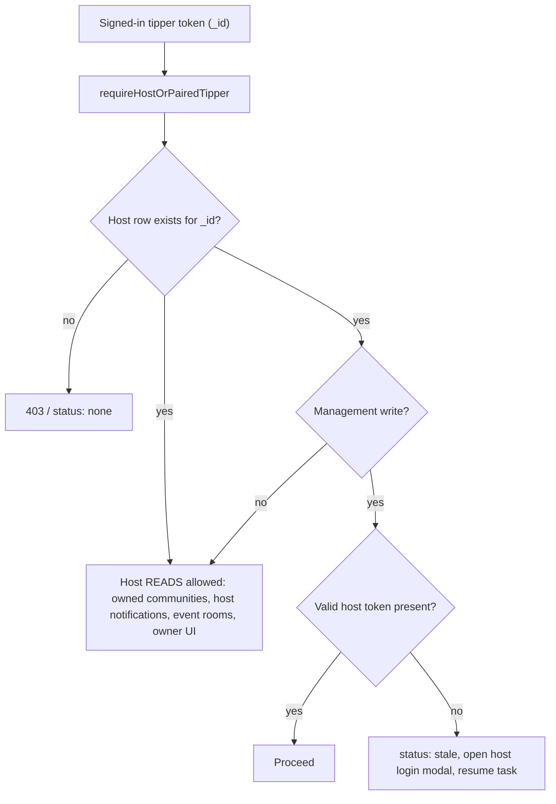

## Account Detector Helper and Full Issue Remediation

Confirmed design decisions from you: **hybrid** host model (detection/reads via paired identity, host login only for management writes); **hard block** on expired guest tokens; cohosts may add channel videos **scoped to their invited event only**; co-creators get **permanent membership until the owner revokes co-creator status**; visitors may **not** save videos, set reminders, or hold system membership.

### Core invariant this all rests on

`Tipper.id === Host.id` for every linked pair, guaranteed by `ensureLinkedTipperForHost` in [backend/src/utils/push-recipient.util.ts](backend/src/utils/push-recipient.util.ts) and preserved on both host-creation paths ([auth.controller.ts:133-149](backend/src/controllers/auth.controller.ts), [:963-1001](backend/src/controllers/auth.controller.ts)). So the correct identity test everywhere is "does a host row exist for my id", never "is my current role HOST". Nearly every bug below is a violation of that.



---

## Phase 0 - Blockers (nothing else works without these)

### 0.1 Fix cohost identity

[backend/src/controllers/cohost.controller.ts](backend/src/controllers/cohost.controller.ts) mints `_id: invite.id` (a `CohostInvite.id`) at line 250-253, but [event-ownership.middleware.ts:78-81](backend/src/middlewares/event-ownership.middleware.ts) resolves cohosts via `eventCohost.findFirst({ id: actorId, eventId })`. Every cohost-gated route currently 403s, including screen-settings.

- Change token to `_id: activeCohostRecord.id`, and add `eventId` to the JWT payload for defence-in-depth against cross-event use.
- Set `acceptedInvite: true` and `acceptedAt: new Date()` on the `EventCohost` row (both fields exist in [schema.prisma:1865-1879](backend/prisma/schema.prisma) and are never written today).
- Have `requireEventHostOrCohost` additionally require `acceptedInvite: true`.
- Fix `POST /auth/login-cohost` ([auth.controller.ts:707-732](backend/src/controllers/auth.controller.ts)): `eventCohost.findFirst({ where: { email } })` is unscoped, so a cohost of several events gets a token bound to an arbitrary event. Scope by event, or return the list and require an event choice.
- Add `@@unique([email, eventId])` to `EventCohost` (no unique constraint exists today, so duplicates are possible).

### 0.2 Add the paired-identity bridge

[backend/src/middlewares/role.middleware.ts](backend/src/middlewares/role.middleware.ts) has `requireTipperOrPairedHost` (host acting as tipper) but no reverse. Add `requireHostOrPairedTipper`: pass if role is `host`; if role is `tipper`, pass when `prisma.host.findUnique({ where: { id: req.user._id } })` exists, and set `req.pairedHostId`.

Apply to the read endpoints the frontend already tries to call from tipper sessions, all currently `requireHost`:
- `GET /communities/me` and `GET /communities/sends/me` in [community-host.route.ts](backend/src/routes/community-host.route.ts)
- `GET /events/host/me/summary` in [event.route.ts:406-411](backend/src/routes/event.route.ts)

Controllers must read the host id from `req.pairedHostId ?? req.user._id`, not `getUserId(req)` directly ([community-content-bank.controller.ts:34-78](backend/src/controllers/community-content-bank.controller.ts)).

This alone fixes A1, A2, A3 - the tipper branches in [community-hub-client.tsx:329-355](frontend/src/components/community/community-hub-client.tsx), [create-dialog.tsx:207-265](frontend/src/components/home/create-dialog.tsx) and [explore-page-client.tsx:428-470](frontend/src/components/explore/explore-page-client.tsx) are dead code purely because these routes 403.

---

## Phase 1 - The unified helper

### 1.1 Backend

- `GET /auth/me/host-link` (authMiddleware only): returns `{ hasHost, hostId, eventSlug, username }` by looking up a host row for the caller's `_id`. This is the single canonical linkage resolver.
- Add `requireActiveHostSession` for management writes: requires a host-role token (not a paired tipper token).
- Standardise the currently unenforced `PUT /auth/creator-profile` and `PUT /auth/host-profile` ([auth.route.ts:98-102](backend/src/routes/auth.route.ts)), which today authorise by coincidence of id equality with no role middleware at all.

### 1.2 Frontend helper

New `frontend/src/hooks/use-host-capability.ts`:

```ts
type HostCapability =
  | { status: "loading" }
  | { status: "none" }
  | { status: "active"; hostId: string; eventSlug: string }
  | { status: "stale"; hostId: string };
```

Responsibilities, and only these: resolve linkage from `/auth/me/host-link`; report whether a host credential is present; expose `requestHostAuth()` that opens the host login modal and resolves so the interrupted task continues without losing form state; keep the tipper session primary.

Not its job: resource-level authorisation (owns this event/community) and cohost grants (`tag === "COHOST"` is per-event, orthogonal).

Host session storage: add a `hostToken`/`hostUser` cookie pair beside the existing `token`/`user`, mirroring the visitor pattern in [frontend/src/app/api/auth/session/route.ts](frontend/src/app/api/auth/session/route.ts). Host login must write only that pair, never replace `auth.user`. Today [signin-form.tsx:217-243](frontend/src/components/auth/signin-form.tsx) overwrites the whole session.

### 1.3 Migrate call sites

Silent (no interruption unless a management write): notifications sub-tab and [use-notification-badge.ts:56-61](frontend/src/hooks/use-notification-badge.ts); owned/co-created lists in [community-hub-client.tsx](frontend/src/components/community/community-hub-client.tsx); [explore-page-client.tsx:428-470](frontend/src/components/explore/explore-page-client.tsx); [tv-source-picker-provider.tsx:115-118](frontend/src/components/tv/tv-source-picker-provider.tsx); nav affordances in [account-nav-href.ts](frontend/src/lib/account-nav-href.ts), [tipper-banner.tsx:349-356](frontend/src/components/tipper/tipper-banner.tsx), [footer.tsx:141-146](frontend/src/components/shared/footer.tsx) which currently push existing hosts to `/create-account`.

Interactive: [create-dialog.tsx](frontend/src/components/home/create-dialog.tsx) (delete the dead `hostSessionActive` probe); the "Manage" link at [community-hub-client.tsx:1055-1067](frontend/src/components/community/community-hub-client.tsx); the three creation wizards that each duplicate `isExistingHost = tag === "EXISTING_HOST"`.

---

## Phase 2 - Event room and cohost scope

- Extend `POST /:eventId/channel` and `PUT /channels/:channelId/default` ([event.route.ts:351-368](backend/src/routes/event.route.ts)) to cohosts: swap `requireHost` for `requireRole("host","cohost")` and add a new `requireChannelEventHostOrCohost` mirroring the event-level variant.
- Critical: middleware is not enough. Both controllers repeat the ownership check inline - `parent.hostId !== hostId` at [event.controller.ts:2266-2270](backend/src/controllers/event.controller.ts) and `channel.event.hostId !== hostId` at [:2419-2421](backend/src/controllers/event.controller.ts). Both must resolve host-or-cohost for that specific event, and the cohost path must use `event.hostId` for the `Host` record lookup, co-owner assertions and channel data (`assertVideoLinksCoOwnerForCreate`, `buildEventChannelUncheckedData`).
- Scope guarantee: cohost authorisation stays `{ id: actorId, eventId }`, so access never spans other rooms owned by the same host.
- Frontend: replace the `isHost`-only props with a single `canManageRoomContent = isHost || isCohost` at [content-room-settings.tsx:149,161,173,184](frontend/src/components/events/content-room-settings.tsx), the `disabled={!isHost}` at [select-default-video-modal.tsx:199](frontend/src/components/events/select-default-video-modal.tsx), `draftAutosave: { enabled: isHost }` at [event-channel-modal.tsx:169](frontend/src/components/events/event-channel-modal.tsx), the `openAddVideo` deep link at [content-room-settings.tsx:66-68](frontend/src/components/events/content-room-settings.tsx), and `isHost={isEventOwner === user?.id}` at [message-header.tsx:376](frontend/src/components/events/message-header.tsx) and [event-live.tsx:861-876](frontend/src/components/events/event-live.tsx).
- Side fixes found: [frontend/src/actions/events.ts:427-439](frontend/src/actions/events.ts) `updateDefaultChannel` sends no Authorization header; `add-performers-modal.tsx` and `add-projects-modal.tsx` accept an unused `isHost` prop and POST without auth headers.

---

## Phase 3 - Creator profile identity

- [host-creator-page-client.tsx:132-135](frontend/src/components/host/host-creator-page-client.tsx): drop `user?.role === "HOST"` from `isOwnProfile` so it is id/username based. Today a linked tipper sees a "Save host" button on their own profile and no Edit or Add controls, while the backend would accept their write.
- `handleMyAccountClick` at [:222-232](frontend/src/components/host/host-creator-page-client.tsx) opens sign-in for an already-signed-in tipper; use the `accountHref` already computed at line 196 from `getAccountNavHref`.
- Re-derive `showBottomExpressNav` ([:137-140](frontend/src/components/host/host-creator-page-client.tsx)) which currently excludes tippers entirely.
- Gate `SaveHostToggleButton` ([:631-637](frontend/src/components/host/host-creator-page-client.tsx)) on tipper identity, not `isAuthenticated` - `SavedHost.tipperId` is an FK to `Tipper`, so visitor saves fail at the database.
- Owner-only management writes go through `requestHostAuth()` per the hybrid decision.

---

## Phase 4 - Tipmanna system community

### 4.1 Feed picker count (your reported bug)

Three code paths disagree in [explore-page-client.tsx](frontend/src/components/explore/explore-page-client.tsx): auto-seed includes Tipmanna (`:853-862`), picker rows exclude it (`:1279`), and the label counts the raw array (`:1878-1884`). Because Tipmanna never renders a switch, its id is stuck in the array permanently.

- Filter Tipmanna at seed time and derive both the count and `scopedExploreCommunityIds` (`:889-900`) from picker-visible ids only.
- Third consequence not yet reported: because `scopedExploreCommunityIds` passes the raw array to the feed query, Tipmanna content is silently mixed into the community feed even when one specific community is selected. Same fix resolves it.
- Replace the local name-matching `isTipmannaPublicCommunityRow` (`:212-224`) with the shared `isTipmannaSystemCommunity` from [tv-community-picker.ts:29-45](frontend/src/lib/tv-community-picker.ts), which also honours the configured id.
- Leave the TV pickers alone: they use separate state (`tvExploreSource`, `scheduleSourceCommunityId`) and represent global Tipmanna TV as `communityId = null`.

### 4.2 Search and discovery leaks - fix server-side

`searchCommunities` has no `isSystem` filter and does not even select `isSystem`, so no client can filter it:

```120:126:backend/src/controllers/community-discovery.controller.ts
    const rows = await prisma.community.findMany({
      where: {
        status: CommunityStatus.active,
        name: { contains: q, mode: "insensitive" },
      },
      take: 24,
      orderBy: { name: "asc" },
```

Add `isSystem: false` to: `searchCommunities`; the `alphabetical` branch of `listCommunitiesExploreCatalog` (`:207-246`); and [discovery-search.service.ts:423-489](backend/src/services/discovery-search.service.ts), where `isSystem` currently adds a +15 rank boost and sets `verified: true`. Then remove the now-redundant client filters and fix the two that leak: the A-Z dialog at [community-hub-client.tsx:486-495](frontend/src/components/community/community-hub-client.tsx) and search at [discover-panel.tsx:445-447](frontend/src/components/explore/discover-panel.tsx). Also exclude it from [frontend/src/app/sitemap.ts:93-96](frontend/src/app/sitemap.ts). Keep it visible in My Community and `listMyJoinedCommunities`.

---

## Phase 5 - Permanent owner and co-creator membership

- Grant co-creator membership in the existing transaction at [community-co-creator.controller.ts:421-449](backend/src/controllers/community-co-creator.controller.ts) (`acceptCoCreatorInvite`), reusing `createOrReactivateMembershipForTipper(tx, communityId, acceptingHost.id, 0)` for `expiresAt: null`. Note `CommunityCoCreator.hostId` is a Host id, which equals the tipper id under the core invariant.
- Revoke it in `revokeCoCreator` ([:242-248](backend/src/controllers/community-co-creator.controller.ts)) - the only place co-creator status is removed. Re-accept already clears `revokedAt`, so re-grant on reactivation.
- Protect permanent memberships: `postTipperMembershipLeave` ([community-discovery.controller.ts:465-508](backend/src/controllers/community-discovery.controller.ts)) guards only `isSystem`, so an owner or co-creator can cancel their own permanent membership. `terminateMember` ([community-membership.controller.ts:532-562](backend/src/controllers/community-membership.controller.ts)) lets an owner revoke any membership including their own. Add owner/co-creator guards to both.
- Add the missing `isSystem` guard to `patchMembershipFeedActive` ([:429-463](backend/src/controllers/community-discovery.controller.ts)), which unlike leave/rejoin has none.
- Fix the silent no-op at [community-membership.util.ts:116](backend/src/utils/community-membership.util.ts): log or repair via `ensureLinkedTipperForHost` instead of returning quietly when the paired tipper row is missing.
- One-off backfill: grant permanent membership to existing `ownerHostId` values and all `status: active` co-creators. No such script exists today.
- Cron is safe: [communitySubscriptionExpire.ts:4-33](backend/src/jobs/communitySubscriptionExpire.ts) only expires memberships attached to a lapsed `CommunitySubscription`, never scans `expiresAt: null`.

---

## Phase 6 - Host notifications sub-tab

Not a split of existing behaviour - host notifications are absent from the drawer entirely. The feed resolves exactly one `recipientKind` from the JWT role:

```132:136:backend/src/services/notification-feed.service.ts
  if (rk && params.userId) {
    const personal = await prisma.notification.findMany({
      where: {
        recipientId: params.userId,
        recipientKind: rk,
```

- Add a host-scoped feed (either a `recipientKind` parameter or a dedicated route) behind `requireHostOrPairedTipper`.
- Add a Host sub-tab to [notifications-tab.tsx](frontend/src/components/notifications/notifications-tab.tsx) driven by `useHostCapability()`: `none` hides the tab, `active` fetches, `stale` shows a re-login prompt via `requestHostAuth()`.
- Bind the host Pusher channel on linkage rather than `role === "host"` ([use-notification-badge.ts:56-61](frontend/src/hooks/use-notification-badge.ts)).

---

## Phase 7 - Guest / temporary account

### 7.1 Close the tipper-activity gates

- Saved videos: remove the `role === "VISITOR"` branches in `saveChannelVideo` ([event.controller.ts:2472-2511](backend/src/controllers/event.controller.ts)), `unsaveChannelVideo` (`:2563-2572`) and `getSavedVideosForTipper` (`:2748-2753`); return 403. Drop the `visitorId` branch from [save-video-client.ts:13-21](frontend/src/lib/save-video-client.ts).
- Reminders: remove the visitor branch in `setReminderForPost` ([reminder-bucket.controller.ts:370-387](backend/src/controllers/reminder-bucket.controller.ts)) and the visitor paths in `listMyEntries`/`listMyHistory`/`cancelMyEntry`. Open question to settle during implementation: whether the separate email-only guest reminder path (no JWT, `subscriberId`) stays allowed - it is a different mechanism from visitor tokens.
- System membership: drop the `ensureSystemMembershipForVisitor` call at [visitor.controller.ts:69-70](backend/src/controllers/visitor.controller.ts) and the visitor loop in [backfill-system-membership.ts](backend/src/scripts/backfill-system-membership.ts). Blast radius is low: guest access to global/Tipmanna TV and public content is driven by public visibility plus optional auth, not this row; the row mainly made visitors appear "joined" in discovery APIs.
- Frontend gates: visitors have `isAuthenticated: true`, so every gate must check `user?.role === "VISITOR"`, not just `!user`. Reuse the existing `TipperEmailOtpSignInDialog` pattern ([notifications-tab.tsx:203-208](frontend/src/components/notifications/notifications-tab.tsx)). Sites to fix: [explore-feed-client.tsx:1146-1178](frontend/src/components/explore/explore-feed-client.tsx) (dialog is currently only mounted inside blocked-feed empty states, so the trends reel has no dialog to open), `channel-client.tsx:698-701`, `content-client.tsx:722-725`, `home-tv-looper.tsx:907-910`, `tv-looper.tsx`, `web-tv-looper.tsx`, `set-reminder-button.tsx:108-144`, `reminder-bucket-tab.tsx:129-133`, and the comment-like gate at [comment-drawer.tsx:267-270](frontend/src/components/events/comment-drawer.tsx) which lets visitors click into a 401.

### 7.2 Enforce 24h expiry (hard block, per your decision)

The window exists ([visitor-session.service.ts:4-8](backend/src/services/visitor-session.service.ts)) but only blocks merge. Meanwhile the token is issued for 7 days ([visitor.controller.ts:87](backend/src/controllers/visitor.controller.ts)) and no cleanup job exists in [backend/src/jobs](backend/src/jobs).

- Reject expired visitor tokens in `authMiddleware`/`optionalAuthMiddleware` with a distinct status the client can detect, and clear the client session. Keep the `Visitor` row so transaction history stays intact.
- Reduce the visitor JWT TTL to 24h so the token cannot outlive the session.
- Mount the already-written but unmounted `VisitorAutoLogoutWrapper` ([frontend/src/components/VistorAutoLogoutWrapper.tsx](frontend/src/components/VistorAutoLogoutWrapper.tsx)) in providers.
- Delete the unmounted `create-visitor-onload.tsx`, which would create guest accounts on page load if anyone wired it back up.
- Move creation to payment success. Today the row is minted when checkout starts ([tip-drawer.tsx:634-686](frontend/src/components/events/tip-drawer.tsx)), so abandoned checkouts create guests, and `emitWelcomeFirstVisit` fires before any payment. The payment-specific `guest_account_created` notification already fires correctly on first success ([guest-account-notification.service.ts:48-75](backend/src/services/guest-account-notification.service.ts)); align `guestWelcomeShown` in [notification-feed.service.ts:204-208](backend/src/services/notification-feed.service.ts) to track that kind rather than `welcome_first_visit`.

### 7.3 Fix conversion data loss

Merge moves two tables then hard-deletes the visitor:

```40:58:backend/src/services/visitor-merge.service.ts
  await prisma.$transaction(async tx => {
    if (existingVisitor.transactions.length > 0) {
      ...
    if (existingVisitor.purchasedCharacters.length > 0) {
      ...
    await tx.visitor.delete({ where: { id: visitorId } });
  });
```

Everything else is destroyed by that delete: `CommunityMembership` and `TipperReminderBucketEntry` are `onDelete: Cascade` ([schema.prisma:1287](backend/prisma/schema.prisma), [:1245](backend/prisma/schema.prisma)), and `SavedVideo.visitorId` is optional with no `onDelete`, so Prisma's default `SetNull` leaves orphan rows owned by nobody ([:1822](backend/prisma/schema.prisma)). Visitor-kind notifications keep pointing at a deleted id.

Scope note: after 7.1 removes visitor saves, reminders and memberships, this mostly reduces to re-keying notifications and stopping the orphan writes - so sequence 7.1 before 7.3 and re-key only what remains.

### 7.4 Data migration

No reverse cleanup script exists. Write one to delete `CommunityMembership WHERE visitorId IS NOT NULL`, delete `TipperReminderBucketEntry WHERE visitorId IS NOT NULL`, and delete `SavedVideo WHERE visitorId IS NOT NULL`, with before/after counts logged.

---

## Verification

- Cohost: accept an invite, confirm the JWT `_id` is the `EventCohost.id`, then confirm screen-settings and channel add-video succeed in the invited room and 403 in another room owned by the same host.
- Helper: signed in as tipper only, confirm My Community lists the owned community, the create dialog loads existing event rooms, and the host notifications sub-tab appears - all with no re-login; then confirm a management write prompts host login and resumes.
- Picker: with zero selections the label reads "My Communities"; one selection reads "1 community selected"; and the feed contains no Tipmanna content unless Tipmanna is the source.
- Search: Tipmanna Public appears in no search, browse, A-Z, top-communities, discovery or sitemap surface, but still shows in My Community.
- Guest: a visitor cannot save, remind, or hold membership and is prompted to sign in; after 24h idle the token is rejected and the session clears; a converted guest keeps their tips.

## Items needing a decision during implementation

- Whether email-only guest reminders (no JWT, `subscriberId` path) remain allowed, since they are a separate mechanism from visitor tokens.
- Whether cohosts should also get `PATCH /:id/video-display-settings`, which is host-only today.