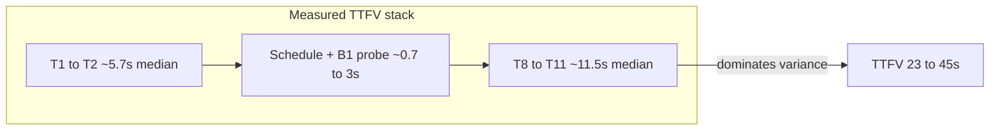

# TV Startup — Phase B1 Validation Failure & Player Error Investigation

**Mode:** read-only investigation. No code changes in this phase.

---

## Executive verdict

| Question | Answer |
|----------|--------|
| Did B1 pass functionally? | **Yes** — schedule still serves; ready path skips `ensureTvSchedules`; Phase A single-request held in 4/5 runs |
| Did B1 improve backend latency? | **No** — probe median ≈710ms exceeds prior warm-ensure ≈350ms; TTFV worsened for non-B1 reasons |
| Primary TTFV driver | **Player path** (T8→T11 median ≈11.5s; runs 3/5 up to ≈22–26s) + bootstrap T1→T2 (median ≈5.7s) |
| B1 keep/optimize/rollback | **Disable on staging now**; redesign as **B1.1** after curl A/B — do not retain unchanged |
| Next implementation | **Phase C0 — player error + startup seek/orchestration containment** |



---

## 1. Phase B1 functional status

**Passed.** Evidence from design + staging table:

- Runs still return schedules and reach playback (TTFV and stable TTFV recorded).
- Probe durations present on all five runs → fast path executed.
- Network attempts mostly 1 (Phase A invariant).
- No indication of 503 / missing-schedule failures from skipping ensure when ready.

B1 did **not** pass as a **latency remediation**.

---

## 2. Backend latency: B1 did not improve

### Measurement correction (critical)

[`tv-startup-backend-trace.util.ts`](backend/src/utils/tv-startup-backend-trace.util.ts) records:

- `elapsedRequestMs` / `stageMs` = delta since **previous** mark
- `totalElapsedMs` / `totalMs` = cumulative from tracer create
- Server-Timing `dur=` uses **`totalMs` (cumulative)**, not stage delta

Values labeled “backend total” at `ensure_tv_schedules` (703–1124ms) are **cumulative time through that stage**, not full endpoint totals. With B1 ready:

`request_received` → `schedule_existence_probe` → `schedule_ensure_decision` → `ensure_tv_schedules` (`invoked: false`) → playlist → compose → access → `response_completed`

### Full `response_completed.totalElapsedMs` for the five attempts

**Not recoverable from the table you provided.** Those rows only give probe/ensure-stage cumulatives.

Approximate reconstruction from your later-stage notes (same order of magnitude, not per-`attemptId` truth):

| Component | Approx |
|-----------|--------|
| Through ensure stage | 0.70–1.12s |
| playlist_loaded | +1.11–1.13s |
| ongoing_composed | +≈0.35s |
| access_safety_resolved | +0.70–0.77s |
| **Estimated full total** | **≈2.9–3.4s** |

**Why correlation may fail without logs:**

1. Frontend has `scheduleAttemptIds`; backend logs `attemptId` on each mark — join requires backend log export for those UUIDs.
2. If staging only captured frontend summaries + a misread Server-Timing `dur`, `response_completed` was never recorded in the validation sheet.
3. Ready path still marks `ensure_tv_schedules` with `invoked: false` — easy to confuse with “ensure ran for X ms.”

**Action for Investigation 2 (curl A/B):** scrape `[TV_STARTUP_BACKEND_TRACE] response_completed` with matching `attemptId`; use `extra.probeMs` for probe wall time, not Server-Timing `dur`.

---

## 3. Root cause of 703–1124ms probe

Probe implementation ([`tv-schedule-existence-probe.service.ts`](backend/src/services/tv-schedule-existence-probe.service.ts) + [`probeScheduleWindow`](backend/src/jobs/generateTvSchedule.ts)):

1. **Serial** `tvGlobalSettings.findUnique` (broadcastEpoch) — **included in `probeMs`**
2. **Three parallel** `findUnique({ windowStart })` with `_count: { items: true }`

Schema ([`schema.prisma`](backend/prisma/schema.prisma)): `windowStart @unique`; items indexed by `[scheduleId, position]`; **no stored itemCount/status**.

Why this is slow vs “lightweight”:

| Factor | Assessment |
|--------|------------|
| Remote DB RTT | High confidence — each query pays RTT; Neon/hosted PG often 50–200ms+ |
| `_count.items` | Emits correlated `COUNT(*)` — not a free existence check |
| Connection pool | `Promise.all` can still serialize if pool size / Prisma engine queues |
| Epoch included | Yes — 4th query inside probe timer |
| Tracing overhead | Negligible vs DB |
| Indexes | `windowStart` unique OK; COUNT still touches item index |

**Why probe can beat “warm ensure ≈350ms” in the wrong direction:**

Warm ensure when rows exist still does lock + 3 sequential probes + adjustment + enforcement sync + **2 full `include: { items }` loads** then discards results ([`generateSchedule`](backend/src/jobs/generateTvSchedule.ts)). On paper warm ensure is **heavier**. Therefore measured warm-ensure ≈350ms is likely:

- a **different stage/metric** (cumulative mark misread), or
- **lock-loser early return** (`withCronLock` → `null` without generation — cheap but does not prove readiness), or
- different DB temperature / concurrency

**Conclusion:** current B1 probe design is a **net lose** on the measured gate it was meant to shrink; it does not explain the ~25s TTFV regression.

### Probe design comparison (do not implement yet)

| Design | Query count | Correctness | Notes |
|--------|-------------|-------------|-------|
| 1. 3× parallel findUnique+_count (current) | 1 epoch + 3 COUNT | Detects zero-item orphans | Measured 0.7–1.1s |
| 2. 1× findMany `windowStart IN (...)` +_count | 1 epoch + 1 multi | Same orphan rule | Likely fewer RTTs |
| 3. Grouped item COUNT | 1–2 | Same | Still COUNT cost |
| 4. Row existence + stored readiness/itemCount | 1 epoch + 1 findMany | Needs write-path maintenance | Best hot path |
| 5. Reuse later playlist load | 0 extra | Wrong layer — playlist is heavy | Only share epoch/window math |
| 6. Keep warm ensure | Lock + probes + full loads | Proven | Heavier; skip only if lock-loser |

---

## 4. Controlled A/B design (Investigation 2)

Isolate **backend only** (no browser/YouTube):

```bash
# Headers for correlation
-H "X-TV-Startup-Trace-Id: ab-<run>"
-H "X-TV-Schedule-Attempt-Id: attempt-<n>"
GET /api/v1/tv/schedule
```

**Cell A:** `TV_SCHEDULE_EXISTENCE_FAST_PATH=0` — 5+ requests  
**Cell B:** `TV_SCHEDULE_EXISTENCE_FAST_PATH=1` — 5+ requests  

Same deployment, same materialized windows, no concurrent cold cron.

Per request log: `response_completed.totalElapsedMs`, `probeMs` / ensure `elapsedRequestMs`, playlist/compose/access stageMs, status, payload bytes. Optional: Prisma query log / `EXPLAIN` on `_count`.

**Pass criterion for keeping B1:** Cell B `response_completed.totalElapsedMs` p50 **strictly less** than Cell A by a meaningful margin (e.g. ≥100ms), with `invoked: false` on ready path.

Until that passes: **disable B1 on staging**.

---

## 5. Run 2 — second schedule request

Reported:

- `scheduleNetworkAttemptCount: 2`
- `scheduleRefreshCountDuringStartup: 1`
- two distinct attempt IDs

From [`tv-startup-trace.ts`](frontend/src/lib/tv-startup-trace.ts): refresh counter increments only for triggers in `{pusher, visibility, interval, boundary, sync_miss, source_change, manual}`. **`initial` / `retry` do not.**

So attempt #1 was almost certainly `initial`; attempt #2 was a **refresh-class** trigger.

| Candidate | Plausible? |
|-----------|------------|
| Player error → schedule | **No** — [`handlePlayerError`](frontend/src/components/tv/tv-looper.tsx) calls `goLive()` / reload only; no `loadSchedule` |
| Phase B1 / slow backend | **No direct cause** — slow schedule only delays `initialStartupComplete` |
| Visibility after schedule returns | **High** — guard ends when initial `loadSchedule` **finishes** ([`tv-provider.tsx`](frontend/src/components/tv-provider.tsx) finally ~1440), long before PLAYING; DevTools/tab blur sets `documentWasHidden` then refresh on visible |
| sync_miss | **Possible** on slow player-ready runs (>15 not-ready syncs) |
| Pusher | Possible if `tv-schedule-updated` during load |
| source_change / interval / boundary | Unlikely on short cold test |

**Answers:**

1. Second request was a **legitimate refresh-class call**, not a Phase A coalescing bug — but may be **test-environment noise** (visibility).
2. Visibility is the **most likely** human/test cause without event logs.
3. **Not** caused by player-error → schedule (code path absent).
4. B1 did not invent the second request; longer schedule only widens the post-schedule / pre-PLAYING window where visibility refresh is allowed.
5. Narrower Phase A guard (e.g. suppress visibility until T11/T13) only if traces show `trigger: "visibility"` — do not weaken pusher/sync_miss without evidence.

**Unknown:** exact `schedule_request_started.trigger` for attempt `5b2294c4-…` — need that event from the run-2 console dump.

---

## 6. Player-error sequence (runs 2–5)

### Code path (proven)

```
YT onError(code)
  → onPlayerError(code)   // code DROPPED by looper
  → player_error event (no youtube error code in data)
  → if videoErrorReloadsRef >= 1 for this URL: stop
  → else goLive() [GLOBAL]
       → enterGlobalMode → lastSyncedIndex=-1 → syncToLive()
            → maybe setCurrentIndex + loadVideoById OR seekTo
```

Counter resets when `effectivePlayerUrl` changes → **each new schedule item gets another recovery**. That yields run 5’s pattern: `playerErrorCount: 6`, `loadVideoByIdCount: 6` without a same-URL infinite loop.

### Reconstructed sequences (evidence-limited)

**Run 3** (errors 2, loads 2, seeks 10, syncs 16, T8→T11 ≈26.5s):

1. Initial embed / first orchestrated load
2. Error #1 → goLive → sync → load #2 (or seek)
3. Error #2 on new URL → goLive again → load or seek
4. Meanwhile `syncToLive` every **3s** ([`SYNC_INTERVAL_MS`](frontend/src/components/tv-provider.tsx)); drift seeks when `|getCurrentTime() − liveOffset| > 3` with **no BUFFERING/PLAYING guard**
5. ≈26s buffering window ÷ 3s ≈ **~8–10 seeks** — matches seek count 10

**Run 5** (errors 6, loads 6, seeks 3):

- Cross-item recovery chain: each failed video resets reload budget → six loads
- Fewer drift seeks (reached PLAYING sooner per item, or different live offset)

**Run 2** (errors 2, loads 2, seeks 4): milder instance of same pattern + second schedule refresh.

**Run 4** (errors 0, seeks 0): clean path — proves orchestration can work when YT accepts the video.

Exact YouTube codes, video hashes, and pre-error commands are **unknown** from the aggregate table; traces do not currently persist `event.data` error codes.

---

## 7. Repeated loads and seeks

| Mechanism | Effect |
|-----------|--------|
| Error → goLive → syncToLive → loadVideoById | Extra loads; may change index |
| URL change resets `videoErrorReloadsRef` | Multi-error across playlist |
| Drift seek every 3s using `getCurrentTime()` during BUFFERING | Often `0` → false drift → seek → prolongs buffering |
| Initial embed without `playerVars.start` | Embed at 0 then sync seeks/loads to live — Phase C territory |

No same-URL infinite loop; **cross-URL recovery storm + unguarded drift seeks** explain the counters.

---

## 8. Invalid / unembeddable videos

| Layer | Embeddability check? |
|-------|----------------------|
| Submit | Optional oEmbed if `YOUTUBE_OEMBED_VERIFY_ON_SUBMIT` |
| Schedule generation / serve | **No** — filters `playbackStatus !== FAULTY` only ([`tv-eligibility.util.ts`](backend/src/utils/tv-eligibility.util.ts)) |
| Health job | privacy/upload/duration — not embed flag |
| Player | No classification — code discarded |

**Cannot prove** from this validation alone whether failures were 100/101/150 (unavailable/embed-disabled) vs CDN/network. Ideal rejection points (future): ingestion → generation → serve → runtime (last resort). Runtime today is the only gate and it is blind.

---

## 9. Frontend bootstrap (T1→T2 ≈3.3–9.8s)

**Provable from repo:** T1 is HTML `responseStart`; T2 is `TVProvider` mount. Gap includes JS download, parse, hydrate, layout providers (auth/Redux/persist), fonts, Pusher wiring, TV route chunk.

**Not provable without Performance panel:** which long tasks, CPU throttle, DevTools variance, exact bundle waterfalls.

Do **not** attribute this to B1. Separate later work from player/C0.

---

## 10. Ranked remediation options

| Rank | Option | Evidence | Expected impact | Confidence | Risk | Rollback | Deps |
|------|--------|----------|-----------------|------------|------|----------|------|
| **1** | **C0: player error + startup seek containment** | Errors/loads/seeks correlate with T8→T11 11–26s; clean run 4 | Largest TTFV variance cut | High | Medium (playback edge cases) | Feature flag | Trace must keep YT error code |
| 2 | B1 disable (flag=0) | Probe slower than warm ensure | Remove ~0.3–0.8s ensure-path loss; clears noise | High | Low | Flag | None |
| 3 | B1.1 probe redesign | 4 RTTs + COUNT | Ensure-path only; not TTFV | Med | Low | Flag | Curl A/B first |
| 4 | Startup seek suppress until PLAYING | Seek counts match 3s sync during buffer | Cuts false drift seeks | High | Med | Flag | Part of C0 |
| 5 | Phase C initial embed at live offset | Embed@0 then sync | Fewer first seeks/loads | Med | Med | Flag | After C0 stability |
| 6 | B2 playlist/access slim | playlist≈1.1s, access≈0.7s | ~1–2s backend | Med | Med | Flag | After B1.1/curl |
| 7 | Frontend bootstrap | T1→T2 median 5.7s | Secondary | Low without perf panel | Med | — | Measurement first |

---

## 11. Recommended next implementation: Phase C0

**Name:** Phase C0 — Player error classification + startup orchestration containment  

**Not** B1.1 first — B1 cannot explain the TTFV cliff; player path can.

### Scope (narrow)

1. **Record YouTube error code** on `player_error` / startup trace (no private URLs).
2. **Contain recovery storms:**
   - Cap recoveries per startup window (not only per URL).
   - On hard errors (100/101/150): advance to next live-eligible item or soft-fail — do not blindly `goLive` reload forever across playlist.
   - Do not call `loadSchedule` from errors unless evidence requires it.
3. **Startup seek policy:** while `playerState !== PLAYING` (or until first T11), suppress drift `seekTo`; allow one orchestrated live seek/load only.
4. **Feature flag** e.g. `NEXT_PUBLIC_TV_STARTUP_PLAYBACK_GUARD=0` default off.
5. **Staging:** set `TV_SCHEDULE_EXISTENCE_FAST_PATH=0` during C0 validation to remove B1 noise.

### Out of scope for C0

- B1 probe SQL redesign (B1.1 later)
- Playlist Prisma slimming (B2)
- `playerVars.start` full Phase C
- Overlay Phase D
- Embeddability pipeline at generation

### Acceptance criteria

- Five cold global runs with guard on:
  - `playerErrorCount` does not produce unbounded `loadVideoByIdCount` (e.g. loads ≤ errors+1, hard cap documented)
  - `seekToCount` during pre-PLAYING ≤ 1 (or 0 if initial command already at live offset)
  - Median T8→T11 improved vs current B1 five-run median (~11.5s) — target: below Phase A median player segment if measurable, else ≥30% reduction
  - Phase A: `scheduleNetworkAttemptCount === 1` on cold (absent intentional hide→show)
  - No payment / GLOBAL-LOCAL / enforcement regression smoke
- Traces include numeric YouTube error codes on errors
- Flag off restores legacy recovery

### Tests

- Unit: error-code → recovery decision table
- Unit: drift seek suppressed when not PLAYING / startup guard active
- Unit: per-startup recovery cap
- Existing startup-trace + Phase A single-schedule tests still pass
- Optional looper harness: simulate onError 150 twice → assert load count

---

## 12. Remaining unknowns

1. Exact `response_completed.totalElapsedMs` per attemptId (need backend logs).
2. Run 2 second request `trigger` (need frontend event dump).
3. YouTube error codes and whether videos were unembeddable vs transient (codes not in traces today).
4. Whether warm-ensure ≈350ms was lock-loser artifact.
5. Whether connection pool serialized the three probe queries (need Prisma/DB metrics).
6. T1→T2 long-task attribution (need Performance panel).
7. DevTools/CPU throttle variance across the five runs.

---

## Immediate ops recommendation (no code)

1. Set staging `TV_SCHEDULE_EXISTENCE_FAST_PATH=0` (B1 off).
2. Keep Phase A + startup tracing on.
3. Run controlled **curl A/B** for B1 latency truth (Investigation 2).
4. Implement **Phase C0** next for TTFV.
5. Only after C0 + curl A/B: **B1.1** (single findMany / stored readiness) if Cell B still loses to warm ensure.
