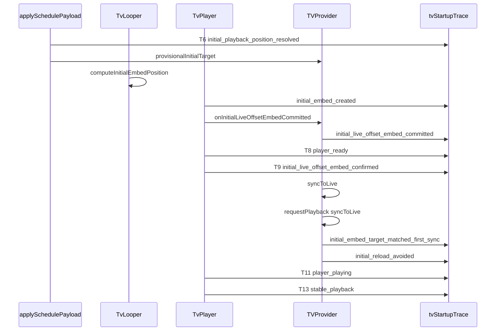

# Phase C1 Sanity Gate Failure — Investigation Report

## Executive verdict

**Classification:** Core implementation working; **instrumentation confirmation defective** (with first-sync coordination incomplete on the actual clean path).

**Staging recommendation:** **Keep C1 enabled** during C1.1. Rollback is not warranted: `loadVideoByIdCount=0`, stable playback, no player errors, and offset 2347 confirm the iframe-at-offset path worked. Only the acceptance booleans and their gating logic are wrong.

---

## 1. Exact C1 event sequence (intended vs actual)

### Intended sequence ([docs/tv-startup-phase-c1-report.md](docs/tv-startup-phase-c1-report.md))



### Actual sequence for trace `81adbc2a` (inferred from summary + code)

| Order | Event | Canonical mark | Evidence |
|-------|-------|----------------|----------|
| 1 | `tv_provider_mounted` | T2 | Standard cold start |
| 2 | `schedule_request_started` (trigger=`initial`) | T3 | `scheduleNetworkAttemptCount=2`, first attempt |
| 3 | `schedule_payload_accepted` / `playlist_selected` | T4/T5 | Schedule ready before embed |
| 4 | `initial_playback_position_resolved` | **T6 = 6985ms** | Summary |
| 5 | `initial_embed_created` | — | `initialEmbedCount=1`, `targetWasResolved=true` |
| 6 | `initial_live_offset_embed_committed` | — | Seeds orchestration + **`lastSyncedIndex`** |
| 7 | `player_ready` | **T8 = 10147.6ms** | Summary |
| 8 | `initial_live_offset_embed_confirmed` | **T9 = 10148.1ms** | Summary; C1 T9 semantics |
| 9 | `syncToLive` (interval / effect) | — | `syncToLiveCount` ≥ 1 (not in summary) |
| 10 | `pre_play_drift_seek_suppressed` | — | `prePlaySeekSuppressedCount=1` |
| 11 | **`requestPlayback` NOT called** | — | `loadVideoByIdCount=0`; success events absent |
| 12 | `player_playing` | **T11 = 12749.2ms** | Summary; autoplay succeeded |
| 13 | `player_buffering` | **T10 = 13238.7ms** | After T11 (see §5) |
| 14 | `orchestrated_playback_command_issued` ×2 (`seekTo`) | — | `seekToCount=2`, post-T11 (see §4) |
| 15 | `stable_playback` | **T13 = 15357.4ms** | `finalState=stable` |
| 16 | Post-T13 interval/sync events | — | `postFinalizationEventCount=18` |

**Never emitted:** `initial_embed_target_matched_first_sync`, `initial_reload_avoided`.

### Where summary fields are set

Both fields are **event-derived only** in [frontend/src/lib/tv-startup-trace.ts](frontend/src/lib/tv-startup-trace.ts):

- `initialEmbedTargetMatchedFirstSync` ← `initial_embed_target_matched_first_sync` (line ~508)
- `initialReloadAvoided` ← `initial_reload_avoided` (line ~516)

They are **not** ref-derived, not finalized from provider state, and **only emitted** when `shouldSkipInitialReload()` returns true inside `requestPlayback` in [frontend/src/components/tv-provider.tsx](frontend/src/components/tv-provider.tsx) (lines ~723–748).

---

## 2. Exact cause of the two false summary fields

### Repository-backed root cause (primary)

The clean C1 path **never enters `requestPlayback` for the first sync**, so the success events are never emitted.

**Chain:**

1. **T4 cold-start seeding** sets `lastSyncedIndex = live.scheduleIndex` ([tv-provider.tsx](frontend/src/components/tv-provider.tsx) ~1336–1338).

2. **Embed commit** sets `lastSyncedIndex = payload.selectedIndex` again (~944), plus seeds `orchestratedPlaybackRef` with committed offset 2347 (~929–932).

3. First post-T8 `syncToLive` resolves the **same schedule index** → enters the **same-index branch** (~1157–1212), **not** the index-change branch that calls `requestPlayback` (~1143–1148).

4. Same video already orchestrated → drift check: `|actual - effectivePos.offsetSeconds| > DRIFT_THRESHOLD_S (3)`.

5. **C0 pre-play guard** suppresses the drift seek → `pre_play_drift_seek_suppressed` (~1172–1189). Matches `prePlaySeekSuppressedCount: 1`.

6. **`shouldSkipInitialReload` is never invoked** — it lives only inside `requestPlayback` (~723–748).

7. Iframe **autoplay reaches PLAYING** without any imperative load → functional success, **instrumentation failure**.

### Hypothesis checklist (user’s 10 items)

| # | Verdict |
|---|---------|
| 1. No syncToLive → requestPlayback before PLAYING | **Confirmed** — same-index drift path, no `requestPlayback` |
| 2. First sync only after PLAYING | Partially — sync runs before T11, but confirmation path skipped |
| 3. Dedup branch before shouldSkipInitialReload | **Not applicable** — `requestPlayback` never called |
| 4. Video match, offset compare failed | **Not the cause** — compare never ran |
| 5. Raw offset without elapsed time | **Not the cause** — `matchesCommittedInitialEmbed` already uses `O + elapsed` ([tv-initial-live-offset-embed.ts](frontend/src/lib/tv-initial-live-offset-embed.ts) ~191–194); function never called |
| 6. lastSyncedIndex seeding blocked branch | **Confirmed primary cause** |
| 7. Event after finalization | **Ruled out** — events never fired |
| 8. Trace aggregation bug | **Ruled out** — counters correct; events absent |
| 9. Stale closure | **Ruled out** |
| 10. Autoplay without imperative sync decision | **Confirmed** — core behavior |

### Why `initialEmbedUsedResolvedTarget: true` but match/avoided false

- `initialEmbedUsedResolvedTarget` is set from `initial_embed_created` / `initial_live_offset_embed_confirmed` when `targetWasResolved=true` (~485–506) — independent of first-sync confirmation.
- Match/avoided require the **`requestPlayback` success branch** that the clean path bypasses.

---

## 3. Second schedule request

### Facts from counters

- `scheduleNetworkAttemptCount: 2` → two `schedule_request_started` events
- `scheduleRefreshCountDuringStartup: 1` → second trigger ∈ `{pusher, visibility, interval, boundary, sync_miss, source_change, manual}` ([tv-startup-trace.ts](frontend/src/lib/tv-startup-trace.ts) ~56–64)
- First trigger = `initial`; second = a refresh trigger

### Ruled-out triggers (code timing)

| Trigger | Ruled out because |
|---------|-------------------|
| `interval` | `SCHEDULE_REFETCH_MS = 5 * 60 * 1000` ([tv-provider.tsx](frontend/src/components/tv-provider.tsx) ~128) — startup ~15s |
| `sync_miss` | Requires 15 consecutive not-ready syncs (~45s) (~1038–1041) |
| `boundary` | Half-day boundary timer |
| `source_change` | Initial establishment skipped ([tv-single-startup-schedule.ts](frontend/src/lib/tv-single-startup-schedule.ts) ~47–48) |
| `retry` | Would not increment `scheduleRefreshCountDuringStartup` |

### Most likely triggers (code-supported, trace not in repo)

1. **`pusher`** — `tv-schedule-updated` binding (~1862–1885) fires `loadSchedule({ trigger: "pusher" })` unconditionally on staging live updates.

2. **`visibility`** — After `initialStartupComplete=true` (~1846–1847, set in `initial` loadSchedule `finally`), visibility refresh is **no longer suppressed** unless tab was never hidden ([tv-single-startup-schedule.ts](frontend/src/lib/tv-single-startup-schedule.ts) ~103–108). A focus/visibility flip in test harness could trigger it.

### Timing relative to T11

- `initialStartupComplete` is set when the **initial** network load finishes (~T4 area, well before T6=6985ms).
- Second request therefore likely **before T11** (between ~4–12s), but **cannot be pinned without raw `schedule_request_started` trigger field** from console/sessionStorage trace.

### Impact on C1

- If response is **304 not_modified**: payload not reapplied (~1640–1674) → **no C1 target replacement**, no effect on first-sync comparison.
- If **200 with same `activeScheduleId`**: committed embed **not cleared** (~1274–1283 guard) → provisional target refreshed at T6 but **iframe not remounted** (generation unchanged).
- **Did not cause pre-play seeks** — the one suppressed seek came from `syncToLive` drift, not schedule refresh.
- **Phase A guard adequate** for duplicate initial loads; this refresh is expected background behavior, not a Phase A defect.

---

## 4. Two seek commands

### Facts

- `seekToCount: 2` — from `orchestrated_playback_command_issued` with `command: "seekTo"` (~519–524)
- `prePlaySeekSuppressedCount: 1` — separate event; **not** counted in `seekToCount`
- `loadVideoByIdCount: 0`

### Seek sources in code

Only [syncToLive](frontend/src/components/tv-provider.tsx) issues traced `seekTo`:

- **Index change, same video:** `syncToLive_coalesced_seek` (~1121–1141)
- **Same index, drift > 3s, post-first-play:** `syncToLive_drift_seek` (~1191–1210)

Pre-play drift is **suppressed** by C0 (~1172–1189) — matches the single suppression event.

### Inferred timing (no raw trace in repo)

| Seek | When | Trigger | C0 suppress? |
|------|------|---------|--------------|
| (suppressed) | ~T8–T11, before first PLAYING | `syncToLive_drift_seek` | **Yes** — correct C0 behavior |
| Seek 1 | **After T11** (~13–15s) | `syncToLive_drift_seek` | No — `firstPlayReached=true` |
| Seek 2 | **After T11**, ~3s later | `syncToLive_drift_seek` (3s `SYNC_INTERVAL_MS`) | No — ordinary post-play sync |

**C1 seek gate:** **PASS** — no executed `seekTo` before first PLAYING. The one pre-play correction was suppressed.

**Note:** `pendingLiveOffsetSeconds` is stored on suppression (~1179) but **never consumed** after first play — post-play seeks come from the next sync tick’s live drift check, not deferred pending offset.

---

## 5. T10 after T11

### Mechanism

[TvPlayer onStateChange](frontend/src/components/tv/tv-player.tsx) (~458–475):

- **T10:** first `player_buffering` (YouTube state 3) — `recordCanonicalMark` **first-wins** (~372–378)
- **T11:** first `player_playing` (state 1)

Marks are independent; order is not enforced. [computeSummary](frontend/src/lib/tv-startup-trace.ts) (~642–644) emits diagnostic `reordered_T10_after_T11` when T10 > T11.

### What happened

YouTube briefly reached **PLAYING** at 12749ms (offset embed autoplay), then re-entered **BUFFERING** at 13239ms (~489ms later) — common at high start offsets. C1 did not change state ordering; offset embed can produce PLAYING-before-late-buffering.

### Stability impact

`player_buffering` is a **stability interrupt** (~74). T13 at 15357ms ≈ T11 + 2.6s suggests: PLAYING → BUFFERING interrupt → resumed PLAYING (possibly untraced duplicate state) → 2s stability window → T13.

### Recommendation for canonical T10

- **Keep T10 = first buffering event globally** (backward compatible).
- **Add diagnostic split:** `firstBufferingBeforePlayingMs` / `firstBufferingAfterPlayingMs` (or segment flags) so late re-buffer after offset embed is visible without conflating pre-play stall with post-play rebuffer.

---

## 6. Did C1 actually avoid the reload?

**Yes.** Evidence:

- `loadVideoByIdCount: 0`
- `initialEmbedCount: 1`
- `initialEmbedStartOffsetSeconds: 2347`
- Playback reached stable state with zero player errors

C0 would have issued exactly one post-ready `loadVideoById` on the C0 path. C1 eliminated it.

---

## 7. Was the initial target safely current?

**Yes, with high confidence:**

- `initialEmbedStaleReason: null` — no `initial_embed_target_stale`
- T9 confirmed at 10148ms — `isInitialTargetStillValid` passed (~976–991)
- `initialEmbedGenerationCount: 1` — no stale-generation remount
- Stable PLAYING at live offset — no corrective load required

Minor live drift between commit (~T6+3s) and first sync is expected and handled by suppression + post-play seeks, not by reload.

---

## 8. Recommended C1 success semantics — **Option C (Combined)**

| Path | When to confirm |
|------|-----------------|
| **A — First sync** | `requestPlayback` invoked OR same-index pre-play sync determines `matchesCommittedInitialEmbed(committed, videoId, liveOffset, now)` with no load issued |
| **B — First PLAYING fallback** | Before/at first `player_playing`: committed embed exists, generation valid, provisional target valid, `loadVideoByIdCount === 0`, no executed pre-play seek |

**Why Option C is race-safe:**

- Autoplay-before-sync (this run) → **B confirms** at T11.
- Sync-before-play (slow iframe) → **A confirms** via elapsed-aware compare in `requestPlayback` or same-index branch.
- Actual mismatch → neither path fires; corrective `loadVideoById` allowed once.
- Stale generation → commit/confirm callbacks already reject; success helper must re-check generation.
- **Do not** set success from `loadVideoByIdCount === 0` alone.

Use a **once-only ref** (`initialEmbedSuccessRecordedRef`) so events emit at most once and before summary finalization.

---

## 9. Recommended offset-comparison formula

Already correct in helpers; ensure all confirmation call sites use it:

```
elapsedSec = (performanceNowMs - committed.committedAtPerformanceMs) / 1000
expectedOffset = committed.startOffsetSeconds + max(0, elapsedSec)
match = (committed.videoId === syncVideoId)
     && abs(syncOffsetSeconds - expectedOffset) <= INITIAL_EMBED_SYNC_TOLERANCE_S  // 3s
```

**Could 2347 fail solely due to elapsed time?** Only if `requestPlayback` ran — it did not. Elapsed-aware compare is necessary for **A-path** confirmation but was **not the failure mode** in this trace.

**Same-index drift branch** currently compares `actual` vs raw `effectivePos.offsetSeconds` (~1170) — fine for seek decisions; success confirmation should use the **elapsed committed formula** above against live target, not player `getCurrentTime()` at pre-play (player may still be buffering near embed start).

---

## 10. Minimal C1.1 implementation plan

**Scope:** Instrumentation + confirmation wiring only. No backend, Phase D, preconnect, or unrelated schedule changes.

### C1.1a — Central success recorder

Add to [tv-initial-live-offset-embed.ts](frontend/src/lib/tv-initial-live-offset-embed.ts):

```typescript
// recordInitialEmbedSuccessOnce(opts) → boolean
// Checks: c1 enabled, !firstPlayReached (for sync path) OR at firstPlay (for B path),
// committed exists, generation valid, provisional valid (B only),
// matchesCommittedInitialEmbed(...), no loadVideoById issued yet
```

Provider holds `initialEmbedSuccessRecordedRef`.

### C1.1b — Wire three confirmation points in [tv-provider.tsx](frontend/src/components/tv-provider.tsx)

1. **Existing:** `requestPlayback` when `shouldSkipInitialReload` → call recorder (keep current events).
2. **New:** `syncToLive` same-index branch — when pre-play drift suppressed **or** drift within tolerance, and `matchesCommittedInitialEmbed` → call recorder with trigger `syncToLive_same_index`.
3. **New:** `notifyStartupPlayerPlaying` — if no success yet, no pre-play load, committed + provisional valid, live target matches → call recorder with trigger `first_playing_fallback`.

### C1.1c — Trace diagnostics (optional, small)

In [tv-startup-trace.ts](frontend/src/lib/tv-startup-trace.ts):

- Add `initialEmbedSuccessTrigger: "first_sync" | "first_playing" | null` to summary.
- Add `firstBufferingRelativeToPlaying: "before" | "after" | null` diagnostic.

### C1.1d — Docs

Update [docs/tv-startup-phase-c1-report.md](docs/tv-startup-phase-c1-report.md) clean-path step 6 to reflect Option C.

**Files touched:** ~4 (`tv-initial-live-offset-embed.ts`, `tv-provider.tsx`, `tv-startup-trace.ts`, tests + doc).

---

## 11. Tests and acceptance gate

### Required unit tests ([tv-initial-live-offset-embed.spec.ts](frontend/src/lib/__tests__/tv-initial-live-offset-embed.spec.ts) + provider integration)

1. **Autoplay before first-sync comparison** — committed embed, no `requestPlayback`, first PLAYING, target current → both summary fields true via B path.
2. **First-sync comparison** — committed O at C, sync at C+N with offset O+N ± tolerance → A path success.
3. **Actual mismatch** — committed A, live B beyond tolerance → no success, load allowed.
4. **Stale generation** — old generation callback → rejected, no false success.
5. **Seek ordering** — pre-play drift suppressed (no seekTo count); post-play seek allowed; success not blocked by post-play seeks.
6. **Instrumentation** — success events set booleans; after `finalizeRun`, summary fields immutable; T9 ≥ T8; T10/T11 reorder diagnostic present when applicable.

### Staging acceptance gate (next sanity run)

All must pass on ≥5 cold global runs:

- `initialEmbedCount=1`
- `loadVideoByIdCount=0`
- `initialReloadAvoided=true`
- `initialEmbedTargetMatchedFirstSync=true` (or explicit `initialEmbedSuccessTrigger` set)
- `prePlaySeekSuppressedCount` may be ≥0; **`seekToCount` before T11 = 0**
- `playerErrorCount=0`
- `finalState=stable`

---

## 12. Staging enable during correction

**Keep `NEXT_PUBLIC_TV_INITIAL_LIVE_OFFSET_EMBED=1` on staging.**

Functional behavior is correct; C0 guards remain active; false negatives only affect measurement. Roll back only if a run shows unexpected `loadVideoByIdCount > 0` or `initialEmbedStaleReason` set on clean path.

---

## 13. Remaining unknowns (one targeted runtime trace)

Raw event log for `traceId=81adbc2a` is **not in the repository**. One console/sessionStorage export would resolve:

1. **Second schedule `trigger`** on `schedule_request_started` (pusher vs visibility).
2. **Exact timestamps** of both `orchestrated_playback_command_issued` seekTo events vs T11.
3. Whether second schedule returned **304** or **200**.
4. **`syncToLiveCount`** and whether index-change branch ever fired.

**Capture command for next run:**

```javascript
JSON.parse(sessionStorage.getItem('tipmanna-tv-startup-traces') ?? '[]')
  .find(s => s.traceId === '...') 
// Plus filter console for [tv-startup] schedule_request_started
```

---

## Summary table (user checklist)

| # | Answer |
|---|--------|
| 1 | Sequence reconstructed above; success events require `requestPlayback` branch never taken |
| 2 | `lastSyncedIndex` seeding → same-index drift suppression → autoplay without `requestPlayback` |
| 3 | Second schedule = refresh trigger (likely **pusher** or **visibility**); before T11; unlikely to replace C1 embed |
| 4 | 1 suppressed pre-play drift seek; 2 post-T11 drift seeks |
| 5 | YouTube PLAYING then BUFFERING; T10 first-wins; recommend pre/post-play buffering diagnostic |
| 6 | **Yes**, reload avoided (`loadVideoByIdCount=0`) |
| 7 | **Yes**, target safely current (T9 confirmed, no stale reason) |
| 8 | **Option C** combined semantics |
| 9 | `expectedOffset = committed + elapsed`; tolerance ±3s |
| 10 | C1.1: success recorder + same-index + first-PLAYING fallback |
| 11 | 6 test areas + staging gate above |
| 12 | **Stay enabled** on staging |
| 13 | Need raw trace for schedule trigger + seek timestamps |
