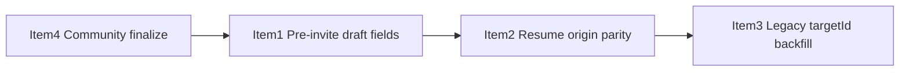

# Co-owner Draft Lifecycle Remediation Plan

## Sequencing



Ship **Item 4** first (proven production correctness bug, isolated backend change). Items 1–3 are frontend-heavy and interrelated; Item 3 must run **after** Item 2 is deployed so new drafts carry `origin` + `targetId`.

---

## Item 1 — Persist pre-invite co-owner details in drafts

### Root cause

Co-owner name, email, and payout % live in component `useState` in [`CoOwnerInviteBlock`](frontend/src/components/events/event-content-privacy-step.tsx) (`:491-493`) and [`AddVideoPolicyFields`](frontend/src/components/events/add-video-policy-fields.tsx) (`:70-72`). Draft autosave only persists policy fields defined in [`VideoPolicySlice`](frontend/src/lib/form-draft-utils.ts) (`:4-8`) and [`modal`](frontend/src/lib/form-draft-utils.ts) (`:32-38`) — none include co-owner contact fields. Server hydration runs only when a pending/approved invite exists (`event-content-privacy-step.tsx:503-527`).

### Proposed architecture

**Move pre-invite co-owner fields into react-hook-form + policy JSON** (same pattern as `coOwnerDraftKey` / `ownershipAnswer`). Do **not** add DB columns; `FormDraft.policyJson` is already unstructured JSON ([`schema.prisma:2347`](backend/prisma/schema.prisma)).

**Field model** (extend policy slice, not main payload):

```typescript
// form-draft-utils.ts — VideoPolicySlice (per video link index)
coOwnerName?: string;
coOwnerEmail?: string;
coOwnerPayoutPercent?: number; // integer 1–100

// form-draft-utils.ts — modal policy
modal?: {
  // existing fields...
  coOwnerName?: string;
  coOwnerEmail?: string;
  coOwnerPayoutPercent?: number;
};
```

**Form binding:**

| Surface                | Form path                                                             |
| ---------------------- | --------------------------------------------------------------------- |
| Wizard (multi-video)   | `videoLinks[i].coOwnerName`, `.coOwnerEmail`, `.coOwnerPayoutPercent` |
| Modal (`AddVideoForm`) | top-level `coOwnerName`, `.coOwnerEmail`, `.coOwnerPayoutPercent`     |

Extend [`newEventSchema`](frontend/src/schemas/index.ts) videoLinks object (`:173-192`) and [`AddVideoFormValues`](frontend/src/components/events/add-video-form.tsx) (`:59-77`) with optional nullable string/number fields.

**Hydration priority** (new shared hook `useCoOwnerDraftFields`):

1. If server invite exists (pending or approved) for `coOwnerDraftKey` → **server is source of truth**, fields read-only (current behavior preserved).
2. Else → use form/draft-restored values (autosave keeps them current).
3. Never overwrite read-only server state with stale draft on restore.

Trigger autosave on field edits via existing `useFormDraftAutosave(form.watch(), …)` on wizard pages and modal — no new save mechanism needed once fields are in `watch()`.

**Why react-hook-form (not policy-only):** Form fields participate in `splitDraftPayload` / `splitModalDraftPayload` automatically; step navigation remounts components but `form.reset(merged)` on restore repopulates values; co-owner block stays a presentational layer over form state.

### Files to modify

| File                                                                                                                             | Change                                                                                                                                               |
| -------------------------------------------------------------------------------------------------------------------------------- | ---------------------------------------------------------------------------------------------------------------------------------------------------- |
| [`frontend/src/lib/form-draft-utils.ts`](frontend/src/lib/form-draft-utils.ts)                                                   | Extend `VideoPolicySlice`, `FormDraftPolicyJson.modal`, `splitDraftPayload`, `mergeDraftPayload`, `splitModalDraftPayload`, `mergeModalDraftPayload` |
| [`frontend/src/schemas/index.ts`](frontend/src/schemas/index.ts)                                                                 | Optional co-owner fields on `videoLinks[]`                                                                                                           |
| [`frontend/src/components/events/add-video-form.tsx`](frontend/src/components/events/add-video-form.tsx)                         | Extend `AddVideoFormValues` + `defaultValues`                                                                                                        |
| [`frontend/src/components/events/event-content-privacy-step.tsx`](frontend/src/components/events/event-content-privacy-step.tsx) | Replace `useState` in `CoOwnerInviteBlock` with form `watch`/`setValue`; wire hydration hook                                                         |
| [`frontend/src/components/events/add-video-policy-fields.tsx`](frontend/src/components/events/add-video-policy-fields.tsx)       | Same; remove redundant-only reliance on local state                                                                                                  |
| **New** `frontend/src/hooks/use-coowner-draft-fields.ts`                                                                         | Shared hydration + read-only logic                                                                                                                   |
| [`frontend/src/lib/__tests__/form-draft-utils.spec.ts`](frontend/src/lib/form-draft-utils.spec.ts)                               | Add `mergeModalDraftPayload` + co-owner field round-trip tests                                                                                       |
| **New** `frontend/src/hooks/__tests__/use-coowner-draft-fields.spec.ts`                                                          | Server-wins vs draft-wins cases                                                                                                                      |

### Database / migration

**None.** All persistence via existing `FormDraft.policyJson`.

### Rollout

Deploy frontend only. Old drafts without co-owner fields restore empty (acceptable); new edits persist immediately.

### Automated tests

- Policy split/merge round-trip: wizard multi-link indices; modal single block.
- Hydration: approved invite → read-only server values; no invite → draft values restored.
- Regression: send invite still calls `onDraftSaveNow` after success (`event-content-privacy-step.tsx:584`).

### Manual QA

1. Enter co-owner details on step 4, **do not** send invite, go to step 3, return → fields visible.
2. Hard refresh with `?draftId=` on wizard → fields visible.
3. Send invite → fields read-only with server values.
4. After approval, resume draft → still read-only, submit enabled.
5. Repeat for modal (host-community + room add-video).

### Risks

- **Stale draft overwriting pending invite:** mitigated by read-only gate when invite status is pending/approved.
- **Schema optional fields:** ensure send-invite validation still requires non-empty name/email before API call.

---

## Item 2 — Create-dialog draft resume parity

### Root cause

[`form-drafts-panel.tsx`](frontend/src/components/dashboard/form-drafts-panel.tsx) Resume for modal kinds always routes to host-community (`:57-60`) or room (`:61-64`), regardless of where the draft originated. [`create-dialog.tsx`](frontend/src/components/home/create-dialog.tsx) autosaves modal drafts (`:665-679`) but stores no **origin surface**; Resume never reopens it.

### Proposed draft metadata model

Extend `FormDraftPolicyJson` (no DB migration):

```typescript
type DraftResumeOrigin = {
  /** Where the user was when the draft was saved */
  surface:
    | "create_dialog"
    | "host_community"
    | "event_channel_modal"
    | "content_room_settings";
  /** Pathname at save time, e.g. /explore, /host/my-slug */
  pathname: string;
  /** create-dialog tab when surface === create_dialog */
  hostTab?: "event" | "owner" | "cocreator";
  /** community id or event id — same semantic as modal.targetId */
  targetId: string;
};

// policyJson.modal.origin?: DraftResumeOrigin;
// Keep modal.targetId for backward compat; origin.targetId is canonical going forward
```

**Autosave:** [`use-form-draft-autosave.ts`](frontend/src/hooks/use-form-draft-autosave.ts) accepts new optional `draftOrigin: DraftResumeOrigin`. Parents pass origin at save time:

| Parent                                                                                     | `surface`               | `pathname`        | `hostTab`         |
| ------------------------------------------------------------------------------------------ | ----------------------- | ----------------- | ----------------- |
| [`create-dialog.tsx`](frontend/src/components/home/create-dialog.tsx)                      | `create_dialog`         | `usePathname()`   | current `hostTab` |
| [`host-community-client.tsx`](frontend/src/components/dashboard/host-community-client.tsx) | `host_community`        | current pathname  | —                 |
| [`event-channel-modal.tsx`](frontend/src/components/events/event-channel-modal.tsx)        | `event_channel_modal`   | `/room/{eventId}` | —                 |
| [`content-room-settings.tsx`](frontend/src/components/events/content-room-settings.tsx)    | `content_room_settings` | `/room/{eventId}` | —                 |

**Resume routing** in [`form-drafts-panel.tsx`](frontend/src/components/dashboard/form-drafts-panel.tsx):

```
if origin.surface === "create_dialog":
  router.push(`${origin.pathname}?resumeCreateVideo=1&modalDraftId=…&targetId=…&hostTab=…&draftKind=…`)
else if origin.surface === "host_community":
  // existing host-community deep link
else if surface in (event_channel_modal, content_room_settings):
  // existing room deep link (?openAddVideo=1&modalDraftId=)
else if no origin (legacy):
  // fallback to current host-community/room routing IF targetId present
  // else mark unrecoverable (Item 3)
```

**Resume consumers** (read URL params on mount):

- [`dashboard-client.tsx`](frontend/src/components/dashboard/dashboard-client.tsx) — open `CreateDialog`, pass `seedDraftId`, `initialTargetId`, `initialHostTab` when `resumeCreateVideo=1`.
- [`create-dialog.tsx`](frontend/src/components/home/create-dialog.tsx) — accept resume props; set `hostTab`, `targetId`, open add-video section; pass `seedDraftId` to `AddVideoForm`.
- [`explore-page-client.tsx`](frontend/src/components/explore/explore-page-client.tsx), [`navbar-client.tsx`](frontend/src/components/shared/navbar-client.tsx), etc. — same param handler wherever `CreateDialog` mounts (shared hook `useCreateDialogResume` to avoid duplication).

Ensure all four modal entry points pass identical `draftAutosave` + `seedDraftId` + origin to [`AddVideoForm`](frontend/src/components/events/add-video-form.tsx).

### Files to modify

**Frontend**

- [`frontend/src/lib/form-draft-utils.ts`](frontend/src/lib/form-draft-utils.ts) — types + origin in split/merge
- [`frontend/src/hooks/use-form-draft-autosave.ts`](frontend/src/hooks/use-form-draft-autosave.ts) — persist `origin`
- [`frontend/src/components/dashboard/form-drafts-panel.tsx`](frontend/src/components/dashboard/form-drafts-panel.tsx) — origin-aware resume + user-visible error toast when unrecoverable
- [`frontend/src/components/home/create-dialog.tsx`](frontend/src/components/home/create-dialog.tsx) — origin on autosave, resume props, `seedDraftId`
- [`frontend/src/components/dashboard/dashboard-client.tsx`](frontend/src/components/dashboard/dashboard-client.tsx) — URL resume handler
- [`frontend/src/components/dashboard/host-community-client.tsx`](frontend/src/components/dashboard/host-community-client.tsx) — set origin
- [`frontend/src/components/events/event-channel-modal.tsx`](frontend/src/components/events/event-channel-modal.tsx) — set origin
- [`frontend/src/components/events/content-room-settings.tsx`](frontend/src/components/events/content-room-settings.tsx) — set origin
- **New** `frontend/src/hooks/use-create-dialog-resume.ts` — shared URL param parsing for all CreateDialog mount points
- **New** `frontend/src/lib/__tests__/draft-resume-routing.spec.ts` — pure function tests for resume URL builder

**Backend**

- None required (origin lives in `policyJson`). Optional: validate `policyJson` shape in [`form-draft.controller.ts`](backend/src/controllers/form-draft.controller.ts) is passthrough-only — no change needed.

### Database / migration

**None.**

### Rollout

1. Deploy frontend with origin writing (backward compatible).
2. New/updated drafts get full resume parity.
3. Run Item 3 backfill for legacy rows.

### Automated tests

- Resume URL builder: each `surface` → correct pathname + query params.
- Panel: `create_dialog` origin → does not route to host-community.
- CreateDialog resume: given params, `targetId` + `hostTab` + `seedDraftId` reach `AddVideoForm`.

### Manual QA

1. Start co-owner flow in **create-dialog on dashboard** → save draft → Resume → create-dialog reopens, correct tab, correct target, form restored.
2. Repeat from **explore** create-dialog → Resume returns to explore (not dashboard).
3. Start in **host-community modal** → Resume opens host-community (not create-dialog).
4. Start in **room event-channel modal** → Resume opens room settings + add-video modal.
5. Cross-tab: Resume with `modalDraftId` restores co-owner draft key + gating.

### Risks

- CreateDialog mounted in many places — missed mount point = resume lands on dashboard only. Mitigate with shared `useCreateDialogResume` and grep audit of all `CreateDialog` imports.
- `hostTab=cocreator` + co-owner: verify `coOwnerPolicyMode="ownerOnly"` restored from origin or draft policy.

---

## Item 3 — Legacy modal draft `targetId` backfill

### Root cause

[`use-form-draft-autosave.ts`](frontend/src/hooks/use-form-draft-autosave.ts) only began writing `modal.targetId` recently (`:66-75`). Older `community_video` / `room_add_video` drafts lack it; [`form-drafts-panel.tsx`](frontend/src/components/dashboard/form-drafts-panel.tsx) silently returns at `:47-48`.

### Proposed backfill strategy

**New script:** [`backend/src/scripts/backfill-form-draft-modal-target.ts`](backend/src/scripts/backfill-form-draft-modal-target.ts)

**Kinds affected:** `community_video`, `room_add_video` only.

**Inference rules (strict confidence tiers — never guess on ambiguity):**

| Tier              | Rule                                                                                                              | Sets `targetId`                                                                       | Sets `origin` (optional) |
| ----------------- | ----------------------------------------------------------------------------------------------------------------- | ------------------------------------------------------------------------------------- | ------------------------ |
| **S0 Skip**       | `policyJson.modal.targetId` already present                                                                       | —                                                                                     | —                        |
| **S1 High**       | `policyJson.modal.coOwnerDraftKey` → `VideoCoOwnerInvite.eventChannelId` set → channel → `event.id`               | `room_add_video`: event.id; `community_video`: `event.communityId` (must be non-null) | —                        |
| **S2 High**       | `payloadJson.url` trimmed → exactly **one** `EventChannel` on host's events (via `Event.hostId`) matching URL     | Same as above per kind                                                                | —                        |
| **S3 Medium**     | S2 match + exactly **one** active `Community` where `ownerHostId = hostId` AND `event.communityId = community.id` | `community_video` only                                                                | —                        |
| **Unrecoverable** | Zero matches, multiple matches, `community_video` but `event.communityId` null, URL missing/invalid               | Mark `policyJson.modal.recoverable = false`                                           | —                        |

**Never infer from:** draft title, host's community list alone, or single-community heuristics without URL/event linkage.

**Script features:**

- `--dry-run` (default): log CSV-style report, no writes
- `--apply`: update `policyJson` only (merge, preserve existing keys)
- `--limit N` for staged rollout
- Output columns: `draftId`, `kind`, `hostId`, `tier`, `inferredTargetId`, `action` (skip/apply/unrecoverable), `reason`

**Rollback:** Script writes previous `policyJson` to a JSON audit file per run (`backfill-audit-{timestamp}.jsonl`). Rollback script reapplies stored snapshots by `draftId`.

**Frontend handling of unrecoverable:**

- [`form-drafts-panel.tsx`](frontend/src/components/dashboard/form-drafts-panel.tsx): if `recoverable === false` or missing `targetId` after backfill, show disabled Resume + tooltip _"This draft can't be reopened automatically. Start a new video or contact support."_; never silent no-op.

### Files to modify

| File                                                                                                                 | Change                             |
| -------------------------------------------------------------------------------------------------------------------- | ---------------------------------- |
| **New** `backend/src/scripts/backfill-form-draft-modal-target.ts`                                                    | Dry-run/apply/report               |
| **New** `backend/src/scripts/rollback-form-draft-backfill.ts`                                                        | Optional restore from audit log    |
| [`frontend/src/lib/form-draft-utils.ts`](frontend/src/lib/form-draft-utils.ts)                                       | `modal.recoverable?: boolean` type |
| [`frontend/src/components/dashboard/form-drafts-panel.tsx`](frontend/src/components/dashboard/form-drafts-panel.tsx) | Unrecoverable UX                   |

### Database / migration

**None** (JSON patch on `FormDraft.policyJson`).

### Rollout

1. Staging: `--dry-run`, human review report.
2. Staging: `--apply --limit 50`, verify Resume on sample.
3. Production: `--apply` during low traffic.
4. Deploy frontend unrecoverable UX (can ship with Item 2).

### Automated tests

- Unit tests for inference pure functions (mock Prisma): single match, multi-match, invite-linked, unrecoverable.
- No DB integration test required if logic is extracted to testable module `form-draft-target-inference.util.ts`.

### Manual QA

- Pick known legacy draft pre-backfill → Resume fails with message.
- After backfill → Resume succeeds to correct surface (Item 2).
- Ambiguous draft → marked unrecoverable, no wrong target attached.

### Risks

- **Wrong target attachment:** mitigated by tier rules + dry-run + audit rollback.
- **Invite without eventChannelId:** correctly unrecoverable until user re-saves draft post-deploy.

---

## Item 4 — Community `existingChannel` co-owner linkage

### Root cause

[`community-content-bank.controller.ts`](backend/src/controllers/community-content-bank.controller.ts) reuses an existing `EventChannel` (`:189-190`) but only calls [`finalizeCoOwnersForNewChannel`](backend/src/services/coOwner/event-create-coowner.util.ts) in the `else` branch (`:211-216`). Co-owned submissions with approved invites pass validation (`:163-167`) but leave no `VideoCoOwner` rows when the channel pre-exists (e.g. fully-owned wizard upload of same URL).

### Proposed architecture

**Always finalize co-owned submissions** after `channelId` is resolved, regardless of new vs existing channel.

Add helper [`reconcileExistingChannelForCoOwnedSubmit`](backend/src/services/coOwner/event-create-coowner.util.ts):

```typescript
// Called inside transaction when existingChannel && link.ownershipAnswer === "no"
// 1. Load channel + existing videoCoOwners (with payout check)
// 2. If channel has co-owners from a DIFFERENT draft lineage → 409 (delegate to assertYoutubeVideoNotAlreadyCoOwned already run pre-tx)
// 3. Patch channel metadata from link:
//    coOwnerDraftKey, ownershipAnswer=no, ownershipState=approved,
//    hostYoutubeChannelId, isOnHostYoutube, ownerLockedAt
//    (mirror buildEventChannelUncheckedData outputs)
// 4. await finalizeCoOwnersForNewChannel(tx, hostId, channelId, draftKey)
```

**Scenario coverage with existing idempotent finalize (`event-create-coowner.util.ts:275-333`):**

| Scenario                                                   | Behavior                                                                          |
| ---------------------------------------------------------- | --------------------------------------------------------------------------------- |
| **A** Fully-owned channel, co-owned community submit       | Reconcile metadata + finalize creates `VideoCoOwner` rows                         |
| **B** Channel already has co-owners (same draft)           | Finalize reuses rows (`:283-291`), no duplicates                                  |
| **C** Co-owner row has payout history on different channel | Finalize throws 409 (`:294-298`) — transaction rolls back, bank entry not created |

**Do not create a separate finalize** — extend call site; existing function is idempotent.

### Transaction impact

Change is inside existing `$transaction` (`community-content-bank.controller.ts:187-238`). Adds one channel read + optional update + finalize loop. No nested transactions. Duration increase negligible.

### Files to modify

| File                                                                                                                           | Change                                                             |
| ------------------------------------------------------------------------------------------------------------------------------ | ------------------------------------------------------------------ |
| [`backend/src/controllers/community-content-bank.controller.ts`](backend/src/controllers/community-content-bank.controller.ts) | Call reconcile + finalize on existing-channel branch when co-owned |
| [`backend/src/services/coOwner/event-create-coowner.util.ts`](backend/src/services/coOwner/event-create-coowner.util.ts)       | New `reconcileExistingChannelForCoOwnedSubmit`                     |
| **New** `backend/src/services/__tests__/community-coowner-existing-channel.spec.ts`                                            | Scenarios A/B/C                                                    |
| **New** `backend/src/services/__tests__/finalize-coowners-for-new-channel.spec.ts`                                             | Reuse, payout refusal, already-linked                              |

### Database / migration

**None.**

### Rollout

Backend-only deploy. No backfill needed for past bank entries created without co-owner rows (manual data fix out of scope unless audit finds affected rows).

### Automated tests

- **A:** Mock existing channel (no co-owners) + co-owned link → finalize called, `VideoCoOwner.create` invoked.
- **B:** Existing co-owners same invite → no duplicate create.
- **C:** Existing co-owner with payouts on other channel → 409, no bank entry.
- Controller integration test: existing channel path leaves bank entry + co-owner rows atomically.

### Manual QA

1. Create event with fully-owned video URL X.
2. Community bank co-owned upload URL X (approved invite) → bank entry created, co-owner visible in dashboard.
3. Retry same submission → idempotent / appropriate 409 on bank duplicate (`:175-179`).
4. Channel with payout history → submit rejected with clear error.

### Risks

- **Ownership metadata transition yes→no:** reconcile helper must only run when submit declares `ownershipAnswer: "no"` and invites validated — avoids mutating truly fully-owned in-flight content.
- **Global duplicate rule:** pre-tx `assertVideoLinksCoOwnerForCreate` still enforces global YouTube co-owner uniqueness.

---

## Global rollout checklist

| Step | Action                                                  |
| ---- | ------------------------------------------------------- |
| 1    | Deploy Item 4 backend                                   |
| 2    | Deploy Items 1 + 2 frontend                             |
| 3    | Run Item 3 backfill dry-run on staging → review → apply |
| 4    | Full manual QA matrix (all items)                       |
| 5    | Production deploy + backfill apply                      |

## Revised production verdict (post-remediation)

After Items 1–4 and successful manual QA + full test suite:

- **Production blockers cleared:** community co-owner linkage (Item 4), complete draft lifecycle (Items 1–3).
- **Updated confidence:** 90% (pending QA execution).
- **Deployment approval:** Approve after Item 4 ships + Items 1–2 ship + Item 3 backfill dry-run reviewed + manual QA pass + full CI green.

**Safe post-production improvements (not required):**

- Mounted hook tests for `useCoOwnerDraftSubmitBlocked`
- Stale verify toast assertion test
- Remove redundant child mint effect in `add-video-policy-fields.tsx` once form defaults guaranteed
- Extract shared `CoOwnerInviteFields` UI component
