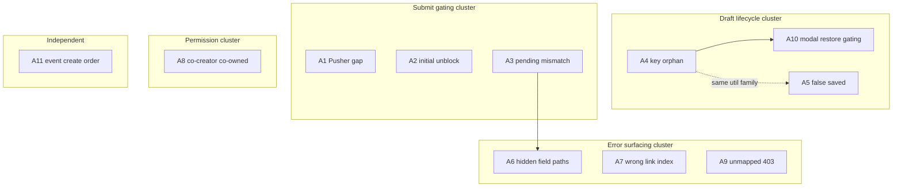

# Co-Owner & Video Submission — Implementation Plan

Based solely on verified bugs **A1–A11** from the latest audit. No performance optimizations in scope.

---

## Part 1 — Verified Bug Review

| Bug ID  | Root cause                                                                      | Files                                                                                                                                                                                                                                                                                                                                          | Functions                                                                       | Why it occurs                                                                | Severity | User impact                                           | Confidence |
| ------- | ------------------------------------------------------------------------------- | ---------------------------------------------------------------------------------------------------------------------------------------------------------------------------------------------------------------------------------------------------------------------------------------------------------------------------------------------- | ------------------------------------------------------------------------------- | ---------------------------------------------------------------------------- | -------- | ----------------------------------------------------- | ---------- |
| **A1**  | Event wizard Pusher handler does not refresh submit-gating state                | [`frontend/src/components/events/event-content-privacy-step.tsx`](frontend/src/components/events/event-content-privacy-step.tsx), [`frontend/src/hooks/use-coowner-draft-submit-blocked.ts`](frontend/src/hooks/use-coowner-draft-submit-blocked.ts)                                                                                           | `CoOwnerInviteBlock` Pusher handler, `useCoOwnerDraftSubmitBlocked`             | Approval toast fires but hook only polls every 5s                            | Medium   | Submit stays disabled after approval for up to ~5s    | 95%        |
| **A2**  | Submit hook initializes `blocked = false` before first async poll               | [`frontend/src/hooks/use-coowner-draft-submit-blocked.ts`](frontend/src/hooks/use-coowner-draft-submit-blocked.ts)                                                                                                                                                                                                                             | `useCoOwnerDraftSubmitBlocked`                                                  | `useState(false)` until first `refresh()` completes                          | Medium   | Brief window where submit is clickable while pending  | 90%        |
| **A3**  | Frontend checks `some(approved)`; backend rejects if `any(pending)`             | [`frontend/src/hooks/use-coowner-draft-submit-blocked.ts`](frontend/src/hooks/use-coowner-draft-submit-blocked.ts), [`frontend/src/lib/coowner-draft-submit.util.ts`](frontend/src/lib/coowner-draft-submit.util.ts), [`backend/src/services/coOwner/event-create-coowner.util.ts`](backend/src/services/coOwner/event-create-coowner.util.ts) | `refresh`, `validateCoOwnerDraftsForSubmit`, `assertVideoLinksCoOwnerForCreate` | Contract never aligned on pending invites                                    | High     | UI enables submit; API returns 400                    | 98%        |
| **A4**  | `mergeDraftPayload` mints new UUID when saved key missing                       | [`frontend/src/lib/form-draft-utils.ts`](frontend/src/lib/form-draft-utils.ts), [`frontend/src/hooks/use-form-draft-autosave.ts`](frontend/src/hooks/use-form-draft-autosave.ts)                                                                                                                                                               | `mergeDraftPayload`, `splitDraftPayload`, `persistDraft`                        | Key only saved if non-empty; 1.5s debounce; restore fallback generates UUID  | Critical | Approved invites orphaned; submit permanently blocked | 92%        |
| **A5**  | `lastSavedAt` set even when `upsertFormDraftAction` fails                       | [`frontend/src/hooks/use-form-draft-autosave.ts`](frontend/src/hooks/use-form-draft-autosave.ts)                                                                                                                                                                                                                                               | `persistDraft`                                                                  | Unconditional `setSaveState({ lastSavedAt: new Date() })` after try          | Medium   | False “saved” indicator                               | 100%       |
| **A6**  | Backend maps errors to `coOwnerDraftKey`; no visible field                      | [`backend/src/utils/coowner-form-error.util.ts`](backend/src/utils/coowner-form-error.util.ts), [`frontend/src/lib/form-error-mapper.ts`](frontend/src/lib/form-error-mapper.ts)                                                                                                                                                               | `coOwnerErrorFieldPath`, `applyServerFormErrors`                                | Hidden field path; scroll/highlight misses                                   | Medium   | Toast-only errors on ownership issues                 | 98%        |
| **A7**  | `createEvent` catch always passes `videoLinkIndex: 0`                           | [`backend/src/controllers/event.controller.ts`](backend/src/controllers/event.controller.ts)                                                                                                                                                                                                                                                   | `createEvent` catch, `respondCoOwnerValidationError`                            | Hard-coded index in error responder                                          | Medium   | Wrong video URL highlighted (multi-link events)       | 95%        |
| **A8**  | UI allows co-owned path; backend forbids non-owner community co-owned           | [`frontend/src/components/home/create-dialog.tsx`](frontend/src/components/home/create-dialog.tsx), [`backend/src/controllers/community-content-bank.controller.ts`](backend/src/controllers/community-content-bank.controller.ts)                                                                                                             | `AddVideoForm` render, `addCommunityVideo`                                      | No frontend guard for `hostTab === "cocreator"` + `ownershipAnswer === "no"` | High     | Full invite flow then 403                             | 97%        |
| **A9**  | Unmapped 403 tier string for community co-owned                                 | [`backend/src/utils/coowner-form-error.util.ts`](backend/src/utils/coowner-form-error.util.ts), [`backend/src/controllers/community-content-bank.controller.ts`](backend/src/controllers/community-content-bank.controller.ts)                                                                                                                 | `CO_OWNER_FIELD_MESSAGES`, `addCommunityVideo`                                  | Message literal mismatch vs mapped strings                                   | Medium   | Generic toast for tier/permission errors              | 96%        |
| **A10** | Modal gating uses `useCoOwnerInviteStatus(draftKey, email)`; email not in draft | [`frontend/src/components/events/add-video-form.tsx`](frontend/src/components/events/add-video-form.tsx), [`frontend/src/components/events/add-video-policy-fields.tsx`](frontend/src/components/events/add-video-policy-fields.tsx), [`frontend/src/lib/form-draft-utils.ts`](frontend/src/lib/form-draft-utils.ts)                           | `coOwnerSubmitBlocked`, `useCoOwnerInviteStatus`, `splitModalDraftPayload`      | Email is local `useState`; restore leaves status `null`                      | High     | Submit blocked after restore despite DB approval      | 94%        |
| **A11** | `event.create` runs before `assertVideoLinksCoOwnerForCreate`                   | [`backend/src/controllers/event.controller.ts`](backend/src/controllers/event.controller.ts)                                                                                                                                                                                                                                                   | `createEvent`                                                                   | Validation ordered after event persistence                                   | Critical | Orphan events when co-owner/video validation fails    | 99%        |

---

## Part 2 — Dependency Analysis

### Related bugs / shared root cause

| Cluster         | Bugs        | Shared code                                                              |
| --------------- | ----------- | ------------------------------------------------------------------------ |
| Submit gating   | A1, A2, A3  | `use-coowner-draft-submit-blocked.ts`, `coowner-draft-submit.util.ts`    |
| Draft lifecycle | A4, A5, A10 | `form-draft-utils.ts`, `use-form-draft-autosave.ts`, modal policy fields |
| Error surfacing | A6, A7, A9  | `coowner-form-error.util.ts`, `form-error-mapper.ts`                     |
| Permissions UX  | A8, A9      | `create-dialog.tsx`, community controller messages                       |
| Data integrity  | A11         | `event.controller.ts` only                                               |

### Fix dependencies

| Fix                  | Depends on                         | Never ship alone                                                   |
| -------------------- | ---------------------------------- | ------------------------------------------------------------------ |
| A3 alignment         | None (but same files as A1/A2)     | **Do not** ship A1/A2 without A3 (same hook/util edits)            |
| A10 modal restore    | A4 recommended first (stable keys) | Can ship after A4                                                  |
| A6 error paths       | A7/A9 (mapping consistency)        | Prefer single error-mapping PR                                     |
| A4 draft key         | None                               | Safe alone; enables A10 testing                                    |
| A11 validation order | None                               | **Do not** combine with large event.controller refactor in same PR |

### Never implement independently

- **A1 without A2/A3** — same hook; partial fix leaves inconsistent gating.
- **A6 without updating message map for A9** — incomplete error UX.
- **A10 without A4** — restore may still mint new keys on event wizards; modal path partially fixed only.

---

## Part 3 — Implementation Order (Phases)

### Phase 0 — Critical data integrity (ship first)

**A11** — Move co-owner/video asserts before `event.create`.

**Why first:** Prevents irreversible orphan events. No frontend dependency. Smallest backend-only change with highest integrity impact.

### Phase 1 — Draft key lifecycle (unblocks restore correctness)

**A4**, **A5** — Stable `coOwnerDraftKey`; honest save indicator.

**Why second:** A10 and refresh journeys depend on stable keys. A5 is isolated and low-risk.

### Phase 2 — Frontend/backend contract alignment (submit gating)

**A1**, **A2**, **A3** — Shared co-owner submit readiness util + hook refresh API + Pusher wiring.

**Why third:** Requires stable draft keys (Phase 1) for meaningful QA; aligns client with server before UX polish.

### Phase 3 — Error surfacing & permissions UX

**A6**, **A7**, **A8**, **A9** — Field mapping, link index, co-creator guard, message map.

**Why fourth:** Depends on correct gating (Phase 2) to avoid debugging submit vs error issues simultaneously.

### Phase 4 — Modal draft restore gating

**A10** — Persist co-owner email in modal draft OR derive approved state from draftKey-only poll (mirror event hook).

**Why fifth:** Builds on Phase 1 draft utils; can reuse Phase 2 shared validation helper.

**Performance work:** Explicitly postponed (duplicate YouTube verify, email off critical path, parallel status checks).

---

## Part 4 — Per-Bug Implementation Spec

### A1 — Pusher not wired to event submit gating

1. **Root cause:** `CoOwnerInviteBlock` Pusher handler only toasts; no callback to refresh submit hook.
2. **Recommended fix:** Extract shared `evaluateCoOwnerSubmitReadiness(invites)` in [`coowner-draft-submit.util.ts`](frontend/src/lib/coowner-draft-submit.util.ts). Export `refreshCoOwnerDraftSubmitBlocked()` from hook via React context **or** pass `onCoOwnerInviteStatusChange` from event pages into `EventContentPrivacyStep` → `CoOwnerInviteBlock` (mirror [`add-video-policy-fields.tsx`](frontend/src/components/events/add-video-policy-fields.tsx) lines 82–87).
3. **Safest because:** Mirrors proven modal pattern; no backend change.
4. **Alternatives rejected:**
   - Reduce poll interval only — still laggy; doesn’t fix Pusher gap.
   - Global event bus — unnecessary abstraction.
5. **Regressions:** False unblock if callback fires for wrong link index.
6. **Affected:** Event pages (3), `event-content-privacy-step.tsx`, hook.
7. **Must preserve:** Modal Pusher behaviour; invite send flow unchanged.
8. **DB:** None | **API:** None | **Migration:** No | **Feature flag:** No
9. **Rollback:** Revert frontend commit; Pusher optional at runtime.

---

### A2 — Initial submit enabled while pending

1. **Root cause:** `useState(false)` in hook.
2. **Recommended fix:** Initialize `blocked` to `true` when `coOwned.length > 0 && watchKey` non-empty; set false only after successful readiness check. Keep `blocked = false` when no co-owned links.
3. **Safest because:** Conservative default matches backend; no API change.
4. **Alternatives rejected:**
   - Disable button via separate loading flag on pages — duplicates logic across 3 pages.
5. **Regressions:** Flash of “Awaiting approval” on step 4 entry for fully-owned videos — mitigated by `coOwned.length === 0` branch.
6. **Affected:** Hook + 3 event pages (display only).
7. **Must preserve:** Non-co-owned submits unaffected.
8. **DB/API:** None | **Migration:** No | **Flag:** No
9. **Rollback:** Revert hook init logic.

---

### A3 — Pending vs approved contract mismatch

1. **Root cause:** Frontend `some(approved)` vs backend `pending.length > 0`.
2. **Recommended fix:** Single function `getCoOwnerSubmitBlockReason(invites)` returning `null | 'missing_approved' | 'has_pending'`. Use in hook, `validateCoOwnerDraftsForSubmit`, and optionally mirror messages to backend strings.
3. **Safest because:** One source of truth; aligns with [`event-create-coowner.util.ts`](backend/src/services/coOwner/event-create-coowner.util.ts) lines 73–86 without changing backend rules.
4. **Alternatives rejected:**
   - Relax backend to allow pending — violates product/validation rules.
   - Auto-revoke pending on new invite — changes invite workflow.
5. **Regressions:** Users with stale pending+approved pairs blocked until pending revoked (correct behaviour).
6. **Affected:** Hook, util, 3 event pages, `add-video-form.tsx` submit validation.
7. **Must preserve:** Backend assert logic; payout/invite creation unchanged.
8. **DB/API:** None | **Migration:** No | **Flag:** No
9. **Rollback:** Revert util + hook together.

---

### A4 — Draft restore orphans invites (new UUID)

1. **Root cause:** `mergeDraftPayload` fallback `crypto.randomUUID()`; `splitDraftPayload` skips empty keys.
2. **Recommended fix:**
   - **Always persist** `coOwnerDraftKey` once assigned (include empty→assigned in split by never omitting after step 4 mount).
   - **Remove UUID fallback** in `mergeDraftPayload`; preserve empty string and let step-4 `useEffect` assign key only on fresh forms, not restore.
   - **Flush draft on invite send:** call `saveNow()` from co-owner invite success handlers (event + modal).
   - Optionally persist `draftId` to `sessionStorage` for event wizards (same pattern as modal) — **optional sub-fix**, document as follow-up if scope tight.
3. **Safest because:** Stops silent key rotation; flush-on-invite minimizes debounce race without changing autosave debounce globally.
4. **Alternatives rejected:**
   - Store approval status in draft JSON — duplicates DB; higher sync risk.
   - Lookup invites by URL instead of draftKey — breaks multi-draft same URL.
5. **Regressions:** Restore with genuinely missing key shows error instead of silent new key — acceptable, user must re-invite.
6. **Affected:** `form-draft-utils.ts`, `event-content-privacy-step.tsx`, `add-video-policy-fields.tsx`, autosave consumers.
7. **Must preserve:** Modal/event draft kinds; 30-day TTL; dashboard resume links.
8. **DB:** None (draft JSON shape extended only) | **API:** None | **Migration:** No | **Flag:** No
9. **Rollback:** Revert merge/split + flush calls.

---

### A5 — False “saved” draft indicator

1. **Root cause:** `lastSavedAt` set unconditionally.
2. **Recommended fix:** Set `lastSavedAt` only when `res.success`; on failure toast optional via `DraftSaveIndicator` error state (new `saveError` field).
3. **Safest because:** Pure UI honesty; no persistence change.
4. **Alternatives rejected:** Retry loop — out of scope.
5. **Regressions:** Users see errors more often — intended.
6. **Affected:** `use-form-draft-autosave.ts`, `draft-save-indicator.tsx`.
7. **Must preserve:** Autosave debounce timing (1.5s).
8. **DB/API:** None | **Migration:** No | **Flag:** No
9. **Rollback:** Revert hook + indicator.

---

### A6 — Hidden `coOwnerDraftKey` error paths

1. **Root cause:** Backend maps to non-rendered field.
2. **Recommended fix:** Map co-owner submit errors to `ownershipAnswer` (event: `videoLinks.{i}.ownershipAnswer`; modal: `ownershipAnswer`) in [`coowner-form-error.util.ts`](backend/src/utils/coowner-form-error.util.ts). Add frontend fallback in `applyServerFormErrors` to redirect unknown `coOwnerDraftKey` paths to ownership field.
3. **Safest because:** Surfaces errors where users act; no rule change.
4. **Alternatives rejected:** Add hidden `<input name="coOwnerDraftKey">` — bad a11y/UX.
5. **Regressions:** None if index preserved (pairs with A7).
6. **Affected:** Backend util, frontend error mapper, event pages.
7. **Must preserve:** Invite field errors (`coOwnerEmail`/`coOwnerName`) unchanged.
8. **DB:** None | **API:** Response `details[].path` changes — backward compatible | **Migration:** No | **Flag:** No
9. **Rollback:** Revert mapping util.

---

### A7 — Multi-link errors pinned to index 0

1. **Root cause:** Hard-coded `0` in `createEvent` catch.
2. **Recommended fix:** In `assertVideoLinksCoOwnerForCreate`, attach `videoLinkIndex` to thrown errors (custom property or structured message). Update `respondCoOwnerValidationError` to accept index from error. Loop in assert already has link index.
3. **Safest because:** Localized to assert + controller; successful creates unchanged.
4. **Alternatives rejected:** Frontend-only guess from URL match — fragile with duplicate URLs.
5. **Regressions:** Single-link events still index 0.
6. **Affected:** `event-create-coowner.util.ts`, `event.controller.ts`, `coowner-form-error.util.ts`.
7. **Must preserve:** Single-video modal paths (no index).
8. **DB:** None | **API:** Error path precision improves | **Migration:** No | **Flag:** No
9. **Rollback:** Revert assert + controller.

---

### A8 — Co-creator co-owned community path

1. **Root cause:** UI exposes ownership “No” for `hostTab === "cocreator"`; backend rejects.
2. **Recommended fix:** In [`create-dialog.tsx`](frontend/src/components/home/create-dialog.tsx), pass `coOwnerPolicyMode="ownerOnly" | "full"` to `AddVideoForm` / `AddVideoPolicyFields`. When `hostTab === "cocreator"`, hide/disable “No (co-owner required)” and show helper text matching backend rule. **Do not** change backend authorization.
3. **Safest because:** Aligns UI with existing server rule; zero permission expansion.
4. **Alternatives rejected:**
   - Allow co-creators to submit co-owned — product rule change.
   - Backend-only friendlier message without UI guard — still wastes invite flow.
5. **Regressions:** Co-creators must use “Yes” for community uploads — already required server-side.
6. **Affected:** `create-dialog.tsx`, `add-video-form.tsx`, `add-video-policy-fields.tsx`.
7. **Must preserve:** Owner community co-owned flow; co-creator “Yes” uploads; dashboard owner-only add video.
8. **DB/API:** None | **Migration:** No | **Flag:** No
9. **Rollback:** Revert prop/guard.

---

### A9 — Unmapped community tier 403

1. **Root cause:** Message literal not in `CO_OWNER_FIELD_MESSAGES`.
2. **Recommended fix:** Add entries:
   - `"Host Community subscription required for co-owned community uploads"` → `ownershipAnswer`
   - `"Only the community owner can submit co-owned videos to this bank"` → `ownershipAnswer`
     Map in both backend util and frontend `mapCoOwnerInviteErrors` if used at submit.
3. **Safest because:** Additive mapping only.
4. **Alternatives rejected:** Change backend message to match old string — breaks log/monitoring consistency.
5. **Regressions:** None.
6. **Affected:** `coowner-form-error.util.ts`, frontend error util tests.
7. **Must preserve:** Premium vs Community entitlement rules.
8. **DB:** None | **API:** Error body shape unchanged | **Migration:** No | **Flag:** No
9. **Rollback:** Revert map entries.

---

### A10 — Modal submit blocked after restore without email

1. **Root cause:** Gating uses email-dependent hook; email not in draft.
2. **Recommended fix (preferred):** Persist `coOwnerEmail` (and optionally `coOwnerName`) in `policyJson.modal` via `splitModalDraftPayload` / `mergeModalDraftPayload`. On restore, `useCoOwnerInviteStatus` resolves. **Additionally:** unify modal button gating with shared draftKey-only readiness check (same as Phase 2 util) so button state doesn’t depend solely on email match.
3. **Safest because:** Restores visible state; draftKey-only check matches backend truth.
4. **Alternatives rejected:**
   - Remove modal gating entirely — allows premature submit clicks (mitigated by submit validation but worse UX).
5. **Regressions:** PII in draft JSON — same host-only draft ACL as today; document in code comment.
6. **Affected:** `form-draft-utils.ts`, `add-video-policy-fields.tsx`, `add-video-form.tsx`, hook/util.
7. **Must preserve:** Owner/co-creator modal flows; sessionStorage draft restore.
8. **DB:** Draft JSON only | **API:** None | **Migration:** No | **Flag:** No
9. **Rollback:** Revert policy slice fields.

---

### A11 — Event created before validation

1. **Root cause:** `prisma.event.create` at line ~252 before `assertVideoLinksCoOwnerForCreate` at ~274.
2. **Recommended fix (minimal, Phase 0):** Move `assertVideoLinksCoOwnerForCreate(host.id, tier, videoLinks)` **before** `prisma.event.create`. Keep channel creation transaction as-is.
3. **Safest because:** Successful happy path identical; failures no longer leave orphan events for co-owner/YouTube asserts.
4. **Alternatives rejected:**
   - Full mega-transaction including character sets + host credit + event — XL refactor, high regression risk.
   - Soft-delete orphan events — masks integrity issue.
5. **Regressions:** None on success; failure now occurs earlier (before event row).
6. **Affected:** `event.controller.ts` `createEvent` only.
7. **Must preserve:** Event payload fields, email send on success, channel finalize, live video path.
8. **DB:** None | **API:** Same 400/403/409 codes, earlier failure | **Migration:** No | **Flag:** No (optional env to log pre-check timing — not required)
9. **Rollback:** Revert ordering in controller.

**Note:** Channel-create failures after event exists remain possible; document as known residual risk; defer transactional wrap to future XL task.

---

## Part 5 — Test Plan

### Phase 0 (A11)

| Type            | Cases                                                                                                            |
| --------------- | ---------------------------------------------------------------------------------------------------------------- |
| **Unit**        | Mock `assertVideoLinksCoOwnerForCreate` throw → assert `event.create` not called (new controller unit test file) |
| **Integration** | POST `/events/new` with invalid co-owner draft → 400/403 and no new `Event` row (DB count)                       |
| **E2E**         | Event wizard submit with pending co-owner → no redirect; no event in host list                                   |
| **Manual QA**   | Submit co-owned event without approval → verify no orphan in admin/host events                                   |
| **Regression**  | Fully-owned event still creates; banner upload path unchanged                                                    |
| **Negative**    | Missing draftKey, pending invite, YouTube duplicate                                                              |
| **Edge**        | Empty `videoLinks`, live-only path                                                                               |
| **Performance** | None required (correctness only)                                                                                 |

**Journey:** Host → event-only wizard → step 4 → co-owned pending → submit → expect error, no event.

---

### Phase 1 (A4, A5)

| Type            | Cases                                                                                                                                                  |
| --------------- | ------------------------------------------------------------------------------------------------------------------------------------------------------ |
| **Unit**        | `mergeDraftPayload` does not mint UUID when policy key missing; `splitDraftPayload` retains assigned keys; autosave sets `lastSavedAt` only on success |
| **Integration** | Upsert draft with policyJson keys → get draft → keys identical                                                                                         |
| **E2E**         | Send co-owner invite → immediate refresh with `?draftId=` → same draftKey → submit still viable after approval                                         |
| **Manual QA**   | Draft indicator on simulated API failure                                                                                                               |
| **Regression**  | Draft restore step navigation; modal sessionStorage restore                                                                                            |
| **Negative**    | Restore draft with missing key → explicit error/toast, no silent UUID                                                                                  |
| **Edge**        | Multi-video links each with own key                                                                                                                    |

**Journey:** Step 4 → invite → manual “Save now” → dashboard Resume → approve → submit enabled.

---

### Phase 2 (A1–A3)

| Type            | Cases                                                                                           |
| --------------- | ----------------------------------------------------------------------------------------------- |
| **Unit**        | `getCoOwnerSubmitBlockReason`: approved+pending → blocked; approved only → open; none → blocked |
| **Integration** | Status action returns mixed invites → hook state                                                |
| **E2E**         | Pusher/mock approval → submit enables without 5s wait (event wizard)                            |
| **Manual QA**   | Initial load step 4 co-owned → button disabled immediately                                      |
| **Regression**  | Modal still uses Pusher path; non-co-owned submit                                               |
| **Negative**    | Declined-only invites; API failure → stay blocked                                               |
| **Edge**        | Two co-owned links, one approved one pending → blocked                                          |

**Journey:** Co-owner approves via email → host sees button enable immediately (event wizard).

---

### Phase 3 (A6–A9)

| Type            | Cases                                                                              |
| --------------- | ---------------------------------------------------------------------------------- |
| **Unit**        | `coOwnerErrorFieldPath` maps all messages; index 1 paths; frontend mapper redirect |
| **Integration** | Multi-link create error returns `videoLinks.1.url`                                 |
| **E2E**         | Create-dialog co-create tab → no “No” option; owner tab unchanged                  |
| **Manual QA**   | HOST_PREMIUM owner community co-owned → tier message on ownership field            |
| **Regression**  | Invite errors still on email/name fields                                           |
| **Negative**    | Unmapped 403 before fix → mapped after                                             |
| **Edge**        | Community owner co-owned happy path                                                |

---

### Phase 4 (A10)

| Type            | Cases                                                                                         |
| --------------- | --------------------------------------------------------------------------------------------- |
| **Unit**        | `mergeModalDraftPayload` restores email; draftKey-only readiness unblocks button              |
| **Integration** | Modal draft round-trip with co-owner fields                                                   |
| **E2E**         | Community add-video → draft restore → approved invite → submit enabled without retyping email |
| **Manual QA**   | Room modal + create-dialog owner tab                                                          |
| **Regression**  | Fresh modal co-owner flow unchanged                                                           |

---

## Part 6 — Risk Analysis

| Fix   | Risk           | Rationale                                                            |
| ----- | -------------- | -------------------------------------------------------------------- |
| A11   | **Medium**     | Controller ordering; touches critical create path — but minimal diff |
| A4    | **Medium**     | Draft restore affects all event wizards                              |
| A1–A3 | **Low–Medium** | Hook shared across 3 pages; contract change may block edge cases     |
| A5    | **Very Low**   | Indicator only                                                       |
| A6–A9 | **Low**        | Additive mapping + UI guard                                          |
| A8    | **Low**        | UI restriction only                                                  |
| A10   | **Low–Medium** | Draft JSON shape + gating logic                                      |

**Critical risk:** None if A11 limited to reorder (not full transaction refactor).

---

## Part 7 — Implementation Strategy

**Recommendation: Option B — Multiple small PRs**, phased as above.

| PR   | Bugs           | Rationale                                                 |
| ---- | -------------- | --------------------------------------------------------- |
| PR-1 | A11            | Backend-only; deploy/verify independently                 |
| PR-2 | A4, A5         | Draft integrity; enables QA for later phases              |
| PR-3 | A1, A2, A3     | Single cohesive gating PR — **never split A3 from A1/A2** |
| PR-4 | A6, A7, A8, A9 | Error + permissions UX                                    |
| PR-5 | A10            | Depends on PR-2 + PR-3 utilities                          |

**Not recommended:** One large PR (hard rollback). **Feature flags:** Not needed — all correctness fixes with low blast radius. **Incremental rollout:** Deploy PR-1 to prod first; monitor orphan event rate.

---

## Part 8 — Regression Audit

### Files to change (by phase)

| Phase | Files                                                                                                                                                                                                                                                                                                                                                                                                                                                                                                  |
| ----- | ------------------------------------------------------------------------------------------------------------------------------------------------------------------------------------------------------------------------------------------------------------------------------------------------------------------------------------------------------------------------------------------------------------------------------------------------------------------------------------------------------ |
| 0     | [`backend/src/controllers/event.controller.ts`](backend/src/controllers/event.controller.ts)                                                                                                                                                                                                                                                                                                                                                                                                           |
| 1     | [`frontend/src/lib/form-draft-utils.ts`](frontend/src/lib/form-draft-utils.ts), [`frontend/src/hooks/use-form-draft-autosave.ts`](frontend/src/hooks/use-form-draft-autosave.ts), [`frontend/src/components/events/draft-save-indicator.tsx`](frontend/src/components/events/draft-save-indicator.tsx), [`event-content-privacy-step.tsx`](frontend/src/components/events/event-content-privacy-step.tsx), [`add-video-policy-fields.tsx`](frontend/src/components/events/add-video-policy-fields.tsx) |
| 2     | [`use-coowner-draft-submit-blocked.ts`](frontend/src/hooks/use-coowner-draft-submit-blocked.ts), [`coowner-draft-submit.util.ts`](frontend/src/lib/coowner-draft-submit.util.ts), event pages (3), [`event-content-privacy-step.tsx`](frontend/src/components/events/event-content-privacy-step.tsx), [`add-video-form.tsx`](frontend/src/components/events/add-video-form.tsx)                                                                                                                        |
| 3     | [`coowner-form-error.util.ts`](backend/src/utils/coowner-form-error.util.ts), [`event-create-coowner.util.ts`](backend/src/services/coOwner/event-create-coowner.util.ts), [`event.controller.ts`](backend/src/controllers/event.controller.ts), [`form-error-mapper.ts`](frontend/src/lib/form-error-mapper.ts), [`create-dialog.tsx`](frontend/src/components/home/create-dialog.tsx), [`add-video-policy-fields.tsx`](frontend/src/components/events/add-video-policy-fields.tsx)                   |
| 4     | [`form-draft-utils.ts`](frontend/src/lib/form-draft-utils.ts), [`add-video-policy-fields.tsx`](frontend/src/components/events/add-video-policy-fields.tsx), [`add-video-form.tsx`](frontend/src/components/events/add-video-form.tsx)                                                                                                                                                                                                                                                                  |

### Must NOT modify (unless explicitly required later)

- [`event-sign-in-form.tsx`](frontend/src/components/events/event-sign-in-form.tsx) — tipper prefill/disable
- [`backend/src/controllers/videoCoOwnerInvite.controller.ts`](backend/src/controllers/videoCoOwnerInvite.controller.ts) — invite/OTP/payout flow
- [`finalizeCoOwnersForNewChannel`](backend/src/services/coOwner/event-create-coowner.util.ts) — payout linkage
- [`tier.service.ts`](backend/src/services/coOwner/tier.service.ts) — subscription rules
- [`youtube-verify.service.ts`](backend/src/services/coOwner/youtube-verify.service.ts) — verification rules (correctness unchanged)
- Payout portal, co-owner approve/decline pages

### Shared utilities / hooks / actions

- **Utils:** `coowner-draft-submit.util.ts`, `form-draft-utils.ts`, `coowner-form-error.util.ts`, `form-error-mapper.ts`
- **Hooks:** `use-coowner-draft-submit-blocked.ts`, `use-form-draft-autosave.ts`, `use-coowner-invite-status.ts`
- **Actions:** `getVideoCoOwnerInviteStatusAction`, `upsertFormDraftAction`, `newCreateEventAction`
- **Controllers:** `event.controller.ts`, `community-content-bank.controller.ts` (messages only via util)
- **Services:** `event-create-coowner.util.ts`
- **Schemas:** [`frontend/src/schemas/index.ts`](frontend/src/schemas/index.ts) — only if adding optional draft policy types (prefer local types in form-draft-utils)
- **Tests to add/update:** New `form-draft-utils.spec.ts`, extend `coowner-invite-error.util.spec.ts`, new `coowner-draft-submit.util.spec.ts`, backend `coowner-form-error.util.spec.ts`, optional controller ordering test

---

## Part 9 — Performance (deferred)

| Category                     | Items                                                                                       |
| ---------------------------- | ------------------------------------------------------------------------------------------- |
| **Correctness only**         | A1–A11 all phases                                                                           |
| **May incidentally improve** | A11 fail-fast (less wasted work after failed create)                                        |
| **Postpone**                 | Duplicate YouTube verify removal, parallel status checks, email async, poll interval tuning |

---

## Part 10 — Implementation Readiness

### Final order

1. A11 → 2. A4+A5 → 3. A1+A2+A3 → 4. A6+A7+A8+A9 → 5. A10

### Complexity & merge independence

| Bug   | Complexity | Regression risk | Time est. | Independent merge?  |
| ----- | ---------- | --------------- | --------- | ------------------- |
| A11   | S          | Medium          | 2–4h      | Yes (PR-1)          |
| A4    | M          | Medium          | 4–6h      | With A5 (PR-2)      |
| A5    | S          | Very Low        | 1–2h      | With A4             |
| A1–A3 | M          | Medium          | 6–8h      | Single PR-3 only    |
| A6–A9 | M          | Low             | 6–8h      | Single PR-4         |
| A10   | M          | Low–Med         | 4–6h      | After PR-2+3 (PR-5) |

**Total estimate:** ~25–35 engineering hours + QA.

### Git commit boundaries

- `fix(events): validate co-owner before event create` (A11)
- `fix(drafts): stabilize coOwnerDraftKey and save indicator` (A4, A5)
- `fix(coowner): align submit gating with backend invite rules` (A1–A3)
- `fix(coowner): surface validation errors and co-creator policy UI` (A6–A9)
- `fix(modal): restore co-owner draft gating after autosave` (A10)

### Go / No-Go recommendation

**GO** for implementation with conditions:

1. Ship **PR-1 (A11)** first; smoke-test event create in staging before draft/gating PRs.
2. Do **not** expand A11 into full transactional create in this initiative.
3. QA must include multi-link event + create-dialog co-create tab + modal draft restore.
4. **NO-GO** on combining all fixes into one release without phased deploy.

**Challenge accepted:** A10 could use draftKey-only gating alone without persisting email — reduces PII in drafts but still needs A4 for keys. Recommended: both draftKey-only gating **and** email persist for UX parity with approval badge.
