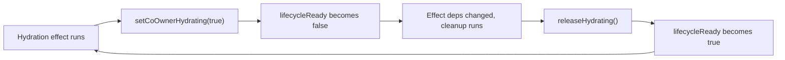

# Co-owner Forms: Gap Closure and Production Readiness

## Confirmation on the reported error

Yes, the plan fixes it, and it is Phase 0 because it currently breaks every co-owner form.

Root cause is a self-triggering effect, not a component-level mistake. In [frontend/src/hooks/use-coowner-draft-fields.ts](frontend/src/hooks/use-coowner-draft-fields.ts) the hydration effect lists `lifecycleReady` as a dependency and calls `setCoOwnerHydrating(true)` inside its body:

```
}, [draftKey, lifecycleReady, ownershipAnswer, refreshToken, setCoOwnerHydrating]);
```

In [frontend/src/providers/co-owner-draft-lifecycle-provider.tsx](frontend/src/providers/co-owner-draft-lifecycle-provider.tsx), `lifecycleReady` is derived as `!draftRestoring && !modalRestoring && !coOwnerHydrating`. So the effect consumes a value it also produces:



This fires only when `ownershipAnswer === "no"` with a draft key present, which is exactly the three reported surfaces (wizard step 4, add-video modal, community bank modal). It also issues an unbounded stream of `getVideoCoOwnerInviteStatusAction` calls, so it is a backend load problem as well as a UI crash. It is a regression from the earlier hydration-leak fix, which added `releaseHydrating()` to the cleanup and converted a stuck flag into an oscillation.

## Submit policy (confirmed with you)

Per co-owned video link:

- Approved invite present: video submits normally; stale expired/declined/revoked rows on the same draft key are ignored (auto-supersede).
- Pending invite present: submit stays blocked (host should wait or resend).
- No invite sent yet: submit stays blocked (host is mid-flow, nothing to drop).
- Only terminal invites (expired/declined/revoked), or an approved invite whose `youtubeLink` does not match the submitted URL: the video is dropped from the submission entirely.
- Hosts also get an explicit Remove control so they can clear stale rows instead of relying on the drop.

Single-video surfaces (add-video modal, community bank) cannot drop their only video, so they block with an actionable message instead.

---

## Phase 0: Stop the infinite loop (critical)

Split the one flag into two so no effect depends on its own output.

- [frontend/src/providers/co-owner-draft-lifecycle-provider.tsx](frontend/src/providers/co-owner-draft-lifecycle-provider.tsx): expose `restoreReady` (`!draftRestoring && !modalRestoring`) alongside the existing `lifecycleReady` (`restoreReady && !coOwnerHydrating`). Keep the fallback object for unwrapped consumers.
- [frontend/src/hooks/use-coowner-draft-fields.ts](frontend/src/hooks/use-coowner-draft-fields.ts): both the draft-key init effect and the hydration effect switch from `lifecycleReady` to `restoreReady`. `restoreReady` is unaffected by `setCoOwnerHydrating`, so the cycle is cut.
- Autosave consumers keep the full `lifecycleReady` so drafts still do not save mid-hydration: [frontend/src/components/events/add-video-form.tsx](frontend/src/components/events/add-video-form.tsx) (`AddVideoFormDraftLayer`) and [frontend/src/providers/wizard-draft-autosave-provider.tsx](frontend/src/providers/wizard-draft-autosave-provider.tsx).

Verification: a `renderHook` regression test asserting the invite-status action is called exactly once for a stable draft key, plus a manual check that `ownershipAnswer = "no"` on all three surfaces produces one network request.

While here, confirm the secondary suspect is benign: `useFormDraftAutosave` receives `form.watch()`, a fresh object each render, which resets the 1.5s debounce on every render. It does not loop on its own, but under a render storm autosave never fires. Stabilise by passing a serialised fingerprint as the effect dependency.

## Phase 1: Readiness rule and drop-on-submit

Backend, [backend/src/services/coOwner/event-create-coowner.util.ts](backend/src/services/coOwner/event-create-coowner.util.ts):

- Replace the throw-on-any-terminal-status block (currently lines 127-140) with a per-link classifier returning `ready`, `blocked` (pending or no invites), or `dropped` (terminal only, or approved-URL mismatch).
- Export `partitionVideoLinksByCoOwnerReadiness()` returning `{ accepted, dropped, blocked }`; keep a thin `assertVideoLinksCoOwnerForCreate` wrapper that throws only for `blocked`.
- Approved-wins: once an approved invite matching the submitted YouTube ID exists, ignore sibling terminal rows.

Call sites:

- [backend/src/controllers/event.controller.ts](backend/src/controllers/event.controller.ts) line ~290 (wizard, multi-video): drop the failing links before the transaction, call `revokeOrphanCoOwnerInvitesForDraft` for each dropped link, promote a new default if the dropped video was default, and return 400 only if every link is dropped.
- [backend/src/controllers/event.controller.ts](backend/src/controllers/event.controller.ts) line ~2348 (add-video modal, single link): a dropped link means an empty submission, so return 400 with a message naming the resend / remove / switch-to-full-ownership options.
- [backend/src/controllers/community-content-bank.controller.ts](backend/src/controllers/community-content-bank.controller.ts) line ~174: same single-link handling.

Both create responses gain an `excludedVideos: [{ title, reason }]` array.

Frontend:

- [frontend/src/lib/coowner-submit-readiness.util.ts](frontend/src/lib/coowner-submit-readiness.util.ts): approved short-circuits ahead of the terminal checks; terminal-only returns a new non-blocking `will_be_dropped` state; `has_revoked` stops being a hard block, aligning with the backend which never checked revoked.
- [frontend/src/hooks/use-coowner-draft-submit-blocked.ts](frontend/src/hooks/use-coowner-draft-submit-blocked.ts): return `warnings` alongside `blocked`/`reason`.
- Wizard step 4 and both modals render a pre-submit warning listing videos that will be excluded, and a post-submit toast built from `excludedVideos`, so the drop is never silent.

## Phase 2: Invite lifecycle correctness

[frontend/src/hooks/use-coowner-draft-fields.ts](frontend/src/hooks/use-coowner-draft-fields.ts):

- `activeInviteRow` currently returns the first row in `createdAt` order, so a stale declined invite masks a newer approved one. Change to priority order: approved, pending, expired, declined, revoked.
- The 409 `invite_resendable` handler uses `setActiveInvite(prev => prev ? { ...prev, id } : null)`, which leaves `activeInvite` null when there was no active row, rendering a Resend button that then errors "No invite to resend". Build a synthetic row from the response instead.
- `resendInvite` discards the response. Apply the returned `status`, `resentAt`, `resendCount`, and `expiresAt` to `activeInvite` so the cooldown timer and max-count guard actually engage; today a second click just earns a 429.

[backend/src/controllers/videoCoOwnerInvite.controller.ts](backend/src/controllers/videoCoOwnerInvite.controller.ts):

- `resendCoOwnerInviteCore` permits pending/expired/declined, but `createVideoCoOwnerInvite` advertises `invite_resendable` for revoked duplicates too, producing a guaranteed error loop. Add `revoked` to the resend allow-list. Because of `@@unique([draftKey, coOwnerEmail])` a revoked invite must be reactivated in place rather than recreated, so resend is the correct mechanism.
- The `P2002` catch returns `code: "invite_resendable"` with no `inviteId`, which the frontend branch requires. Look up the conflicting row and include its id.
- Call `triggerCoOwnerInviteStatus` after a successful resend, matching approve, decline, and revoke, so other surfaces refresh immediately rather than waiting up to 15s.

## Phase 3: Remove control

- [backend/src/controllers/videoCoOwnerInvite.controller.ts](backend/src/controllers/videoCoOwnerInvite.controller.ts) `revokeVideoCoOwnerInvite` currently rejects anything not pending. Widen to pending, expired, and declined so hosts can clear stale rows.
- Add `revokeVideoCoOwnerInviteAction` to [frontend/src/actions/events.ts](frontend/src/actions/events.ts); the endpoint at `coowner.route.ts:61` exists but has no caller today.
- Add a Remove button to [frontend/src/components/events/co-owner-invite-status-row.tsx](frontend/src/components/events/co-owner-invite-status-row.tsx), exposed through `useCoOwnerDraftFields`, with a confirmation for pending invites (that cancels a live invitation) and none for terminal ones. On success, clear the co-owner slice and refresh readiness.

## Phase 4: Tests

- Regression test for the Phase 0 loop (single status fetch per stable draft key).
- `coowner-submit-readiness.util.spec.ts`: approved plus declined is ready; terminal-only is `will_be_dropped`; pending still blocks.
- New backend spec for the readiness partition covering approved-wins, drop, all-dropped, and URL mismatch.
- Resend spec: revoked is now resendable, cooldown and max-count enforced, `inviteId` present on the P2002 path.
- Controller-level test that a dropped default video promotes a replacement.

## Phase 5: Documentation and re-certification

- The current [docs/PRODUCTION_READINESS_VIDEO_FORMS.md](docs/PRODUCTION_READINESS_VIDEO_FORMS.md) marks items 3, 4, and 11 as closed when they are not, and does not mention the render loop. Rewrite it against verified test output rather than intent.
- Update the product guide with the new submit policy, the drop behaviour, and the Remove control.
- `PRODUCT_GUIDE_VIDEO_FORMS.md` currently exists in both `docs/` and `product-behaviors/`. Keep the `product-behaviors/` copy to match the convention used by the payment-animation docs and delete the `docs/` duplicate.

---

## Does this get us production ready?

It closes every gap I have verified: the render loop, the two submit dead-ends, the missing revoke path, the four resend defects, the invite-priority bug, and the frontend/backend rule mismatch. Two caveats on certification:

- The `prisma migrate deploy` for `20260822100000_video_co_owner_invite_resend` still has to run in each environment; the code assumes those columns exist.
- I will only re-certify after the Phase 4 suites pass and the manual QA checklist is walked on staging. The previous report was written from intent rather than evidence, which is how these gaps survived.