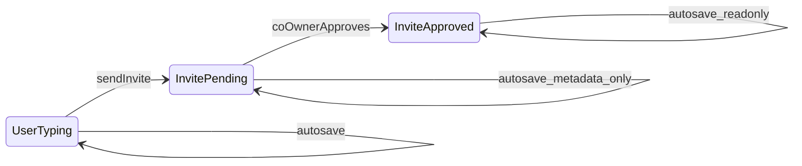
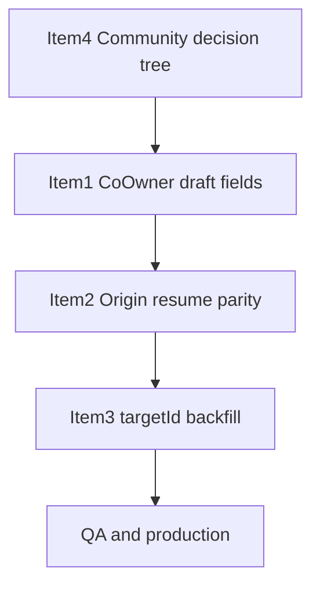

# Co-owner Draft Lifecycle — Final Implementation Plan

## Architecture validation summary

Reviewed against [`community-content-bank.controller.ts`](backend/src/controllers/community-content-bank.controller.ts), [`event-create-coowner.util.ts`](backend/src/services/coOwner/event-create-coowner.util.ts), [`youtube-verify.service.ts`](backend/src/services/coOwner/youtube-verify.service.ts), [`schema.prisma`](backend/prisma/schema.prisma) (`EventChannel`, `CommunityContentBankEntry.eventChannelId @unique`), and all modal/wizard submission paths.

**Key product constraints confirmed in code:**

- **Global co-owner rule:** one co-owner relationship per YouTube video system-wide ([`assertYoutubeVideoNotAlreadyCoOwned`](backend/src/services/coOwner/youtube-verify.service.ts):52-98). Fully-owned channels (no `videoCoOwners`) do **not** trigger this guard.
- **Community bank dedup:** rejects if URL already in any bank ([`:171-179`](backend/src/controllers/community-content-bank.controller.ts)).
- **EventChannel reuse:** same `eventId + url` reuses channel for bank entry ([`:182-190`](backend/src/controllers/community-content-bank.controller.ts)) — intentional for same-destination asset sharing, **not** for ownership conversion.
- **Other flows always create new channels:** event wizard ([`event.controller.ts:293`](backend/src/controllers/event.controller.ts)), add-event-channel ([`:2284`](backend/src/controllers/event.controller.ts)).

**Rejected approach:** mutating `ownershipAnswer` / `ownershipState` on an existing fully-owned `EventChannel` when a co-owned community submission reuses it. This contradicts confirmed product behavior.

**Revised Item 4:** explicit decision tree → reject, reuse unchanged, or create new + finalize — never generic ownership transition.

---

## Part A — Community content ownership decision tree

### Model mapping

| Concept | DB entity |
|---------|-----------|
| Event room / channel destination | `EventChannel` (per `eventId`) |
| Community bank destination | `CommunityContentBankEntry` → `eventChannelId` (1:1 unique) |
| Co-owner relationship | `VideoCoOwner` + `VideoCoOwnerInvite` (global per YouTube video) |

### Pre-transaction guards (all community bank submits)

1. **`existingEntry`** by URL globally → **reject** (409: already in a bank) — unchanged.
2. **`assertVideoLinksCoOwnerForCreate`** when `ownershipAnswer === "no"` → validates invites + calls **`assertYoutubeVideoNotAlreadyCoOwned`** (global co-owner rule + same-lineage retry bypass).
3. **New helper:** `assertCommunityBankChannelCompatible(existingChannel, submitOwnership, coOwnerDraftKey, hostId)` — see tree below.

### Decision tree

**Inputs:** `submitOwnership` (`yes`|`no`), `existingChannel` (nullable, with `ownershipAnswer`, `videoCoOwners[]`, `coOwnerDraftKey`, `communityBankEntry`), `coOwnerDraftKey`, `hostId`, global guard result (already passed).

```
IF existingEntry for URL → REJECT (unchanged)

IF submitOwnership === "no" (co-owned):
  IF global assertYoutubeVideoNotAlreadyCoOwned failed → REJECT (already handled pre-tx)

  IF existingChannel IS NULL:
    → CREATE new EventChannel + finalizeCoOwnersForNewChannel + CREATE bank entry

  IF existingChannel.communityBankEntry EXISTS:
    → REJECT (should be caught by existingEntry; defense in depth)

  IF existingChannel.videoCoOwners.length === 0:
    → REJECT 409
       "This video is already on your event as fully-owned content.
        Co-owned community submissions cannot convert an existing record.
        Use a different destination flow or contact support."
       (leave existing record unchanged)

  IF existingChannel.videoCoOwners.length > 0:
    IF lineage matches submit coOwnerDraftKey (same draftKey + approved invites):
      → REUSE channel + finalizeCoOwnersForNewChannel (idempotent) + CREATE bank entry
    ELSE:
      → REJECT (global guard should have caught; defense in depth)

IF submitOwnership === "yes" (fully-owned):
  IF existingChannel IS NULL:
    → CREATE new EventChannel (no finalize) + CREATE bank entry

  IF existingChannel IS NULL is false:
    → REUSE existing EventChannel unchanged + CREATE bank entry
    (no finalize; co-owner rows untouched if any exist — should not happen for yes submit)
```

### Outcome matrix

| Existing URL state | Submit | VideoCoOwner | Payout | Outcome |
|------------------|--------|--------------|--------|---------|
| No channel on event | co-owned | — | — | **Create channel + co-owner records + bank entry** |
| No channel on event | fully-owned | — | — | **Create channel (no co-owner) + bank entry** |
| Fully-owned channel, no co-owners | co-owned | none | — | **Reject** (no mutation) |
| Fully-owned channel | fully-owned | none | — | **Reuse channel + bank entry** |
| Co-owned channel, same draft lineage | co-owned | exists | none | **Reuse channel + idempotent finalize + bank entry** |
| Co-owned channel, same draft, payouts exist | co-owned | exists | yes | **Reject** via finalize 409 (payout integrity) |
| Any channel, co-owners elsewhere (global) | co-owned | other lineage | any | **Reject** via `assertYoutubeVideoNotAlreadyCoOwned` |
| URL in any bank | any | any | — | **Reject** via `existingEntry` |

### Ownership transition policy

**Not allowed:** yes → no on the same `EventChannel` record via community bank (or any flow). No field mutation on existing records for ownership conversion.

**If product later needs conversion:** would require an explicit admin/host action creating a **new** content record — out of scope here.

### Item 4 implementation (revised)

| File | Change |
|------|--------|
| **New** [`backend/src/services/coOwner/community-bank-channel.util.ts`](backend/src/services/coOwner/community-bank-channel.util.ts) | `resolveCommunityBankChannelAction()` implementing tree; unit-tested |
| [`backend/src/controllers/community-content-bank.controller.ts`](backend/src/controllers/community-content-bank.controller.ts) | Replace naive `if (existingChannel)` branch; load channel with `videoCoOwners`, `communityBankEntry`, `ownershipAnswer` |
| [`backend/src/services/coOwner/event-create-coowner.util.ts`](backend/src/services/coOwner/event-create-coowner.util.ts) | No reconcile/mutate helper |

**Transaction impact:** one extra `findFirst` with includes inside existing `$transaction`; no schema change.

---

## Part B — Ownership draft data structure (Item 1 revised)

### Recommended structure (grouped under ownership policy)

**Wizard** — per video link index in `policyJson.videoLinks[]`:

```typescript
type CoOwnerDraftSlice = {
  name?: string;
  email?: string;
  payoutPercent?: number; // 1–100 integer
};

type VideoPolicySlice = {
  ownershipAnswer?: "yes" | "no";
  coOwnerDraftKey?: string;
  onYoutubeChannelSlot?: number | null;
  isOnHostYoutube?: boolean;
  coOwner?: CoOwnerDraftSlice;
};
```

**Modal** — in `policyJson.modal`:

```typescript
modal: {
  ownershipAnswer?: "yes" | "no";
  coOwnerDraftKey?: string;
  hostYoutubeSlot?: "none" | "1" | "2";
  targetId?: string;
  origin?: DraftResumeOrigin;
  coOwner?: CoOwnerDraftSlice;
  recoverable?: boolean; // Item 3
}
```

### Why nested `coOwner` (not flat on `videoLinks` root)

- Groups all ownership-policy fields together — matches your preferred model.
- Wizard multi-video: array index alignment already exists for `videoLinks` policy slices ([`form-draft-utils.ts:47-62`](frontend/src/lib/form-draft-utils.ts)).
- Modal: single `modal.coOwner` block.
- **Backward compatible:** existing drafts lack `coOwner`; merge treats missing as empty; no migration.

### Form binding (react-hook-form)

Mirror policy in form for autosave via `form.watch()`:

- Wizard: `videoLinks[i].coOwner.name`, `.email`, `.payoutPercent` (extend [`newEventSchema`](frontend/src/schemas/index.ts) with optional nested `coOwner` object).
- Modal: top-level `coOwner: { name, email, payoutPercent }` on [`AddVideoFormValues`](frontend/src/components/events/add-video-form.tsx).

Policy fields stay out of `payloadJson` (existing split/merge pattern). `stripVideoLinkPolicy` extended to strip nested `coOwner`.

### Why form + policy (not policy-only)

- Step navigation remounts `CoOwnerInviteBlock`; form state survives via draft autosave + restore.
- `useFormDraftAutosave(form.watch())` already runs on wizard pages and modal — no new persistence mechanism.

---

## Part C — Draft source-of-truth lifecycle



### Stage 1 — User typing (no invite sent)

| Aspect | Rule |
|--------|------|
| **Source of truth** | react-hook-form fields (`coOwner.*`) |
| **Persistence** | Debounced autosave → `policyJson` via split helpers |
| **Restore** | `mergeDraftPayload` / `mergeModalDraftPayload` → `form.reset` |
| **Editable** | Yes — all co-owner fields |

### Stage 2 — Invite sent, pending

| Aspect | Rule |
|--------|------|
| **Source of truth** | **`VideoCoOwnerInvite` row** (server) |
| **Persistence** | Draft still autosaves metadata (title, url, ownershipAnswer, coOwnerDraftKey); co-owner contact fields **frozen in UI** |
| **Restore** | On mount: fetch status by `coOwnerDraftKey` → if pending, populate from server, set `readOnlyInvite=true` |
| **Merge priority** | Server invite **wins** over draft `coOwner` slice for name/email/payoutPercent |
| **Editable** | No — send-invite button hidden; fields read-only ([existing pattern](frontend/src/components/events/event-content-privacy-step.tsx:530-533)) |

### Stage 3 — Invite approved

| Aspect | Rule |
|--------|------|
| **Source of truth** | **Approved `VideoCoOwnerInvite`** (authoritative for submit + display) |
| **Immutable fields** | name, email, payoutPercent, draftKey (cannot re-send duplicate) |
| **Restore** | Server hydration on mount + submit-gating hook (`useCoOwnerDraftSubmitBlocked`) |
| **Merge priority** | Server **always wins**; draft `coOwner` values ignored when invite is approved/pending |
| **Autosave** | May persist other form fields; co-owner contact fields not written over server values on restore |

### Stage 4 — Resume draft after approval

| Aspect | Rule |
|--------|------|
| **Sequence** | 1) `form.reset(merged)` from draft 2) `useCoOwnerDraftFields` fetches invite status 3) if approved/pending → overwrite co-owner fields from server, lock UI |
| **Stale draft prevention** | Hydration hook runs **after** reset; server branch takes precedence — approved values cannot be clobbered by older draft JSON |
| **Submit gating** | `evaluateCoOwnerSubmitReadiness` + backend `assertVideoLinksCoOwnerForCreate` unchanged |

**Shared hook:** `useCoOwnerDraftFields({ draftKey, formPaths, onDraftSaveNow })` used by [`CoOwnerInviteBlock`](frontend/src/components/events/event-content-privacy-step.tsx) and [`AddVideoPolicyFields`](frontend/src/components/events/add-video-policy-fields.tsx).

---

## Part D — CreateDialog resume architecture

### CreateDialog inventory (grep evidence)

**Import + render locations (14 surfaces + 1 definition):**

| # | File | Line | Context |
|---|------|------|---------|
| 1 | [`new-hero-client.tsx`](frontend/src/components/home/new-hero-client.tsx) | 17, 264 | Home hero |
| 2 | [`explore-page-client.tsx`](frontend/src/components/explore/explore-page-client.tsx) | 166-167, 1502 | Explore (dynamic import) |
| 3 | [`explore-feed-client.tsx`](frontend/src/components/explore/explore-feed-client.tsx) | 97, 2311 | Explore feed |
| 4 | [`navbar-client.tsx`](frontend/src/components/shared/navbar-client.tsx) | 23, 134 | Global navbar |
| 5 | [`footer.tsx`](frontend/src/components/shared/footer.tsx) | 21, 165 | Site footer |
| 6 | [`pricing-grid.tsx`](frontend/src/components/home/pricing-grid.tsx) | 8, 178 | Pricing |
| 7 | [`features.tsx`](frontend/src/components/home/features.tsx) | 25, 89 | Features |
| 8 | [`tv-navbar.tsx`](frontend/src/components/tv/tv-navbar.tsx) | 12, 192 | TV navbar |
| 9 | [`tv-footer.tsx`](frontend/src/components/tv/tv-footer.tsx) | 5, 53 | TV footer |
| 10 | [`tv-express-buttons.tsx`](frontend/src/components/tv/tv-express-buttons.tsx) | 12, 155 | TV express |
| 11 | [`content-client.tsx`](frontend/src/components/events/content-client.tsx) | 60, 1796 | Content room page |
| 12 | [`channel-client.tsx`](frontend/src/components/events/channel-client.tsx) | 62, 1802 | Channel room page |
| 13 | [`dashboard-client.tsx`](frontend/src/components/dashboard/dashboard-client.tsx) | 31, 186 | Host dashboard |
| 14 | [`manage-event/page.tsx`](frontend/src/app/(dashboard)/host/[slug]/manage-event/page.tsx) | 13, 40 | Manage event |
| — | [`create-dialog.tsx`](frontend/src/components/home/create-dialog.tsx) | 86 | Component definition |

### Current resume entry points

| Entry | File | Behavior |
|-------|------|----------|
| Wizard drafts | [`form-drafts-panel.tsx:101-104`](frontend/src/components/dashboard/form-drafts-panel.tsx) | Link to `/event-only?draftId=` etc. |
| Modal drafts | [`form-drafts-panel.tsx:40-64`](frontend/src/components/dashboard/form-drafts-panel.tsx) | Routes **only** to host-community or room — **never** create-dialog |
| Room modal resume | [`content-room-settings.tsx:53,152`](frontend/src/components/events/content-room-settings.tsx) | `?modalDraftId=` → `EventChannelModal` |
| Community resume | [`host-community-client.tsx:658-667`](frontend/src/components/dashboard/host-community-client.tsx) | `?modalDraftId=` → add-video dialog |

### Origin metadata model

```typescript
type DraftResumeOrigin = {
  surface:
    | "create_dialog"
    | "host_community"
    | "event_channel_modal"
    | "content_room_settings";
  pathname: string;        // window.location.pathname at last autosave
  hostTab?: "event" | "owner" | "cocreator"; // create_dialog only
  targetId: string;        // communityId or eventId
};
```

Persisted in `policyJson.modal.origin` on every modal autosave ([`use-form-draft-autosave.ts`](frontend/src/hooks/use-form-draft-autosave.ts)).

### Resume routing (form-drafts-panel)

| `origin.surface` | Action |
|------------------|--------|
| `create_dialog` | `router.push(`${origin.pathname}?resumeCreateVideo=1&modalDraftId=…&targetId=…&hostTab=…&draftKind=…`)` |
| `host_community` | `/host/{slug}/host-community?communityId=…&modalDraftId=…` |
| `event_channel_modal` | `/room/{eventId}?openAddVideo=1&modalDraftId=…` |
| `content_room_settings` | Same room URL (settings modal hosts `EventChannelModal`) |
| Legacy (no origin) + `targetId` | Fallback: infer surface from `draftKind` only if **unambiguous**; else unrecoverable |
| Legacy, no `targetId` | Unrecoverable (Item 3) |

### Shared resume hook

**New** [`frontend/src/hooks/use-create-dialog-resume.ts`](frontend/src/hooks/use-create-dialog-resume.ts):

- Reads `resumeCreateVideo`, `modalDraftId`, `targetId`, `hostTab`, `draftKind` from URL.
- Called at **every CreateDialog mount point** (14 files above) OR via a thin wrapper `<CreateDialogWithResume />` to avoid 14 copy-paste integrations (preferred).

**Guarantee:** Draft saved from create-dialog on `/explore` resumes on `/explore` (pathname stored in origin), not dashboard.

### Surface → autosave origin wiring

| Parent | `surface` |
|--------|-----------|
| [`create-dialog.tsx`](frontend/src/components/home/create-dialog.tsx) | `create_dialog` |
| [`host-community-client.tsx`](frontend/src/components/dashboard/host-community-client.tsx) | `host_community` |
| [`event-channel-modal.tsx`](frontend/src/components/events/event-channel-modal.tsx) | `event_channel_modal` |
| [`content-room-settings.tsx`](frontend/src/components/events/content-room-settings.tsx) | `content_room_settings` |

---

## Part E — Legacy targetId backfill (Item 3)

### Principles

- **Never guess** when multiple candidates exist.
- **Never attach** draft to wrong destination.
- Default mode: **dry-run**.

### Inference rules (strict)

| Rule | Required data | Confidence | `targetId` | Draft kinds | On failure |
|------|---------------|------------|------------|-------------|------------|
| **R0 Skip** | `policyJson.modal.targetId` present | — | — | both | skip |
| **R1 Invite-linked channel** | `modal.coOwnerDraftKey` → `VideoCoOwnerInvite` with **non-null** `eventChannelId` → channel → event | **High** | `room_add_video`: `event.id`; `community_video`: `event.communityId` (must be non-null) | both | unrecoverable if communityId null |
| **R2 Unique URL channel** | `payloadJson.url` + `draft.hostId` → exactly **one** `EventChannel` where `event.hostId = hostId` and normalized URL match | **High** | per kind as R1 | both | unrecoverable if 0 or >1 matches |
| **R3 Unrecoverable** | Anything else: missing URL, multiple matches, no invite channel, ambiguous community | — | — | both | set `modal.recoverable = false` |

**Explicitly excluded (never use):**

- Draft title matching community name
- Host's only community / only event heuristics
- Single-community-without-URL inference
- Cross-host data

### Script

**New** [`backend/src/scripts/backfill-form-draft-modal-target.ts`](backend/src/scripts/backfill-form-draft-modal-target.ts)

- Flags: `--dry-run` (default), `--apply`, `--limit N`
- Output: JSONL audit + console table (`draftId`, `kind`, `rule`, `targetId`, `action`, `reason`)
- **Rollback:** companion script reads audit JSONL, restores prior `policyJson` snapshots

### UI for unrecoverable drafts

[`form-drafts-panel.tsx`](frontend/src/components/dashboard/form-drafts-panel.tsx):

- If `recoverable === false` OR resume fails (no `targetId` + no origin): **disabled Resume** button + tooltip: *"This draft can't be reopened automatically. Delete it or start a new video."*
- Toast on click attempt for legacy drafts without silent return ([current `:47-48`](frontend/src/components/dashboard/form-drafts-panel.tsx))

---

## Part F — Final implementation sequence



| Order | Item | Depends on | Deploy |
|-------|------|------------|--------|
| **1** | Item 4 — community channel decision tree | — | Backend only |
| **2** | Item 1 — pre-invite co-owner in policy + hydration hook | — | Frontend |
| **3** | Item 2 — origin metadata + CreateDialog resume | Item 1 (coOwner in policy) | Frontend |
| **4** | Item 3 — backfill script dry-run → apply | Item 2 deployed (new drafts self-sufficient) | Backend script + frontend unrecoverable UX |

### Migration requirements

**None.** All changes use existing `FormDraft.policyJson` JSON and backend service logic.

### Files affected (consolidated)

**Backend:** `community-bank-channel.util.ts` (new), `community-content-bank.controller.ts`, `backfill-form-draft-modal-target.ts` (new), tests.

**Frontend:** `form-draft-utils.ts`, `use-form-draft-autosave.ts`, `use-coowner-draft-fields.ts` (new), `event-content-privacy-step.tsx`, `add-video-policy-fields.tsx`, `add-video-form.tsx`, `schemas/index.ts`, `form-drafts-panel.tsx`, `create-dialog.tsx`, `CreateDialogWithResume` wrapper (new), `host-community-client.tsx`, `event-channel-modal.tsx`, `content-room-settings.tsx`, tests.

### Testing strategy

| Area | Tests |
|------|-------|
| Item 4 | Unit: all decision-tree branches A/B/C + reject fully-owned→co-owned; integration: bank entry + co-owner rows atomic |
| Item 1 | Policy round-trip with nested `coOwner`; hydration server-wins vs draft-wins |
| Item 2 | Pure: resume URL builder per surface; integration: create-dialog pathname preserved |
| Item 3 | Unit: inference rules with mocked Prisma; zero ambiguous cases apply |

### Manual QA (critical paths)

1. **Community co-owned, URL already fully-owned on event** → clear 409, existing channel unchanged.
2. **Community co-owned, new URL** → channel + co-owner + bank entry created.
3. **Community co-owned retry same draft (orphan channel with co-owners)** → reuse + bank entry.
4. **Pre-invite wizard:** type co-owner details, leave step 4, return → fields restored from draft.
5. **After approval:** resume wizard/modal → read-only co-owner, submit enabled.
6. **Create-dialog on explore:** save draft → Resume from dashboard → explore create-dialog reopens (not host-community).
7. **Host-community modal draft** → Resume opens host-community (not create-dialog).
8. **Legacy draft without targetId** → backfill dry-run → apply OR unrecoverable message.

### Production risks

| Risk | Mitigation |
|------|------------|
| Co-owned community submit wrongly rejected for valid reuse | Tree allows reuse only when co-owners already exist + lineage match |
| CreateDialog resume missed on one mount point | Single `CreateDialogWithResume` wrapper; grep audit in PR |
| Backfill attaches wrong target | R1/R2 require uniqueness; else unrecoverable |
| Stale draft overwrites approved invite | Server-wins hydration after reset |
| Global co-owner rule regression | Existing `assertYoutubeVideoNotAlreadyCoOwned` unchanged; add community-specific assert only |

### Post-remediation approval criteria

Deploy when: Item 4 shipped + Items 1–2 shipped + Item 3 dry-run reviewed + manual QA pass + full CI green.

**Confidence after completion:** 92%.
