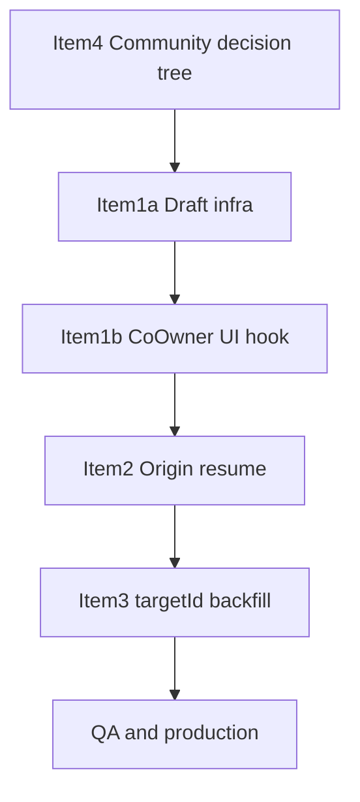

# Co-owner Draft Lifecycle — Updated Implementation Plan (v2)

Incorporates architecture validation + pre-implementation review. **No Prisma migration** — uses existing `FormDraft.policyJson` JSON and backend service logic.

---

## Guiding principles

- **Never mutate** `ownershipAnswer` / co-owner fields on an existing fully-owned `EventChannel`.
- **Create another content record** when a co-owned community bank submit targets a URL that already exists as fully-owned on the same event (new `EventChannel` row + `finalizeCoOwnersForNewChannel` + new `CommunityContentBankEntry`).
- **Stable `coOwnerDraftKey`** — invite correlation must survive restore; no remint during restore/hydration.
- **Server-wins** for co-owner contact fields when invite is pending/approved.
- **YouTube verification and payment flows unchanged.**

---

## Sequencing



| Order | Item    | Deploy surface       | Depends on                          |
| ----- | ------- | -------------------- | ----------------------------------- |
| 1     | Item 4  | Backend only         | —                                   |
| 2     | Item 1a | Frontend             | — (can ship after Item 4)           |
| 3     | Item 1b | Frontend             | Item 1a                             |
| 4     | Item 2  | Frontend             | Item 1a (`coOwner` in policy)       |
| 5     | Item 3  | Script + frontend UX | Item 2 (new drafts self-sufficient) |
| 6     | QA      | Staging → production | All                                 |

Each item is **independently revertible** via deploy rollback (no DB migrations).

---

## Item 4 — Community bank channel decision tree

### Problem (current code)

[`community-content-bank.controller.ts:189-190`](backend/src/controllers/community-content-bank.controller.ts) reuses `existingChannel` and **skips** `finalizeCoOwnersForNewChannel` when the URL already exists on the event — co-owned bank submits silently attach to a fully-owned channel with no co-owner rows.

### Product rules (validated)

| Rule                                              | Implementation                                                                                                       |
| ------------------------------------------------- | -------------------------------------------------------------------------------------------------------------------- |
| Banks reference `EventChannel` rows               | `CommunityContentBankEntry.eventChannelId` (1:1 unique)                                                              |
| No ownership mutation on existing records         | Never update `ownershipAnswer` on existing channel                                                                   |
| Co-owned bank on URL already fully-owned on event | **Create new `EventChannel`** + finalize + bank entry                                                                |
| Global one co-owner per YouTube video             | Existing [`assertYoutubeVideoNotAlreadyCoOwned`](backend/src/services/coOwner/youtube-verify.service.ts) (unchanged) |
| URL already in any bank                           | Reject (unchanged, `:171-179`)                                                                                       |

### Revised decision tree

```
IF existingEntry for URL → REJECT 409 (unchanged)

IF submitOwnership === "no" (co-owned):
  IF existingChannel IS NULL:
    → CREATE EventChannel + finalizeCoOwnersForNewChannel + CREATE bank entry

  IF existingChannel.videoCoOwners.length > 0:
    IF lineage matches coOwnerDraftKey (same draftKey + approved invites):
      → REUSE channel + finalizeCoOwnersForNewChannel (idempotent) + CREATE bank entry
    ELSE:
      → REJECT (assertYoutubeVideoNotAlreadyCoOwned / defense in depth)

  IF existingChannel.videoCoOwners.length === 0 (fully-owned):
    → CREATE NEW EventChannel (same eventId + url, new row)
       + finalizeCoOwnersForNewChannel + CREATE bank entry
    (existing fully-owned channel untouched)

IF submitOwnership === "yes" (fully-owned):
  IF existingChannel IS NULL:
    → CREATE EventChannel (no finalize) + CREATE bank entry
  ELSE:
    → REUSE existing EventChannel unchanged + CREATE bank entry
```

**Note:** Duplicate URL rows on one event are allowed (no `(eventId, url)` unique constraint). Community flow must **not** use blind `findFirst` reuse for co-owned submits when the matched row is fully-owned.

### Files

| File                                                                                                                                 | Change                                                                                                                               |
| ------------------------------------------------------------------------------------------------------------------------------------ | ------------------------------------------------------------------------------------------------------------------------------------ |
| **New** [`backend/src/services/coOwner/community-bank-channel.util.ts`](backend/src/services/coOwner/community-bank-channel.util.ts) | `resolveCommunityBankChannelAction()` — tree above; returns `{ action: 'create' \| 'reuse', channelId? }` or throws                  |
| [`backend/src/controllers/community-content-bank.controller.ts`](backend/src/controllers/community-content-bank.controller.ts)       | Replace `if (existingChannel)` branch; load channel with `videoCoOwners`, `communityBankEntry`, `ownershipAnswer`, `coOwnerDraftKey` |
| [`backend/src/utils/coowner-form-error.util.ts`](backend/src/utils/coowner-form-error.util.ts)                                       | Map any new 409 messages if community add uses field errors                                                                          |

**No** reconcile/mutate helper in [`event-create-coowner.util.ts`](backend/src/services/coOwner/event-create-coowner.util.ts).

### Outcome matrix (updated)

| Existing URL on event        | Submit      | Outcome                                                                 |
| ---------------------------- | ----------- | ----------------------------------------------------------------------- |
| None                         | co-owned    | Create channel + co-owners + bank entry                                 |
| None                         | fully-owned | Create channel + bank entry                                             |
| Fully-owned, no co-owners    | co-owned    | **Create new channel** + co-owners + bank entry (old channel unchanged) |
| Fully-owned                  | fully-owned | Reuse channel + bank entry                                              |
| Co-owned, same draft lineage | co-owned    | Reuse + idempotent finalize + bank entry                                |
| Co-owned, payouts exist      | co-owned    | Reject via finalize 409                                                 |
| URL in any bank              | any         | Reject                                                                  |

### Rollback

Revert controller + util deploy. No schema/data migration to undo.

---

## Item 1a — Draft infrastructure (schema, split/merge, lifecycle gates)

### Policy structure

**Wizard** — `policyJson.videoLinks[i]`:

```typescript
type CoOwnerDraftSlice = {
  name?: string;
  email?: string;
  payoutPercent?: number;
};
type VideoPolicySlice = {
  ownershipAnswer?: "yes" | "no";
  coOwnerDraftKey?: string;
  onYoutubeChannelSlot?: number | null;
  isOnHostYoutube?: boolean;
  coOwner?: CoOwnerDraftSlice;
};
```

**Modal** — `policyJson.modal.coOwner` + existing fields (`targetId`, later `origin` in Item 2).

### Form schema

Extend [`frontend/src/schemas/index.ts`](frontend/src/schemas/index.ts) — optional nested `videoLinks[].coOwner`.

Extend [`AddVideoFormValues`](frontend/src/components/events/add-video-form.tsx) — top-level `coOwner?: CoOwnerDraftSlice`.

### Split/merge

Update [`frontend/src/lib/form-draft-utils.ts`](frontend/src/lib/form-draft-utils.ts):

- Include `coOwner` in policy slice on split.
- Merge `coOwner` on restore (backward compatible — missing = empty).
- Extend `stripVideoLinkPolicy` / modal strip to exclude nested `coOwner`.
- **`resolveCoOwnerDraftKey`:** never mint during merge if policy explicitly stores a key; add `mergeCoOwnerDraftKeyFromPolicy()` used only after server confirms no active invite on a different key.

### Lifecycle gates (critical — closes architecture gaps)

**1. Autosave suppression**

In wizard pages ([`event-only/page.tsx`](<frontend/src/app/(event)/event-only/page.tsx>), `content-only`, `event-and-content`) and [`AddVideoForm`](frontend/src/components/events/add-video-form.tsx):

```typescript
enabled: userIsHost && !draftRestoring && !coOwnerHydrating;
```

Pass `coOwnerHydrating` from shared hook (Item 1b) or a lightweight `useDraftLifecycleReady()` in 1a.

**2. Defer key mint**

Guard existing mint effects:

- [`event-content-privacy-step.tsx:84-91`](frontend/src/components/events/event-content-privacy-step.tsx)
- [`add-video-policy-fields.tsx:79-84`](frontend/src/components/events/add-video-policy-fields.tsx)

Only mint when `draftLifecycleReady === true` (restore + hydration complete).

**3. Modal restore**

[`use-modal-form-draft-restore.ts`](frontend/src/hooks/use-modal-form-draft-restore.ts) — expose `restoring` flag; wire to autosave gate in `AddVideoForm`.

### Tests (Item 1a)

- Policy round-trip with nested `coOwner` (wizard + modal).
- Backward compat: drafts without `coOwner`.
- Merge preserves `coOwnerDraftKey` from policy (no remint).
- Autosave disabled while `restoring === true` (unit/integration).

### Rollback

Revert frontend; old merge ignores unknown `coOwner` keys safely.

---

## Item 1b — `useCoOwnerDraftFields` + component wiring

### New hook: [`frontend/src/hooks/use-coowner-draft-fields.ts`](frontend/src/hooks/use-coowner-draft-fields.ts)

**Inputs:** `draftKey`, form paths (wizard index or modal top-level), `onCoOwnerInvitePending`, `onDraftSaveNow`, `onRefreshSubmitReadiness`.

**Behavior:**

| Phase    | Source of truth               | UI        |
| -------- | ----------------------------- | --------- |
| Typing   | RHF `coOwner.*`               | Editable  |
| Pending  | `VideoCoOwnerInvite` (server) | Read-only |
| Approved | Approved invite (server)      | Read-only |

**On mount (after form reset):**

1. Fetch `getVideoCoOwnerInviteStatusAction(draftKey)`.
2. If any invite `pending` or `approved` → populate `coOwner.*` from server, set `readOnlyInvite = true`, set `coOwnerHydrating = false`.
3. Else merge draft `coOwner` slice into form.

**Invite lock (fixes duplicate-send bug):**

- `readOnlyInvite` from **any** pending/approved invite on `draftKey` — **not** email-gated [`useCoOwnerInviteStatus`](frontend/src/hooks/use-coowner-invite-status.ts) alone.
- Keep `useCoOwnerInviteStatus` only for status indicator styling if needed.

**On successful `createVideoCoOwnerInviteAction`:**

1. `setReadOnlyInvite(true)` immediately (optimistic).
2. `onCoOwnerInvitePending(invite.id)` (Pusher subscription).
3. `onRefreshSubmitReadiness()` → `refreshCoOwnerSubmit()`.
4. `onDraftSaveNow()`.

**Outputs:** `{ readOnlyInvite, sendInvite, fieldErrors, coOwnerHydrating, invitePhase }`.

### Wire into

- [`CoOwnerInviteBlock`](frontend/src/components/events/event-content-privacy-step.tsx) — replace local `useState` for name/email/pct; bind to RHF `videoLinks[i].coOwner.*`.
- [`AddVideoPolicyFields`](frontend/src/components/events/add-video-policy-fields.tsx) — same pattern for modal.
- Wizard pages — pass `refreshCoOwnerSubmit` into hook via `EventContentPrivacyStep` props.
- [`add-video-form.tsx`](frontend/src/components/events/add-video-form.tsx) — pass `refreshCoOwnerSubmit` into `AddVideoPolicyFields`.

### Fixes closed by Item 1a+1b

| Bug                                  | Mechanism                                                    |
| ------------------------------------ | ------------------------------------------------------------ |
| Co-owner details lost on step change | RHF + policy autosave                                        |
| Default video error after approval   | Stable `coOwnerDraftKey` + server fetch sees approved invite |
| Duplicate invite after resume        | draftKey-level lock + immediate post-send lock               |
| Draft/autosave race                  | Autosave gate + hydration after reset                        |
| Submit before approval               | Existing hook + refresh on send                              |

### Non-goals

- Do **not** change [`evaluateCoOwnerSubmitReadiness`](frontend/src/lib/coowner-submit-readiness.util.ts) rules.
- Do **not** change YouTube verify paths.

### Tests (Item 1b)

- Hook: server-wins over stale draft; draftKey-only lock without email; post-send lock.
- Integration: restore → hydrate → autosave does not overwrite approved fields.
- Regression: `validateCoOwnerDraftsForSubmit` with `isDefault: true` + approved invite → null error.

### Rollback

Revert hook + component wiring; Item 1a infra remains harmless.

---

## Item 2 — Origin-aware CreateDialog resume

### Origin model

```typescript
type DraftResumeOrigin = {
  surface:
    | "create_dialog"
    | "host_community"
    | "event_channel_modal"
    | "content_room_settings";
  pathname: string;
  hostTab?: "event" | "owner" | "cocreator";
  targetId: string;
};
```

Persist in `policyJson.modal.origin` on modal autosave — update [`use-form-draft-autosave.ts`](frontend/src/hooks/use-form-draft-autosave.ts) (capture `pathname` client-side only).

### Surface wiring

| Parent                                                                                     | `surface`               |
| ------------------------------------------------------------------------------------------ | ----------------------- |
| [`create-dialog.tsx`](frontend/src/components/home/create-dialog.tsx)                      | `create_dialog`         |
| [`host-community-client.tsx`](frontend/src/components/dashboard/host-community-client.tsx) | `host_community`        |
| [`event-channel-modal.tsx`](frontend/src/components/events/event-channel-modal.tsx)        | `event_channel_modal`   |
| [`content-room-settings.tsx`](frontend/src/components/events/content-room-settings.tsx)    | `content_room_settings` |

### Resume routing — [`form-drafts-panel.tsx`](frontend/src/components/dashboard/form-drafts-panel.tsx)

| `origin.surface`                                | Route                                                                                          |
| ----------------------------------------------- | ---------------------------------------------------------------------------------------------- |
| `create_dialog`                                 | `` `${origin.pathname}?resumeCreateVideo=1&modalDraftId=…&targetId=…&hostTab=…&draftKind=…` `` |
| `host_community`                                | `/host/{slug}/host-community?communityId=…&modalDraftId=…`                                     |
| `event_channel_modal` / `content_room_settings` | `/room/{eventId}?openAddVideo=1&modalDraftId=…`                                                |
| Legacy + `targetId` only                        | Infer from `draftKind` if unambiguous                                                          |
| Legacy, no `targetId`, no `origin`              | **Unrecoverable UX** (see below)                                                               |

**Fix silent failure:** replace [`form-drafts-panel.tsx:48`](frontend/src/components/dashboard/form-drafts-panel.tsx) `if (!targetId) return` with disabled Resume + tooltip.

### New files

- [`frontend/src/hooks/use-create-dialog-resume.ts`](frontend/src/hooks/use-create-dialog-resume.ts) — read URL params, open dialog, restore draft, **clear query params** after open.
- [`frontend/src/components/home/create-dialog-with-resume.tsx`](frontend/src/components/home/create-dialog-with-resume.tsx) — thin wrapper for **14 mount points** (grep audit in PR).

### CreateDialog inventory (14 surfaces)

`new-hero-client`, `explore-page-client`, `explore-feed-client`, `navbar-client`, `footer`, `pricing-grid`, `features`, `tv-navbar`, `tv-footer`, `tv-express-buttons`, `content-client`, `channel-client`, `dashboard-client`, `manage-event/page`.

### Tests

- Pure: resume URL builder per surface.
- Integration: pathname preserved explore → dashboard Resume → explore.
- Regression: host-community and room modal resume unchanged.

### Rollback

Revert wrapper/hook; legacy `targetId`-only routing still works.

---

## Item 3 — Legacy `targetId` backfill

### Script

**New** [`backend/src/scripts/backfill-form-draft-modal-target.ts`](backend/src/scripts/backfill-form-draft-modal-target.ts)

| Rule | Condition                                                          | Action                           |
| ---- | ------------------------------------------------------------------ | -------------------------------- |
| R0   | `modal.targetId` present                                           | Skip                             |
| R1   | `coOwnerDraftKey` → invite with **non-null** `eventChannelId`      | Set `targetId` (high confidence) |
| R2   | `payloadJson.url` + `hostId` → exactly one matching `EventChannel` | Set `targetId`                   |
| R3   | Ambiguous / missing                                                | Set `modal.recoverable = false`  |

**R1 limitation (document in runbook):** draft-phase invites often have `eventChannelId = null` ([`VideoCoOwnerInvite.eventChannelId`](backend/prisma/schema.prisma) optional). Expect **many** drafts to fall through to R2 or R3 — not a script bug.

**Never use:** title matching, single-community heuristics, cross-host data.

Flags: `--dry-run` (default), `--apply`, `--limit N`. Output JSONL audit. Companion rollback script restores `policyJson` snapshots.

### UI

[`form-drafts-panel.tsx`](frontend/src/components/dashboard/form-drafts-panel.tsx): disabled Resume + tooltip when `recoverable === false` or resume preflight fails.

### Rollback

Run rollback script from audit JSONL.

---

## Migration and contract changes

| Area                   | Change                                                  |
| ---------------------- | ------------------------------------------------------- |
| Prisma schema          | **None**                                                |
| `FormDraft.policyJson` | Additive JSON keys (`coOwner`, `origin`, `recoverable`) |
| API                    | New/changed 409 messages for community bank (Item 4)    |
| Frontend types         | Zod + `AddVideoFormValues` + `FormDraftPolicyJson`      |

---

## Testing strategy (consolidated)

### Item 4 — unit + integration

- All decision-tree branches including **create-new-channel for fully-owned + co-owned submit**.
- Idempotent finalize; payout-exists 409.
- Fully-owned reuse path unchanged.

### Item 1 — unit + integration + regression

- Policy round-trip; server-wins hydration; autosave race; draftKey stability.
- Approved + `isDefault` submit passes.
- Send invite → submit blocked; send invite → Send button hidden immediately.

### Item 2 — unit + E2E

- Create-dialog pathname resume; unrecoverable legacy draft UX.

### Item 3 — unit

- R0–R3 with mocked Prisma; R1 null `eventChannelId` → skip to R2/R3.

### Manual QA matrix (required before production)

1. Community co-owned, URL fully-owned on event → **new channel** + co-owners + bank entry; old channel unchanged.
2. Community co-owned, new URL → create + bank entry.
3. Community co-owned retry same draft (orphan co-owned channel) → reuse + bank entry.
4. Wizard: type co-owner, leave step 4, return → fields restored.
5. After approval: resume wizard/modal → read-only co-owner, submit enabled.
6. **Default co-owned video after approved restore → submit succeeds** (regression for staging bug).
7. Resume approved draft → Send Invite hidden; no duplicate 409.
8. Create-dialog on explore → Resume → explore (not host-community).
9. Legacy draft without targetId → unrecoverable message or backfill dry-run.
10. YouTube verify smoke (unchanged; confirm `YOUTUBE_DATA_API_KEY` in env).

---

## Production risks and mitigations

| Risk                                 | Mitigation                                                                                                                     |
| ------------------------------------ | ------------------------------------------------------------------------------------------------------------------------------ |
| Duplicate URL channels on same event | Intentional for Item 4; document; queries using `findFirst` by URL may need future ordering — out of scope unless broken in QA |
| Missed CreateDialog mount            | Single wrapper + grep CI check                                                                                                 |
| Backfill wrong target                | R2 uniqueness; dry-run audit review                                                                                            |
| Stale draft overwrites invite        | Autosave gate + server-wins (Item 1)                                                                                           |
| Global co-owner regression           | `assertYoutubeVideoNotAlreadyCoOwned` unchanged                                                                                |

---

## Rollback summary

| Item       | Rollback                                          |
| ---------- | ------------------------------------------------- |
| Item 4     | Revert backend deploy                             |
| Item 1a/1b | Revert frontend deploy (backward compatible JSON) |
| Item 2     | Revert frontend deploy                            |
| Item 3     | Rollback script from audit JSONL                  |

---

## Approval criteria

Ship when: Item 4 + Items 1a/1b + Item 2 deployed; Item 3 dry-run reviewed; manual QA matrix pass; full CI green; staging env has YouTube API key for verify smoke.

**Target confidence after completion: 92%.**
