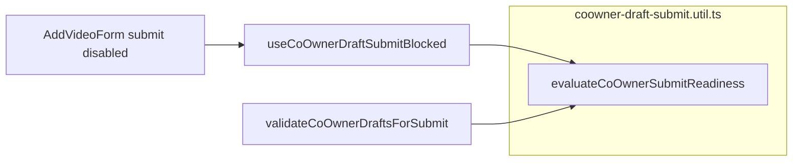

# Co-Owner & Video Submission — Revised Implementation Plan (v2)

Scope: **verified bugs A1–A11 only**. No new features. No business-rule changes. No performance work. No architectural refactors beyond what correctness requires.

---

## Verified bugs in scope

| ID  | Defect                                                      | Primary location                                                                                                                                                             |
| --- | ----------------------------------------------------------- | ---------------------------------------------------------------------------------------------------------------------------------------------------------------------------- |
| A1  | Event wizard Pusher approval does not refresh submit gating | [`event-content-privacy-step.tsx`](frontend/src/components/events/event-content-privacy-step.tsx)                                                                            |
| A2  | Submit hook starts unblocked before first poll              | [`use-coowner-draft-submit-blocked.ts`](frontend/src/hooks/use-coowner-draft-submit-blocked.ts)                                                                              |
| A3  | Frontend `some(approved)` vs backend `any(pending)`         | [`coowner-draft-submit.util.ts`](frontend/src/lib/coowner-draft-submit.util.ts), [`event-create-coowner.util.ts`](backend/src/services/coOwner/event-create-coowner.util.ts) |
| A4  | `mergeDraftPayload` mints replacement UUID                  | [`form-draft-utils.ts`](frontend/src/lib/form-draft-utils.ts)                                                                                                                |
| A5  | Draft indicator shows saved when upsert failed              | [`use-form-draft-autosave.ts`](frontend/src/hooks/use-form-draft-autosave.ts)                                                                                                |
| A6  | Co-owner errors mapped to hidden `coOwnerDraftKey`          | [`coowner-form-error.util.ts`](backend/src/utils/coowner-form-error.util.ts)                                                                                                 |
| A7  | Multi-link errors always use `videoLinks.0.*`               | [`event.controller.ts`](backend/src/controllers/event.controller.ts)                                                                                                         |
| A8  | Co-creator UI allows co-owned path; backend 403             | [`create-dialog.tsx`](frontend/src/components/home/create-dialog.tsx)                                                                                                        |
| A9  | Community 403 strings unmapped                              | [`coowner-form-error.util.ts`](backend/src/utils/coowner-form-error.util.ts)                                                                                                 |
| A10 | Modal submit gated on email-based status not in draft       | [`add-video-form.tsx`](frontend/src/components/events/add-video-form.tsx)                                                                                                    |
| A11 | `event.create` before co-owner validation                   | [`event.controller.ts`](backend/src/controllers/event.controller.ts)                                                                                                         |

---

## Architecture decision: single readiness source of truth

Introduce **one** shared module in [`frontend/src/lib/coowner-draft-submit.util.ts`](frontend/src/lib/coowner-draft-submit.util.ts):

```text
evaluateCoOwnerSubmitReadiness(invites: { status: string }[]): CoOwnerSubmitReadiness
```

Where `CoOwnerSubmitReadiness` is `{ blocked: boolean; reason: CoOwnerBlockReason | null }` and `CoOwnerBlockReason` mirrors backend rules:

- missing draftKey → blocked
- no approved invite → blocked
- any pending invite → blocked (aligns with [`event-create-coowner.util.ts`](backend/src/services/coOwner/event-create-coowner.util.ts) L73–86)
- approved only, no pending → not blocked

**Mandatory consumers (no duplicated logic):**

| Consumer                                                                                 | Today                                        | After                                                                  |
| ---------------------------------------------------------------------------------------- | -------------------------------------------- | ---------------------------------------------------------------------- |
| [`useCoOwnerDraftSubmitBlocked`](frontend/src/hooks/use-coowner-draft-submit-blocked.ts) | Inline `some(approved)`                      | Calls `evaluateCoOwnerSubmitReadiness` after fetch                     |
| [`validateCoOwnerDraftsForSubmit`](frontend/src/lib/coowner-draft-submit.util.ts)        | Inline `some(approved)`                      | Same utility + user-facing message from `reason`                       |
| [`add-video-form.tsx`](frontend/src/components/events/add-video-form.tsx) modal gating   | `coOwnerInviteStatus !== "approved"` (email) | Hook or thin wrapper over same utility + draftKey poll (**fixes A10**) |
| Pusher immediate refresh (A1)                                                            | N/A                                          | Triggers hook `refresh()`; refresh uses same utility                   |

**Rule:** No other file may implement approve/pending checks. Future consumers must import this utility only.



Email-based [`useCoOwnerInviteStatus`](frontend/src/hooks/use-coowner-invite-status.ts) remains **cosmetic only** (approval badge styling in co-owner panel). It must **not** gate submit.

---

## A11 — Pure validation reorder

**Implementation (only change in `createEvent`):**

```text
assertVideoLinksCoOwnerForCreate(host.id, tier, videoLinks)
        ↓
prisma.event.create(...)
        ↓
(existing channel transaction, live video, email, etc. — unchanged)
```

**Explicitly out of this PR:**

- Wrapping event + channels in one transaction
- Controller redesign or service extraction
- New validation rules inside `assertVideoLinksCoOwnerForCreate`
- Changing YouTube verify, tier checks, or invite rules

**Known residual risk (documented, deferred):** If channel creation fails after successful `event.create`, an event row may still exist without channels. Fixing that is **Deferred / Out of Scope** (transactional create is a separate initiative).

---

## A4 — Draft key lifecycle (UUID ownership)

**Remove:** UUID fallback in [`mergeDraftPayload`](frontend/src/lib/form-draft-utils.ts) L109–114.

**Do not:** Add UUID generation inside `mergeDraftPayload` or `splitDraftPayload`.

**Preserve existing fresh-form initialization:**

- Event wizard: [`event-content-privacy-step.tsx`](frontend/src/components/events/event-content-privacy-step.tsx) L73–79 — assigns UUID when `!coOwnerDraftKey` on link count change
- Modal: [`add-video-policy-fields.tsx`](frontend/src/components/events/add-video-policy-fields.tsx) L97–107 — assigns UUID when key empty on mount

**Invariants:**

| Scenario                                     | Expected behavior                                                                                                                |
| -------------------------------------------- | -------------------------------------------------------------------------------------------------------------------------------- |
| Fresh form, step 4 / modal open              | Existing `useEffect` assigns new UUID                                                                                            |
| Restore draft with saved key in `policyJson` | Merge restores key; init `useEffect` sees key → **no overwrite**                                                                 |
| Restore draft without key                    | Merge leaves empty; init `useEffect` assigns new UUID when user reaches step 4 / opens modal — **no silent link to old invites** |

**Additional A4 fix (verified bug):** Call `saveNow()` after successful co-owner invite send (event + modal) so key is persisted before 1.5s debounce.

**Do not add:** sessionStorage for event `draftId`, new draft fields, or approval status in draft JSON.

---

## A10 — Draft-key gating only (merged into PR-4)

**Do not persist** `coOwnerEmail` or `coOwnerName` in `policyJson`.

**Fix:** Replace modal `coOwnerSubmitBlocked` ([`add-video-form.tsx`](frontend/src/components/events/add-video-form.tsx) L264–267) with the same draft-key readiness path as the event wizard (shared hook + `evaluateCoOwnerSubmitReadiness`).

**Optional / out of verified bug scope:** After restore, approval badge may not show until user re-enters email in co-owner panel. Fixing badge-only UX without PII is **Deferred / Out of Scope** unless product explicitly requests it later.

**PR-7:** Only if post-PR-4 QA finds remaining A10 submit-blocking behavior. Expected: **PR-7 not needed**.

---

## Deferred / Out of Scope

- sessionStorage or URL persistence for event wizard `draftId`
- Persisting co-owner email/name or approval status in drafts
- Event wizard draft refresh UX improvements
- Transactional event + channel create (post-A11 residual orphan risk)
- Duplicate YouTube verify removal, parallel status polling, async email
- Performance optimization of any kind
- Refactors not required for A1–A11
- Cosmetic approval-badge restore after modal draft reload

---

## PR rollout (seven PRs)

### PR-1 — A11 only

**Files:** [`backend/src/controllers/event.controller.ts`](backend/src/controllers/event.controller.ts) only.

**Why isolated:** Backend-only; zero frontend blast radius; fail-fast integrity fix deployable and rollbackable independently.

**Staging gate (must pass before PR-2):**

1. Happy path: ownership Yes → event + channels created
2. Co-owned pending → 4xx, **Event count unchanged**
3. Missing/invalid draftKey with ownership No → 4xx, no Event row
4. Banner upload path still succeeds

---

### PR-2 — A4 only

**Files:** [`form-draft-utils.ts`](frontend/src/lib/form-draft-utils.ts), invite-success handlers in [`event-content-privacy-step.tsx`](frontend/src/components/events/event-content-privacy-step.tsx) and [`add-video-policy-fields.tsx`](frontend/src/components/events/add-video-policy-fields.tsx) (flush `saveNow` only).

**Why separate from A5:** Draft restore touches all three event wizards + modal autosave; distinct from indicator UI.

**Staging gate:**

1. Fresh step 4: UUID assigned via existing `useEffect`
2. Draft round-trip: same `coOwnerDraftKey` after `?draftId=` restore
3. Invite → flush → restore: key matches DB invite `draftKey`
4. Restore with valid saved key: init `useEffect` does **not** replace key
5. Restore without key: new UUID only via init `useEffect`, not merge

---

### PR-3 — A5 only

**Files:** [`use-form-draft-autosave.ts`](frontend/src/hooks/use-form-draft-autosave.ts), [`draft-save-indicator.tsx`](frontend/src/components/events/draft-save-indicator.tsx) (optional `saveError` display).

**Why isolated:** Smallest possible diff; rollback does not affect co-owner or draft key logic.

**Staging gate:**

1. Successful upsert → `lastSavedAt` updates
2. Failed upsert → `lastSavedAt` unchanged; error surfaced
3. Autosave debounce still 1.5s

---

### PR-4 — A1 + A2 + A3 + A10 (single frontend gating PR)

**Files:**

- [`coowner-draft-submit.util.ts`](frontend/src/lib/coowner-draft-submit.util.ts) — `evaluateCoOwnerSubmitReadiness` + refactor `validateCoOwnerDraftsForSubmit`
- [`use-coowner-draft-submit-blocked.ts`](frontend/src/hooks/use-coowner-draft-submit-blocked.ts) — A2 init, A3 rules, export/imperative refresh for A1
- [`event-content-privacy-step.tsx`](frontend/src/components/events/event-content-privacy-step.tsx) — Pusher → refresh hook (A1)
- Three event pages — no logic change if hook-only
- [`add-video-form.tsx`](frontend/src/components/events/add-video-form.tsx) — modal uses shared hook/util (A10)
- Remove submit gating dependency on `coOwnerInviteStatus` for button disabled state

**Why one PR:** A1/A2/A3 share one utility; A10 is the same defect class (wrong gating source). Splitting would ship inconsistent approve/pending semantics.

**Staging gate:**

1. Step 4 co-owned pending: button disabled on first paint (A2)
2. Pusher approval: button enables without 5s wait (A1)
3. Approved + pending invites: stays blocked (A3)
4. Modal co-owned: same gating as wizard (A10)
5. Modal draft restore + approved invite in DB: submit enabled **without** email re-entry (A10 + A4)
6. Ownership Yes paths unchanged

**After PR-4:** Decide if PR-7 needed (expected: no).

---

### PR-5 — A8 only (optional standalone hotfix)

**Files:** [`create-dialog.tsx`](frontend/src/components/home/create-dialog.tsx), [`add-video-policy-fields.tsx`](frontend/src/components/events/add-video-policy-fields.tsx) (prop e.g. `coOwnerPolicyMode="ownerOnly"` when `hostTab === "cocreator"`).

**Why optional / early:** High user impact; frontend-only; no backend or error-contract change. Can ship before or after PR-6; **before PR-6** stops wasted invite flows fastest.

**Staging gate:**

1. Create dialog co-create tab: no “No (co-owner required)”
2. Co-creator Yes upload still works
3. Owner tab / dashboard owner add-video: co-owned path unchanged

---

### PR-6 — A6 + A7 + A9

**Files:**

- [`backend/src/utils/coowner-form-error.util.ts`](backend/src/utils/coowner-form-error.util.ts) — map co-owner submit errors to `ownershipAnswer`; add A9 strings
- [`backend/src/services/coOwner/event-create-coowner.util.ts`](backend/src/services/coOwner/event-create-coowner.util.ts) — attach `videoLinkIndex` to thrown errors (A7)
- [`backend/src/controllers/event.controller.ts`](backend/src/controllers/event.controller.ts) — read index from error in catch (A7)
- [`frontend/src/lib/form-error-mapper.ts`](frontend/src/lib/form-error-mapper.ts) — fallback redirect `coOwnerDraftKey` → `ownershipAnswer` (A6)

**Why after PR-4:** Separates “can submit” from “what error field shows”; avoids debugging gating and mapping simultaneously.

**Staging gate:**

1. Multi-link error on link 2 → `videoLinks.1.*` in response
2. Pending-invite error highlights ownership field
3. Community tier 403 → ownership field, not generic toast
4. Invite-time email/name errors unchanged

---

### PR-7 — Remaining A10 only if required

**Expected content:** None if PR-4 passes modal restore QA.

**If needed:** Narrow fix for any missed modal entry point still using email gating.

**Optional cosmetic only:** Badge after restore without PII — label **Deferred / Out of Scope**.

---

## Per-bug fix summary

| Bug | Fix                                                       | Business rule change?      |
| --- | --------------------------------------------------------- | -------------------------- |
| A11 | Move assert before `event.create`                         | No                         |
| A4  | Remove merge UUID fallback; flush draft on invite         | No                         |
| A5  | `lastSavedAt` only on success                             | No                         |
| A1  | Pusher → hook refresh                                     | No                         |
| A2  | Initial blocked when co-owned links exist                 | No                         |
| A3  | Shared utility: block if pending                          | No (aligns to backend)     |
| A10 | Modal uses shared draft-key gating                        | No                         |
| A8  | Hide/disable co-owned UI for co-creators in create dialog | No (reflects existing 403) |
| A6  | Map errors to `ownershipAnswer`                           | No                         |
| A7  | Propagate link index in errors                            | No                         |
| A9  | Add message map entries                                   | No                         |

---

## Testing strategy

### PR-1 (A11)

| Type                   | Requirement                                                                                                     |
| ---------------------- | --------------------------------------------------------------------------------------------------------------- |
| **Unit / integration** | When `assertVideoLinksCoOwnerForCreate` throws, **`prisma.event.create` is not invoked** (mock/spy or DB count) |
| **Integration**        | POST create with pending co-owner → 400/403/409, no new Event row                                               |
| **Regression**         | Successful create unchanged                                                                                     |

### PR-2 (A4)

| Type           | Requirement                                                                                                            |
| -------------- | ---------------------------------------------------------------------------------------------------------------------- |
| **Unit**       | `mergeDraftPayload`: with saved key in policy → restored key identical; **never emits new UUID when valid key exists** |
| **Unit**       | `mergeDraftPayload`: without key → returns empty/missing key (no fallback UUID)                                        |
| **Regression** | Fresh form behavior delegated to existing init effects (integration/E2E)                                               |

### PR-3 (A5)

| Type     | Requirement                                                    |
| -------- | -------------------------------------------------------------- |
| **Unit** | `persistDraft`: failed `res.success` → no `lastSavedAt` update |

### PR-4 (A1–A3, A10)

| Type            | Requirement                                                                                             |
| --------------- | ------------------------------------------------------------------------------------------------------- |
| **Unit**        | `evaluateCoOwnerSubmitReadiness`: matrix — none/pending only/approved only/approved+pending/API failure |
| **Unit**        | Assert **all gating paths import and call** shared utility (lint test or explicit imports test file)    |
| **Integration** | Hook + modal both block/unblock per matrix                                                              |
| **E2E**         | Pusher/mock approval → immediate unblock (event wizard)                                                 |
| **E2E**         | Modal draft restore + DB approved → submit enabled without email                                        |

### PR-5 (A8)

| Type             | Requirement                              |
| ---------------- | ---------------------------------------- |
| **E2E / manual** | Co-create tab cannot select ownership No |

### PR-6 (A6, A7, A9)

| Type         | Requirement                                                                                     |
| ------------ | ----------------------------------------------------------------------------------------------- |
| **Snapshot** | `coOwnerErrorFieldPath` / `CO_OWNER_FIELD_MESSAGES` — snapshot of message → path map            |
| **Contract** | API response tests: `error.details[].path` for each mapped message (including index 1)          |
| **Unit**     | Assert throws from link index 1 produce `videoLinks.1.ownershipAnswer` or `.url` as appropriate |

### Cross-PR regression checklist

- Event creation (all three wizards)
- Draft autosave and `?draftId=` restore
- Add Video modal (room + community owner)
- Co-owner invite + OTP approval flow unchanged
- Community co-creator Yes upload
- Event room channel upload
- Tipper sign-in prefill on event forms untouched
- Premium vs Community tier enforcement unchanged
- Payout / `finalizeCoOwnersForNewChannel` untouched

---

## Files that must not change

- [`event-sign-in-form.tsx`](frontend/src/components/events/event-sign-in-form.tsx)
- [`videoCoOwnerInvite.controller.ts`](backend/src/controllers/videoCoOwnerInvite.controller.ts)
- [`tier.service.ts`](backend/src/services/coOwner/tier.service.ts)
- [`youtube-verify.service.ts`](backend/src/services/coOwner/youtube-verify.service.ts) (rules unchanged)
- [`finalizeCoOwnersForNewChannel`](backend/src/services/coOwner/event-create-coowner.util.ts) (payout linkage)
- Co-owner invite/approve/decline pages

---

## Database, API, draft compatibility

| Area                       | Change                                | Migration                                                |
| -------------------------- | ------------------------------------- | -------------------------------------------------------- |
| Prisma schema              | None                                  | No                                                       |
| Draft `policyJson`         | Same fields; keys saved reliably (A4) | No — backward compatible                                 |
| API success bodies         | Unchanged                             | —                                                        |
| API error `details[].path` | More accurate paths (PR-6)            | Backward compatible (clients using `message` unaffected) |
| PII in drafts              | **None introduced**                   | —                                                        |

---

## Risk and Go / No-Go

| PR   | Risk                   | Merge alone?               |
| ---- | ---------------------- | -------------------------- |
| PR-1 | Medium (critical path) | Yes                        |
| PR-2 | Medium                 | Yes                        |
| PR-3 | Very low               | Yes                        |
| PR-4 | Medium                 | No — A1+A2+A3+A10 together |
| PR-5 | Low                    | Yes                        |
| PR-6 | Low                    | Yes                        |
| PR-7 | Low                    | Only if needed             |

**Go** when:

1. PR-1 staged and orphan-event test passes
2. PR-2 key invariants proven by unit tests
3. PR-4 shared utility tests prove single source of truth
4. PR-6 contract/snapshot tests added before merge

**Estimated effort:** ~22–30 hours engineering + QA (PR-7 likely 0h).

**Commit boundaries:** One commit per PR minimum; PR-4 may use two commits (util + wiring) in one PR.
