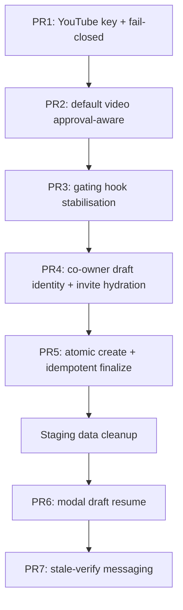

# Co-owner and YouTube Verification Staging Fixes

## Guiding safety rules

1. **Seven separate PRs, merged in order.** These defects currently mask each other: RC-2 stops you ever reaching RC-6, and RC-5 makes RC-4 look like a polling delay. Bundling them makes a QA pass or failure unattributable.
2. **Record the baseline test result before touching anything.** There are known unrelated failures: 6 in frontend (`action-fetch`, `explore-feed-batch-fetch`, `tip-reward-eligibility`) and 8 in backend (TV/enforcement/env suites). Capture the exact list so new failures are distinguishable.
3. **No business-rule changes beyond the two decisions already taken** (global video uniqueness retained but made idempotent; YouTube verification fails closed with an explicit dev opt-in).
4. **No schema migration in any PR.** Every fix below works against the current Prisma schema. `EventChannel.coOwnerDraftKey` already exists and is indexed ([backend/prisma/schema.prisma](backend/prisma/schema.prisma) lines 458, 505), which is what makes the idempotency fix possible without a migration.
5. **Each PR gates on:** `npm run typecheck` and `npm run test` in the touched package, plus the manual QA step named in that PR.

## Sequencing and why



PR1 must land first because nothing else is testable while ownership verification returns 503. PR5 must land before the staging cleanup, because the cleanup is only safe once partial submits can no longer recur.

---

## PR1 - RC-1: YouTube Data API key name and fail-closed verification

**Problem.** [backend/src/services/coOwner/youtube-verify.service.ts](backend/src/services/coOwner/youtube-verify.service.ts) line 161 reads `YOUTUBE_DATA_API_KEY`, but `backend/.env` line 61 and `backend/.env.production` line 45 only define `YOUTUBE_API_KEY`. The variable is undefined everywhere, so production/staging returns 503 and non-production silently skips verification entirely.

**Changes**

- Add a single resolver to [backend/src/configs/runtime-flags.config.ts](backend/src/configs/runtime-flags.config.ts):
  - `resolveYoutubeDataApiKey()` returning `process.env.YOUTUBE_DATA_API_KEY?.trim() || process.env.YOUTUBE_API_KEY?.trim() || null`. Accepting the legacy name keeps existing deployments working; do **not** delete `YOUTUBE_API_KEY` from the env files, because [backend/src/scripts/backfill-youtube-durations.ts](backend/src/scripts/backfill-youtube-durations.ts) line 6 and [backend/src/jobs/tv-content-health.ts](backend/src/jobs/tv-content-health.ts) line 59 still read it.
  - `isYoutubeVerifyDisabled()` returning `process.env.COOWNER_YT_VERIFY_DISABLED === "true"`.
- Replace the `NODE_ENV` branch in `youtube-verify.service.ts`:

```ts
const apiKey = resolveYoutubeDataApiKey();
if (!apiKey) {
  if (isYoutubeVerifyDisabled()) return;   // explicit local-dev opt-in only
  throw createHttpError(
    503,
    "YouTube ownership verification is unavailable — contact support"
  );
}
```

  This removes the accidental fail-open path: absence of a key now fails closed in every environment unless someone deliberately set the flag.
- Apply the same resolver at [backend/src/controllers/policy.controller.ts](backend/src/controllers/policy.controller.ts) line 56 and [backend/src/controllers/hostChannels.controller.ts](backend/src/controllers/hostChannels.controller.ts) line 52.
- Add `YOUTUBE_DATA_API_KEY` to `backend/.env` and `backend/.env.production` (same value as the existing key), and document `COOWNER_YT_VERIFY_DISABLED` in the env example file.
- Add a boot-time assertion in [backend/src/index.ts](backend/src/index.ts): if no key and the flag is not set, log a fatal-level warning naming both variables. Fail loudly at startup rather than at user submit time.

**Tests.** New `backend/src/services/__tests__/youtube-verify-config.spec.ts`: key present takes the real path; no key and flag unset throws 503 for `NODE_ENV` of both `production` and `development`; no key with flag set returns without throwing; legacy `YOUTUBE_API_KEY` alone resolves.

**Manual QA.** With the key deployed, verify a video that *is* on the selected channel (expect success) and one that is *not* (expect "Video not found on the selected YouTube channel"). The second case is the one that silently passed before.

---

## PR2 - RC-2: default co-owned video must consider approval

**Problem.** [frontend/src/lib/validate-privacy-video-links.ts](frontend/src/lib/validate-privacy-video-links.ts) lines 69-74 reject `isDefault && ownershipAnswer === "no"` unconditionally, never consulting invite status. The event-only wizard sets `isDefault: true` on the first link ([frontend/src/app/(event)/event-only/page.tsx](frontend/src/app/(event)/event-only/page.tsx) line 158), so a single-video co-owned event can never be submitted even after approval. The backend rule it is meant to mirror *is* approval-aware ([backend/src/services/coOwner/event-create-coowner.util.ts](backend/src/services/coOwner/event-create-coowner.util.ts) lines 129-144).

**Changes**

- Delete the block at lines 69-74 of `validate-privacy-video-links.ts`. Keep the function synchronous; it has no access to invite status and should not acquire it.
- Move the rule into [frontend/src/lib/coowner-draft-submit.util.ts](frontend/src/lib/coowner-draft-submit.util.ts), which already fetches invites per link and already runs immediately after `runPrivacyChecks()` in all three wizards (see [frontend/src/app/(event)/event-only/page.tsx](frontend/src/app/(event)/event-only/page.tsx) lines 203-207). Extend `LinkSlice` with `isDefault?: boolean` and, when `link.isDefault` and readiness is blocked, return a default-video-specific message instead of the generic one. Approved links pass.
- Add a `default_awaiting_approval` case to `CoOwnerBlockReason` and `coOwnerBlockReasonMessage` in [frontend/src/lib/coowner-submit-readiness.util.ts](frontend/src/lib/coowner-submit-readiness.util.ts) so the message stays in the single source of truth.
- Confirm during implementation that `runPrivacyChecks()` is not also called from `nextStep` in `content-only` and `event-and-content` (it is called only from `onSubmit` in `event-only`). If it is, the removal is still correct because the rule now lives in the submit-time async validator.

**Tests.** Update [frontend/src/lib/\_\_tests\_\_/validate-privacy-video-links.test.ts](frontend/src/lib/__tests__/validate-privacy-video-links.test.ts): a default co-owned link no longer fails the sync validator. New cases in the co-owner submit util spec: default + approved passes; default + pending returns the default-specific message; default + no invites blocks.

**Manual QA.** Event-only wizard, one video, ownership "No", invite approved, submit succeeds.

---

## PR3 - RC-5: stabilise the submit-gating hook

**Problem.** In [frontend/src/hooks/use-coowner-draft-submit-blocked.ts](frontend/src/hooks/use-coowner-draft-submit-blocked.ts), `coOwned` is memoised on the *identity* of `links` (line 19), and every caller passes a freshly allocated array each render - `form.watch("videoLinks") ?? []` at [frontend/src/app/(event)/content-only/page.tsx](frontend/src/app/(event)/content-only/page.tsx) line 202 and an inline literal at [frontend/src/components/events/add-video-form.tsx](frontend/src/components/events/add-video-form.tsx) lines 272-275. So `refresh` gets a new identity every render and the effect tears itself down and re-runs continuously. Four consequences: the 5s interval never fires; `blocked` flips true/false in a self-sustaining render loop after approval; concurrent polls can overwrite each other; and `blocked` initialises to `false` so there is a painted frame where the button is enabled.

**Changes**

- Key the memo and callback on the already-computed stable string rather than array identity. `watchKey` (lines 21-29) is derived from `coOwnerDraftKey` and `ownershipAnswer` values, so it is referentially stable across renders. Restructure so `coOwned` is memoised on `watchKey`, `refresh` depends on `watchKey`, and the effect depends on `watchKey` alone.
- Replace the two-state boolean with three states so the button never reads "ready" while status is unknown: `{ blocked, checking, refresh }`. Initialise `blocked: true`. Stop writing `setBlocked(true)` on entry to every refresh (line 39) - that write is what drives the oscillation loop; set `checking` instead.
- Add request correlation using the pattern already established in [frontend/src/lib/youtube-verify-request.util.ts](frontend/src/lib/youtube-verify-request.util.ts): a monotonic ref, and discard any response whose id is not the latest. Prevents a slow earlier poll from overwriting a newer result.
- Update the four call sites to consume `blocked || checking` for the `disabled` prop, keeping `disabled` strictly boolean: the three wizard pages and [frontend/src/components/events/add-video-form.tsx](frontend/src/components/events/add-video-form.tsx).
- Lift the Pusher approval subscription out of the unmountable subtree. It currently lives in `CoOwnerInviteBlock` ([frontend/src/components/events/event-content-privacy-step.tsx](frontend/src/components/events/event-content-privacy-step.tsx) lines 517-535) and in [frontend/src/components/events/add-video-policy-fields.tsx](frontend/src/components/events/add-video-policy-fields.tsx) line 100, so closing the modal or leaving step 4 loses it. Subscribe at the page/modal level keyed on the draft key so approval always reaches `refresh`.

**Tests.** New `frontend/src/hooks/__tests__/use-coowner-draft-submit-blocked.spec.ts` (or a util-level test if the hook is awkward to mount): re-rendering with a new array of identical values does not re-subscribe or re-poll; approved status settles to unblocked exactly once with no flip-flop; a late response with a stale id cannot overwrite a newer one; initial state is blocked before the first poll resolves.

**Manual QA.** Watch the button for 30 seconds after approval - the label must not alternate. Before approval it must never become clickable, including on first arrival at step 4.

---

## PR4 - RC-3 and RC-4: co-owner draft identity and invite hydration

These two are one PR because both touch the invite block and `form-draft-utils`, and splitting them would mean two passes over the same code.

**Problem (RC-3).** Name, email and share percent live in local `useState` inside `CoOwnerInviteBlock` ([frontend/src/components/events/event-content-privacy-step.tsx](frontend/src/components/events/event-content-privacy-step.tsx) lines 503-505), rendered only when `coOwnerBlockIndex === i` (line 472) inside a component mounted only on step 4. Navigating away unmounts everything and nothing rehydrates, so the user retypes the co-owner and hits the duplicate guard at [backend/src/controllers/videoCoOwnerInvite.controller.ts](backend/src/controllers/videoCoOwnerInvite.controller.ts) lines 123-131, producing the "already has an invite ... status: approved" pair.

**Problem (RC-4).** The draft key is minted by a mount-only effect with `[form]` deps at [frontend/src/components/events/add-video-policy-fields.tsx](frontend/src/components/events/add-video-policy-fields.tsx) lines 102-112, so it never re-fires. `form.reset(merged)` in [frontend/src/hooks/use-modal-form-draft-restore.ts](frontend/src/hooks/use-modal-form-draft-restore.ts) line 57 can set it back to `""` because `mergeModalDraftPayload` coerces a missing key to empty string ([frontend/src/lib/form-draft-utils.ts](frontend/src/lib/form-draft-utils.ts) line 161), and if `sessionStorage` is empty the restore never runs at all and a *new* UUID is minted that does not match the approved invite.

**Changes**

- Hydrate the invite block from the server instead of persisting new fields. The status endpoint already returns `coOwnerName`, `coOwnerEmail` and `payoutPercentBp` ([backend/src/controllers/videoCoOwnerInvite.controller.ts](backend/src/controllers/videoCoOwnerInvite.controller.ts) lines 250-260). On mount, fetch by draft key and, when an invite exists, render it read-only with its status plus revoke/resend actions rather than an empty form. This removes the duplicate-submit path entirely - no schema change, no new persisted fields.
- Derive the block's visibility from `ownershipAnswer === "no"` rather than the transient `coOwnerBlockIndex` state (line 203), so returning to step 4 restores the same view.
- Move draft-key minting out of the child effect and into form initialisation, so it is deterministic and cannot race a restore: generate it in `defaultValues` for the modal ([frontend/src/components/events/add-video-form.tsx](frontend/src/components/events/add-video-form.tsx) line 192) and in the wizard's video-link factory.
- Make `mergeModalDraftPayload` preserve the current in-form key when the draft has none, instead of coercing to `""` ([frontend/src/lib/form-draft-utils.ts](frontend/src/lib/form-draft-utils.ts) line 161). Apply the same review to `mergeDraftPayload` for the wizard.
- Guard the hook against the empty-key state it can no longer reach, keeping `blocked: true` with the existing `missing_draft_key` reason as defence in depth.

**Tests.** `form-draft-utils` spec: merging a draft with no policy key preserves the in-form key rather than blanking it. Invite-block spec: with an existing approved invite for the draft key, the form renders read-only and exposes no path to re-send. Regression spec: draft key is stable across a simulated step-away and step-back.

**Manual QA.** Send an invite, navigate to step 3 and back - co-owner details still visible with status. Approve, close and reopen the modal in a **new browser tab**, confirm submit is not blocked.

---

## PR5 - RC-6: atomic event creation and idempotent co-owner finalisation

**Problem.** [backend/src/controllers/event.controller.ts](backend/src/controllers/event.controller.ts) validates at line 248, creates the event at line 255 **outside** any transaction, then creates channels and co-owners in a separate transaction at lines 276-299. A failure after line 291 leaves an `EventChannel` with `VideoCoOwner` rows. Every later retry of the same video then hits the global guard at [backend/src/services/coOwner/youtube-verify.service.ts](backend/src/services/coOwner/youtube-verify.service.ts) lines 30-49, and because `finalizeCoOwnersForNewChannel` filters on `eventChannelId: null` (line 264) the invites are already consumed and cannot be re-linked.

**Decision applied.** Global uniqueness is retained. A retry of the *same* draft and invite set must succeed instead of returning 409.

**Changes**

- **Prevention first - make creation atomic.** Wrap `prisma.event.create` together with the channel loop and `finalizeCoOwnersForNewChannel` in one `$transaction` in `createEvent`. A failed submit then leaves no channel and no co-owner rows, so the 409 cannot arise in the first place. Note the existing transaction already has a timeout concern elsewhere in this file (line 1780 carries an explicit timeout comment); set an explicit timeout here too.
- **Scope the guard to allow same-draft retry.** Give `assertYoutubeVideoNotAlreadyCoOwned` an optional `{ hostId, coOwnerDraftKey }` and exclude channels whose `coOwnerDraftKey` matches, using the existing `@@index([coOwnerDraftKey])`. Pass it from [backend/src/services/coOwner/event-create-coowner.util.ts](backend/src/services/coOwner/event-create-coowner.util.ts) line 81, which already holds `link.coOwnerDraftKey`. A different draft key or a different host still returns 409, preserving the global rule.
- **Make finalisation idempotent, and safe against payout history.** `VideoCoOwner.inviteId` is `@unique` and `VideoCoOwnerPayout` hangs off `videoCoOwnerId` ([backend/prisma/schema.prisma](backend/prisma/schema.prisma) lines 544, 559-573), so a retry must **reuse** the existing row, never duplicate it, and must never silently relocate one that has payouts. Rework `finalizeCoOwnersForNewChannel` to select approved invites by `draftKey` + host regardless of `eventChannelId`; for each, if a `VideoCoOwner` already exists for that invite, re-point it to the new channel **only when it has no `payouts`** and otherwise throw a precise 409 naming the conflicting event; if none exists, create it as today. Also drop the `eventChannelId: null` filter that currently causes a retried submit to produce a channel with zero co-owners - a silent data-integrity bug independent of the 409.
- **Apply to all three create paths,** which currently duplicate this sequence: `createEvent` (line 248), `addEventChannel` (line 2263) and [backend/src/controllers/community-content-bank.controller.ts](backend/src/controllers/community-content-bank.controller.ts) line 163.

**Tests.** Extend [backend/src/services/\_\_tests\_\_/youtube-coowner-duplicate.spec.ts](backend/src/services/__tests__/youtube-coowner-duplicate.spec.ts): same draft key is excluded and passes; different draft key still throws 409; different host still throws 409. New finalize spec: retry with an already-linked invite reuses the row rather than duplicating; retry when payouts exist throws instead of relocating; approved invites are linked even when `eventChannelId` is already set. New controller spec: a failure inside the channel loop leaves no `Event` row.

**Manual QA.** Submit a co-owned video successfully. Then attempt a second, distinct co-owned submission of the *same* video with a *new* invite - expect the 409, which is the intended rule.

---

## Staging data cleanup (after PR5)

Staging almost certainly holds `EventChannel` rows with `VideoCoOwner` records created by the failed attempts behind issue 6. Those video URLs will keep returning 409 even after PR1-PR5, and QA will read that residue as a regression.

- Write a **read-only audit script first** listing every `EventChannel` that has `videoCoOwners` and whose parent `Event` looks orphaned or was created during the failed staging window, with its `coOwnerDraftKey` and any `VideoCoOwnerPayout` rows.
- Review the output manually. Only then delete, and only rows with no payout history. Do not automate the delete step.
- Alternatively, have QA use fresh YouTube video ids for the re-test and defer cleanup - lower risk and preferable if the audit shows anything with payouts attached.

---

## PR6 - RC-7: make modal drafts resumable

**Problem.** [frontend/src/components/dashboard/form-drafts-panel.tsx](frontend/src/components/dashboard/form-drafts-panel.tsx) lines 12-16 map only the three wizard kinds, and the Resume button is gated on that map (line 62), so `community_video` and `room_add_video` drafts render prose (lines 53-59) with no control. Underneath, the only pointer is `sessionStorage` ([frontend/src/hooks/use-modal-form-draft-restore.ts](frontend/src/hooks/use-modal-form-draft-restore.ts) lines 41-46), and `modalDraftId` starts `null` in every caller with no caller reading it from the URL.

**Changes**

- Accept an explicit `draftId` input in `useModalFormDraftRestore` so restore no longer depends on `sessionStorage`, keeping session storage as a fallback.
- Add a deep link for modal kinds that opens the owning surface with the draft id, and seed `modalDraftId` from it in [frontend/src/components/home/create-dialog.tsx](frontend/src/components/home/create-dialog.tsx) line 114, [frontend/src/components/events/event-channel-modal.tsx](frontend/src/components/events/event-channel-modal.tsx) line 56 and [frontend/src/components/dashboard/host-community-client.tsx](frontend/src/components/dashboard/host-community-client.tsx) line 459 - mirroring the `?draftId=` convention the wizard pages already accept.
- Render a real Resume button for modal kinds in the drafts panel and remove the placeholder prose.

**Tests.** Panel spec: a `community_video` draft renders an enabled Resume control. Restore spec: an explicit `draftId` restores without any `sessionStorage` entry.

**Manual QA.** Start a modal draft, hard-refresh in a new tab, resume from the dashboard, confirm the co-owner draft key and gating survive.

---

## PR7 - Issue 10: feedback for cancelled verification

**Finding.** Cancelling on URL or channel change is correct and already works. `resolveYoutubeVerifyOutcome` returns `stale` and both call sites discard silently ([frontend/src/components/events/event-content-privacy-step.tsx](frontend/src/components/events/event-content-privacy-step.tsx) line 185, [frontend/src/components/events/add-video-form.tsx](frontend/src/components/events/add-video-form.tsx) line 643). There is no stuck "Verifying" state, because the same edit that makes a response stale also resets verify state (fingerprint effect at `event-content-privacy-step.tsx` lines 222-228, slot select line 408, ownership select line 351; modal effect line 234 and slot select line 534). The backend also re-verifies at submit, so a discarded frontend result cannot create a false positive once PR1 lands.

**Changes (low risk, cosmetic).** Emit a neutral "Verification cancelled - the URL or channel changed, please verify again" notice on the stale branch so the button silently reverting is explicable. Optionally thread an `AbortController` through the verify server action to stop burning YouTube API quota on abandoned requests.

**Tests.** Existing [frontend/src/lib/\_\_tests\_\_/youtube-verify-request.util.spec.ts](frontend/src/lib/__tests__/youtube-verify-request.util.spec.ts) already covers the stale classification; add a case asserting the cancellation notice fires only on `stale`.

---

## Verification per PR

- Backend: `npm run typecheck` then `npm run test` (vitest) in `backend`.
- Frontend: `npm run typecheck`, `npm run lint`, `npm run test` (vitest) in `frontend`.
- Compare failures against the recorded baseline. Any new failure blocks the PR; the 14 known unrelated failures do not.

## Residual risks

- PR5 changes transaction boundaries in the highest-traffic controller. Verify the create path against a large `videoLinks` payload for transaction timeout before deploying.
- PR1 will surface previously hidden verification failures for hosts whose channel URL cannot be resolved. Expect a rise in "Could not resolve YouTube channel ID" errors - that is the bypass being removed, not a regression.
- PR3 changes the gating contract from `{ blocked, refresh }` to include `checking`. All four call sites must be updated in the same PR or the buttons will be permanently enabled.