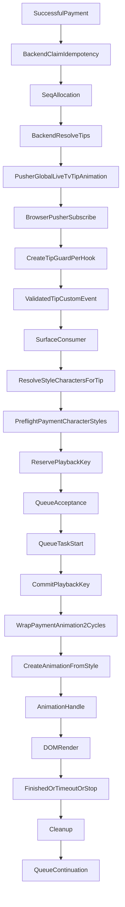
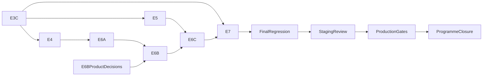
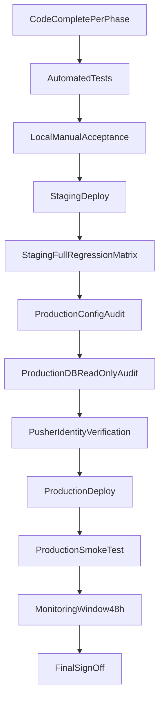

# Master Repository-Grounded Plan — E3C Through E7

**Planning only.** No files, code, environment variables, or database records were modified to produce this document.

---

## 1. Executive summary

Phases E1–E3B are closed. Remaining work is **seven independently deployable phases** plus final regression and production gates.

**Confirmed open defects (repository evidence):**
- **E3C:** [`wrapPaymentAnimation.ts`](frontend/src/lib/wrapPaymentAnimation.ts) L118–198 — safety timeout and swallowed `finished` rejection both return `true`; `payment_double_cycle_completed result=ok` (L218–228) can fire after timeout.
- **E4:** Two `useGlobalTipStream` producers on event room page ([`event-room-client.tsx`](frontend/src/components/events/event-room-client.tsx) L388 + [`screen-display.tsx`](frontend/src/components/events/screen-display.tsx) L104) → two independent `createTipGuard` instances ([`use-global-tip-stream.ts`](frontend/src/hooks/use-global-tip-stream.ts) L69) → two `validated-tip` dispatches (L172) → four consumer invocations (room + screen listeners).
- **E5:** [`resolveStyleCharactersForTip`](frontend/src/lib/tip-animation-characters.ts) all-or-nothing server path (L110–120, L122–133, L152–159); local fallback silently omits unresolved names (L20–51); `characterId` emitted but unused.
- **E6A:** Budget 20,475 ms/character ([`payment-playback-budget.ts`](frontend/src/lib/payment-playback-budget.ts) L15–20) vs worst-case 30,475 ms (2×15 s safety timeout in [`wrapPaymentAnimation.ts`](frontend/src/lib/wrapPaymentAnimation.ts)); segment skip at task execution (L151–160 in [`run-payment-bundle-animations.ts`](frontend/src/lib/run-payment-bundle-animations.ts)).
- **E7:** `[PAYMENT_ANIMATION_TRACE]` env-gated; `[TipmannaRealtime]` always logs in production ([`realtime-telemetry.ts`](frontend/src/lib/realtime-telemetry.ts) L50–51); no APM vendor wired.

**Recommended order:** E3C → E4 → E5 → E6A → E6B (gate) → E6C → E7 → final regression → staging → production gates → closure.

**Do not combine phases into one change set.**

---

## 2. Repository architecture after E1–E3B

### Pipeline diagram



### Stage table (authoritative references)

| Stage | File | Symbol | Input | Output | Ownership | State | E1–E3B fix | Remaining risk | Evidence |
|-------|------|--------|-------|--------|-----------|-------|------------|----------------|----------|
| Backend claim | [`message.controller.ts`](backend/src/controllers/message.controller.ts) | `createMessage` | `transactionId`, body | claimed / skip emit | Backend | DB | **E1** claim by `transactionId` (L65–171) | Uncorrelated message without `transactionId` may still emit | L46–171 |
| Seq allocation | same | Prisma increment | `eventId` | `seq` | Backend | DB | E1 single seq per claim | — | emit block ~L200+ |
| Backend resolution | [`tip-animation-resolve.util.ts`](backend/src/utils/tip-animation-resolve.util.ts) | `resolveTipsForAnimationPayload` | `selectedTips[]` | `ResolvedTipCharacter[]` (full length) | Backend | — | E3B diagnostic trace for invalid styles | Placeholders for missing chars | L40–67 |
| Pusher emit | [`message.controller.ts`](backend/src/controllers/message.controller.ts) | `pusher.trigger` | bundle | `global-live-tv` / `tip-animation` | Backend | — | E1 single bundle | — | L251–262 |
| Wallet side-effect | [`tip-payment-side-effects.service.ts`](backend/src/services/tip-payment-side-effects.service.ts) | `broadcastTipAnimationAndPersistMessage` | payment | same payload shape | Backend | — | E1 | — | L256–263 |
| Pusher subscribe | [`pusher.ts`](frontend/src/lib/pusher.ts) | `subscribeChannel` | channel name | ref-counted Channel | Shared browser | `channelRefCounts` Map | — | Multiple binds same channel | L53–89 |
| Stream hook | [`use-global-tip-stream.ts`](frontend/src/hooks/use-global-tip-stream.ts) | `useGlobalTipStream` | Pusher payload | `validated-tip` dispatch | Per hook | hook closure | — | **Duplicate producers** | L69, L172 |
| Guard | [`animation-guard.ts`](frontend/src/lib/animation-guard.ts) | `createTipGuard` | `TipAnimationEvent` | accept/reject | Per hook instance | `lastSeqByEvent` Map | — | Not shared across hooks | L69 in stream hook |
| Surface consumer | [`room-messages.tsx`](frontend/src/components/events/room-messages.tsx), [`screen-display.tsx`](frontend/src/components/events/screen-display.tsx) | `handleValidatedTip` | CustomEvent | enqueue call | Event Room / Screen | component | — | Duplicate listener invocations | room L204–208, screen L253–280 |
| Frontend resolution | [`tip-animation-characters.ts`](frontend/src/lib/tip-animation-characters.ts) | `resolveStyleCharactersForTip` | `resolvedTips`, map | `StyleCharacter[]` | Per consumer call | — | — | All-or-nothing server reject | L92–164 |
| Preflight | [`payment-style-preflight.ts`](frontend/src/lib/payment-style-preflight.ts) | `preflightPaymentCharacterStyles` | characters | accepted + rejections | Per consumer | — | **E3A** | No icon check | L74–87 in bundle |
| Key reserve | [`playback-key-lifecycle.ts`](frontend/src/lib/playback-key-lifecycle.ts) | `reservePlaybackKey` | playbackKey | bool | Tab-global | `playbackKeyStates` Map | **E2** | — | L52–91 |
| Queue accept | [`animation-queue-core.ts`](frontend/src/lib/animation-queue-core.ts) | `enqueue` | tasks[] | `EnqueueResult` | Per surface queue | `pendingCount`, `generation` | **E2** release on reject | cap=20 drop | L88–120 |
| Key commit | same | `commitPlaybackKey` | key | committed | Tab-global | Map | **E2** at task start | Before outcome known | L226+ (commit before `task.run`) |
| Two-cycle wrap | [`wrapPaymentAnimation.ts`](frontend/src/lib/wrapPaymentAnimation.ts) | `wrapPaymentAnimation` | factory | Promise | Per task | — | E3A EMPTY_HANDLE→false | **Timeout→success** | L118–198 |
| Segment skip | [`run-payment-bundle-animations.ts`](frontend/src/lib/run-payment-bundle-animations.ts) | factory closure | `playbackEndsAt`, index | noop or real handle | Per task at run | — | — | Instant success, no trace | L151–160 |
| Style factory | [`animation-style-registry.ts`](frontend/src/lib/animation-style-registry.ts) | `createAnimationFromStyleName` | character, mode | handle or throw | Per invocation | `EMPTY_HANDLE` singleton | **E3A** payment throw | — | L160–227 |
| Queue continue | [`animation-queue-core.ts`](frontend/src/lib/animation-queue-core.ts) | `processQueue` | task result | next task | Per surface | promise chain | E2 | — | catch at L238–248 |

### Drift from earlier Phase D analysis

| Earlier finding | Current state |
|-----------------|---------------|
| Duplicate card emission | **Fixed (E1)** — `transactionId` claim |
| Key marked before queue accept | **Fixed (E2)** — reserve→commit lifecycle |
| Unknown style false success pre-reservation | **Fixed (E3A)** |
| Malformed DB/admin styles | **Fixed (E3B)** |
| Duplicate validated-tip fan-out | **Still open (E4)** |
| Timeout reported as success | **Still open (E3C)** |
| Server resolution all-or-nothing | **Still open (E5)** |
| Budget/timeout skew | **Still open (E6A)** |

---

## 3. Confirmed defects still open

1. **False post-start success (E3C)** — timeout/reject → `payment_cycle_completed` → `payment_double_cycle_completed result=ok`.
2. **Duplicate browser fan-out (E4)** — 2 producers × 2 listeners = 4 processing attempts per tip when both surfaces active.
3. **Resolution integrity (E5)** — all-or-nothing server reject; silent local omission; Comment alias backend-only; `characterId` unused.
4. **Timing/budget skew (E6A)** — 20,475 ms budget vs 30,475 ms worst-case execution.
5. **Segment skip invisible success (E6A/E3C)** — `noopPaymentAnimationHandle()` not classified as skip.
6. **stop/finished decoupling (E6A)** — burst, fall, luxurious, confetti, spin, pop-and-shoot.
7. **Observability gap (E7)** — verbose trace not production-durable; no counters for failures.

**Unconfirmed (needs runtime capture):** background-tab timer throttling magnitude on target devices; production Pusher identity mismatch.

---

## 4. Recommended implementation order

**Confirm:** E3C → E4 → E5 → E6A → E6B → E6C → E7

| Dependency | Why earlier phase required | Contract established | Reliable later testing | Reversal risk |
|------------|---------------------------|--------------------|------------------------|---------------|
| E3C before E5 | Bundle summaries need honest cycle outcomes | `PaymentCycleOutcome`, `PaymentCharacterOutcome` | Partial-bundle "completed" vs "partial" | E5 reports false success |
| E3C before E7 | Permanent failure counters | outcome fields on trace/telemetry | Alert thresholds meaningful | Noisy/false alerts |
| E4 before E6 | Duplicate work skews timing/queue depth | 1 dispatch per page | Latency measurements valid | E6 misattributes load |
| E5 before E6C multi-char | Stress tests need explicit omission reporting | per-character resolution result | Pass criteria for partial bundles | Silent shrink undetected |
| E6A before E6B | Fix bugs before policy | aligned budget/timeout | Policy tests on correct baseline | Policy masks bugs |
| E6B before E6C overload | Cap/skip/replay need approval | overload policy enum | Stress pass/fail unambiguous | Accidental two-cycle change |
| E7 after E3C–E6C | Cleanup removes diagnostics used in regression | permanent signal set | Final matrix green | Premature trace removal |

**E7 partial early instrumentation:** Add outcome/resolution counters during E3C/E4/E5 (extend `[TipmannaRealtime]`), but **do not remove** `[PAYMENT_ANIMATION_TRACE]` until final regression passes.

---

## 5. Dependency map



---

## 6. Shared cross-phase contracts

Define **one module** (recommended: extend [`payment-animation-trace.ts`](frontend/src/lib/payment-animation-trace.ts) types or new `payment-animation-outcomes.ts`) consumed by E3C, E5, E6, E7.

| Contract | Introduced | Consumers | Scope | Compatibility |
|----------|------------|-----------|-------|---------------|
| `PaymentCycleOutcome` | E3C | wrap, queue trace, E7 | Internal FE | Additive trace fields |
| `PaymentCharacterOutcome` | E3C | wrap, bundle summary | Internal FE | Additive |
| `PaymentBundleOutcome` | E5 | enqueue result, telemetry | Internal FE | Additive |
| `CharacterResolutionOutcome` | E5 | tip-animation-characters, telemetry | Internal FE | No Pusher change v1 |
| `CanonicalValidatedTip` publication | E4 | provider, consumers | Internal FE | Same `TipAnimationEvent` shape |
| `ActiveSurfaceRegistration` | E4 | provider/player | Internal FE | — |
| `EnqueueResult` | E2 (existing) | queue, E6 | Internal FE | Preserve |
| `PlaybackKeyState` | E2 (existing) | lifecycle | Internal FE | **No release on failure (invariant #16)** |
| Trace correlation fields | E7 | all | Internal | `bundleId`, `seq`, `surface`, `playbackKey`, `characterName`, `styleName`, `eventId` |
| `OverloadDecision` | E6B | queue, budget | Internal FE | Product-gated |

**Wire-level:** `TipAnimationEvent` / Pusher payload unchanged in E3C, E4, E5, E6A. E5 may add optional internal use of `characterId` without payload migration.

**Tests locking contracts:** dedicated spec files per phase (listed in packets).

---

## 7. E3C implementation packet

### Goal
Honest per-cycle and per-character outcomes; eliminate false `payment_double_cycle_completed result=ok`.

### Confirmed evidence
[`wrapPaymentAnimation.ts`](frontend/src/lib/wrapPaymentAnimation.ts) L152–198: race winner `"timeout"` still returns `true`; L172–183: reject swallowed; L218–228: double-cycle ok only checks boolean return.

### Root cause
Success is defined as "factory/handle pre-check passed + race settled" rather than "animation completed naturally."

### Authoritative files
- [`frontend/src/lib/wrapPaymentAnimation.ts`](frontend/src/lib/wrapPaymentAnimation.ts)
- [`frontend/src/lib/animationContract.ts`](frontend/src/lib/animationContract.ts)
- [`frontend/src/lib/payment-animation-trace.ts`](frontend/src/lib/payment-animation-trace.ts)
- [`frontend/src/lib/run-payment-bundle-animations.ts`](frontend/src/lib/run-payment-bundle-animations.ts) (noop path)
- [`frontend/src/lib/animation-style-registry.ts`](frontend/src/lib/animation-style-registry.ts) (`isNoOpAnimationHandle`)
- Style files: burst, fall, luxurious, confetti, float, spin (stop/finished gaps)

### Files likely to change
- `wrapPaymentAnimation.ts` (core)
- New `payment-animation-outcomes.ts` (types — optional colocation)
- `payment-animation-trace.ts` (add `result` on cycle stages)
- `run-payment-bundle-animations.ts` (classify segment noop)
- Tests: extend [`wrapPaymentAnimation-e3a.spec.ts`](frontend/src/lib/__tests__/wrapPaymentAnimation-e3a.spec.ts), new `wrapPaymentAnimation-outcomes.spec.ts`
- **E6A deferral:** burst/fall/luxurious stop/finished coupling (only if E3C timeout detection requires it)

### Proposed types (minimal set — only values code can distinguish)

```typescript
type PaymentCycleOutcome =
  | "completed"           // finished resolved before safety timeout
  | "timed_out"           // safety timeout won race
  | "factory_failed"      // factory throw
  | "invalid_handle"      // missing finished/stop
  | "finished_rejected"   // finished promise rejected
  | "noop_or_skipped";    // EMPTY_HANDLE (pre-check), noopPaymentAnimationHandle (segment budget)

type PaymentCharacterOutcome =
  | "completed"                 // both cycles completed
  | "completed_with_warning"    // e.g. cycle1 timed_out, cycle2 completed
  | "partially_completed"       // cycle1 ok, cycle2 failed
  | "failed_cycle_1"
  | "failed_cycle_2"
  | "timed_out"                 // both cycles timed out
  | "skipped";                  // pre-start only — NOT queue generation abort
```

**Do not add `asset_failed`** unless a style throws typed evidence (none today). **Do not add `stopped`** as separate from `timed_out` unless stop is invoked outside timeout path with distinct detection.

### Outcome semantics

| Current event | E3C honest result |
|---------------|-------------------|
| Safety timeout | `timed_out` — cycle success flag **false** for "natural completion" aggregation |
| finished resolves | `completed` |
| finished rejects | `finished_rejected` |
| factory throw | `factory_failed` |
| invalid handle | `invalid_handle` |
| EMPTY_HANDLE (identity) | `noop_or_skipped` at pre-check (already returns false) |
| noopPaymentAnimationHandle (segment) | `noop_or_skipped` — trace explicitly, still runs wrap cycles |

### Cycle-two behaviour (preserve control flow, report honestly)

| Cycle 1 | Current behaviour | E3C |
|---------|-------------------|-----|
| completes | cycle 2 runs | same; aggregate `completed` if both natural |
| times out | cycle 2 runs | **same (PD-1 default)**; aggregate `completed_with_warning` or `timed_out` |
| factory throw | cycle 2 skipped | same; `failed_cycle_1` |
| invalid handle | cycle 2 skipped | same |
| finished reject | cycle 2 runs (cycle1 returned true today) | **change:** cycle1 `finished_rejected` → treat as failed; **skip cycle 2** (align with factory throw) |
| segment noop | both cycles instant | `noop_or_skipped` for both |

### Playback-key policy
**No change.** Committed keys remain committed (invariant #16). Failures do not release keys. No retry.

### Queue continuation
Preserve [`animation-queue-core.ts`](frontend/src/lib/animation-queue-core.ts) L238–248: task `run()` must always settle (wrap outer catch). Outcome typing is trace-only; do not rethrow.

### Trace changes
- `payment_cycle_completed.result` = `PaymentCycleOutcome`
- `payment_double_cycle_completed.result` = `PaymentCharacterOutcome` (not unconditional `"ok"`)
- Add `cycle1Outcome`, `cycle2Outcome` optional fields

### Automated tests
- Mock hanging `finished` → `timed_out`, no `result=ok` on double-cycle
- Mock reject `finished` → `finished_rejected`
- Factory throw → no cycle 2, no double-cycle ok
- Segment noop mock → `noop_or_skipped`
- Queue: char B after char A timeout still runs

### Manual tests
- Valid wallet: two visible cycles, `completed`
- Force slow/hung style (Float): timeout visible in trace, honest outcome

### Deployment risk
**Medium** — core wrapper. Frontend-only. No backend deploy coupling.

### Rollback
Revert `wrapPaymentAnimation.ts` + trace type changes. Trigger: valid payments lose cycles or queue stalls.

### Dependencies
None.

### Completion gate
- All E3C unit tests green
- E3A/E2/E1 regression suites green
- Manual timeout case shows non-ok double-cycle result

---

## 8. E4 implementation packet

### Goal
One raw Pusher bundle → one guard decision → one `validated-tip` dispatch → one enqueue invocation per active surface.

### Confirmed evidence
- Producers: [`event-room-client.tsx`](frontend/src/components/events/event-room-client.tsx) L388, [`screen-display.tsx`](frontend/src/components/events/screen-display.tsx) L104
- Consumers: [`room-messages.tsx`](frontend/src/components/events/room-messages.tsx) L204–208, [`screen-display.tsx`](frontend/src/components/events/screen-display.tsx) L253–280
- Reference pattern: [`content-client.tsx`](frontend/src/components/events/content-client.tsx) — one stream + [`usePaymentAnimationPlayer`](frontend/src/hooks/use-payment-animation-player.ts)

### Root cause
Each `useGlobalTipStream` mount creates independent `createTipGuard` ([`use-global-tip-stream.ts`](frontend/src/hooks/use-global-tip-stream.ts) L69) and dispatches globally (L172).

### Recommended architecture (single choice)
**`GlobalTipStreamProvider` + module-level shared guard + migrate consumers to `usePaymentAnimationPlayer`**

Not a partial fix (removing only screen producer) — provider scales to explore/TV and eliminates guard duplication everywhere.

### Files to change
| File | Change |
|------|--------|
| **NEW** [`frontend/src/providers/global-tip-stream-provider.tsx`](frontend/src/providers/global-tip-stream-provider.tsx) | Single bind, shared guard, one dispatch |
| [`frontend/src/lib/animation-guard.ts`](frontend/src/lib/animation-guard.ts) | `getSharedTipGuard()` singleton Maps keyed by eventId |
| [`frontend/src/hooks/use-global-tip-stream.ts`](frontend/src/hooks/use-global-tip-stream.ts) | Deprecate direct use OR thin delegate to provider context |
| [`frontend/src/components/events/event-room-client.tsx`](frontend/src/components/events/event-room-client.tsx) | Remove L388 stream; wrap with provider |
| [`frontend/src/components/events/screen-display.tsx`](frontend/src/components/events/screen-display.tsx) | Remove stream L104 + inline listener; `usePaymentAnimationPlayer` with `enabled:isOpen`, `buildDedupeKey` prefix `screen-` |
| [`frontend/src/components/events/room-messages.tsx`](frontend/src/components/events/room-messages.tsx) | Remove inline listener; hoist `usePaymentAnimationPlayer` to room level OR keep chat-only side effects separate from player |
| Route layouts: [`frontend/src/app/(event)/room/[id]/page.tsx`](frontend/src/app/(event)/room/[id]/page.tsx), content/channel/explore/TV layouts | Mount provider with scoped `eventId` |
| [`frontend/src/components/dashboard/venue-event-card.tsx`](frontend/src/components/dashboard/venue-event-card.tsx) | Local provider per card (standalone screen — no EventRoomClient) |
| [`frontend/src/lib/realtime-telemetry.ts`](frontend/src/lib/realtime-telemetry.ts) | Add `validated_tip_dispatch_count` guard metric |

### Behaviour preserved
- Keys: `<bundleId>-<name>` vs `screen-<bundleId>-<name>`
- Independent surface queues
- Screen closed: player `enabled:false`, queue flush ([`use-animation-queue.ts`](frontend/src/hooks/use-animation-queue.ts) L53–61)
- No closed-period replay (guard seq/serverTs; no buffer)
- First post-reopen tip animates (new seq)
- Pusher ref-count via [`pusher.ts`](frontend/src/lib/pusher.ts) unchanged

### Behaviour changed
- 1 Pusher handler per provider scope (not per surface)
- 1 dispatch per accepted tip
- 1 resolution/preflight/enqueue path per surface per tip

### Instrumentation proof
Before: 2× `validated_tip_dispatched`, 4× `validated_tip_listener_received` per tip. After: 1× dispatch, 2× listener (room + screen when open). Add trace `fan_out_duplicate_prevented` during migration if safety shim used.

### Tests
- Fan-out spec: mock Pusher, count dispatches/listeners
- Screen close/reopen
- Standalone venue card
- `/room/[id]/screen` force-open path
- Reconnect: unbind/bind does not duplicate handlers

### Deployment risk
**Medium-high** — touches all realtime surfaces. **Feature flag optional:** `NEXT_PUBLIC_SINGLE_TIP_STREAM_BROKER=true` for staged rollout on event room first.

### Rollback
Restore dual `useGlobalTipStream` calls. Trigger: missed animations, duplicate binds after reconnect.

### Dependencies
None strict; E3C outcomes help telemetry but not blocking.

### Completion gate
- Telemetry proves 1 dispatch per bundle per provider scope
- E1–E3B + E3C regression green
- Manual both-surfaces test passes

---

## 9. E5 implementation packet

### Goal
Every selected character gets explicit resolution outcome; no silent omission; partial bundles reported.

### Confirmed evidence
[`tip-animation-characters.ts`](frontend/src/lib/tip-animation-characters.ts) L110–120 all-or-nothing; L20–51 silent filter; backend [`tip-animation-resolve.util.ts`](backend/src/utils/tip-animation-resolve.util.ts) always full array; `characterId` in [`animation-guard.ts`](frontend/src/lib/animation-guard.ts) L11–16 unused on FE.

### Root cause
Frontend server path rejects entire batch on first invalid entry; local path drops unresolved without bundle-level accounting.

### Resolution algorithm (planned)

For each name in `selectedTips` (preserve order):
1. Find server entry by **name** (not positional index) from `resolvedTips`.
2. If server entry valid (canonical style, icon rules): outcome `server_resolved` → runnable candidate.
3. Else if local map hit (apply Comment alias via shared util mirroring [`tip-name-alias.util.ts`](backend/src/utils/tip-name-alias.util.ts)): `local_fallback`.
4. Else: `unresolved_character`.
5. Apply icon rules: Confetti exempt; Luxurious uses bundled video ([`preload-payment-animations.ts`](frontend/src/lib/preload-payment-animations.ts) L58–77) → not `missing_required_icon`.
6. Preflight (E3A): unknown style → `rejected`.
7. Emit bundle summary: `{ expected, resolved, runnable, rejected, unresolved }`.

**Server authoritative when valid.** Local fallback only when server entry missing/invalid — **not** full-batch discard.

**Pusher payload:** unchanged v1. **`characterId`:** store in internal resolution result for future ID-based matching; optional trace field only.

**Duplicate names in one bundle:** **unconfirmed** product rule — default: process each cart entry independently (same name twice → two tasks if keys differ by index — **requires explicit decision**; document as PD-9).

### Files to change
- [`frontend/src/lib/tip-animation-characters.ts`](frontend/src/lib/tip-animation-characters.ts) — core refactor
- NEW `frontend/src/lib/tip-name-alias.ts` (FE mirror of backend alias) OR shared package (prefer FE mirror to avoid cross-package coupling)
- [`frontend/src/lib/run-payment-bundle-animations.ts`](frontend/src/lib/run-payment-bundle-animations.ts) — bundle summary trace
- NEW `frontend/src/lib/__tests__/tip-animation-characters.spec.ts`
- [`frontend/src/lib/realtime-telemetry.ts`](frontend/src/lib/realtime-telemetry.ts) — `bundle_resolution_summary` event

### Interaction with E3A/E3C
- E3A: preflight after resolution
- E3C: per-character playback outcome separate from resolution outcome

### Tests
- All valid server
- One invalid server entry — others server_resolved
- Missing icon non-Confetti
- Comment alias local + server
- All invalid → explicit empty runnable set
- Mixed partial → enqueue count + summary

### Manual tests
- Staging character with bad style in DB (if exists) — partial play
- Multi-character wallet with one unknown name

### Compatibility risk
**Medium** — changes which characters animate when server batch partially invalid. No TV/native wire change.

### Rollback
Revert `tip-animation-characters.ts`. Trigger: fewer characters play vs pre-E5 for same bundle.

### Dependencies
E3C recommended for honest bundle completion reporting.

### Completion gate
- `tip-animation-characters.spec.ts` full coverage
- No `character_resolution_completed` when `expected !== runnable`
- E3A/E3C/E4 regression green

---

## 10. E6A implementation packet

### Goal
Fix technical timing/lifecycle defects without changing overload product policy.

### Confirmed issues (with classification)

| Issue | Class | Evidence |
|-------|-------|----------|
| Budget 20,475 vs timeout 30,475 | **Confirmed code bug** | [`payment-playback-budget.ts`](frontend/src/lib/payment-playback-budget.ts) L15–20 vs [`animationContract.ts`](frontend/src/lib/animationContract.ts) L37 |
| Segment skip at execution, no trace | **Confirmed code bug** | [`run-payment-bundle-animations.ts`](frontend/src/lib/run-payment-bundle-animations.ts) L151–160 |
| stop() doesn't settle finished (burst, fall, luxurious) | **Likely code bug** | style audit; mitigated by 15s timeout |
| `#icon-shake-overlay` DOM singleton | **Likely code bug** under concurrency | [`screen-shake.ts`](frontend/src/animation-styles/screen-shake.ts) L35–42 |
| Broad canvas/video cleanup selectors | **Likely code bug** | confetti L78–90, luxurious L152–170 |
| Float stop before firstFrame | **Likely code bug** | float.ts RAF poll |
| characterCount for segments vs server budget count | **Likely code bug** | bundle L106 vs backend `characterCountForPlaybackBudget` |
| Background tab timer throttling | **Browser limitation** | unconfirmed magnitude |
| Queue cap 20 drop | **Intended current policy** → E6B | [`animation-queue-core.ts`](frontend/src/lib/animation-queue-core.ts) L12 |
| Two cycles | **Intended product policy** | invariant #1 |

### E6A change sets (technical only)
1. **Align budget formula with safety timeout** OR emit `playbackEndsAt` using safety timeout per cycle (backend + FE mirror) — document chosen formula in [`animation-contract.ts`](backend/src/constants/animation-contract.ts).
2. **Add `segment_skipped` trace** + E3C `noop_or_skipped` linkage.
3. **Unique overlay IDs per invocation** (screen-shake, optionally all full-screen overlays).
4. **stop/finished coupling** in burst, fall, luxurious, confetti (minimal: resolve finished in stop after min-lifetime).
5. **Fix float firstFrame hang** on early stop.
6. **Align segment characterCount** with server budget count (coordinate with E5 resolution summary).

### Explicitly deferred to E6B
Queue cap changes, cycle reduction, compression, replay, background-tab expiry policy.

### Tests
- Unit: budget formula parity backend/frontend
- Unit: segment skip trace fires
- Integration: same style on room+screen concurrent DOM isolation
- Regression: two cycles still run

### Completion gate
- Budget/timeout skew resolved or documented with explicit segment behaviour
- No cross-instance DOM cleanup failures in concurrent test
- E3C/E4/E5 regression green

---

## 11. E6B product-decision packet

**No implementation until decisions approved.**

### Decision table (summary — full register in §15)

| Topic | Options | Recommended default | Customer impact |
|-------|---------|---------------------|-----------------|
| Normal: two cycles | preserve / reduce under load | **preserve** | Visual reward consistency |
| Max queue wait | unbounded / 30s / 60s | **unbounded until cap** | Delay vs loss |
| Late multi-char | always play / skip / shorten | **always play + honest late status (E3C)** | Purchaser fairness |
| Queue full (20) | drop newest (current) / drop oldest / reject bundle / operator alert | **drop newest + trace (current) + alert (E7)** | Silent loss vs visibility |
| Reduce cycles under overload | yes/no | **no (deferred)** | Violates invariant #1 |
| Background tab | continue / expire / shorten | **continue (current)** | Delay on return |
| Replay deferred animations | yes/no | **no** — conflicts with Screen Display no-replay (invariant #4) | — |

Each row needs signed product approval before coding.

### Completion gate
Written approval document referenced in repo (`docs/payment-animation-overload-policy.md` — create in E6B implementation, not now).

---

## 12. E6C verification packet

### Goal
Measurable stress verification of E6A (+ E6B if approved).

### Test harness
- Extend [`frontend/scripts/e2e-soak.ps1`](frontend/scripts/e2e-soak.ps1) or new Playwright spec under `frontend/e2e/payment-animation-*`
- Manual playbook document (ops runbook section in E7)

### Scenarios + pass criteria

| Scenario | Pass criteria (measurable) |
|----------|-------------------------|
| Same style twice, one bundle | 2 distinct playback keys; 2× double-cycle outcomes |
| Multi-character (3+) | runnable count = expected; queue depth returns to 0 |
| Room + screen simultaneous | 2 surface enqueues, 1 dispatch (post-E4) |
| 10 rapid tips | no queue stall; pendingCount ≤ 20; trace queue_full if capped |
| Slow 3G icons | outcome `completed` or `timed_out` (not ok-after-timeout) |
| Background tab 30s | queue drains after foreground OR explicit outcome per E6B |
| Pusher reconnect mid-queue | no duplicate binds; tasks complete |
| Screen close while waiting | queue flushed; no screen enqueue |
| Screen reopen | first new seq animates within 1 queue drain |
| Multi-tab same event | **unconfirmed** — document observed behaviour; keys tab-global |

### Dependencies
E6A complete; E6B if policy changes implemented.

### Completion gate
All scenarios pass criteria recorded in test report artifact.

---

## 13. E7 implementation packet

### Goal
Durable low-noise observability; retire verbose trace after final regression.

### Current infrastructure
- FE trace: [`payment-animation-trace.ts`](frontend/src/lib/payment-animation-trace.ts) — env-gated
- BE trace: [`payment-animation-trace.util.ts`](backend/src/utils/payment-animation-trace.util.ts) — env-gated
- Permanent: [`realtime-telemetry.ts`](frontend/src/lib/realtime-telemetry.ts)
- Backend: [`logger.config.ts`](backend/src/configs/logger.config.ts) Winston console
- **No Datadog/Sentry/Prometheus** — vendor-neutral console JSON + runbook grep patterns

### Signals plan

| Signal | Classification |
|--------|----------------|
| claim accepted/deduped | permanent structured log (backend trace → Winston info subset) |
| bundle emitted | permanent |
| guard rejected | counter via TipmannaRealtime |
| validated bundle published | counter (1 per tip post-E4) |
| resolution summary | permanent (E5) |
| preflight rejection | counter |
| queue depth | gauge (pendingCount) |
| queue full/disabled | counter |
| cycle/character/bundle outcome | permanent (E3C) |
| timeout | counter |
| fan-out prevention | counter (E4 migration) |
| DOM mount stages | dev-only trace → remove |
| ref-count stages | dev-only → remove |

### Environment policy
- Production: `PAYMENT_ANIMATION_TRACE_ENABLED=false`, `NEXT_PUBLIC_PAYMENT_ANIMATION_TRACE_ENABLED=false`
- Sampling: 100% for error outcomes; 5% for success cycle completion
- PII: extend `maskId()`; never log `sender` in client permanent logs

### Production gates (scripts)
- [`audit-character-animation-styles.ts`](backend/src/scripts/audit-character-animation-styles.ts) — read-only JSON report
- Pusher identity: `pusher_runtime_identity` trace at deploy smoke

### Operator runbook (deliverable)
- grep patterns for `[TipmannaRealtime]`
- alert thresholds: queue_full rate, timeout rate, unresolved_character rate
- rollback: disable feature flag (E4), revert deploy

### Dependencies
E3C–E6C complete; final regression green before trace removal.

### Completion gate
- Verbose trace removed/disabled in prod configs
- Permanent signals documented
- 48h post-deploy monitoring checklist executed

---

## 14. Phase sizing and commit strategy

| Phase | Size | Logical commits | Feature flag | FE/BE deploy | Staged deploy |
|-------|------|-----------------|--------------|--------------|---------------|
| E3C | **Medium** | 4: types/tests → wrap core → trace → integration tests | No | FE only | Yes |
| E4 | **Medium-Large** | 5: provider+guard → event room → migrate consumers → explore/TV → tests | **Optional** `SINGLE_TIP_STREAM_BROKER` | FE only | Yes — event room first |
| E5 | **Medium** | 4: types/tests → resolution refactor → bundle summary → tests | No | FE only | Yes |
| E6A | **Medium** | 3: budget align → DOM/stop fixes → tests | No | FE+BE if budget formula changes | BE first if emit changes |
| E6B | **Small** (docs) / **Variable** (impl) | 1 doc + N policy commits | Per policy | TBD | No impl until approved |
| E6C | **Medium** | 2: harness → playbook | No | FE | Staging only |
| E7 | **Medium** | 4: permanent signals → runbook → prod flag cleanup → remove dev traces | No | FE+BE | Config last |

**Commit sequence pattern (each phase):** types/tests → core → integration → diagnostics → (E7 only) cleanup

---

## 15. Product decision register

| ID | Question | Options | Recommended | Reason | Phase blocked | If deferred |
|----|----------|---------|-------------|--------|---------------|-------------|
| PD-1 | Cycle 2 after cycle 1 timeout? | attempt / skip | **attempt** | Preserves two-cycle invariant | E3C spec | attempt with warning outcome |
| PD-2 | Cycle 2 after factory failure? | skip / attempt | **skip** | Factory likely same failure | E3C | skip |
| PD-3 | Late multi-char animation | always play / skip / shorten | **always play** | Purchaser expectation | E6B | current segment skip |
| PD-4 | Queue full policy | drop newest / oldest / reject bundle | **drop newest (current)** | Known behaviour | E6B | current |
| PD-5 | Queue capacity | keep 20 / increase | **keep 20** | Invariant #15 | E6B | 20 |
| PD-6 | Reduce cycles under overload | yes/no | **no** | Invariant #1 | E6B | two cycles |
| PD-7 | Background tab expiry | continue / expire / shorten | **continue** | No replay | E6B | current |
| PD-8 | Local fallback when server invalid | per-char / full batch | **per-char** | E5 design | E5 | all-or-nothing remains |
| PD-9 | Duplicate character names in bundle | index-keyed / name-keyed | **unconfirmed** — needs product | Affects keys | E5 | current name keys |
| PD-10 | Missing icon behaviour | reject char / Confetti-only exempt | **reject char (Confetti exempt)** | Matches current server path | E5 | same |
| PD-11 | Operator alerting | trace only / alert | **trace + E7 counter** | Ops visibility | E7 | trace only |
| PD-12 | Monitoring approach | console JSON / vendor | **vendor-neutral console + runbook** | No vendor in repo | E7 | TipmannaRealtime only |
| PD-13 | Comedy Mask canonical style | Screen Shake / other | **unconfirmed** — product sign-off | E3B seed mapping | none (docs) | Screen Shake in seed |

---

## 16. Cross-phase risk register

| Risk | Phase | Cause | User impact | Detection | Prevention | Rollback |
|------|-------|-------|-------------|-----------|------------|----------|
| Valid payment, no animation | E4,E5 | Broker/regression | No celebration | bundle_enqueue absent | phased flag | restore streams |
| False success after timeout | E3C | incomplete fix | Ops blind | outcome=ok | E3C gate | revert wrap |
| Queue stall | E3C | rethrow in task | Frozen tips | queue_task_failed | never rethrow | revert wrap |
| Duplicate playback | E2,E4 | key release | Double anim | key state | no release on fail | — |
| Duplicate work without duplicate play | E4 | fan-out | CPU/telemetry noise | dispatch count | provider | restore hooks |
| Screen miss post-reopen | E4 | stream gating | TV blank | screen trace | preserve isOpen player | restore |
| Closed-period replay | E4 | buffer | Policy violation | seq replay | no buffer | — |
| Event Room stream stops when screen closes | E4 | over-coupling | Room miss | room enqueue | independent players | fix provider scope |
| Committed key released | E2,E3C | regression | duplicate play | lifecycle trace | E2 tests | revert |
| Reservation never released | E2 | abort path bug | blocked keys | reserved count | E2 tests | revert |
| Partial bundle silent shrink | E5 | resolution | Missing chars | summary mismatch | E5 gate | revert resolution |
| Missing icon invisible success | E3C,E5 | noop misclassified | Blank anim | noop_or_skipped | E3C+E5 | revert |
| DOM cleanup collision | E6A | broad selectors | broken anim | DOM trace | scoped overlays | revert styles |
| Background stale queue | E6B | tab throttle | delayed burst | tabHidden | policy | — |
| Queue capacity silent loss | E6B | cap=20 | dropped tips | queue_full | alert | policy change |
| Overload violates two-cycle | E6B | policy bug | product break | cycle count | PD-6 gate | revert policy |
| Pusher env mismatch | E7 | wrong cluster | no tips | identity trace | deploy checklist | fix env |
| Prod DB invalid styles | E7 | data drift | E3A reject | audit script | E3B gate | backfill (approved) |
| Telemetry PII | E7 | log fields | privacy | review | maskId | disable signal |
| Console noise | E7 | trace on in prod | perf/noise | log volume | prod flags false | disable |
| Wire break TV/native | E5 | payload change | TV break | contract test | no payload v1 | revert |

---

## 17. Regression plan after each phase

**Every suite includes E1–E3B smoke:** card single bundle, wallet single bundle, unknown style preflight reject, invalid admin write 400, playback-key reserve/commit/release.

### After E3C
Wallet valid → `completed`; hung factory → `timed_out`; factory throw → no double-cycle ok; queue char2 after char1 fail; Stripe/card E1 paths unchanged.

### After E4
Event room only (1 dispatch); screen open (2 enqueues); screen closed (0 screen); reopen first tip; both surfaces; reconnect; standalone venue card.

### After E5
All valid; one unknown; missing icon; mixed partial; Comment alias; stale map; all-invalid; server/local disagreement.

### After E6A
Budget/segment alignment; concurrent same style; stop/finished; two cycles preserved.

### After E6B (if implemented)
Queue cap behaviour per approved policy; overload scenarios; **verify two-cycle invariant unless PD-6 approved.**

### After E6C
Full stress playbook pass criteria.

### After E7
Metrics correctness; prod flags off; no PII; sampling; reduced noise.

---

## 18. Final production-readiness matrix (38 tests — pass criteria summary)

Each row requires: backend invariant + frontend invariant + visual + telemetry + rollback rule.

| # | Test | Key pass criteria |
|---|------|-------------------|
| 1 | Wallet | 1 emit, 1 seq, 1 dispatch, 2 cycles, outcome=completed |
| 2 | Stripe | E1 claim; 1 bundle |
| 3 | Webhook retry | idempotency reject; 1 animation |
| 4 | Card/message race | correlated transactionId; 1 bundle |
| 5 | Room only | 1 surface enqueue |
| 6 | Screen open | screen enqueue + visible |
| 7 | Screen closed | no screen enqueue |
| 8 | Reopen | first new seq animates |
| 9 | Both surfaces | 2 enqueues, 1 dispatch |
| 10 | Late join | no backlog replay |
| 11 | Multi-char | summary expected=runnable+rejected+unresolved |
| 12 | Same style ×2 | 2 keys, 2 tasks |
| 13 | Same char ×2 | **PD-9 dependent** |
| 14 | Unknown style | preflight reject; no reservation |
| 15 | Unknown character | unresolved outcome |
| 16 | Missing required icon | missing_required_icon; not runnable |
| 17 | Missing optional icon | Confetti runs |
| 18 | Factory throw | factory_failed |
| 19 | Invalid handle | invalid_handle |
| 20 | Rejected finished | finished_rejected |
| 21 | Hung finished | timed_out |
| 22 | Safety timeout | timed_out; not ok |
| 23 | Segment skip | noop_or_skipped traced |
| 24 | Queue disabled | rejected disabled |
| 25 | Queue full | rejected full; no stall |
| 26 | Queue flush | keys released (reserved only) |
| 27 | Duplicate Pusher | guard dedupe once |
| 28 | Out-of-order seq | guard reject |
| 29 | Pusher reconnect | bind ok; next tip works |
| 30 | Background tab | outcome explicit; queue drains |
| 31 | Foreground recovery | pending tasks execute |
| 32 | Slow assets | completed or timed_out (honest) |
| 33 | Burst | queue behaviour per E6B |
| 34 | Prod Pusher identity | cluster/key match |
| 35 | Prod DB audit | invalidStyleCharacterCount=0 |
| 36 | Trace sampling | verbose off; permanent on |
| 37 | No PII | manual log review |
| 38 | Rollback rehearsal | revert E4 flag restores dual stream |

---

## 19. Deployment and rollback plan



| Stage | Evidence supplier | Retained artifact | Blocking failures |
|-------|-------------------|-------------------|-------------------|
| Code complete | Dev | PR, phase gate checklist | failing unit tests |
| Automated tests | CI | test report | E1–E3B regression red |
| Local manual | Dev | trace capture screenshots | false success, queue stall |
| Staging deploy | Ops | deploy log | startup error |
| Staging regression | QA/Dev | 38-test matrix | any P0 row fail |
| Prod config audit | Ops | env diff | trace flags true in prod |
| Prod DB audit | Ops | audit JSON | invalid character assignments |
| Pusher identity | Ops | identity trace | cluster mismatch |
| Deploy | Ops | release tag | — |
| Smoke | Ops | 3-tip wallet test | no animation |
| Monitoring 48h | Ops | counter grep | timeout rate spike |
| Sign-off | Product+Eng | checklist | open P0 |

**Rollback triggers:** queue stall; duplicate playback; missed post-reopen screen anim; P0 false success rate; E4 flag revert.

---

## 20. Final closure checklist

- [ ] E3C–E7 phases complete with gates passed
- [ ] 38-test matrix green on staging
- [ ] E6B decisions documented (or explicitly deferred with defaults)
- [ ] Production DB audit: 0 invalid assignments
- [ ] Prod trace flags off; permanent telemetry reviewed
- [ ] Pusher identity verified
- [ ] 48h monitoring complete
- [ ] Rollback procedures tested
- [ ] Programme final invariant satisfied (see §1 executive summary)
- [ ] Post-deployment artifact archive (audit JSON, matrix results, config snapshot)

---

## 21. Exact recommended first implementation prompt

```
Phase E3C — Honest Post-Start Payment Animation Outcomes

Implement one isolated frontend fix in the payment animation wrapper pipeline.
Do not implement E4, E5, E6, or E7 in this task.

Confirmed defect: wrapPaymentAnimation.ts returns true and emits
payment_double_cycle_completed result=ok after safety timeout, factory
failure, invalid handle, or finished rejection.

Preserve:
- Two-cycle attempt for valid factories (cycle 2 after cycle 1 timeout — PD-1)
- Skip cycle 2 after factory throw / invalid handle / finished_rejected
- Queue never blocks (task promise always settles)
- No visual fallback aliases
- E3A pre-reservation rejection unchanged
- E2 playback-key commit-at-start; do not release committed keys on failure

Implement:
1. PaymentCycleOutcome and PaymentCharacterOutcome types
2. runSinglePaymentPlay returns outcome (not boolean)
3. payment_cycle_completed.result and payment_double_cycle_completed.result
   reflect honest outcomes
4. Classify noopPaymentAnimationHandle segment skips as noop_or_skipped
5. Unit tests: timeout, factory throw, invalid handle, finished reject,
   cycle-1-fail-skip-cycle-2, cycle-1-timeout-cycle-2-attempt,
   queue continuation with second character
6. Keep E1/E2/E3A regression suites green

Acceptance:
- Hung finished → timed_out, not payment_double_cycle_completed result=ok
- Valid wallet → two visible cycles, outcome completed
- Second character runs after first times out
```

---

**Confirmation:** No files, code, environment variables, or database records were modified to produce this plan.
