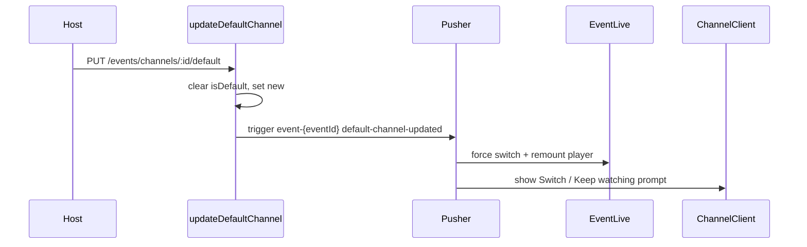

## Workstream A — Event-native reminders (Option B)

### A0. First fix what we are copying: the program landing flow has real bugs

The audit of [frontend/src/components/program/set-reminder-button.tsx](frontend/src/components/program/set-reminder-button.tsx) and [frontend/src/components/program/guest-reminder-push-offer.tsx](frontend/src/components/program/guest-reminder-push-offer.tsx) confirms the two-option modal exists, but it does not behave as you described:

- The guest second option is labelled **"Email only"** and simply closes the dialog (`onClick={() => onOpenChange(false)}`, line 106). It does not require sign-in and produces **no in-app channel** — `defaultReminderChannels` gives subscribers email only. Your spec requires both options to lead to sign-in/sign-up so in-app is guaranteed.
- **Merge race**: `showGuestPushOffer` requires `!isAuthenticated || requiresVerification` (line 170–173). The instant OTP verification flips Redux `isAuthenticated`, `GuestReminderPushOffer` unmounts, and `handleVerified` (which calls `mergeSubscriberRemindersAction`) can be cut off. The guest's reminder is then never linked to their new account.
- `postId` falls back to the literal string `"program"` (line 78) when both enforcement ids are missing, guaranteeing a 404.
- Duplicate dead visitor check at lines 99–102 vs 115–118.
- Visitor-role accounts are hard-blocked (`setTipperSignInOpen`), but your spec says visitors enter an email like any guest.
- No hydration of existing state — reload clears `done` and the user can set the same reminder twice.

Fix these in place, and hoist the choice dialog above the `done` early-return so it survives the auth transition.

### A1. Backend schema + timezone

Migration `backend/prisma/migrations/<ts>_event_timezone_and_event_reminders/`:

- `Event.timeZone String @default("Europe/London")` — the default backfills every existing row, satisfying "all existing events get UK timezone".
- New `EventReminder` model, fully separate from `TipperReminderBucketEntry`:

```prisma
model EventReminder {
  id                      String              @id @default(uuid())
  eventId                 String
  tipperId                String?
  subscriberId            String?
  offsetMinutes           Int                 @default(15)
  remindAt                DateTime
  channels                Json
  scheduledNotificationId String?
  status                  ReminderEntryStatus @default(scheduled)
  createdAt               DateTime            @default(now())
  updatedAt               DateTime            @updatedAt
  event                   Event               @relation(fields: [eventId], references: [id], onDelete: Cascade)
  subscriber              Subscriber?         @relation(fields: [subscriberId], references: [id])

  @@unique([eventId, tipperId])
  @@unique([eventId, subscriberId])
  @@index([remindAt, status])
}
```

- New `NotificationKind` values: `event_reminder`, `event_rescheduled`.

Timezone math: the backend has **no** date library ([backend/package.json](backend/package.json) has only `zod`, `node-cron`, `ms`). Add `dayjs` plus its bundled `utc` + `timezone` plugins — the frontend already ships `dayjs@^1.11.21`, so this is a consistent, tiny addition. New `backend/src/utils/event-schedule.util.ts`:

```ts
/** Resolve an event's wall-clock start/end into absolute UTC instants. */
export function resolveEventInstants(e: {
  eventDate: Date | null;
  startTime: string;
  endTime: string;
  timeZone: string;
}): { startsAt: Date | null; endsAt: Date | null };
```

This replaces the three inconsistent approaches in use today: `combineDateAndTime` (browser-local), `formatDateUK` (hardcoded `Europe/London`), and `getGoogleCalendarUrl` (`Date.UTC`).

### A2. Backend service + routes

New `backend/src/services/event-reminder.service.ts`, reusing the generic infrastructure but none of the TV bucket:

- `setEventReminder({ eventId, tipperId?, email?, offsetMinutes, channels? })` — computes `startsAt` **server-side** from the event row (never trust a client `scheduledAt`, unlike the program endpoint), upserts `Subscriber` for guests, upserts `ScheduledNotification` with `kind: event_reminder`, `idempotencyKey: event-reminder:{entryId}:{offsetMinutes}`, and `deepLinkUrl` pointing at `{base}/room/{eventId}`.
- `getMyEventReminder(eventId, subject)` — lets the button render "Reminder set" on page load.
- `cancelEventReminder`.
- `mergeSubscriberEventReminders({ email, tipperId })` — re-keys guest entries onto the tipper and expands `channels` to include `in_app` (and `push` when they chose that option). Mirrors `mergeSubscriberRemindersIntoTipper` in [backend/src/services/reminder-bucket.service.ts](backend/src/services/reminder-bucket.service.ts).
- `rescheduleEventReminders(eventId)` — recomputes `remindAt` for all `scheduled` entries, updates the linked `ScheduledNotification.runAt`, and fires an **immediate in-app-only** `event_rescheduled` notification via `createNotificationLegacy`, **only for entries that have a `tipperId`** (guest-only subscribers get nothing, per your instruction).

New `backend/src/routes/event-reminder.route.ts` mounted under `/api/v1/events`:

- `POST /events/:eventId/reminders` — `optionalAuthMiddleware`; email required when unauthenticated **or** when role is `VISITOR`.
- `GET /events/:eventId/reminders/me` — `optionalAuthMiddleware`.
- `DELETE /events/:eventId/reminders/me` — auth.
- `POST /events/reminders/merge-subscriber` — auth.

Wire `rescheduleEventReminders` into the two write paths: `createEvent` in [backend/src/controllers/event.controller.ts](backend/src/controllers/event.controller.ts) (accepts `timeZone`, line ~217) and `updateHostEventDetails` in [backend/src/controllers/host.controller.ts](backend/src/controllers/host.controller.ts) (line ~722, called whenever `eventDate`/`startTime`/`endTime`/`timeZone` changes). Extend `newCreateEventSchema` with `timeZone`.

Dispatcher: [backend/src/services/notification-dispatcher.service.ts](backend/src/services/notification-dispatcher.service.ts) is already channel-generic, but its post-send hook only updates `tipperReminderBucketEntry` (lines ~487–500). Add an `event_reminder` branch that marks `EventReminder.status = delivered`, and an event-flavoured email subject/body reusing `buildTipmannaEmailHtml`.

### A3. Frontend

- `frontend/src/lib/event-timezones.ts` — curated list of ~20 IANA zones with `Europe/London` first. Auto-detect via `Intl.DateTimeFormat().resolvedOptions().timeZone`; if the detected zone is not in the shortlist, prepend it so nothing is silently lost.
- Add the timezone field to the three date/time forms: [frontend/src/components/events/host-event-info.tsx](frontend/src/components/events/host-event-info.tsx) (lines 496–569), [frontend/src/components/events/host-event-and-content-info.tsx](frontend/src/components/events/host-event-and-content-info.tsx) (lines 457–529), and [frontend/src/components/host/event-detail-client.tsx](frontend/src/components/host/event-detail-client.tsx) (lines 941–1005). Add `timeZone` to `newEventSchema` in [frontend/src/schemas/index.ts](frontend/src/schemas/index.ts).
- New `frontend/src/actions/event-reminders.ts`.
- New `frontend/src/components/events/event-reminder-choice-dialog.tsx` — the shared post-set modal with exactly two options: **"Push + in-app"** and **"Email + in-app"**. Both require auth: if signed in, apply immediately (skipping push activation when `hasBackendPushSubscription` or `pushState === "subscribed"` already reports a live subscription); if not, open `TipperEmailOtpSignInDialog` prefilled with the email they just used, then merge + apply on verify. Rendered at the component root, not inside a conditional branch, so it survives the auth flip.
- New `frontend/src/components/events/event-set-reminder-button.tsx` — offsets 5/15/30/60/1440, email input for guests and visitors, hydrates from `GET .../reminders/me`, disabled once the event has ended.
- Replace the dead button in [frontend/src/components/events/message-header.tsx](frontend/src/components/events/message-header.tsx) (lines ~253–258, currently no `onClick`) and delete the hardcoded `const isEventOver = false`. Compute the real value from a new zone-aware helper in [frontend/src/lib/utils.ts](frontend/src/lib/utils.ts) using dayjs `utc`/`timezone`.
- Show the timezone label next to the event time. `formatEventDateTime` is duplicated verbatim in `message-header.tsx` (lines 24–68) and [frontend/src/components/events/event-detail-dialog.tsx](frontend/src/components/events/event-detail-dialog.tsx) (lines 20–59) — consolidate into one zone-aware util and thread `timeZone` through `room/[id]/page.tsx` → `EventRoomClient` → `EventHeader` → `MessageHeader`.

Out of scope for this pass: refactoring the three divergent `getEventStatus` copies.

---

## Workstream B — Real-time default video



### B1. Backend broadcast

`updateDefaultChannel` in [backend/src/controllers/event.controller.ts](backend/src/controllers/event.controller.ts) (lines 2400–2455) currently only writes to Postgres. After the transaction, emit on the channel `EventPusherProvider` already subscribes to:

```ts
await pusher.trigger(`event-${channel.eventId}`, "default-channel-updated", {
  channelId,
  url: channel.url,
  title: channel.title,
  isLive: channel.isLive,
});
```

Also invalidate the cached channel/content lists so a reload agrees with the live state.

### B2. Event room — compulsory switch

[frontend/src/components/events/event-live.tsx](frontend/src/components/events/event-live.tsx) resolves `currentChannel` from frozen SSR props (lines 143–154). Add a small hook `frontend/src/hooks/use-default-channel-realtime.ts` that subscribes to `event-{eventId}` via the existing ref-counted `subscribeChannel` in [frontend/src/lib/pusher.ts](frontend/src/lib/pusher.ts), then:

- Hold the new default in local state so it wins over the stale `channels.find(c => c.isDefault)`. The existing `key={currentChannel?.id}` (line 690) already remounts the player, so the switch is immediate for anyone watching.
- Strip any `?frame=` param on a default change and `router.refresh()`, so returning to the room always lands on the current default — your "compulsorily showing the latest default video at all times" requirement.
- Brief toast: "Host switched the streaming video."

### B3. Channel + content clients — prompt, do not yank

[frontend/src/components/events/channel-client.tsx](frontend/src/components/events/channel-client.tsx) and [frontend/src/components/events/content-client.tsx](frontend/src/components/events/content-client.tsx) both hold `currentContent` locally. On the same Pusher event: refetch the playlist, then if `currentContent.id !== newDefaultId` render a new inline banner `frontend/src/components/events/default-video-switch-prompt.tsx` above the player with **"Switch to new video"** and **"Keep watching"**.

An inline banner rather than an action-toast: the codebase has **no** `toast(..., { action })` precedent, `react-toastify` is the mounted library ([frontend/src/app/layout.tsx](frontend/src/app/layout.tsx) lines 168–181), and Sonner's `<Toaster />` is not mounted at all. Adding a second toast system for one prompt is not worth it.

### B4. Pre-existing bug that would make B3 look broken

[frontend/src/app/channel/[eventId]/page.tsx](frontend/src/app/channel/[eventId]/page.tsx) casts `res.data` as `ChannelData[]`, but `getContentChannel` returns `{ formattedContents, isCommunity, communityId, communityName }`. The sibling [frontend/src/app/content/[eventId]/page.tsx](frontend/src/app/content/[eventId]/page.tsx) (lines 175–180) unwraps `formattedContents` correctly. Fix the channel page the same way before layering realtime on top.

Optional follow-up: surface the default-video picker in [frontend/src/components/host/event-detail-client.tsx](frontend/src/components/host/event-detail-client.tsx) so hosts can change it without entering the room, and delete the duplicated dead logic in `event-channel-modal.tsx` (lines 119–153).

---

## Workstream C — Dedicated top-communities endpoint

Today a single `GET /api/v1/communities/explore-catalog` scans up to 500 communities with per-row tip/member/video aggregation and slices the top 3 in memory ([backend/src/controllers/community-discovery.controller.ts](backend/src/controllers/community-discovery.controller.ts) lines 204–265). Fifteen frontend surfaces consume it; **only four actually need the A–Z list**.

### C1. New endpoint

`GET /api/v1/communities/top?limit=3` in the same controller:

- Aggregate approved `ContentBankEntry` rows grouped by `communityId` to rank by summed distinct-event tips, take the top N, then hydrate **only those N** communities with member counts. This avoids the 500-row + memberships fan-out entirely rather than just re-caching it.
- Own cache key `communities:top-by-tips:v1:l{limit}`, `DISCOVERY_RAIL_TTL_MS` via `cacheWrapJson`, plus `setDiscoveryRailCacheHeaders`.
- Apply the same `isExcludedFromTopCommunities` filter.
- **Enrich the results with `viewer.joined`** — the current `topByTips` is returned straight from cache with no viewer state (line 303), so Join/Open buttons in the top section can already be wrong today.

### C2. Frontend

- `getTopCommunitiesAction(limit)` in [frontend/src/actions/communities.ts](frontend/src/actions/communities.ts).
- In [frontend/src/components/explore/explore-page-client.tsx](frontend/src/components/explore/explore-page-client.tsx): a separate `topCommunitiesLoading` state and a `loadTopCommunities()` that fires in parallel with, and independently of, the A–Z catalog. [frontend/src/components/explore/explore-community-picker-menu.tsx](frontend/src/components/explore/explore-community-picker-menu.tsx) section 2 gates on `topCommunitiesLoading`, section 3 keeps `catalogLoading` — so the top 3 paint without waiting.
- Replace the fire-once booleans (`communityCatalogLoadedRef`, `catalogLoadedRef`) with a `"idle" | "loading" | "loaded" | "error"` status. Both are currently set to `true` **before** the fetch, so a single failure permanently blocks retry, and the two paths can still double-fetch the same endpoint.
- Repoint the top-3-only consumers to the new endpoint: `discover-panel.tsx`, `discover-sheet.tsx`, `discover-page-client.tsx`, `discover-catalog-server.ts`, `home/top-communities-section.tsx`, `home/top-communities.tsx`, `tv-interactive-shell.tsx` (currently a raw `fetch`), and `explore-discover-seo-shell.tsx` (call with `limit=12`).
- Keep `explore-catalog` for the genuine A–Z consumers: explore picker section 3, `community-hub-client.tsx`, `community-search-browse-section.tsx`, `sitemap.ts`.
- Fix [backend/src/utils/content-list-cache-invalidation.util.ts](backend/src/utils/content-list-cache-invalidation.util.ts) line 13: it invalidates prefix `"explore-catalog:"` but the real key is `"communities:explore-catalog:v3"`, so the catalog is never actually busted.

---

## Workstream D — Audio controls

### D1. Root cause, one file

[frontend/src/components/events/video-player.tsx](frontend/src/components/events/video-player.tsx) `unmute()` calls `playVideo()` whenever the player was paused or cued (lines 437–443). Every mute button in the app routes through this, which is exactly why unmuting resumes a paused video.

- Delete the auto-play from `unmute()`. Mute state must never change playback state.
- Add an explicit `unmuteAndPlay()` for the one legitimate combined-gesture case (TV autoplay unlock).
- After every mute change, re-read `player.isMuted()` and push it through `onMuteStateChange`, so the icon reflects the real player state rather than optimistic local state.

### D2. Explore feed

[frontend/src/components/explore/explore-feed-client.tsx](frontend/src/components/explore/explore-feed-client.tsx):

- The mute button (lines 706–721) does not set `engageUnlocked` / `reelEngageUnlocked`. A user who unmutes via the button burns their "first tap" anyway and needs an extra tap before pause works. Have it call `onEngageUnlocked?.()`.
- Remove the 80ms `setTimeout(() => videoRef.current?.setMuted(muted))` on every `activeIndex` change (lines 1026–1033). It can re-mute a user who unmuted inside that window. Apply the initial mute state through a `VideoPlayer` prop honoured in `onReady` instead.
- `handleReelTap` should consult `loadReelSoundPref()`: when session sound is already on, the first tap goes straight to play/pause instead of a redundant unmute.
- Stop setting `reelMuted` optimistically from the pref; derive it from `onMuteStateChange`.
- `immersive-channel-actions-rail.tsx` mute (lines 130–141) does not call back into `setReelMuted`. Hidden on Explore today via `hideHostAndAudio`, but fix for correctness.

### D3. Content + channel clients

`toggleMute` in both files sets `isMuted` manually _and_ triggers `onMuteStateChange`, and muting oddly sets `setAudioUnlocked(true)`. Drive the icon from `onMuteStateChange` only and drop the bogus flag. Make the muted-on-content-change behaviour explicit via the new initial-mute prop instead of relying on the `key={currentContent?.id}` remount.

### D4. TV looper "seizing"

- `tipmanna_tv_mute_pref` is written by all three loopers and **never read anywhere** — the TV always starts muted. Read it on mount: keep the _player_ muted for autoplay compliance, but record a pending-unmute so the first user gesture restores their preference.
- Split `unmuteWithUserGesture` in [frontend/src/lib/tv-autoplay.ts](frontend/src/lib/tv-autoplay.ts) (which unconditionally calls `play()`) into `unmuteOnly` and `unmuteAndPlay`. `toggleMute` in [frontend/src/components/tv/web-tv-looper.tsx](frontend/src/components/tv/web-tv-looper.tsx) (lines 830–851) uses `unmuteOnly` and stops calling `setIsPlaying(true)`.
- `prepareMutedLoadForAutoplay` mutes before every orchestrated load and `applyPendingAudioRestore` defers the unmute indefinitely waiting for a gesture ([frontend/src/components/tv-provider.tsx](frontend/src/components/tv-provider.tsx) lines 982–986, 1804–1826). Add a session flag set on the first successful unmute; once set, restore audio immediately after a schedule rollover instead of leaving the user stuck muted with an unmuted-looking icon.
- The looper's sync effect only ever mutes and never unmutes (lines 798–804), so `isMuted === false` can diverge from a muted player. Make it bidirectional once audio is unlocked for the session.
- `frontend/src/components/tv/tv-fullscreen.tsx` has a mute button wired to `onClick={() => {}}`. Wire it or remove it.
- Apply the looper fixes to all three copies: `web-tv-looper.tsx`, `tv-looper.tsx`, `home-tv-looper.tsx`.

---

## Suggested order

D (isolated, highest user-visible impact) → B (small backend change, contained frontend) → C (perf, backed by a 5-minute cache so least urgent) → A (largest: migration, new service, new dispatcher branch, three forms, plus the program-page fixes).
