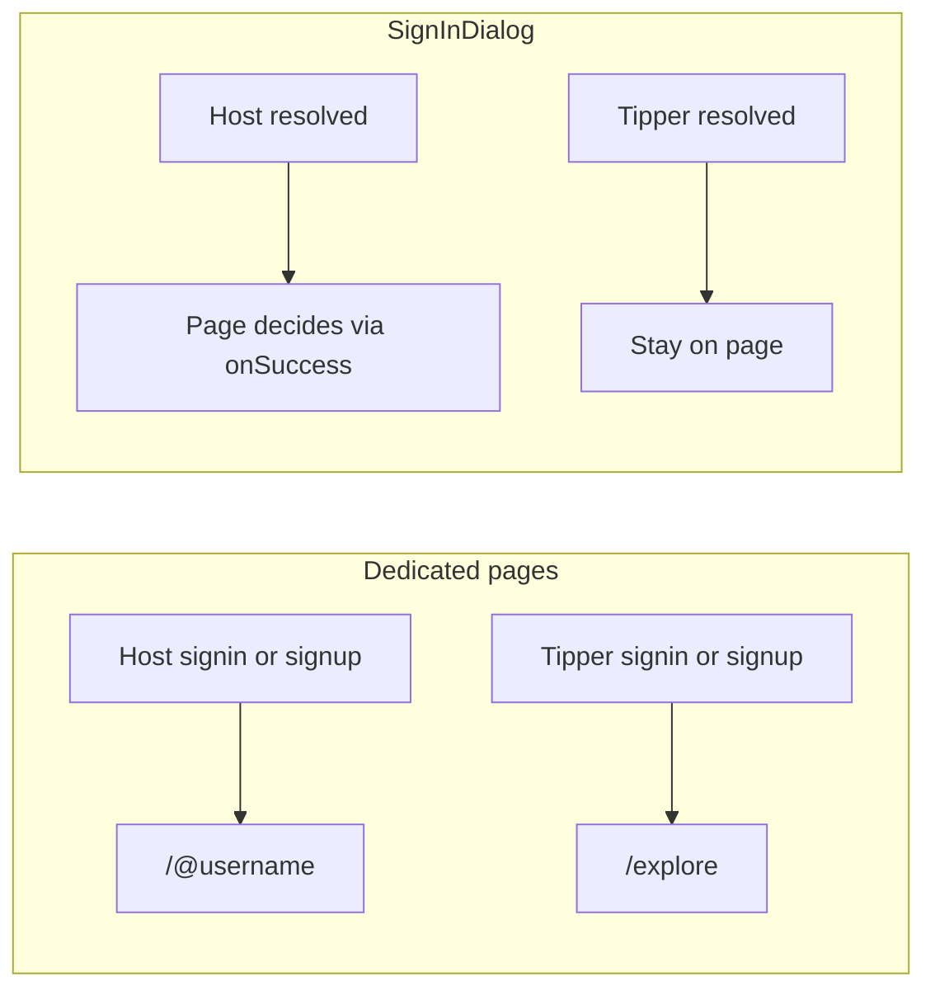

# Fix host signup and auth redirects

## Decisions locked in

- Host usernames and `eventSlug` stay **fully independent**. A username change never touches `eventSlug`, never touches the linked tipper row.
- Host username uniqueness is enforced **against `Host` only**, never against `Tipper`.
- `getAccountNavHref` for a signed-in HOST becomes the creator profile `/@username` everywhere (navbar, footer, creator page).
- Tipper sign-in / sign-up from the dedicated pages lands on `/explore`.
- `eventSlug` keeps being derived from `fullName` (not username), so it stays stable across renames. Only collision handling is added.

---

## Phase 1 — Unblock host signup (the P2002 crash)

### 1a. Collision-safe slug and code generation

`generateSlug` in [backend/src/utils/slug.util.ts](backend/src/utils/slug.util.ts) is a pure transform, so two hosts named "John Smith" both produce `john-smith` and the second `prisma.host.create` violates the `@unique` constraint.

Add DB-aware helpers alongside it (mirroring the existing loop in [backend/src/utils/username.util.ts](backend/src/utils/username.util.ts)):

- `ensureUniqueHostEventSlug(fullName)` — slugify, fall back to `"host"` when the result is empty (emoji/punctuation-only names slugify to `""`, and empty string is a real value under a unique index), then loop with `-2`, `-3`… until `prisma.host.findUnique({ where: { eventSlug } })` is clear. After ~10 attempts append a short random suffix.
- `ensureUniqueHostEventCode(fullName)` — `generateEventCode` gives only ~100 values per name prefix and `eventCode` is also `@unique`. Regenerate in a loop, then widen to a longer random suffix.

### 1b. Use them at both creation sites

- [backend/src/controllers/auth.controller.ts](backend/src/controllers/auth.controller.ts) lines 131-133 (`registerHost`)
- [backend/src/controllers/auth.controller.ts](backend/src/controllers/auth.controller.ts) lines 1000-1002 (`loginOrRegisterHost`)

### 1c. Catch P2002 so a race returns JSON, not a 500

Both controllers currently end in a bare `next(error)`. Wrap the `prisma.host.create` calls so a `PrismaClientKnownRequestError` with `code === "P2002"` regenerates the colliding field and retries once, then surfaces a `409` with a readable message naming the field. This matters because [frontend/src/lib/action-fetch.ts](frontend/src/lib/action-fetch.ts) retries 5xx responses, so today a failed signup silently fires the create twice.

### 1d. Paired-tipper username collision (follows from your note 2)

Once host usernames are no longer checked against `Tipper`, `ensureLinkedTipperForHost` in [backend/src/utils/push-recipient.util.ts](backend/src/utils/push-recipient.util.ts) becomes a new crash site — its `create` branch writes `username: host.username` into `Tipper`, which has its own `@unique` username.

```typescript
  await prisma.tipper.upsert({
    where: { id: host.id },
    create: { ..., username: host.username, ... },
    update: { ..., username: host.username, ... },
  });
```

- `create`: use the host's username only when free in `Tipper`; otherwise derive a unique tipper username from the email.
- `update`: **drop `username` entirely**, so nothing can ever propagate a host rename onto the tipper row.

---

## Phase 2 — Username semantics (your two notes)

### 2a. Stop syncing the tipper username on host rename

In `updateCreatorProfile`, [backend/src/controllers/auth.controller.ts](backend/src/controllers/auth.controller.ts):

- Delete `tipperDataToUpdate.username = normalizedUsername;` (line 2030).
- Delete the now-always-empty `tipperDataToUpdate` declaration (line 1970) and the conditional `prisma.tipper.updateMany` inside the transaction (lines 2151-2159).
- `eventSlug` is already never written here — leave it that way.

### 2b. Stop enforcing uniqueness across Tipper

- Delete the `existingTipper` lookup and its error in `updateCreatorProfile` (lines 2016-2027). The `existingHost` check above it stays.
- `checkHostUsernameAvailability` (lines 226-258) already queries `Host` only — no change needed.
- Split [backend/src/utils/username.util.ts](backend/src/utils/username.util.ts) into two scoped generators, since the current one checks both tables and is used for host *and* tipper usernames:
  - `generateUniqueHostUsername(email)` — checks `Host` only.
  - `generateUniqueTipperUsername(email)` — checks `Tipper` only (used by `ensureTipperForHostEmail`).

### 2c. Honour the submitted username in the modal signup path

`loginOrRegisterHost` validates `req.body.username` at lines 961-972, then throws it away because line 999 shadows it:

```typescript
      const username = await generateUsernameFromEmail(email);
```

Use the submitted username when present, falling back to the generated one only when it is blank. Also guard the two `findUnique({ where: { username } })` lookups at lines 956-966 against an absent username, and remove the `console.log` calls at lines 917-919, 959, 974 and 977.

---

## Phase 3 — Community membership detection

`getCommunityAccessState` in [backend/src/controllers/community-access-state.controller.ts](backend/src/controllers/community-access-state.controller.ts) compares the JWT role against uppercase literals, but every token is minted lowercase (`role: "host"`, `role: "tipper"`) and `authMiddleware` copies it verbatim:

```typescript
    const viewerHostsCommunity = Boolean(
      userId && role === "HOST" && c.ownerHostId === userId
    );
    ...
    if (userId && role === "TIPPER") {
```

Those branches never run, so the endpoint always returns `isMember: false` and a genuine member sees the join prompt.

- Lowercase the comparisons at lines 113, 120 and 143.
- Resolve paired hosts to their tipper id before the membership query, matching `membershipViewerSubject` in [backend/src/controllers/community-discovery.controller.ts](backend/src/controllers/community-discovery.controller.ts), so a host who joined someone else's community is detected too.

I verified every other `req.user.role` consumer already calls `toLowerCase()` or `toUpperCase()` itself, so this is the only broken site and no middleware change is needed. (`payment.controller.ts` reads its role from the request body, not the token.)

---

## Phase 4 — Redirect journeys



### 4a. Host "My Account" goes to the creator profile

In [frontend/src/lib/account-nav-href.ts](frontend/src/lib/account-nav-href.ts), change the `HOST` case from `/host/${user.eventSlug}` to `buildCreatorProfileSharePath(user.username)`, falling back to `/host/${user.eventSlug}` when the username is missing (the helper returns `/` for an empty handle). This updates the navbar, the footer, and the creator page fallback in one place. `getDashboardFooterAccountHref` is a different surface and stays as-is.

### 4b. Tipper lands on /explore

In [frontend/src/app/(auth)/verify-email/page.tsx](frontend/src/app/(auth)/verify-email/page.tsx) lines 113-121, route both the `TIPPER` branch and the `HOST` + `EXISTING_HOST` branch (someone who signed in through the tipper tab) to `/explore`. Plain `HOST` keeps going to the creator profile. Host signup already passes an explicit `?next=/@username`, so it is unaffected.

### 4c. Creator page "My Account" opens the modal for tippers

`handleMyAccountClick` in [frontend/src/components/host/host-creator-page-client.tsx](frontend/src/components/host/host-creator-page-client.tsx) sends any authenticated user through `accountHref`, so a signed-in tipper gets pushed to `/tipper/{username}` instead of the host sign-in modal you specified:

```typescript
  const handleMyAccountClick = () => {
    if (isAuthenticated && user) {
      if (viewerCreatorProfileHref) { router.push(viewerCreatorProfileHref); return; }
      router.push(accountHref);
      return;
    }
    setSignInOpen(true);
  };
```

Gate the navigation on `user.role === "HOST"` so tippers and visitors fall through to `setSignInOpen(true)`. Also remove the `console.log` at line 198 and the one at lines 218-221 that calls `buildCreatorProfileSharePath(hostUsername!)` on a value that is `undefined` for every tipper sign-in.

### 4d. Modal must report the real resolved role

The tipper tab throws away the role the backend returned. `onModalTipperSuccess` takes no arguments in [frontend/src/components/auth/signin-form.tsx](frontend/src/components/auth/signin-form.tsx) (line 83), so [frontend/src/components/auth/sign-in-dialog.tsx](frontend/src/components/auth/sign-in-dialog.tsx) hardcodes the payload:

```typescript
          onModalTipperSuccess={() => {
            onSuccess?.({ role: "TIPPER" });
            onOpenChange(false);
          }}
```

Meanwhile `verifyEmail` genuinely returns `role: "HOST"` with a full host payload when the email belongs to a host ([backend/src/controllers/auth.controller.ts](backend/src/controllers/auth.controller.ts) line 372).

- Change `onModalTipperSuccess` to accept a `SignInModalPayload` and pass the real `user.role` / `user.username` / `eventSlug` from the verify response (around lines 444-468).
- Forward it unchanged from `SignInDialog`.

This is what makes your creator-page rule work: a tipper-tab sign-in on an account that also has a host account now redirects to that host's creator profile, while a genuine tipper still stays on the page.

### 4e. Partner pricing CTAs

In [frontend/src/components/home/pricing-grid.tsx](frontend/src/components/home/pricing-grid.tsx):

- Delete `getPricingReturnPath` (lines 165-178), the three `console.log` calls (168, 180, 182), the unused `pricingReturnPath` variable (line 59) and the stray `Item` import.
- Replace the silent `if (payload.role !== "HOST") return;` in `handlePricingSignInSuccess` with a toast explaining that a host account is required, so the modal no longer just vanishes on a tipper sign-in.
- Tighten `hostDashboardSlug` to require `eventSlug`. The current fallback to `user.username` produces a `/host/{username}/...` URL that `host-subscription-panel.tsx` rejects, since it validates the route slug against the session `eventSlug`.

The destinations themselves are already correct — `premium` goes to `/host/{slug}/host-premium` ("Host Growth") and `community` to `/host/{slug}/host-community` ("Host Community").

---

## Phase 5 — Small correctness fixes

- **Username availability watches the wrong input.** [frontend/src/components/auth/signin-form.tsx](frontend/src/components/auth/signin-form.tsx) line 171 reads `hostForm.watch("emailOrUsername")` (the sign-in field) and feeds it to the availability effect at lines 600-636 and the UI at lines 831-845. Point it at `signUpForm.watch("username")` and rename it to `signUpUsername`; the watch must move below the `signUpForm` declaration at line 205.
- **`?tab=` is ignored.** `app-sidebar.tsx` links to `/sign-in?tab=tipper` but `SigninForm` only honours the modal-only `defaultUserType` prop. Seed `userType` from `searchParams.get("tab")` when no explicit prop is given.
- **Dead links.** `/signin` in [frontend/src/app/restricted/[communityId]/page.tsx](frontend/src/app/restricted/[communityId]/page.tsx) line 30 and `/login` in [frontend/src/components/tv/saved-contents-panel.tsx](frontend/src/components/tv/saved-contents-panel.tsx) line 75 both 404. Point them at `/sign-in`.

---

## Verification

1. Register two hosts with the same full name back to back — both succeed with distinct `eventSlug` and `eventCode` values.
2. Register a host whose chosen username already belongs to an unrelated tipper — succeeds, and the paired tipper row gets a distinct username.
3. Rename a host's username — `eventSlug` unchanged, linked tipper's username unchanged.
4. Join a community as a tipper, reload the community page — the join panel shows member state (`isMember: true` from `/access-state`).
5. Redirect matrix: host signup and signin land on `/@username`; tipper signup and signin land on `/explore`; partner CTAs land on `host-premium` / `host-community`; a signed-in tipper clicking "My Account" on a creator page sees the modal; a tipper-tab sign-in on a host-owned email redirects to that host's creator profile.

## Not included

No database migration is needed — no schema changes. Existing rows with a null `eventSlug` are left alone; if you want those backfilled, that is a separate one-off script.