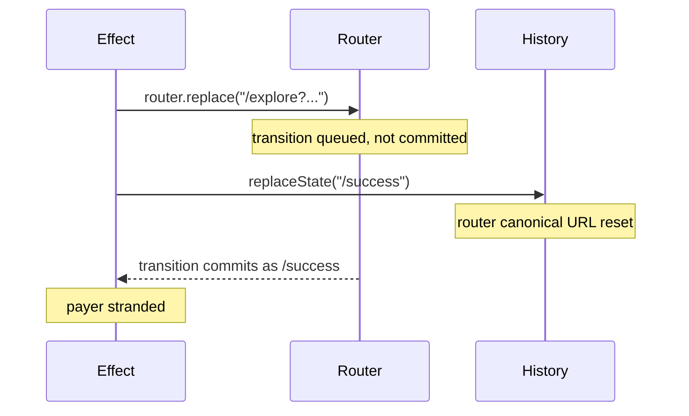

# Fix stuck-on-success redirect and remaining animation gaps

## P0 - Payer stranded on /success (regression, confirmed)

This is my regression from the last change, and it is the highest priority.

In [frontend/src/app/success/page.tsx](frontend/src/app/success/page.tsx) lines 359-363:

```ts
setTimeout(() => {
  setPaymentPendingReturn(true);
  redirectAfterPaymentSuccess(router, storedEventId); // starts async router.replace transition
  sanitizeSuccessUrlInHistory(); // synchronous history.replaceState to "/success"
}, REDIRECT_SETTLE_MS);
```

`router.replace` starts a React transition that resolves asynchronously. `sanitizeSuccessUrlInHistory()` then runs synchronously in the same tick and calls `window.history.replaceState({}, "", "/success")`. Next.js 15.5.7 patches `replaceState` to sync App Router state, so it overwrites the in-flight navigation target. The transition commits against `/success` and the payer never leaves.



### Fixes

1. **Remove `sanitizeSuccessUrlInHistory()` from the redirect branch.** It is redundant there: `router.replace` replaces the current history entry, so the `/success?payment_intent=...&payment_intent_client_secret=...` entry (and its secrets) is discarded automatically.
2. **Call it only in the `blockRedirect` branch** (wallet top-up still processing), which is the only path that intentionally stays on `/success` and therefore keeps the secrets in the URL.
3. **Never let an exception strand the payer.** `void loadSession()` at line 368 has no `catch`; any throw before the `setTimeout` skips the redirect entirely. Wrap the body so the redirect is always scheduled in a `finally`.

## P0 - Navigation watchdog and keyed idempotency

In [frontend/src/lib/payment-success-redirect.ts](frontend/src/lib/payment-success-redirect.ts):

- After `router.replace(path)`, arm a ~1200ms watchdog. If `window.location.pathname` is still `/success`, hard-navigate with `window.location.assign(path)`. Fast path stays soft; the payer can never be stranded again.
- Replace the module-level `paymentSuccessRedirectConsumed` boolean with a `consumedForPaymentIntent: string | null`, so a second payment in the same JS context cannot be silently swallowed. Update `resetPaymentSuccessRedirectForTests` accordingly and pass `paymentIntentId` in from the success page.

## P1 - Gap A: exchange failure leaves no animation and no fallback

The fallback is unreachable when the exchange fails, because the hook bails before it:

```115:120:frontend/src/hooks/use-payer-origin-animation-recovery.ts
    const pending = readPendingPaymentReturn();
    const session = readPaymentRecoverySession();

    if (!pending || !session || session.recoveryCompleted) {
      return;
    }
```

No session is written on `identity_retry`, `transient_failure` or `definitive_rejection`, so `attemptLocalFallback` never runs.

### Fixes

- Add `recoveryUnavailable?: boolean` to `PendingPaymentReturnV1` in [frontend/src/lib/pending-payment-return.ts](frontend/src/lib/pending-payment-return.ts) and to the `patchPendingPaymentReturn` allowed keys. The existing `writePendingPaymentReturn({...existing, ...patch})` spread preserves it through `clearRawRecoveryStateFromPendingReturn`.
- In [frontend/src/app/success/page.tsx](frontend/src/app/success/page.tsx), when the exchange outcome is anything other than `exchanged` or `skipped_no_pending`, patch `recoveryUnavailable: true`.
- In the hook, admit a fallback-only mode: proceed when `!session && pending.recoveryUnavailable === true`, skip the `session.transactionId` and session-token guards, and in `run()` go straight to `attemptLocalFallback()` after the grace window instead of claiming.

## P1 - Gap B: payer sees the animation twice (shared alias dedupe)

The fallback keys on `tx:{transactionId}` while realtime and recovery key on the server `bundleId`, so neither blocks the other. Confirmed cause: [backend/src/services/tip-animation-delivery.service.ts](backend/src/services/tip-animation-delivery.service.ts) line 86 strips `transactionId` from the broadcast even though `CanonicalTipAnimationPayload` carries it.

### Backend

- `pusherPayloadFromCanonical` (line 86): include `transactionId: payload.transactionId`.
- Legacy outbox-off emit at [backend/src/services/tip-payment-side-effects.service.ts](backend/src/services/tip-payment-side-effects.service.ts) line 486: add `transactionId: txId ?? undefined`.

### Frontend

- Add `transactionId?: string` to `TipAnimationEvent` in [frontend/src/lib/animation-guard.ts](frontend/src/lib/animation-guard.ts).
- Add alias support to [frontend/src/lib/playback-key-lifecycle.ts](frontend/src/lib/playback-key-lifecycle.ts): an internal `Map<primaryKey, aliasKey>` plus a `reservePlaybackKeyWithAlias(primary, alias, meta)` that fails if either key is already `reserved` or `committed`, and mirrors state in `commitPlaybackKey` and `releasePlaybackKey` so the queue's existing commit/release calls stay unchanged.
- Use it in [frontend/src/lib/run-payment-bundle-animations.ts](frontend/src/lib/run-payment-bundle-animations.ts) (realtime) and [frontend/src/lib/enqueue-payer-origin-recovery.ts](frontend/src/lib/enqueue-payer-origin-recovery.ts) (recovery), deriving the alias as `buildPaymentPlaybackKey({ prefix, bundleId: "tx:" + transactionId, characterName, occurrenceIndex })` when a `transactionId` is present. Behaviour is unchanged when it is absent, so audience clients on older payloads are unaffected.
- The fallback in [frontend/src/lib/payer-local-animation-fallback.ts](frontend/src/lib/payer-local-animation-fallback.ts) already keys on `tx:{transactionId}`, so it now collides correctly with whichever path ran first.

## P2 - Gap C: remove the ineffective identity retry

`PersistGate` blocks the tree until auth rehydration completes, so `buildOwnership()` returns identical values 150ms later. With the backend now accepting a matching `clientSessionId`, this retry only adds latency. Remove the retry block at lines 348-355 and keep the single exchange call.

## Speed impact

Removing the dead retry saves ~150ms. Optionally reduce `REDIRECT_SETTLE_MS` (400ms) and `PUSHER_GRACE_MS` (400ms), which are serial on the payer path, to 150ms and 250ms for a further ~400ms. The playback-key reservation already handles the Pusher race the grace window guards, and after this change the alias makes that guarantee stronger.

## Verification

- Unit test asserting `sanitizeSuccessUrlInHistory` is not called on the redirect path and is called on the `blockRedirect` path.
- Unit test for the watchdog: still on `/success` after the timer triggers `window.location.assign`.
- Unit tests for alias reservation: realtime-then-fallback and fallback-then-realtime both play exactly once.
- Unit test for fallback-only mode when `recoveryUnavailable` is set and no session exists.
- Manual: Stripe card tip from all nine surfaces, confirming return to the paying surface and exactly one animation; then with `PAYER_ORIGIN_RECOVERY_API_ENABLED=false` to force the fallback path and confirm a single animation.
- Update the flag and failure-mode tables in [docs/payment-animation-product-behavior.md](docs/payment-animation-product-behavior.md), including the new `transactionId` field on the broadcast payload.
