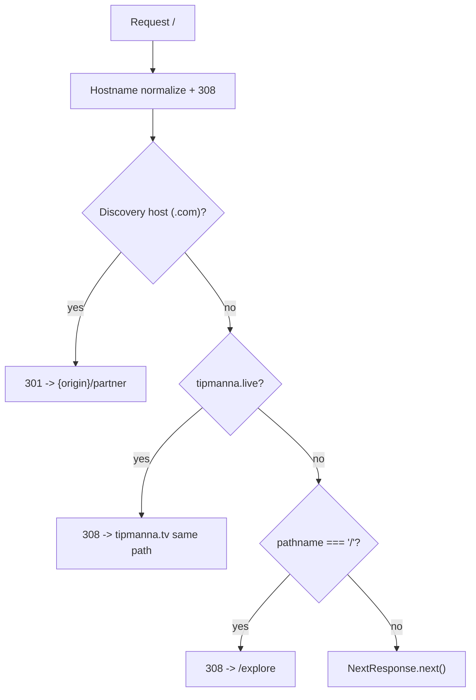

## Corrections to my earlier report

Two things I told you previously were wrong, and they change the work:

- The `prefer-const` build blocker is **not** in `host-banner.tsx` (that file already uses `const eventSlugFromSession`). The two actual ESLint errors are in [frontend/src/components/dashboard/venue-event-card.tsx](frontend/src/components/dashboard/venue-event-card.tsx) lines 107-108.
- The partner PNGs are **already deleted**. `frontend/public/partner/` contains only the five `.webp` files, and no source file references a `_partner.png`. Nothing to do there.

---

## 1. Unblock the build

`npm run lint` currently reports 2 errors and 276 warnings. Only the 2 errors fail `next build` (there is no `eslint.ignoreDuringBuilds` in `next.config.ts`).

In [frontend/src/components/dashboard/venue-event-card.tsx](frontend/src/components/dashboard/venue-event-card.tsx):

```ts
let eventCode = hostSession?.eventCode; // line 107 -> const
let eventSlug = hostSession?.eventSlug; // line 108 -> const
```

Neither is reassigned. Change both to `const`.

Also required at build time (the `assertProductionOrigin` guard in [frontend/src/lib/site-config.ts](frontend/src/lib/site-config.ts) throws otherwise): set `NEXT_PUBLIC_PRIMARY_ORIGIN` and `NEXT_PUBLIC_SITE_URL` to `https://tipmanna.tv`.

---

## 2. Homepage removal strategy

### Order of operations

Redirect first, delete second. If `app/page.tsx` is deleted before middleware covers `/` on non-TV hosts, the root path 404s.



### Middleware change

In [frontend/src/middleware.ts](frontend/src/middleware.ts), the `/` redirect is currently gated behind `canonicalTvHost(hostname)`:

```ts
const tvHost = canonicalTvHost(hostname);
if (tvHost) {
  if (url.pathname === "/") {
    url.pathname = "/explore";
    return NextResponse.redirect(url);
  }
}
```

Remove that block and add a host-agnostic one **after** the `tipmanna.live` block, so `.com` still funnels to `/partner` and `.live` still reaches `.tv` in one hop:

```ts
if (url.pathname === "/") {
  url.pathname = "/explore";
  return NextResponse.redirect(url, 308);
}
```

Use 308 (permanent) rather than the current default 307, since `/` is going away for good. Caveat: browsers cache 308 aggressively, so this is effectively hard to reverse in already-visited clients.

### Delete the page and its orphans

Delete [frontend/src/app/page.tsx](frontend/src/app/page.tsx), then these 12 components, which have no importer other than `page.tsx` or each other:

- `home/hero-server.tsx`, `home/hero-client.tsx`
- `home/tipping-banner.tsx`
- `home/trust-badges.tsx`
- `home/testimonials-lazy.tsx`, `home/testimonials.tsx`
- `home/charities-section.tsx`
- `home/top-events-section.tsx`, `home/top-contents-section.tsx`, `home/top-communities-section.tsx`
- `home/key-stats-lazy.tsx`

Plus `home/trust-badge.tsx`, which is already unreferenced today (duplicate of `new-trust-badge.tsx`).

**Do not delete** `home/charities.tsx` (still used by `tipper/profile-tabs.tsx`), nor `features.tsx`, `lazy-slider.tsx`, `pricing-grid.tsx`, `tv-home-preview-section-lazy.tsx`, `faqs.tsx`, `top-events.tsx`, `top-contents.tsx`, `top-communities.tsx`, `key-stats.tsx` — all are used by `/partner` or the partner wrappers.

---

## 3. Repoint every link and navigation

### `Link href="/"` -> `/explore`

- [frontend/src/components/shared/autodetect-location-prompt.tsx](frontend/src/components/shared/autodetect-location-prompt.tsx) line 333 (logo link)
- [frontend/src/components/explore/explore-global-chrome.tsx](frontend/src/components/explore/explore-global-chrome.tsx) line 234 (wordmark)
- [frontend/src/components/client-error-boundary.tsx](frontend/src/components/client-error-boundary.tsx) line 45 ("Go home")
- [frontend/src/app/error.tsx](frontend/src/app/error.tsx) line 31 ("Go home")
- [frontend/src/app/community/invite/[token]/page.tsx](frontend/src/app/community/invite/[token]/page.tsx) lines 132, 151 ("Back to home")
- [frontend/src/app/cocreator/accept/[token]/page.tsx](frontend/src/app/cocreator/accept/[token]/page.tsx) lines 124, 142 ("Back to home")
- [frontend/src/app/(event)/join/page.tsx](<frontend/src/app/(event)/join/page.tsx>) line 136 ("Home" back link)

The 11th (`hero-client.tsx` line 256) disappears with the orphan sweep.

### Programmatic navigation -> `/explore`

- [frontend/src/app/(auth)/verify-email/page.tsx](<frontend/src/app/(auth)/verify-email/page.tsx>) line 120
- [frontend/src/lib/payment-success-redirect.ts](frontend/src/lib/payment-success-redirect.ts) lines 24, 44
- [frontend/src/components/shared/autodetect-location-prompt.tsx](frontend/src/components/shared/autodetect-location-prompt.tsx) line 322
- [frontend/src/components/join-host/events-client.tsx](frontend/src/components/join-host/events-client.tsx) line 162
- [frontend/src/components/tipper/tipper-banner.tsx](frontend/src/components/tipper/tipper-banner.tsx) line 340
- [frontend/src/components/tipper/visitor-profile-banner.tsx](frontend/src/components/tipper/visitor-profile-banner.tsx) line 169
- [frontend/src/components/home/create-dialog.tsx](frontend/src/components/home/create-dialog.tsx) lines 324, 336 (`let href = "/"` switch default)
- [frontend/src/components/tv/create-drawer.tsx](frontend/src/components/tv/create-drawer.tsx) lines 41, 53 (same pattern)

**Leave alone:** `buildCreatorProfileSharePath` in [frontend/src/lib/creator-profile-url.ts](frontend/src/lib/creator-profile-url.ts) returning `"/"` for an empty username. It is asserted in `creator-profile-url.spec.ts` and guarded by `profilePath !== "/"` in [frontend/src/lib/account-nav-href.ts](frontend/src/lib/account-nav-href.ts) line 32; changing it would break both, and the middleware redirect handles the edge case anyway. Same for `pathname ?? "/"` in `create-dialog.tsx` line 174 (a read, not a target).

### FAQ anchors

The `id="faq"` anchor lives in `home/faqs.tsx`, which after this change renders only on `/partner`.

- [frontend/src/components/shared/navbar-client.tsx](frontend/src/components/shared/navbar-client.tsx) lines 126 and ~245: `/#faq` -> `/partner#faq` (desktop and mobile)
- [frontend/src/components/shared/footer.tsx](frontend/src/components/shared/footer.tsx) line 27: `#faq` -> `/partner#faq` (footer renders on pages with no FAQ section, so the relative anchor is already broken there)
- [frontend/src/components/footer/dashboard-footer.tsx](frontend/src/components/footer/dashboard-footer.tsx) line 28: same

While in the navbar, convert the raw `<a href="/partner#pricing">` at line 118 to `next/link` so it stops forcing a full document load.

### Dead constant

`NAV_LINKS` in [frontend/src/constants/index.ts](frontend/src/constants/index.ts) lines 24-28 has `href: "/"` and `href: "#faq"` but is imported nowhere. Delete it rather than updating it.

### Tests

- [frontend/e2e/smoke.spec.ts](frontend/e2e/smoke.spec.ts) line 4: rewrite "home page loads" to assert the redirect instead — `page.goto("/")` then `await expect(page).toHaveURL(/\/explore/)`.
- [frontend/e2e/create-dialog-signin.spec.ts](frontend/e2e/create-dialog-signin.spec.ts) line 4: `page.goto("/")` -> `page.goto("/partner")`. This matters: `/explore` uses `explore-global-chrome`, not `NavbarShell`, so the "Create" button the four tests in this file depend on is not present there. `/partner` renders `NavbarShell` at line 116.
- [frontend/src/lib/**tests**/audit-remediation.spec.ts](frontend/src/lib/__tests__/audit-remediation.spec.ts) lines 4-9: the "homepage embed" case is now meaningless (it only compares string literals). Optional cleanup.
- `partner-page-metadata.spec.ts` passing `pathname: "/"` still expects `null` — no change needed.

### No change needed

`manifest.webmanifest` already uses `start_url: "/explore"` with no `/` shortcut; `scope: "/"` should stay. `sitemap.ts` has no `/` entry. `robots.ts` `allow: "/"` is scope syntax, not a URL. No file imports `@/app/page`.

---

## 4. Impact section polling -> Route Handler

New file `frontend/src/app/api/impact-in-numbers/route.ts`, matching the conventions in [frontend/src/app/api/auth/host-session/touch/route.ts](frontend/src/app/api/auth/host-session/touch/route.ts) (`NextResponse`, `NEXT_PUBLIC_BACKEND_API_URL`, `{ error }` body on failure):

```ts
export const dynamic = "force-dynamic";

export async function GET() {
  try {
    const res = await fetch(
      `${process.env.NEXT_PUBLIC_BACKEND_API_URL}/impact-in-numbers`,
      { cache: "no-store", headers: { "Content-Type": "application/json" } }
    );
    if (!res.ok) {
      return NextResponse.json({ error: "Upstream error" }, { status: 502 });
    }
    return NextResponse.json(await res.json(), {
      headers: { "Cache-Control": "no-store" },
    });
  } catch {
    return NextResponse.json({ error: "Upstream error" }, { status: 502 });
  }
}
```

Then in [frontend/src/components/home/key-stats.tsx](frontend/src/components/home/key-stats.tsx):

- Delete `export const revalidate = 30` (line 17) — a route segment export in a `"use client"` file, which does nothing.
- Rewrite `refresh` (lines 111-116) to `fetch("/api/impact-in-numbers", { cache: "no-store", signal })`, checking `res.ok` and wrapping in try/catch. Drop the `getImpactInNumbersAction` import.
- Rewrite the interval effect (lines 118-123) to skip when `document.hidden`, refresh immediately on `visibilitychange` back to visible, and abort the in-flight request on unmount.

SSR keeps using the 5-minute ISR path in [frontend/src/lib/partner-data.ts](frontend/src/lib/partner-data.ts); only the client poll changes.

Once `key-stats-lazy.tsx` is deleted and `key-stats.tsx` stops importing it, `getImpactInNumbersAction` in [frontend/src/actions/home.ts](frontend/src/actions/home.ts) is unreferenced — remove it, and remove the file if that is its only export.

---

## 5. Remaining polish

- `isKeyStatEmpty` in [frontend/src/lib/partner-data.ts](frontend/src/lib/partner-data.ts) lines 152-160 checks only 5 of the 7 numeric `KeyStat` fields. A payload where only `activeYoutubeLinks` or `communitiesCreated` are non-zero would be treated as empty and hide the section. Add both to the check.
- [frontend/src/components/home/scheduled-tv-programs.tsx](frontend/src/components/home/scheduled-tv-programs.tsx) returns `null` until its client fetch resolves, so the section pops in and shifts layout. Optional: render a fixed-height skeleton while loading.

---

## 6. Verification

1. `npx tsc --noEmit` — expect zero errors (catches any missed import of a deleted component).
2. `npm run lint` — expect 0 errors.
3. `NEXT_PUBLIC_PRIMARY_ORIGIN=https://tipmanna.tv NEXT_PUBLIC_SITE_URL=https://tipmanna.tv npm run build`.
4. `npm run test` (vitest) and the Playwright e2e suite.
5. Manual: `/` returns 308 to `/explore` on a `.tv` host and on localhost; `.com` root still 301s to `/partner`; navbar FAQ lands on `/partner#faq` and scrolls; impact numbers update every 30s and stop while the tab is backgrounded.
