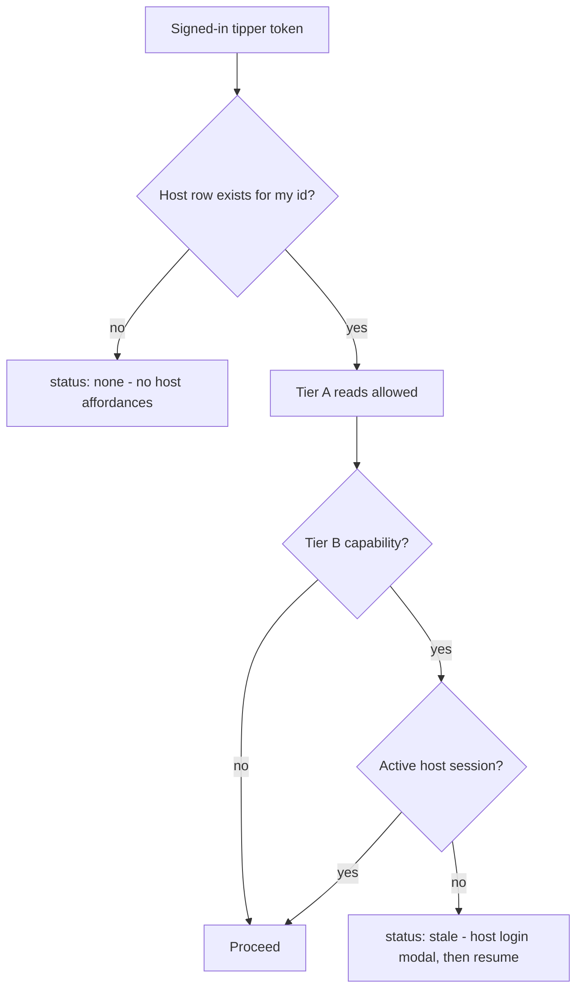

# Hybrid Host Authorization: Policy Codification and Gap Closure

## Decisions locked from this round

- Add videos to an existing event room/channel is Tier A **from the create dialog only**; the event room's own add-video button stays Tier B. Same endpoint, so the caller declares its surface.
- Add videos to a community or co-creator community is Tier B (active host session, modal, resume).
- Cohosts get **full parity** with the owner for every event-scoped route, including `video-display-settings`, so future event-room features are automatically available to them.
- Start-community requests become host-only, and after submission the user is redirected to their host community dashboard in a new tab after a 5-second countdown.
- Signing into a host account whose email differs from the signed-in tipper logs the tipper out; the two never coexist.
- Inactivity is enforced server-side via `lastActiveAt` plus token rotation.

---

## The conclusive authorization policy (deliverable, lives in the codebase)

Three artifacts, one source of truth:

1. `.cursor/rules/authorization-policy.md` - product behavior and team guidance (tiers, session lifetimes, what to do when adding a new host feature).
2. `backend/src/configs/authorization-policy.ts` - machine-readable capability map plus an `enforce(capability)` middleware factory. Every host/cohost route registers through it instead of hand-composing middleware.
3. `frontend/src/lib/authorization-policy.ts` - the same capability keys with their tier, consumed by UI gates so frontend and backend cannot drift.

### Core invariant

`Tipper.id === Host.id` for every linked pair. The identity test is always "does a `Host` row exist for my id", resolved only by `getHostLinkForUserId` in [backend/src/utils/paired-host.util.ts](backend/src/utils/paired-host.util.ts). A host account is **never** inferred from role strings, `auth.tag`, email shape, or cookie presence.

### Tier A - linkage detection alone, no host login

Reads and affordances only. Never mutates host-owned data, never exposes host-private data (revenue, payouts, host notifications, member PII).

- List owned and co-created communities in My Community (`GET /communities/me`, `/communities/sends/me`)
- List own event rooms for the create dialog and TV source picker (`GET /events/host/me/summary`)
- Recognize own creator profile (no Save Host button, Edit button visible but gated on click)
- Owner and co-creator badges, "Manage" affordances rendered
- Nav sends a linked tipper to host sign-in rather than `/create-account`
- **Add videos to an existing owned event room/channel from the create dialog** (surface-scoped, see Phase 3)

### Tier B - active host session mandatory; stale opens the host login modal and resumes

- Any host dashboard route
- Creator profile Edit and save (`PUT /auth/creator-profile`, `PUT /auth/host-profile`)
- Event room administration from the event room UI: create channel, add videos, select streaming video, drop message, screen settings, video display settings, performers/projects add and pin, future event-room features
- Add videos to a community or co-creator community (`POST /communities/:id/content-bank/videos`)
- Start-community request form (`POST /communities/start-interest`)
- Community management, co-creator invites, payouts, revenue
- Host notifications fetch and host Pusher binding
- Event creation wizards - unchanged, the existing `role === "HOST"` gate plus `EventSignInForm` bridge is the correct behavior

### Tier C - cohost session, 7 days, invited event only

Full parity with the owner for everything reachable in that event room. Never the dashboard, creator profile, or any other room. Cohost identity is tied to the tipper account; the tipper's 60-day session is unaffected by cohost expiry. A stale cohost still sees the host-designated event-room UI but any action prompts cohost re-login.

### Session lifetimes

- Tipper: 60 days sliding, refreshed by loading any product page including the dashboard
- Host: 7 days sliding, refreshed by host login or any host dashboard visit
- Cohost: 7 days sliding from invite acceptance, refreshed by event-room activity
- Visitor: 24 hours (already enforced)

---

## Phase 0 - Make the host session detectable (blocker, everything depends on it)

`hostToken` is written `httpOnly: true` in [frontend/src/app/api/auth/host-session/route.ts](frontend/src/app/api/auth/host-session/route.ts), but the only reader is client-side `js-cookie` in [frontend/src/lib/host-session-client.ts](frontend/src/lib/host-session-client.ts). So `hasActiveHostSession()` is permanently false, `useHostCapability` never reaches `active`, and `getHostAuthToken()` returns null - which `serverAuthHeaders` then silently replaces with the **tipper** token.

- Add a `server-only` host token reader and `serverHostAuthHeaders()` beside [frontend/src/lib/server-auth.ts](frontend/src/lib/server-auth.ts), reading the `hostToken` cookie the same way [frontend/src/lib/getToken.ts](frontend/src/lib/getToken.ts) reads `token`. Never fall back to the tipper token on a host-scoped call; return no Authorization header instead.
- Add `hostSessionExpiresAt` and keep `id` in the non-httpOnly `hostUser` cookie; base `hasActiveHostSession()` on that marker rather than on the token. The token stays httpOnly.
- In [frontend/src/hooks/use-host-capability.ts](frontend/src/hooks/use-host-capability.ts): treat the session as active only when the marker is unexpired **and** `hostUser.id === link.hostId`. A mismatch means an unrelated host is in the secondary slot - clear it and fall through to Phase 5's cross-account rule. Remove the tipper fallback from `getHostAuthToken`.
- Give host-scoped server actions an explicit host-session path so `listNotificationsMeAction` and friends cannot be called with a tipper token.

## Phase 1 - Server-side sliding inactivity windows

Only `Visitor` has `lastActiveAt` today; host and tipper tokens are fixed-TTL from issuance and cookies have fixed `maxAge` from login, so neither stated window is expressible.

- Prisma migration: add `lastActiveAt` to `Host`, `Tipper`, and `EventCohost`, mirroring `Visitor`.
- `POST /auth/session/touch` (authMiddleware): updates `lastActiveAt` for the token subject and rotates the token once a threshold of its TTL has elapsed.
- [backend/src/middlewares/auth.middleware.ts](backend/src/middlewares/auth.middleware.ts): reject tipper tokens idle beyond 60 days, host tokens idle beyond 7 days, cohost tokens idle beyond 7 days. Host and cohost staleness return a distinct code (see Phase 2) so the client opens a login modal instead of logging the user out.
- Frontend: a throttled activity pinger in [frontend/src/app/providers.tsx](frontend/src/app/providers.tsx) for the primary session, plus a host touch in [frontend/src/app/(dashboard)/layout.tsx](<frontend/src/app/(dashboard)/layout.tsx>) that also re-issues `hostToken`/`hostUser` with a fresh 7-day window. Event-room load touches the cohost record.
- Normalize the contradictory TTLs in [backend/src/controllers/auth.controller.ts](backend/src/controllers/auth.controller.ts): tipper registration `7d` to `60d` (line ~441, and [backend/src/controllers/visitor.controller.ts](backend/src/controllers/visitor.controller.ts) line ~212), `loginCohost` `60d` to `7d` (line ~738). Cap the host cookie route at 7 days - it currently permits up to `MAX_AGE_DAYS = 60`.

## Phase 2 - Enforcement plumbing and one error contract

- Build `backend/src/configs/authorization-policy.ts` with the capability map and an `enforce(capability)` factory composing `authMiddleware`, `requireRole`, `requireHostOrPairedTipper`, `requireActiveHostSession`, and the event-ownership middlewares. Migrate host/cohost routes in [backend/src/routes/event.route.ts](backend/src/routes/event.route.ts), [backend/src/routes/community-content-bank.route.ts](backend/src/routes/community-content-bank.route.ts), [backend/src/routes/community-discovery.route.ts](backend/src/routes/community-discovery.route.ts), and [backend/src/routes/auth.route.ts](backend/src/routes/auth.route.ts) onto it.
- Add `requireActiveHostSession` to `PUT /auth/host-profile` (only `creator-profile` has it today) and to every Tier B route above.
- Standardize refusals as `403 { code: "HOST_SESSION_REQUIRED" }` and `403 { code: "COHOST_SESSION_REQUIRED" }`. Teach [frontend/src/hooks/use-host-capability-with-auth.tsx](frontend/src/hooks/use-host-capability-with-auth.tsx) to intercept the code, open the modal, and replay the pending task - one contract instead of per-call-site logic.

## Phase 3 - Create dialog

Current state in [frontend/src/components/home/create-dialog.tsx](frontend/src/components/home/create-dialog.tsx): `showHostCreateFlow` is driven by `canReadAsHost`, which includes `stale`, and no write gate exists - so both submit paths can reach a 403. `needsCreateHostAuth` in [frontend/src/lib/needs-create-host-auth.ts](frontend/src/lib/needs-create-host-auth.ts) gates Proceed for signed-out and visitor users only, which is already correct.

- **Linked tipper, existing event room (Tier A):** keep the flow open with no host login. Server-side, `POST /events/:eventId/channel` accepts a paired tipper only when the request carries an `X-Create-Surface: create_dialog` header - a header rather than a body field, since middleware runs before `validate(createChannelSchema)`. New middleware `requireEventChannelActor` allows host, accepted cohost, or paired owner-with-create-dialog-surface, always verifying `event.hostId` against the resolved id. `createEventChannelAction` in [frontend/src/actions/events.ts](frontend/src/actions/events.ts) sets the header only when called from the dialog; the event room omits it and stays Tier B.
- **Linked tipper, community or co-creator (Tier B):** before submit, check `canWriteAsHost`; if stale call `requestHostAuth()` and replay via the existing `pendingVideoSubmitRef` / `resumeVideoSubmit` mechanism (lines ~148, 353-357, 428-439). Send the host token so `POST /communities/:id/content-bank/videos` (currently `requireHost`) succeeds.
- **Linked tipper, create new room/channel:** unchanged - Proceed routes to `/content-only`, `/event-only`, `/event-and-content` and the wizard bridge handles host session detection.
- **Signed-in tipper with no linked host:** the three options render and Proceed is ungated; the wizard bridge requests host sign-up. Scope the host-creator banner (lines 884-896) to signed-out and visitor users, since inviting a tipper with no host account to "sign in as host creator" is misleading.
- **Signed-out or visitor:** three options render, the banner hyperlink and Proceed both open `SignInDialog`, and the existing intent/`pendingHref` resume behavior is preserved verbatim.
- Swap `useHostCapability` for `useHostCapabilityWithAuth` in the dialog so the host modal and Phase 2's error contract are available without disturbing the nested `SignInDialog` used for the signed-out path.

## Phase 4 - Start community request becomes host-scoped with a guided handoff

Today `POST /communities/start-interest` in [backend/src/routes/community-discovery.route.ts](backend/src/routes/community-discovery.route.ts) is `authMiddleware` only, and the controller accepts TIPPER, HOST, or VISITOR. There are also two divergent forms: an inline dialog in [frontend/src/components/community/community-hub-client.tsx](frontend/src/components/community/community-hub-client.tsx) (tipper OTP sign-in, no logo upload) and the shared [frontend/src/components/community/start-community-request-dialog.tsx](frontend/src/components/community/start-community-request-dialog.tsx) (host sign-in, with logo upload) used by the creator profile.

- Backend: route through `enforce("community.startInterest")` with `requireActiveHostSession`; drop TIPPER and VISITOR from the controller's role check in [backend/src/controllers/community-start-interest.controller.ts](backend/src/controllers/community-start-interest.controller.ts).
- Consolidate on the shared dialog and delete the hub's inline duplicate; switch the hub from `TipperEmailOtpSignInDialog` to the host `SignInDialog` with the Phase 5 host-required notice, and restore the currently commented-out "Start community" button (lines ~975-983) so signed-in users have an entry point.
- Gate both entry points on host capability: `active` shows the form immediately; `stale` or `none` opens host sign-in/sign-up first and then opens the form via the existing `pendingStartCommunity` pattern.
- On success: keep the toast, then show a countdown panel that counts 5, 4, 3, 2, 1 and opens `/host/{eventSlug}/host-community` in a new tab, reusing the `window.open(..., "_blank")` pattern already in the hub. `eventSlug` comes from the host user or `capability.eventSlug`.

## Phase 5 - Identity hygiene across sign-in surfaces

- **Unrelated host account:** in [frontend/src/components/auth/signin-form.tsx](frontend/src/components/auth/signin-form.tsx), `tipperKeepsPrimarySession` (lines 234-255) checks only role and callback presence, never email. Add an email/id comparison against the signed-in tipper: on mismatch, run `performAuthLogout`, clear the host session, and make the host the primary session. Dual sessions are only ever the linked pair.
- `performAuthLogout` in [frontend/src/lib/auth-logout.ts](frontend/src/lib/auth-logout.ts) does not call `clearHostSession()`; host cookies currently survive logout. Fix.
- **Modal requirement notice:** add a prop to [frontend/src/components/auth/sign-in-dialog.tsx](frontend/src/components/auth/sign-in-dialog.tsx) that renders a visible notice ("This action needs your host creator account") and lands on the Host creator tab, used everywhere a Tier B action triggers sign-in. Reading your note as host-required, since the surrounding sentence says the action requires host rather than tipper sign-in - flag if you meant the reverse.
- **Already-signed-in states:** add a shared notice component showing who is signed in plus a "Log out to use a different account" button, mounted on `/sign-in` and `/create-account` (neither guards today), and on the modal's tipper and host tabs. Do not auto-redirect - you asked for an indicator with a logout affordance. [frontend/src/components/public-route.tsx](frontend/src/components/public-route.tsx) is dead code that would redirect instead; delete it.
- **Never assume a host account:** audit every `tag === "EXISTING_HOST"` consumer so the tag drives copy only, never authorization. Authorization comes from `GET /auth/me/host-link`.

## Phase 6 - Cohost parity and cohost session

- Adopt the systematic rule in the policy module: every event-scoped route uses `requireRole("host","cohost")` plus `requireEventHostOrCohost` (or the channel variant) plus `resolveEventActorAsHost`. New event-room features inherit cohost access by default.
- Convert the remaining host-only event routes in [backend/src/routes/event.route.ts](backend/src/routes/event.route.ts): `/:eventId/performers`, `/:eventId/projects`, `/:id/video-display-settings`, and `/performers/:performerId/toggle-pin`. The toggle-pin route is `requireHost` with **no ownership check at all**, so any host can pin any performer by id - derive the event from the performer and enforce ownership as part of this change.
- Frontend: replace the residual owner-only gates with `canManageRoomContent` - `show: isHost` for select-streaming-video and performers/projects in [frontend/src/components/events/content-room-settings.tsx](frontend/src/components/events/content-room-settings.tsx) (lines 77, 91), `draftAutosave.enabled` in [frontend/src/components/events/event-channel-modal.tsx](frontend/src/components/events/event-channel-modal.tsx) (line 169), `disabled={!isHost}` in `select-default-video-modal.tsx`, and `isHost={isEventOwner === user?.id}` in [frontend/src/components/events/message-header.tsx](frontend/src/components/events/message-header.tsx) and [frontend/src/components/events/event-live.tsx](frontend/src/components/events/event-live.tsx).
- Add the missing `Authorization` headers in `add-performers-modal.tsx` and `add-projects-modal.tsx` - they POST unauthenticated today and 403 for host and cohost alike.
- Cohost staleness: a stale cohost still renders the host-designated UI; any action returns `COHOST_SESSION_REQUIRED` and opens a cohost login modal that resumes the action. Cohosts created inline at event creation via `mapCohostForCreate` start at `acceptedInvite: false`; keep acceptance as the gate but guarantee an invite is always dispatched so a path to acceptance exists.
- Assert cohost tokens can never satisfy `requireActiveHostSession` (they cannot today) and never reach dashboard or creator-profile routes.

## Phase 7 - Remaining gaps from the observations and the prior plan

- Creator profile: route the Edit button through `requestHostAuth()` and make [frontend/src/components/host/edit-creator-profile-dialog.tsx](frontend/src/components/host/edit-creator-profile-dialog.tsx) send the host token - it currently posts the tipper token into a route that requires a host session.
- Dashboard entry: when capability is `stale`, show the host login modal in place instead of bouncing to `/sign-in` and losing context.
- `getAddEventNavHref` in [frontend/src/lib/account-nav-href.ts](frontend/src/lib/account-nav-href.ts) and [frontend/src/components/shared/footer.tsx](frontend/src/components/shared/footer.tsx): send a linked tipper to host sign-in with wizard resume, an unlinked tipper to `HostUpgradeDialog`. The footer's computed `addEventHref` is currently unused.
- Host notifications: fetch with the host token from Phase 0; when there is no active host session show the stale note and sign-in button rather than any data. Bind the host Pusher channel only on an active host session.
- Visitor leftovers: move visitor creation and `emitWelcomeFirstVisit` from checkout start to payment success in [frontend/src/components/events/tip-drawer.tsx](frontend/src/components/events/tip-drawer.tsx); block visitors in `cancelMyEntry` in [backend/src/controllers/reminder-bucket.controller.ts](backend/src/controllers/reminder-bucket.controller.ts) - the only reminder handler still open. Email-only guest reminders stay allowed.
- Extend [backend/src/scripts/cleanup-visitor-tipper-data.ts](backend/src/scripts/cleanup-visitor-tipper-data.ts) with an owner-membership backfill and run it in the target environment.
- Update the todo statuses in [c:\Users\Elite\.cursor\plans\account_detector_helper_47041162.plan.md](c:\Users\Elite.cursor\plans\account_detector_helper_47041162.plan.md), which still reads `pending` throughout.

---

## Verification

- Linked tipper, no host login: My Community lists owned and co-created communities, the create dialog lists existing event rooms, and adding a video to an existing room succeeds.
- Same session: adding a video to a community prompts host login and replays the submit with no lost form state.
- Event room add-video button with a stale host session prompts host login; the create dialog path does not.
- Cohost succeeds on every event-room action in the invited room and 403s in a sibling room owned by the same host; after 7 idle days the UI still renders but actions prompt cohost re-login while the tipper session persists.
- Start community: signed-out user is asked for host sign-in/sign-up with a visible host-required notice, sees the form, submits, and is handed off to `/host/{eventSlug}/host-community` in a new tab after the countdown.
- Signing into an unrelated host account ends the tipper session; `/sign-in` and `/create-account` show the signed-in notice with a working logout-to-switch button.
- Tipper stays signed in across 60 days of activity; host session goes stale after 7 days without a dashboard visit or host login.
- Tipmanna Public appears in no search, browse, A-Z, top-communities, discovery, or sitemap surface, but still shows in My Community.
