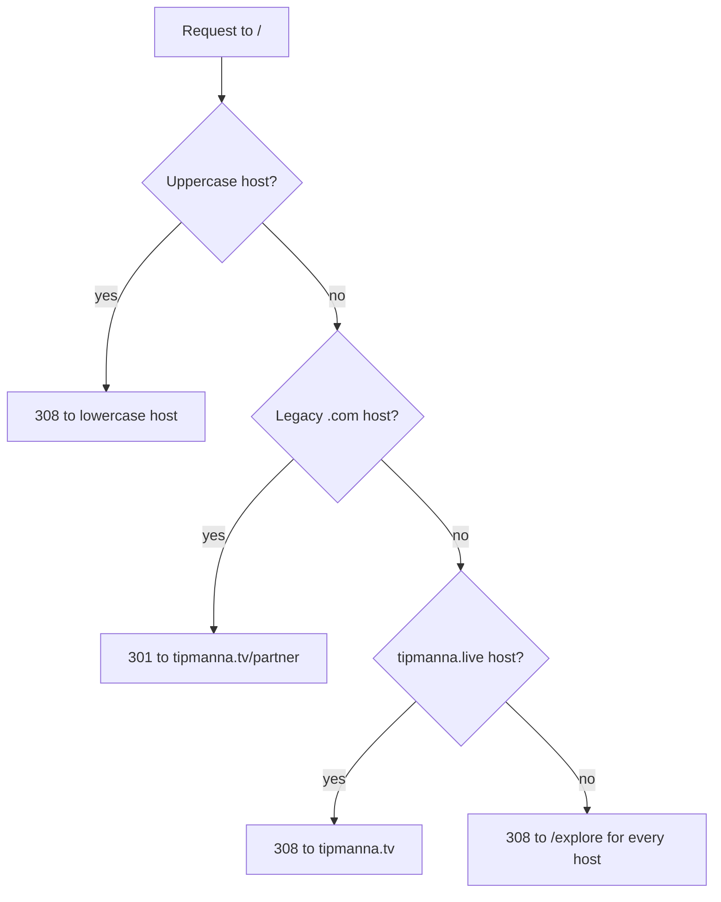

# Partner Page Production Readiness

## Current state

The `/partner` remediation is already implemented (ISR, JSON-LD, OG image, WebP assets, HTML nesting, tablet pricing fix). The original PNGs in `frontend/public/partner` are already gone — only `.webp` remains. Six gaps remain.

## Gap 1: Build is blocked by 2 ESLint errors

`npm run lint` reports `277 problems (2 errors, 275 warnings)`. The two errors are the build blocker, and they are **not** in `host-banner.tsx` (that one is already `const` at line 100). They are in [frontend/src/components/dashboard/venue-event-card.tsx](frontend/src/components/dashboard/venue-event-card.tsx):

```107:108:frontend/src/components/dashboard/venue-event-card.tsx
  let eventCode = hostSession?.eventCode;
  let eventSlug = hostSession?.eventSlug;
```

Change both to `const`. The 275 warnings are pre-existing and non-blocking.

## Gap 2: Remove `/` and redirect to `/explore`

### Removal strategy (per your choice: page only, leave orphaned components)

Delete [frontend/src/app/page.tsx](frontend/src/app/page.tsx) only. The 13 orphaned `home/` components (`hero-server`, `hero-client`, `tipping-banner`, `trust-badges`, `trust-badge`, `charities-section`, `testimonials`, `testimonials-lazy`, `top-events-section`, `top-events-lazy`, `top-contents-section`, `top-communities-section`, `key-stats-lazy`) plus `getAllFeaturedEventsAction` / `getAllTestimonialsAction` in `actions/home.ts` stay in the tree. They are not imported by any route, so they will not be bundled — dead weight in the repo, not in the build. Logged as a follow-up.

Do **not** touch these — `/partner` still needs them: `features.tsx`, `pricing-grid.tsx`, `pricing-card.tsx`, `lazy-slider.tsx`, `image-slider.tsx`, `tv-home-preview-section*.tsx`, `faqs.tsx`, `faq-accordion.tsx`, `top-events.tsx`, `top-contents.tsx`, `top-communities.tsx`, `key-stats.tsx`, `stat-card.tsx`, `create-dialog.tsx`, `new-trust-badge.tsx`, `feature-card.tsx`, `navbar-shell.tsx`, `footer.tsx`. Also keep `charities.tsx` and `logo-slider.tsx` (used by `tipper/profile-tabs.tsx`).

### Middleware

In [frontend/src/middleware.ts](frontend/src/middleware.ts), replace the `.tv`-only block at lines 45-51 with a host-agnostic rule placed **after** the `.live` host normalization so `.live/` resolves in one hop:

```ts
if (hostname === "tipmanna.live" || hostname === "www.tipmanna.live") {
  /* unchanged */
}

if (url.pathname === "/") {
  url.pathname = "/explore";
  return NextResponse.redirect(url, 308);
}
```

Order matters. The legacy `.com` block (lines 38-43) already runs first and keeps sending `.com/` to `https://tipmanna.tv/partner` via `resolveLegacyRedirectTarget` — unchanged, per your decision. `308` replaces the current default `307` since the removal is permanent; note browsers cache 308 aggressively.

`config.matcher` already excludes `/api`, so the new Route Handler in Gap 4 is unaffected.



## Gap 3: Repoint `/` and `#faq` call sites

Add a dependency-free `frontend/src/lib/home-href.ts` exporting `export const HOME_HREF = "/explore";` so a future change is one edit. Do not put it in `constants/index.ts` — that file imports `lucide-react` and would drag icons into `lib/` modules.

Repoint to `HOME_HREF`:

- [frontend/src/app/error.tsx](frontend/src/app/error.tsx) line 32 ("Go home")
- [frontend/src/components/client-error-boundary.tsx](frontend/src/components/client-error-boundary.tsx) line 46 ("Go home")
- [frontend/src/app/community/invite/[token]/page.tsx](frontend/src/app/community/invite/[token]/page.tsx) lines 132, 151
- [frontend/src/app/cocreator/accept/[token]/page.tsx](frontend/src/app/cocreator/accept/[token]/page.tsx) lines 124, 142
- [frontend/src/app/(event)/join/page.tsx](<frontend/src/app/(event)/join/page.tsx>) line 137
- [frontend/src/components/explore/explore-global-chrome.tsx](frontend/src/components/explore/explore-global-chrome.tsx) line 235 (logo)
- [frontend/src/components/shared/autodetect-location-prompt.tsx](frontend/src/components/shared/autodetect-location-prompt.tsx) lines 322, 334
- [frontend/src/components/join-host/events-client.tsx](frontend/src/components/join-host/events-client.tsx) line 162
- [frontend/src/app/(auth)/verify-email/page.tsx](<frontend/src/app/(auth)/verify-email/page.tsx>) line 120
- [frontend/src/lib/payment-success-redirect.ts](frontend/src/lib/payment-success-redirect.ts) lines 24, 44
- [frontend/src/components/tipper/tipper-banner.tsx](frontend/src/components/tipper/tipper-banner.tsx) line 340
- [frontend/src/components/tipper/visitor-profile-banner.tsx](frontend/src/components/tipper/visitor-profile-banner.tsx) line 169
- [frontend/src/lib/creator-profile-url.ts](frontend/src/lib/creator-profile-url.ts) line 10 (empty-handle fallback)
- [frontend/src/components/home/create-dialog.tsx](frontend/src/components/home/create-dialog.tsx) lines 324, 336 (`href` default)
- [frontend/src/components/tv/create-drawer.tsx](frontend/src/components/tv/create-drawer.tsx) lines 41, 53 (`href` default)

Skip `home/hero-client.tsx` line 256 — orphaned.

FAQ anchors (only `/partner` has `id="faq"` after the deletion):

- [frontend/src/components/shared/navbar-client.tsx](frontend/src/components/shared/navbar-client.tsx) lines 126 and 245: `/#faq` becomes `/partner#faq`
- [frontend/src/components/shared/footer.tsx](frontend/src/components/shared/footer.tsx) line 27: bare `#faq` becomes `/partner#faq`
- [frontend/src/components/footer/dashboard-footer.tsx](frontend/src/components/footer/dashboard-footer.tsx) line 28: same; and drop the `#community` entry on line 30 — its only target was `id="community"` in `testimonials.tsx`, which lived on the deleted page
- [frontend/src/constants/index.ts](frontend/src/constants/index.ts) lines 24-28: `NAV_LINKS` is unused but stale — set `href: HOME_HREF` and `/partner#faq`

No change needed to [frontend/src/components/home/hash-scroll.tsx](frontend/src/components/home/hash-scroll.tsx): `resolveScrollTargetId` already returns any raw hash before falling back to partner-specific mapping, so `/partner#faq` scrolls correctly.

Already correct, leave alone: `manifest.webmanifest` (`start_url: "/explore"`), `sitemap.ts` (no `/` entry), `robots.ts` (`allow: "/"` is a crawl scope), `sw.ts` (`/offline` fallback), `not-found.tsx`, and `explore/page.tsx` JSON-LD `isPartOf.url` (schema.org `WebSite.url` should be the origin root).

## Gap 4: Move impact polling to a Route Handler

Today [frontend/src/components/home/key-stats.tsx](frontend/src/components/home/key-stats.tsx) SSRs from the 5-minute ISR cache but polls `getImpactInNumbersAction()` — an uncached server action, which means a server round-trip plus a full RSC payload every 30 seconds per open tab, forever, even in a hidden tab.

1. Extract the `normalizeKeyStat` / `normalizeKeyStatLastWeek` / `defaultKeyStat` helpers (currently duplicated in `key-stats.tsx` lines 19-94 and inline in [frontend/src/lib/partner-data.ts](frontend/src/lib/partner-data.ts) lines 123-150) into a shared `frontend/src/lib/keystat.ts`, and have both call sites use it.
2. Add `frontend/src/app/api/impact-in-numbers/route.ts`:
   - `export const dynamic = "force-dynamic"`
   - `GET` proxies `${NEXT_PUBLIC_BACKEND_API_URL}/impact-in-numbers` with `cache: "no-store"`
   - returns `normalizeKeyStat(json)` with `Cache-Control: no-store`
   - on upstream failure returns `503` so the client keeps the last good value instead of zeroing the UI
3. In `key-stats.tsx`: replace the server action with `fetch("/api/impact-in-numbers", { cache: "no-store", signal })`, abort on unmount, and gate the interval on `document.visibilityState`. Register a `visibilitychange` listener that clears the interval when hidden and restarts it with an immediate refresh when visible.
4. Delete the dead `export const revalidate = 30` on line 17 — it is a no-op in a `"use client"` module.

## Gap 5: KeyStats section dead code

[frontend/src/components/partner/partner-key-stats-section.tsx](frontend/src/components/partner/partner-key-stats-section.tsx) line 11 has an unreachable fallback after the null guard on line 10:

```tsx
if (!stats || isKeyStatEmpty(stats)) return null;
return <KeyStats stats={stats ?? defaultKeyStat()} />;
```

Simplify to `return <KeyStats stats={stats} />` and drop the now-unused `defaultKeyStat` import. Behavior is unchanged: the section hides when the backend is down or all counters are zero, and reappears at the next 5-minute revalidation.

## Gap 6: Tests referencing `/`

- [frontend/e2e/smoke.spec.ts](frontend/e2e/smoke.spec.ts) lines 4-7: rename the test and assert the redirect instead — `page.goto("/")` then `await expect(page).toHaveURL(/\/explore/)`
- [frontend/e2e/create-dialog-signin.spec.ts](frontend/e2e/create-dialog-signin.spec.ts) line 4: `page.goto("/explore")`; the explore chrome renders `CreateDialog`, so the rest of the spec holds
- [frontend/src/lib/\_\_tests\_\_/audit-remediation.spec.ts](frontend/src/lib/__tests__/audit-remediation.spec.ts) lines 4-9: the TV embed now lives on `/partner`, so replace `homepageEmbed = "/"` with `"/partner"` and update the assertion and test name

## Verification

1. `npm run lint` — expect 0 errors (warnings unchanged at 275)
2. `npx tsc --noEmit -p tsconfig.json`
3. `npm run build` — must succeed
4. `npm run test` (vitest)
5. Manual: `/` redirects to `/explore` on localhost; `/partner#faq` scrolls to the FAQ from both navbar and footer; the impact section renders server-side then updates from `/api/impact-in-numbers`; DevTools Network shows polling stop while the tab is backgrounded and resume on focus
