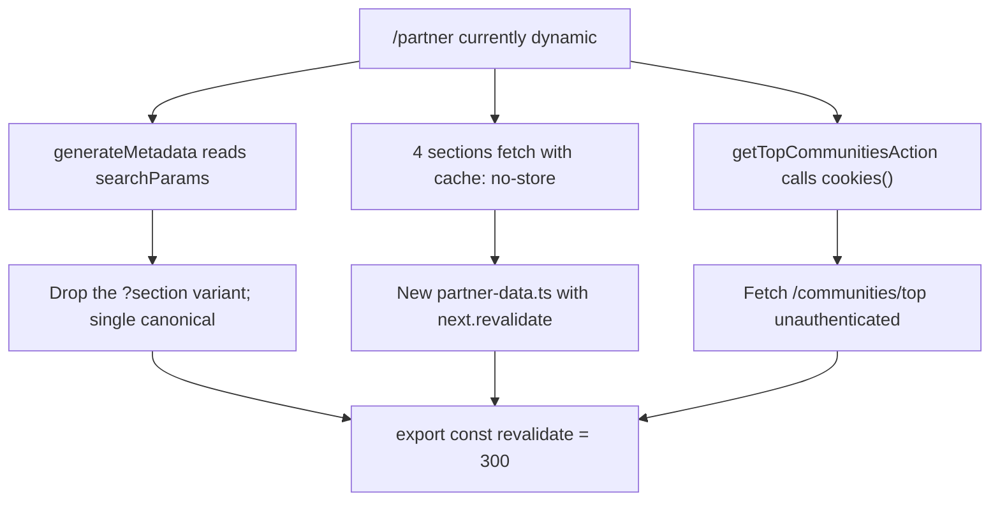

_Confirmed scope: correctness bugs get fixed in place even in components shared with `/`; caching changes stay partner-scoped via new wrapper components so `/` behaviour is unchanged; partner PNGs get converted to WebP._

# Partner Page: Production Readiness

## Phase 1 — Correctness blockers

### 1.1 Give `Title`/`Paragraph` an `as` prop (additive, non-breaking)

`Title` hardcodes `<h2>` and `Paragraph` hardcodes `<p>`, and the new sections wrap them in elements that can't legally contain them. ~68 files import these, so the change must be purely additive: add optional `as` and `id`, keep `h2`/`p` as defaults.

```5:17:frontend/src/components/shared/title.tsx
export const Title = ({
  children,
  align = "left",
  // add: as: Tag = "h2", id
```

Then delete the illegal wrappers at every partner call site rather than nesting:

- [frontend/src/components/home/new-hero-client.tsx](frontend/src/components/home/new-hero-client.tsx):462 — `<h1><Title>` becomes `<Title as="h1" id="hero-headline">`, and the headline must contain the whole sentence. Today the `<h1>` is only "Turn viewers"; "into participants" lives in a sibling `<div>` at line 487. Merge into one `h1`.
- [frontend/src/components/home/new-hero-client.tsx](frontend/src/components/home/new-hero-client.tsx):523-541 — `<Paragraph>` wrapping a `<div>`. Change the inner `<div>` to a `<span>`.
- [frontend/src/components/home/new-trust-badges.tsx](frontend/src/components/home/new-trust-badges.tsx):37 — `<h2>` wrapping `<Paragraph>`. Use `<Paragraph as="h2" id="trust-badges-heading">`.
- [frontend/src/components/home/new-tipping-banner.tsx](frontend/src/components/home/new-tipping-banner.tsx):19, [who-is-tipmanna-for.tsx](frontend/src/components/home/who-is-tipmanna-for.tsx):47, [pricing-grid.tsx](frontend/src/components/home/pricing-grid.tsx):195, [features.tsx](frontend/src/components/home/features.tsx):66 — drop the outer `<h2>`, move `id` onto the `Title`.
- [frontend/src/components/home/stat-card.tsx](frontend/src/components/home/stat-card.tsx):31 — `<h2>` containing a `<Paragraph>`. Change the inner one to a `<span>`.

### 1.2 Fix duplicate DOM ids

`id="features-heading"` appears on four elements on one page (`features.tsx`, `who-is-tipmanna-for.tsx`, `new-tipping-banner.tsx`, `pricing-grid.tsx`) and `top-events-heading` on two (`top-contents.tsx:22`, `top-events.tsx:56`). Give each a unique id and repoint the `aria-labelledby` that references it. Also fix [new-trust-badges.tsx](frontend/src/components/home/new-trust-badges.tsx):33, where `aria-labelledby="trust-badges-heading"` points at an element whose id is `trust-badges-title`.

### 1.3 Heading hierarchy

After 1.1 there is exactly one `<h1>` (hero). Section titles stay `<h2>`. In [content-to-growth.tsx](frontend/src/components/home/content-to-growth.tsx):33 and :66 the step number ("01") is marked up as an `<h2>` while the real step title is a `<p>` — invert that: number becomes a `<span>`, `item.title` becomes `<h3>`.

### 1.4 Pricing features invisible on tablet

```33:35:frontend/src/components/home/pricing-card.tsx
  const isMobile = useMediaQuery({
    query: "(max-width: 500px)",
  });
```

The list renders at `isMobile && seeMore` (line 134) or `hidden ... lg:block` (line 148), so 501px–1023px gets neither. Fix by dropping `useMediaQuery` entirely and doing it in CSS: the "See more" toggle is `lg:hidden`, the collapsed list is `lg:hidden` and gated on `seeMore`, the always-on list is `hidden lg:block`. Removes the bug and the SSR hydration flip in one change.

### 1.5 Crash and unhandled-rejection guards

- [scheduled-tv-programs.tsx](frontend/src/components/home/scheduled-tv-programs.tsx):14-24 — wrap in `try/catch`, check `res.ok`, guard that the payload is an array, and abort on unmount.
- [top-contents.tsx](frontend/src/components/home/top-contents.tsx):40 and :79 — `content.event.id` is unguarded; filter out rows without an `event` before mapping.

### 1.6 Accessibility fixes

- [already-watching.tsx](frontend/src/components/home/already-watching.tsx):126-134 — the "See pricing" control carries `aria-label="Watch TV"` and `aria-haspopup="dialog"` (both copy-paste from the hero) and uses a raw `<a href="/partner#pricing">`, forcing a full document reload on the page you're already on. Remove both ARIA attributes and use `next/link`.
- [new-tipping-banner.tsx](frontend/src/components/home/new-tipping-banner.tsx):55, :60, :80, :99 — four `<Button>` elements with no `onClick`. They are decorative labels; render them as `<span>`/`<div>` so they aren't keyboard-focusable no-ops.
- [new-tipping-banner.tsx](frontend/src/components/home/new-tipping-banner.tsx):84 — the second `motion.div` ignores the `shouldReduceMotion` check the first one honours (line 65). Apply it.
- [support-happens-in-the-moment.tsx](frontend/src/components/home/support-happens-in-the-moment.tsx):33 — add an accessible label to the decorative `<video>` or mark it `aria-hidden`.

---

## Phase 2 — Static rendering / ISR

Target: `/partner` builds as a cached route instead of full SSR on every request.

### 2.1 Remove the three things forcing dynamic



**searchParams.** [partner/page.tsx](frontend/src/app/partner/page.tsx):57 awaits `searchParams` in `generateMetadata`, which alone opts the route out of static rendering. Drop the `pricing` metadata variant and emit one canonical `/partner`. This also resolves the duplicate-content problem flagged in the audit (`canonicalPath: "/partner?section=pricing#pricing"` in [partner-page-metadata.ts](frontend/src/lib/partner-page-metadata.ts):14 serves byte-identical HTML to `/partner`). Deep links keep working: [hash-scroll.tsx](frontend/src/components/home/hash-scroll.tsx) already resolves `#pricing` client-side (line 18) and reads `?section` client-side (line 86), neither of which affects SSR.

**Delete** [partner-page-metadata-sync.tsx](frontend/src/components/partner/partner-page-metadata-sync.tsx) — it rewrites `document.title` and the canonical after hydration, which crawlers never see, and is the source of the server/client canonical split. Trim [partner-page-metadata.ts](frontend/src/lib/partner-page-metadata.ts) to a single metadata object plus `resolvePartnerScrollTargetId` (still used by `HashScroll`), and update [the spec](frontend/src/lib/__tests__/partner-page-metadata.spec.ts).

**Cached data module.** Create `frontend/src/lib/partner-data.ts` — a plain module, _not_ `"use server"` — doing its own `fetch(url, { next: { revalidate: 300, tags: ["partner-sections"] } })` inside `try/catch` with safe empty defaults.

> This cannot reuse `runServerFetch`. `attemptFetchInit` strips the option before it reaches `fetch`:
>
> ```205:205:frontend/src/lib/action-fetch.ts
>   const { perAttemptTimeoutMs, next: _next, ...rest } = init;
> ```
>
> and it attaches an `AbortSignal` when `perAttemptTimeoutMs` is set — Next does not cache signalled fetches. Adding `revalidate` to the existing actions would be silently ignored.

**Partner-scoped section wrappers** in `frontend/src/components/partner/`, reusing the existing presentational children so `/`'s wrappers are untouched:

- `partner-top-contents-section.tsx` → renders `TopContents`
- `partner-top-events-section.tsx` → renders `TopEvents`
- `partner-top-communities-section.tsx` → renders `TopCommunities`, fetching `/communities/top?limit=3` **without** auth headers. Verified safe: the backend route uses `optionalAuthMiddleware` ([backend/src/routes/community-discovery.route.ts](backend/src/routes/community-discovery.route.ts):39-44). This is what removes the `cookies()` dependency.
- `partner-key-stats-section.tsx` → renders `KeyStats`

### 2.2 Flip the route config

Replace `export const dynamic = "force-dynamic"` ([partner/page.tsx](frontend/src/app/partner/page.tsx):1) with `export const revalidate = 300`. Root layout is clean (no `cookies()`/`headers()`) and `NavbarShell` is a client passthrough, so nothing else blocks static rendering.

### 2.3 Suspense boundaries

Wrap each of the four data sections in `<Suspense>` with a skeleton so a cache miss still streams the shell immediately instead of blocking TTFB on the slowest backend call. Add `frontend/src/app/partner/loading.tsx`.

Also give `TopContents`/`TopEvents`/`KeyStats` real empty states on the partner side — today an API failure renders a heading above an empty carousel, and `KeyStats` shows all-zero numbers under "Live updates every 30 seconds".

---

## Phase 3 — SEO restoration

### 3.1 Structured data

Add builders to [frontend/src/lib/structured-data.ts](frontend/src/lib/structured-data.ts) and render them as `<script type="application/ld+json">` in `page.tsx`, matching the existing pattern in [explore/page.tsx](frontend/src/app/explore/page.tsx):101-108:

- **FAQPage** — the 8 Q&A pairs are currently hardcoded in JSX in [faq-accordion.tsx](frontend/src/components/home/faq-accordion.tsx). Extract to a `PARTNER_FAQS` constant, render the accordion by mapping over it, and build the schema from the same source. `/` renders identically.
- **Product / Offer** — built from the existing `PRICING` constant in [frontend/src/constants/index.ts](frontend/src/constants/index.ts):243.
- **Organization** — reuse `buildOrganizationJsonLd`, already exported and unused on this route.

### 3.2 Social preview

`generateMetadata` sets no images and uses `card: "summary"`. Add `frontend/public/og/partner.svg` (1200x630, mirroring `/og/explore.svg`), wire up `openGraph.images` + `twitter.images`, and switch to `summary_large_image` — the same shape as [explore/layout.tsx](frontend/src/app/explore/layout.tsx):22-36.

### 3.3 Duplicate body copy

`content-to-growth.tsx`, `who-is-tipmanna-for.tsx` and `pricing-grid.tsx` each render their full content twice (desktop grid + mobile carousel), so crawlers see every string twice. Collapse each to a single markup pass restyled responsively — one flex container that is a scroll-snap carousel below `lg` and a grid at `lg`.

### 3.4 Production origin

`NEXT_PUBLIC_PRIMARY_ORIGIN` and `NEXT_PUBLIC_SITE_URL` are `http://localhost:3000` in [frontend/.env](frontend/.env):74,78 and there is no `frontend/.env.production`. These are `NEXT_PUBLIC_`, so they are **baked in at build time** — if the deploy doesn't override them, every canonical, OG url and sitemap entry ships as localhost. Add a build-time assertion in `site-config.ts` that fails the production build when the resolved origin is localhost.

---

## Phase 4 — Performance

### 4.1 Images

- Convert the five `public/partner/*.png` slides to WebP with `sharp` (~5.8 MB of source PNGs today; `explore_slide_partner.png` alone is 2.0 MB) and update the paths in `CONTINUOUS_ENGAGEMENT_SLIDES` ([constants/index.ts](frontend/src/constants/index.ts):37-63).
- [partner/page.tsx](frontend/src/app/partner/page.tsx):99-108 — drop `priority` and `fetchPriority="high"` from the below-fold decorative background; it competes directly with the hero LCP.
- [key-stats.tsx](frontend/src/components/home/key-stats.tsx):144 — drop `priority` from another below-fold decoration.
- [new-tipping-banner.tsx](frontend/src/components/home/new-tipping-banner.tsx):48 — `fill` with no `sizes`.
- [support-happens-in-the-moment.tsx](frontend/src/components/home/support-happens-in-the-moment.tsx):33 — the autoplaying Cloudinary MP4 has no `poster` and no `preload` hint. Add `preload="none"` + a poster, and only autoplay once in view.

### 4.2 Kill the SSR media-query flips

`useMediaQuery` from `react-responsive` returns `false` during SSR, so the hero renders at desktop type size and snaps after hydration — visible CLS at the top of the page. Replace with Tailwind breakpoints in [new-hero-client.tsx](frontend/src/components/home/new-hero-client.tsx):398, [new-trust-badge.tsx](frontend/src/components/home/new-trust-badge.tsx):16, [pricing-card.tsx](frontend/src/components/home/pricing-card.tsx):33 (covered by 1.4) and [already-watching.tsx](frontend/src/components/home/already-watching.tsx):33. `new-trust-badge.tsx` can then drop `"use client"` entirely.

### 4.3 Scroll cost and bundle

- Remove `bg-fixed` from the five sections using it (`content-to-growth`, `who-is-tipmanna-for`, `continuous-engagement`, and the two inline-styled wrappers in `page.tsx`). It forces repaint on scroll and degrades badly on mobile Safari.
- Lazy-load `CreateDialog`, `LocationPrompt` and `SignInDialog` via `next/dynamic` — all three are eagerly imported above the fold today.
- Lazy-load `react-slideshow-image` in `continuous-engagement.tsx` behind an IntersectionObserver, as `tv-home-preview-section-lazy.tsx` already does.
- Drop `"use client"` from [who-is-tipmanna-for.tsx](frontend/src/components/home/who-is-tipmanna-for.tsx):1 — it has no hooks or handlers.

---

## Phase 5 — Cleanup and copy

- [new-hero-client.tsx](frontend/src/components/home/new-hero-client.tsx):1-294 — delete 294 lines of commented-out duplicate implementation. Also remove `console.log("Allowed in", country)` (line 329) and the unused `Asterisk`/`Search` imports.
- [features.tsx](frontend/src/components/home/features.tsx) — dead `IntersectionObserver` + unused `visible` state (lines 38-56), dead dynamic `Swiper` (line 33), 11 unused imports.
- [partner/page.tsx](frontend/src/app/partner/page.tsx) — unused `HeroServer`, `TippingBanner`, `TrustBadges` imports and the unused `BACKGROUND_IMAGES` const; delete the two commented-out `DataSection` blocks (lines 155-177).
- Collapse `NewHeroServer` — it is a pass-through that only renders `NewHeroClient`.
- [already-watching.tsx](frontend/src/components/home/already-watching.tsx):73,80 — replace the runtime-built `` `text-${item.txtColor}` `` (invisible to Tailwind's JIT; only works today because `text-black`/`text-white` happen to be emitted by `paragraph.tsx`) with literal classes in the constant.
- [new-trust-badges.tsx](frontend/src/components/home/new-trust-badges.tsx):19 — `useMemo` in a server component is a no-op; remove.
- [continuous-engagement.tsx](frontend/src/components/home/continuous-engagement.tsx):24 unused `activeSlide`; the `continuous-engagement-slideshow` class at line 51 has no CSS rule anywhere.
- Copy fixes: **"Watch TIpmanna TV"** (`new-hero-client.tsx`:571), **"continous engagement"** (`continuous-engagement.tsx`:36), **"accross"** (`constants/index.ts`:56), the `ContinousEngagement` component/file name, and "Connection **become** lasting" (`constants/index.ts`:199).

---

## Phase 6 — Verification

1. `npx tsc --noEmit` and `npx next lint` clean (lint currently has ~35 warnings across these files; target zero in touched files).
2. `npm run build` — confirm `/partner` reports as ISR/static rather than `ƒ (Dynamic)` in the route table.
3. Load `/partner` in dev and confirm **zero** hydration warnings in the console — this is the pass/fail signal for Phase 1.
4. Manually check 375px, 768px, 900px and 1440px. 900px is the specific regression: pricing features must be reachable.
5. Confirm `/` still renders correctly at each breakpoint, since Phase 1 touches shared components.
6. Validate the emitted JSON-LD in Google's Rich Results Test; confirm one `<h1>`, no duplicate ids, and a single `<link rel="canonical">` in view-source.
7. Simulate a backend outage (point `NEXT_PUBLIC_BACKEND_API_URL` at a dead port) and confirm the page still renders its marketing content with graceful empty states.
