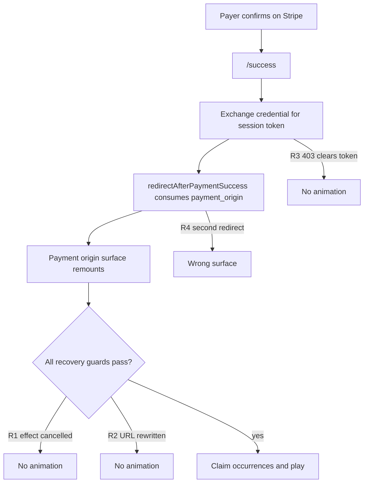

# Payment Animation and Return-Surface Fixes

## What is actually broken

Four independent defects. Any one of them alone is enough to lose the payer's animation, and they are all currently active on the Explore feed and TV surfaces.

### R1. The recovery hook cancels itself on every render (critical)

[frontend/src/hooks/use-payer-origin-animation-recovery.ts](frontend/src/hooks/use-payer-origin-animation-recovery.ts) ends its effect with:

```ts
}, [enabled, eventId, paymentSurface, surface]);
```

Four call sites pass `paymentSurface` as an inline array literal, so it is a new reference on every render:

- [frontend/src/components/explore/explore-feed-client.tsx](frontend/src/components/explore/explore-feed-client.tsx) line 1380 — `["explore_feed", "community_feed"]`
- [frontend/src/components/tv/tv-looper.tsx](frontend/src/components/tv/tv-looper.tsx) line 624, [home-tv-looper.tsx](frontend/src/components/tv/home-tv-looper.tsx) line 624, [web-tv-looper.tsx](frontend/src/components/tv/web-tv-looper.tsx) line 604 — `["tv_looper", "community_tv_looper"]`

Sequence: effect runs, sets `startedRef.current = true`, calls `run()`, which sleeps `PUSHER_GRACE_MS` (400ms). A re-render fires the cleanup, setting `cancelled = true`. The re-run then hits the `startedRef.current` guard and returns. When `run()` wakes it sees `cancelled` and bails. Recovery never claims. On TV this also triggers whenever `currentEventId` rotates.

### R2. Origin matching is too strict for the surfaces that rewrite their own URL

`isCurrentRoutePaymentOrigin` in [frontend/src/lib/payment-recovery-exchange.ts](frontend/src/lib/payment-recovery-exchange.ts) requires full-href equality. But:

- TV's `tv-source-picker-provider` calls `router.replace` in a mount effect to append `?community={id}` from localStorage, and `location.assign` for side-chick mode. Parent effects run before the child recovery effect.
- Explore's video-handoff `useLayoutEffect` appends `feedTab=trends` when returning to `/explore?channel=X&eventId=Y`.

Either rewrite makes the check fail and recovery silently skips.

### R3. A 403 permanently destroys a still-valid credential

Backend `assertRecoveryOwnership` ([backend/src/services/payment-animation-recovery.service.ts](backend/src/services/payment-animation-recovery.service.ts) lines 61-80) throws `Forbidden` when the transaction has a `tipperId` but the client sends none. The backend leaves `exchangedAt` unset, so the credential is still usable — but the frontend calls `clearInvalidRecoveryState()` on any definitive rejection ([payment-recovery-exchange.ts](frontend/src/lib/payment-recovery-exchange.ts) line 102), discarding the raw token from sessionStorage. Recovery is then unrecoverable for that payment.

### R4. `/success` can schedule more than one redirect, and only the first one works

`redirectAfterPaymentSuccess` ([frontend/src/lib/payment-success-redirect.ts](frontend/src/lib/payment-success-redirect.ts) line 21) removes `payment_origin` from localStorage as it navigates. The `/success` effect lists `searchParams` and `authUser` in its dependency array ([frontend/src/app/success/page.tsx](frontend/src/app/success/page.tsx) lines 350-357) with no run-once guard, and `sanitizeSuccessUrlInHistory()` mutates history mid-run. A second pass finds no `payment_origin` and falls through to `/room/{storedEventId}` or `/explore` — exactly the reported "sent back to the wrong place" symptom.



## Fix workstreams

### W1 — Stabilise the recovery effect

In [use-payer-origin-animation-recovery.ts](frontend/src/hooks/use-payer-origin-animation-recovery.ts):

- Derive a stable primitive from `paymentSurface` (for example `const surfaceKey = allowedSurfaces.join("|")`) and depend on that instead of the array. Keep the live array in a ref for the membership check.
- Reset `startedRef.current = false` in the cleanup when the run has not yet claimed, so a genuine dependency change can restart rather than permanently block.
- Key the started guard by `transactionId` rather than a bare boolean, so a second payment in the same session can still recover.

### W2 — Make origin matching intent-based

In [payment-recovery-exchange.ts](frontend/src/lib/payment-recovery-exchange.ts), replace exact-href equality with a comparison that tolerates surface-owned query params:

- Compare `origin` and `pathname` strictly.
- Compare only the identity-bearing params (`channel`, `eventId`, `v`, `videoId`) when present on the saved origin.
- Ignore surface-managed params (`community`, `feedTab`, `tab`, `feedTypes`, `feedLang`, `feedCountry`, `communities`, `tvSource`, `exploreReturnTo`).

Keep `pending.eventId === eventId` as the real correctness gate — it already scopes recovery to the right event. Add unit tests covering the TV `?community=` and Explore `feedTab=trends` cases.

### W3 — Make the exchange survive an identity gap (backend + frontend)

Backend, [payment-animation-recovery.service.ts](backend/src/services/payment-animation-recovery.service.ts):

- In `assertRecoveryOwnership`, accept a matching `clientSessionId` as sufficient proof when the client supplies no `tipperId`/`visitorId`. The caller already holds the single-use credential plus matching `transactionId`, `eventId` and `stripePaymentIntentId`, so this does not weaken the guarantee. Keep the hard 403 when the client asserts an identity that conflicts with the transaction (that path is `ownershipMatches` and stays as-is).

Frontend, [payment-recovery-exchange.ts](frontend/src/lib/payment-recovery-exchange.ts):

- Do not call `clearInvalidRecoveryState()` for a 403 identity mismatch. Reserve credential destruction for `409 already exchanged` and `403 Invalid recovery state`, which are genuinely terminal.
- Return a distinct `identity_retry` outcome so `/success` can retry once auth is settled.

### W4 — One redirect, one time

[frontend/src/app/success/page.tsx](frontend/src/app/success/page.tsx):

- Add a `useRef` run-once guard around `loadSession()`, and reduce the dependency array to the values that genuinely re-key the payment (`paymentIntentId`, `paymentIntentSecret`). Read `authUser` through a ref so late auth changes do not re-trigger the whole flow.
- Move `sanitizeSuccessUrlInHistory()` to after the redirect is scheduled, so it cannot perturb `useSearchParams` mid-run.

[frontend/src/lib/payment-success-redirect.ts](frontend/src/lib/payment-success-redirect.ts):

- Make it idempotent with a module-level `hasRedirected` flag, so a stray second call is a no-op rather than a fallback navigation to the wrong surface.

### W5 — Local fallback animation (chosen behaviour)

New `frontend/src/lib/payer-local-animation-fallback.ts`, consumed by the recovery hook.

- Trigger only after the server path has definitively failed: claim returned 404/403, or no claim resolved within a bounded window after `PUSHER_GRACE_MS`.
- Build tasks from `pending_tip_broadcast_v1` (`selectedTips`, `eventChannelId`, `transactionId`) resolved through the existing character map, and enqueue through the same `useAnimationQueue` path.
- Reuse the existing dedupe primitives in [enqueue-payer-origin-recovery.ts](frontend/src/lib/enqueue-payer-origin-recovery.ts): reserve playback keys via `reservePlaybackKey` / `getPlaybackKeyState`, using a `tx:{transactionId}` bundle namespace. Have the realtime path reserve the same alias so whichever path arrives first blocks the other.
- Write a one-shot `localStorage` marker keyed by `transactionId` so a reload cannot replay it.
- Gate behind a new `NEXT_PUBLIC_PAYER_LOCAL_ANIMATION_FALLBACK` flag, default on, so it can be killed without a deploy.

## Production readiness audit

### Blocker A — the compiled backend disables the entire pipeline

[backend/src/configs/feature-flags.config.ts](backend/src/configs/feature-flags.config.ts) uses opt-out defaults:

```ts
TIP_ANIMATION_OUTBOX_ENABLED: process.env.TIP_ANIMATION_OUTBOX_ENABLED !== "false",
PAYER_ORIGIN_RECOVERY_API_ENABLED: process.env.PAYER_ORIGIN_RECOVERY_API_ENABLED !== "false",
```

But the checked-in `backend/dist/configs/feature-flags.config.js` still has the old opt-in form (`=== "true"`). Neither variable is set in `backend/.env` or `backend/.env.production`. If production runs that `dist/`, both flags are **off**: no `TipAnimationDelivery` rows are written, `createPaymentIntent` returns no `recoveryState`, and every claim 404s. No amount of frontend fixing produces an animation. Action: rebuild `dist/` and set both variables explicitly in the backend env rather than relying on defaults.

### Blocker B — backend flags live in the frontend env file

`TIP_ANIMATION_OUTBOX_ENABLED` and `PAYER_ORIGIN_RECOVERY_API_ENABLED` are at [frontend/.env](frontend/.env) lines 144-145, where the backend process never reads them. Move to `backend/.env` and `backend/.env.production`; keep only `NEXT_PUBLIC_PAYER_ORIGIN_RECOVERY` on the frontend.

### Blocker C — migration must be confirmed applied

`20260804120000_tip_animation_delivery_recovery` creates `TipAnimationDelivery`, `TipAnimationOccurrence`, `PaymentRecoveryCredential` and `TipAnimationRecoveryClaim`. Confirm it is present in `_prisma_migrations` before enabling the outbox flag, otherwise every settlement throws.

### Other findings

- Trace flags are on in dev (`PAYMENT_ANIMATION_TRACE_ENABLED=true` in [backend/.env](backend/.env) line 116, `NEXT_PUBLIC_PAYMENT_ANIMATION_TRACE_ENABLED=true` in [frontend/.env](frontend/.env) line 142). The operator runbook requires both false in production; assert this in the deploy checklist.
- `NEXT_PUBLIC_SINGLE_TIP_STREAM_BROKER` is unset everywhere and relies on an implicit default. Set it explicitly per environment.
- `backend/scripts/backfill-event-channel-num-of-tips.ts` has still not been run; per-video tip counts stay at zero for historical tips until it is.
- Root cause of why recovery exists at all is worth recording: the Stripe webhook usually wins the race, creates the `Message` and broadcasts `tip-animation` while the payer is still on `/success`. `useAutoDropTip`'s later POST is deduped on `transactionId` and does not re-broadcast, so the payer alone misses the event.

## Product behavior guide

New `docs/payment-animation-product-behavior.md`, sitting alongside the existing [operator runbook](docs/payment-animation-operator-runbook.md) and [overload policy](docs/payment-animation-overload-policy.md), which are ops-facing. This one is product-facing and covers:

- The promise: every payer sees their own tip animate on the surface they paid from, and every other viewer of that event sees it once.
- End-to-end flow for both wallet (no redirect) and Stripe card (redirect), including why the webhook/payer race exists and why recovery is the answer.
- Realtime architecture: the `global-live-tv` channel and `tip-animation` event, the single-broker model, `event-{eventId}` for `event-amount-updated` and `live-tip`, and the monotonic guard.
- Broadcast integrity: the outbox (`TipAnimationDelivery`), the advisory lock, emission leases, unique `transactionId`/`bundleId`, and occurrence-level claim/complete accounting.
- Payment integration: cart total to Stripe minor units, PaymentIntent reuse rules, `return_url`, `payment_origin`, `pending_payment_return_v1`, and the credential-to-session-token exchange.
- Surface matrix: which surfaces mount recovery, under which `paymentSurface` label, and which ones rewrite their own URL.
- Flag reference: every flag, its default, what turns on and off, the blast radius of flipping it, and which are safe kill switches.
- Failure modes and what the payer sees for each, plus the local fallback contract.

## Verification

- Unit tests for the stabilised effect dependencies, the relaxed origin match, the 403 retry path, and redirect idempotency.
- Manual matrix: Stripe card tip from Explore feed, TV looper (bare `/tv` with a stored community), channel, content and event room. Confirm return to the exact surface and exactly one animation for the payer.
- Confirm a second viewer sees exactly one animation and no duplicates.
- Wallet tip regression pass on all five surfaces.
- With the backend recovery flag forced off, confirm the local fallback fires once and never double-plays.