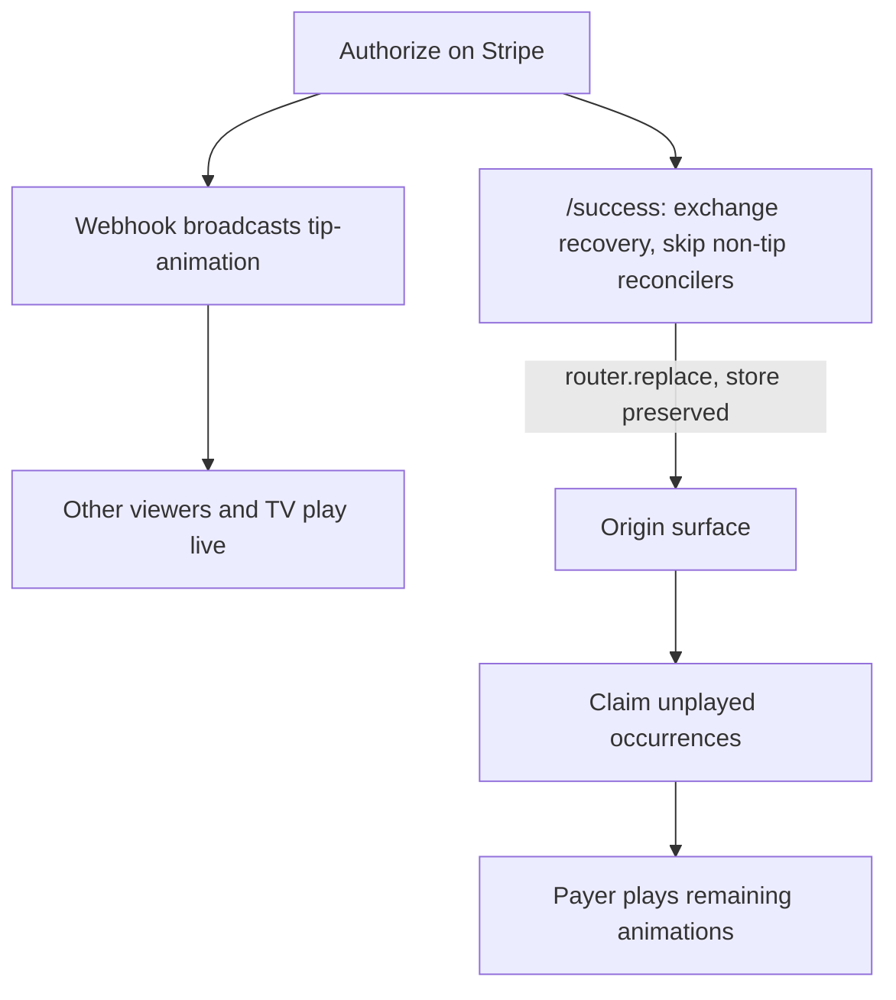

## Payments and payment-animation fixes

Playback routing stays event-scoped (a tip on any video of event X plays on every surface showing event X). No change there. Four workstreams below, in dependency order.

Decisions applied: Option A in full for the channel counter (settlement write plus live tick on the existing Pusher message); comment-drawer video tips move to `Transaction`; feature flags flip to opt-out defaults in code; Stripe amount fixed by syncing the live cart into Elements.

Correction to an earlier claim: `stripe.confirmPayment` defaults to `redirect: "always"`, so Stripe does navigate to `return_url` even for Apple/Google Pay. The long spinner is the `/success` hop plus full page reload, not a permanently stuck overlay. The overlay watchdog is retained as hardening only.

---

### Workstream 1 — Stripe sheet shows the real cart total

Root cause is three copies of the cart-total maths plus a GBP 1 floor. Wallet sheets (Apple/Google Pay/Link) read the amount when the sheet opens, so the amount must be correct before the tap, not only before submit.

- Add `frontend/src/lib/tip-cart-total.ts` exporting `computeTipCartTotal(selectedTips, catalog, textUnitPrice)` and `toMinorUnits(total)`. Replace the duplicated reducers in [frontend/src/components/payments/tipping-elements-provider.tsx](frontend/src/components/payments/tipping-elements-provider.tsx) (`totalFromSelection`), [frontend/src/components/events/stripe-provider.tsx](frontend/src/components/events/stripe-provider.tsx) (`totalAmount`), [frontend/src/components/events/tip-section.tsx](frontend/src/components/events/tip-section.tsx) (line 226) and [frontend/src/components/events/tip-drawer.tsx](frontend/src/components/events/tip-drawer.tsx) (line 496).
- Both providers gain a `textTipUnitPrice` prop and stop hardcoding `Comment` at 5:

```
// tipping-elements-provider.tsx (current)
if (characterName === "Comment") return acc + 5;
amount: Math.max(100, Math.round(deferredTotal * 100)),
```

Replace the floor with the exact amount when the cart is non-empty, falling back to a placeholder minor amount only when the cart is empty (pay is disabled in that state). Do not gate Elements mounting on the total: `TippingElementsProvider` returns bare children when `enabled` is false and `useElements()` throws outside an `Elements` provider.
- Same fix for `amount: deferredAmount * 100 || 100` in [frontend/src/components/events/stripe-provider.tsx](frontend/src/components/events/stripe-provider.tsx) (event room).
- Drive `options.amount` from the live total so react-stripe-js pushes it into `elements.update` before the wallet sheet opens; keep `useDeferredValue` only for non-amount re-render smoothing.
- Belt and braces: in `onConfirm` in [frontend/src/components/events/tip-drawer.tsx](frontend/src/components/events/tip-drawer.tsx), call `elements.update({ amount: toMinorUnits(walletPayTotal) })` immediately before `elements.submit()` (line 678).
- Pass `textTipUnitPrice` at every provider call site: [frontend/src/components/events/channel-client.tsx](frontend/src/components/events/channel-client.tsx) (1486, 1717, 1832), [frontend/src/components/events/content-client.tsx](frontend/src/components/events/content-client.tsx) (1634, 1865, 1976), [frontend/src/components/explore/explore-feed-client.tsx](frontend/src/components/explore/explore-feed-client.tsx) (2686), [frontend/src/components/tv/tv-interactive-shell.tsx](frontend/src/components/tv/tv-interactive-shell.tsx) (1016, 1045), [frontend/src/components/explore/explore-tv-schedule-feed.tsx](frontend/src/components/explore/explore-tv-schedule-feed.tsx) (400), [frontend/src/components/events/event-room-client.tsx](frontend/src/components/events/event-room-client.tsx) (561).
- Resolve the TV text-price conflict: `tv-interactive-shell.tsx` line 1033 passes `textTipUnitPrice={0}` to `TipSection` while its `TipDrawer` defaults to 5. Pick one value from `useTipPresentation().textUnitPrice` and pass it to both.
- Charge-correctness guard in [backend/src/controllers/payment.controller.ts](backend/src/controllers/payment.controller.ts): the quote-reuse branch (line 296) returns an existing PaymentIntent whenever its status is reusable, which can hand back a PI created at an older amount. Only reuse when `existingPi.amount === Math.round(amount * 100)`; otherwise create a new PI.

### Workstream 2 — Payer sees their own animation, and sees it sooner

Flip the three flags to opt-out (on unless the env var is the string `"false"`), matching `isSingleTipStreamBrokerEnabled`:

- [backend/src/configs/feature-flags.config.ts](backend/src/configs/feature-flags.config.ts): `TIP_ANIMATION_OUTBOX_ENABLED` and `PAYER_ORIGIN_RECOVERY_API_ENABLED`.
- [frontend/src/lib/payer-origin-recovery-flag.ts](frontend/src/lib/payer-origin-recovery-flag.ts): `NEXT_PUBLIC_PAYER_ORIGIN_RECOVERY`.

The outbox flag is a hard prerequisite, not a nice-to-have: recovery's claim reads `TipAnimationDelivery` and 404s without it, and only `prepareCanonicalTipAnimationDelivery` writes those rows. Migration `20260804120000_tip_animation_delivery_recovery` already exists, so no schema work. Existing specs mock these flag modules, so the default flip does not break them; re-run and adjust `payment-intent-recovery-flag.spec.ts` only if it asserts the default rather than the mock.

Close the gaps that would make recovery a silent no-op:

- Surface allowlist mismatch on explore: the recovery hook allows only `"explore_feed"` ([frontend/src/components/explore/explore-feed-client.tsx](frontend/src/components/explore/explore-feed-client.tsx) line 1370) while the drawer sends `"community_feed"` on the community tab (line 2698). Accept both.
- Surface mislabel on the content page: [frontend/src/components/events/content-client.tsx](frontend/src/components/events/content-client.tsx) line 1643 renders `TipSection` with `paymentSurface="channel_client"` while that page's recovery hook allows only `"content_client"`. Correct the label (also fixes surface analytics).
- Confirm `writePendingPaymentReturn` coverage: it is called only in [frontend/src/components/events/tip-drawer.tsx](frontend/src/components/events/tip-drawer.tsx) line 824. That is the only Stripe tip confirm path in use; [frontend/src/components/payments/stripe-payment-button.tsx](frontend/src/components/payments/stripe-payment-button.tsx) is unreferenced dead code (it also contains a stray `router.push("/success")`). Delete it or wire it properly rather than leaving a second divergent confirm path.

Make the return fast and store-preserving in [frontend/src/app/success/page.tsx](frontend/src/app/success/page.tsx):

- Detect the tip flow up front via `readPendingPaymentReturn()` / `readPendingTipBroadcast()` and skip the wallet-top-up and community-subscribe reconcile loops entirely (each is a 12-attempt backoff loop; a tip currently still pays for one probe round trip).
- Replace `window.location.href = origin` (line 335) with the existing but currently unused `redirectAfterPaymentSuccess` in [frontend/src/lib/payment-success-redirect.ts](frontend/src/lib/payment-success-redirect.ts). Client-side `router.replace` keeps the fresh Redux store alive across the hop, so `markPaymentCompleted(true)` survives to the origin surface. The resulting href still equals `pending.paymentOrigin`, which `isCurrentRoutePaymentOrigin` requires.
- Cut the fixed 1500 ms timer to a short settle delay, and navigate as soon as the recovery exchange resolves.
- Reduce `DROP_DELAY_MS` (1500 ms) in [frontend/src/hooks/use-auto-drop-tip.ts](frontend/src/hooks/use-auto-drop-tip.ts). Keep the POST: it is still the only path that clears cart state and the only emitter when the webhook is late.
- Hardening: add a watchdog in `tip-drawer.tsx` that clears `isRedirecting` and surfaces an error if no navigation happens within a few seconds, so a non-navigating confirm can never hang the UI.



### Workstream 3 — Per-video tip counts (Option A, full)

- Increment the channel row at settlement, inside the existing idempotency guard so a duplicate webhook cannot double count, and only when `paymentContentId` is set: `EventChannel.numOfTips` plus `lastTipAt`. Two sites: the `tx.event.update` block in [backend/src/webhooks/stripe.webhook.ts](backend/src/webhooks/stripe.webhook.ts) (line 319) and the `tx.event.update` block in [backend/src/services/tip-payment-side-effects.service.ts](backend/src/services/tip-payment-side-effects.service.ts) (line 928). `EventChannel` has no `amountRaised` column, so per-video money is out of scope.
- Extend the existing `event-amount-updated` payload with two optional fields (`paymentContentId`, `channelNumOfTips`) in `buildAmountPayload` / the webhook trigger (line 407) and `broadcastTipSuccessToEvent` (line 687). No new event and no new subscription.
- Consume them in [frontend/src/hooks/use-event-financial-realtime.ts](frontend/src/hooks/use-event-financial-realtime.ts): accept an optional `channelId` and return `channelNumOfTips`, ignoring payloads whose channel id does not match the surface's current video (important for TV and explore, where the active video changes).
- Remove the `?? liveNumOfTips` fallbacks so a real zero renders as zero instead of borrowing the event total: [frontend/src/components/tv/tv-looper.tsx](frontend/src/components/tv/tv-looper.tsx) (661), [frontend/src/components/tv/home-tv-looper.tsx](frontend/src/components/tv/home-tv-looper.tsx) (661), [frontend/src/components/tv/web-tv-looper.tsx](frontend/src/components/tv/web-tv-looper.tsx), [frontend/src/components/events/channel-client.tsx](frontend/src/components/events/channel-client.tsx) (1872), [frontend/src/components/events/content-client.tsx](frontend/src/components/events/content-client.tsx) (2018), [frontend/src/components/explore/explore-feed-client.tsx](frontend/src/components/explore/explore-feed-client.tsx) (2537, 2717), [frontend/src/components/tv/tv-interactive-shell.tsx](frontend/src/components/tv/tv-interactive-shell.tsx) (214).
- One-off backfill script under `backend/src/scripts/` deriving `EventChannel.numOfTips` from `Transaction.groupBy(["paymentContentId"])` where `status = "succeeded"`, mirroring the existing grouping in [backend/src/controllers/host.controller.ts](backend/src/controllers/host.controller.ts) (line 1585). Idempotent, safe to re-run.

### Workstream 4 — Comment drawer video tips (approved)

- In [backend/src/controllers/message-social.controller.ts](backend/src/controllers/message-social.controller.ts) (line 147), replace the `prisma.message.count` source with a `Transaction` count (`status: "succeeded"`, `paymentContentId: channelId`), or read the new `EventChannel.numOfTips`. `Message` is a chat artifact: it can be skipped by the `transactionId` dedupe, can fail to create on the fallback path, and on the client `createMessage` route its `eventChannelId` originates from browser storage.
- Label the two figures unambiguously in [frontend/src/components/events/comment-drawer.tsx](frontend/src/components/events/comment-drawer.tsx) (line 596): event/channel tips versus this video.
- Flagged for your call, not assumed: line 629 renders `amountRaisedLabel ? "£0" : "£0"`, so raised is always GBP 0 on that panel. Either bind it to the real `amountRaised` prop or remove the block if hiding it was intentional.

### Verification

- Unit: `computeTipCartTotal` (mixed cart, duplicate characters, host text price, empty cart); `elements.update` called with the live minor total before `submit`; PI reuse rejected on amount mismatch; channel increment fires once per transaction and never for `event_room`; `event-amount-updated` consumer ignores non-matching channel ids.
- Existing suites to re-run: `backend/src/services/__tests__/payment-animation-delivery.service.spec.ts`, `payment-animation-emission-retry.spec.ts`, `tip-payment-idempotency.spec.ts`, `backend/src/controllers/__tests__/message-create-duplicate-emission.spec.ts`, `frontend/src/lib/__tests__/payer-origin-recovery-p0b.spec.ts`.
- Manual, per surface (event room, channel, content, explore, community feed, TV): select a multi-character cart including a text tip, confirm the Stripe sheet shows the cart total (not GBP 1), pay by card with 3DS, and confirm the payer lands back on the origin surface and plays the full bundle while a second browser on the same event also plays it. Then confirm the video counter ticks and the event counter ticks independently.
- Rollback: every behavioural switch is a flag. Setting `TIP_ANIMATION_OUTBOX_ENABLED=false`, `PAYER_ORIGIN_RECOVERY_API_ENABLED=false` or `NEXT_PUBLIC_PAYER_ORIGIN_RECOVERY=false` restores today's path without a deploy revert.

### Sequencing note

Workstream 1 is independent and shippable first. Workstream 2 must ship the outbox flag with the recovery flags together. Workstream 3's Pusher field addition is additive and backwards compatible, so backend can precede frontend.