## Phase 11 - Community fixes (single deploy)

This plan is intentionally additive. No destructive migrations, no breaking changes to existing role-gated routes; new behavior is opt-in via new flags, new endpoints, and a new dialog component. Each section maps back to the 16 observations.

```mermaid
flowchart LR
    subgraph schema [Schema migration phase 11]
        A1[CommunityActivationRequest]
        A2["Community.tvHostPaused Boolean default false"]
    end
    subgraph backend [Backend]
        B1[Auto Tipmanna Public membership helper]
        B2[Activation request controller routes]
        B3[Paired-host middleware + listMyJoinedCommunities]
        B4[communityIds in trends saves]
        B5[Side-chick controller allow paired host]
        B6[TV enforcement gates + tvHostPaused]
        B7[Superadmin community analytics]
        B8[Tip feed by eventId]
        B9[Idempotent enter-side-chick]
        B10[communityId on channel content analytics]
    end
    subgraph frontend [Frontend]
        F1[SignInDialog + signin-form reads next OR redirect]
        F2[Explore client keeps Trends Saves TV in side-chick]
        F3[Saves event-driven refresh]
        F4[Community TV tip filter by eventId]
        F5[TV looper inline source dropdown]
        F6[Host community-create + request-tv-activation]
        F7[Community TV host UI: auth header + ongoing+upcoming]
        F8[Community join page allow host]
        F9[Side-chick magic page: dialog + 409 ok]
    end
    subgraph superadmin [Superadmin Vite app]
        S1[Activation requests queue]
        S2[Community analytics page]
        S3[TV reorder tab]
        S4[Community TV activate deactivate]
    end
    schema --> backend --> frontend
    backend --> superadmin
```

---

### 1. Schema migration

New file `backend/prisma/migrations/20260509000000_phase_11_community_fixes/migration.sql` and matching schema edits in `[backend/prisma/schema.prisma](backend/prisma/schema.prisma)`:

- `CommunityActivationRequest { id, eventId (unique while pending), requestedByHostId, status: pending|approved|rejected|cancelled, kind: community|tv, notes Text?, createdAt, decidedAt, decidedByAdminId }`. Index on `(status, createdAt)` and `(requestedByHostId)`.
- `Community.tvHostPaused Boolean @default(false)`.
- No drops, no defaults that backfill destructively. Safe to deploy live.

Backfill script `backend/src/scripts/backfill-system-membership.ts`: iterates `Tipper` + `Visitor`, idempotent upsert into `CommunityMembership` for the system community. Safe to re-run; protected by the existing `@@unique([communityId, tipperId])` and `@@unique([communityId, visitorId])` constraints.

### 2. Backend

#### 2.1 Auto Tipmanna Public membership (observation 2)

- Add `ensureSystemMembershipForTipper(tipperId)` and `...ForVisitor(visitorId)` in `[backend/src/utils/community-membership.util.ts](backend/src/utils/community-membership.util.ts)`. Both call `getSystemCommunityId()` (reuse helper from `[backend/src/services/side-chick.service.ts](backend/src/services/side-chick.service.ts)`) and upsert.
- Wire into `[backend/src/controllers/auth.controller.ts](backend/src/controllers/auth.controller.ts)`: after every `tipper.create` (lines ~~119-128, ~293-300, ~660-667, ~757-795) and after `visitor.create` in `[backend/src/controllers/visitor.controller.ts](backend/src/controllers/visitor.controller.ts)` (~~40-47).
- In `[backend/src/controllers/community-membership.controller.ts](backend/src/controllers/community-membership.controller.ts)` `leaveJoinedCommunity`, reject when target is `isSystem === true` (return 400 "System community membership cannot be left").

#### 2.2 Community activation request flow (observation 1)

- New `[backend/src/controllers/community-activation-request.controller.ts](backend/src/controllers/community-activation-request.controller.ts)`:
  - `postCreateActivationRequest` (host-only): validates host owns the event and event has no `communityId` and no pending request; creates row.
  - `getMyActivationRequests` (host).
  - `listActivationRequests` (admin): pending + history with filters.
  - `postApproveActivationRequest` (admin): calls existing `activateCommunityForEvent` logic, then marks request approved. For `kind: tv`, calls existing `activateCommunityTv`.
  - `postRejectActivationRequest` (admin): sets status + notes + notification.
- New routes in `[backend/src/routes/community-admin.route.ts](backend/src/routes/community-admin.route.ts)` (admin paths) and a small host route file `backend/src/routes/community-activation-request.route.ts` mounted at `/api/v1/communities/activation-requests`.
- Existing `POST /api/v1/superadmin/communities/activate` remains untouched as a manual override.

#### 2.3 Paired-host fixes for community routes (observation 7)

Root cause: `[frontend/src/app/community/[id]/join/page.tsx](frontend/src/app/community/%5Bid%5D/join/page.tsx)` lines 66-79 force `role === "TIPPER"`, and backend routes use `requireTipper` (`[backend/src/routes/community-membership.route.ts](backend/src/routes/community-membership.route.ts)` ~~46-93). `Tipper.id === Host.id` is invariant in `[backend/src/controllers/auth.controller.ts](backend/src/controllers/auth.controller.ts)` (~~91-128).

- Add `requireTipperOrPairedHost` in `[backend/src/middlewares/role.middleware.ts](backend/src/middlewares/role.middleware.ts)`: allow `tipper`; allow `host` if `prisma.tipper.findUnique({ where: { id: req.user._id } })` exists; else 403. Cache the lookup on `req.user.pairedTipperId`.
- Replace `requireTipper` with `requireTipperOrPairedHost` ONLY on community-scoped routes: `[backend/src/routes/community-membership.route.ts](backend/src/routes/community-membership.route.ts)` and `[backend/src/routes/community-subscription.route.ts](backend/src/routes/community-subscription.route.ts)`. Other tipper-only surfaces remain unchanged.
- In `tipperJoin` and other handlers, treat `req.user._id` as `tipperId` (already does this via `getUserId`); add a sanity guard that `prisma.tipper.findUnique({ where: { id }})` returns a row.
- Fix `[backend/src/controllers/community-discovery.controller.ts](backend/src/controllers/community-discovery.controller.ts)` `getTipperOrVisitorSubject` (~~11-26) to map `host` role -> `{ tipperId: user._id }` when paired tipper exists, instead of `{ hostId }`. `listMyJoinedCommunities` (~~129-158) then queries `where: { tipperId }`.
- Relax `[backend/src/controllers/side-chick.controller.ts](backend/src/controllers/side-chick.controller.ts)` `reqTipperId` (~29-36) to allow paired host (tipperId === host._id).
- Relax `acceptInviteByToken` (~968-984 in `[community-membership.controller.ts](backend/src/controllers/community-membership.controller.ts)`) similarly.

#### 2.4 Side-chick keeps Trends/Saves/TV (observation 13)

- `[backend/src/schemas/explore-feed.schema.ts](backend/src/schemas/explore-feed.schema.ts)` already accepts `communityIds`. Wire it into the trends and saves branches in `[backend/src/controllers/content.controller.ts](backend/src/controllers/content.controller.ts)`:
  - `buildExploreTrendsWhere`: AND `communityBankEntry.communityId in communityIds` when provided.
  - `buildSavesExplorePool`: when `communityIds` provided, restrict to saves whose channel's `communityBankEntry.communityId in communityIds` AND re-apply `communityBankAccessWhereForLists` to the final `findMany` (also fixes observation 3b leak).

#### 2.5 Idempotent side-chick enter (observation 14)

- In `[backend/src/services/side-chick.service.ts](backend/src/services/side-chick.service.ts)` `enterSideChick` (~109-115): if existing open activation matches the same `communityId`, return that activation row (200) instead of throwing 409. Different community still throws 409.

#### 2.6 Community TV live tip from linked event (observation 4)

- `[backend/src/controllers/content.controller.ts](backend/src/controllers/content.controller.ts)` `getTipFeed`: accept optional `eventId` query; when set, scope `Message` query to that event.

#### 2.7 Admin TV enforcement (observation 16)

- `[backend/src/controllers/community-tv.controller.ts](backend/src/controllers/community-tv.controller.ts)`:
  - `assertCommunityTvActivated` (~70-77): also throw 404 when `tvHostPaused === true`.
  - Add the same guard at the start of `searchCommunityTvChannels` (~465-528).
  - `postCommunityTvDeactivateByHost` (~531-561): set `tvHostPaused: true` only; do NOT null `tvActivatedAt`/`tvActivatedByAdminId`. Add a sibling `postCommunityTvResumeByHost` that sets `tvHostPaused: false` and re-runs `ensureCommunityTvSchedules`.
- `[backend/src/jobs/generateCommunityTvSchedule.ts](backend/src/jobs/generateCommunityTvSchedule.ts)` `ensureCommunityTvSchedules` (~319-323): early return when community has `!tvActivatedAt || tvHostPaused`. Defense in depth on top of the existing `cron.ts` filter.
- `generateCommunitySchedule`: when eligible bank duration < (e.g.) 1h, do not generate a half-filled batch; instead create no new schedule and return a structured warning the host UI surfaces.

#### 2.8 Superadmin community analytics (observation 10)

- New routes under `[backend/src/routes/superadmin.route.ts](backend/src/routes/superadmin.route.ts)`:
  - `GET /api/v1/superadmin/communities` (list + pagination).
  - `GET /api/v1/superadmin/communities/:id/analytics/{summary|video-rollups|payment-methods|overview}` - thin admin variants of the Phase 9 host endpoints, bypassing `assertCommunityOwner`.
- Fix `getVideoChannelRollupAggregates` in `[backend/src/controllers/superadmin.controller.ts](backend/src/controllers/superadmin.controller.ts)`: aggregate keyed on `(videoChannelId, communityId ?? "_global_")` so per-community rows surface; add optional `communityId` query filter.

#### 2.9 communityId on more analytics ingest (observation 10)

- `[frontend/src/components/events/channel-client.tsx](frontend/src/components/events/channel-client.tsx)` and `content-client.tsx`: when the loaded channel has `community`, set `communityId` on the explore/tv analytics context (mirror what `tv-looper.tsx` and `explore-feed-client.tsx` already do).

### 3. Frontend

#### 3.1 Global SignInDialog + next/redirect handling (observations 11, 12, 15)

- New `[frontend/src/components/auth/sign-in-dialog.tsx](frontend/src/components/auth/sign-in-dialog.tsx)`: `Dialog` wrapping `SigninForm` with an `onSuccess(user)` callback. Closes on success without navigation.
- Update `[frontend/src/components/auth/signin-form.tsx](frontend/src/components/auth/signin-form.tsx)` line ~~51-53: `const returnTo = safeInternalPath(searchParams.get("next") ?? searchParams.get("redirect"));` and use `returnTo` in tipper/host/host-code paths (~~152-153, ~274-279, ~366-371). When the form is rendered inside the dialog (`mode === "modal"`), bypass router push and call `onSuccess` instead.
- `[frontend/src/app/(auth)/verify-email/page.tsx](frontend/src/app/%28auth%29/verify-email/page.tsx)` ~74-87 already respects `next`. Add `redirect` fallback for parity.
- Replace navigation `<Link href="/sign-in">` with the dialog at:
  - `[frontend/src/components/explore/explore-feed-client.tsx](frontend/src/components/explore/explore-feed-client.tsx)` ~723-734 (saves), ~738-749 (community).
  - `[frontend/src/app/community/side-chick/[communityId]/page.tsx](frontend/src/app/community/side-chick/%5BcommunityId%5D/page.tsx)` ~147-149 (sign-in CTA).

#### 3.2 Side-chick keeps Trends/Saves/TV (observation 13)

- `[frontend/src/components/explore/explore-page-client.tsx](frontend/src/components/explore/explore-page-client.tsx)`:
  - Remove the `!sideChickLocked ? <> ... </>` guard around Trends/Saves/TV buttons (~613-647).
  - Adjust the lock effect (~314-319): on first transition to `sideChickLocked`, set `tvExploreSource = dedicatedCommunityId` and `communityFeedSelIds = [dedicatedCommunityId]`, but DO NOT force `feedSubTab = "community"` once already locked; let the user move between sub-tabs.
- `[frontend/src/components/explore/explore-feed-client.tsx](frontend/src/components/explore/explore-feed-client.tsx)` ~364-368: send `communityIds` in the body for any `feedMode` when `sideChickLocked || communityIds?.length`.
- Pass `communityIds` from `explore-page-client` to `ExploreFeedClient` for Trends/Saves when `sideChickLocked` (currently it passes `undefined` for non-community modes).

#### 3.3 Saves auto-refresh (observation 15)

- New tiny event in `[frontend/src/lib/save-video-client.ts](frontend/src/lib/save-video-client.ts)` `toggleChannelSaveForUser` (or wherever saves toggle currently happens): `window.dispatchEvent(new CustomEvent("tipmanna:saves-changed"))` after success.
- In `ExploreFeedClient` saves branch, listen for `tipmanna:saves-changed` and the `visibilitychange` event to re-run `fetchBatch` when `feedMode === "saves"` and `savesBlocked` was previously truthy or items are empty.

#### 3.4 Community TV tip feed (observation 4)

- `[frontend/src/components/tv/tv-page-client-wrapper.tsx](frontend/src/components/tv/tv-page-client-wrapper.tsx)` ~515-559: add a ref to track currently-playing eventId. In the `live-tip` and `new-message` handlers, when `scheduleSourceCommunityId` is set, ignore payloads where `data.eventId !== currentEventIdRef.current`. Initial paint: pass `eventId` to `getTipFeed` for the first batch when in community mode.

#### 3.5 TV looper inline source dropdown (observations 3d, 9)

- `[frontend/src/components/tv/tv-interactive-shell.tsx](frontend/src/components/tv/tv-interactive-shell.tsx)`: inline `Select` with the same `tvPickerOptions` filter (`m.community?.tvActivatedAt`), updating `scheduleSourceCommunityId` via the existing handler. Same component picks up side-chick locking via `useSideChick`.

#### 3.6 Host dashboard: create community + request TV activation (observations 1, 16)

- `[frontend/src/components/dashboard/host-community-client.tsx](frontend/src/components/dashboard/host-community-client.tsx)`:
  - In the empty-state block (~733-744): add "Request community activation" button that opens a dialog (event picker via `getMyEventsAction`, body `{ eventId }`).
  - In owner block (~782-805): gate "Watch community TV" / "TV schedule (reorder)" links on `selected.community?.tvActivatedAt && !selected.community?.tvHostPaused`. When not activated, show "Request TV activation" button (POST activation request with `kind: "tv"`). When paused, show "Resume community TV".
- New `frontend/src/actions/community-activation-requests.ts` for the host requests + new "My requests" tab on the host community page showing pending/approved/rejected.

#### 3.7 Community TV host UI: auth header + 12h batches (observations 6a, 6b)

- `[frontend/src/components/dashboard/community-tv-host-client.tsx](frontend/src/components/dashboard/community-tv-host-client.tsx)` ~47-51: add `Authorization: Bearer ${getClientTokenFromPersist()}` to the schedule fetch. Apply same to `[frontend/src/components/tv-provider.tsx](frontend/src/components/tv-provider.tsx)` ~487-494 community branch. This restores private items the host has access to (fixes 11-vs-12).
- Read `alternateBatchItems` + `alternateBatchTotalDuration` + `upcoming` revision from the response and render an "Upcoming batch" section beside "Ongoing batch", mirroring `[frontend/src/components/explore/explore-tv-schedule-feed.tsx](frontend/src/components/explore/explore-tv-schedule-feed.tsx)` ~395-411.

#### 3.8 Community join page allow paired host (observation 7)

- `[frontend/src/app/community/[id]/join/page.tsx](frontend/src/app/community/%5Bid%5D/join/page.tsx)` ~66-79: change the gate to `(user?.role === "TIPPER" || user?.role === "HOST")`. Include same role broadening on side-chick magic page if needed.

#### 3.9 Side-chick magic page: idempotent enter + dialog (observation 14)

- `[frontend/src/app/community/side-chick/[communityId]/page.tsx](frontend/src/app/community/side-chick/%5BcommunityId%5D/page.tsx)` `enterDedicated` (~71-91): treat `r.status === 409` AND `r.status === 200` (per 2.5) as success - `await sideChick.refresh(); router.push("/explore")`. Only set `loadErr` for other statuses. Replace the `<Link>` sign-in with `SignInDialog`; on dialog `onSuccess`, refetch landing payload without navigation.

### 4. Superadmin Vite app (`superadmin/`)

- New page `superadmin/src/pages/community-activation-requests.tsx`: pending list + approve/reject actions wired through new RTK Query mutations in `superadmin/src/api/communityApi.ts`.
- New page `superadmin/src/pages/community-analytics.tsx`: community picker + summary/video-rollups/payment-methods/overview, hitting the new `/superadmin/communities/:id/analytics/*` endpoints.
- Add a "Reorder" tab to `superadmin/src/pages/tv-schedule-control.tsx` driven by the existing-but-unused `useReorderTvScheduleMutation` (`superadmin/src/api/tvScheduleAdminApi.ts` ~99-113), with up/down buttons matching the host community TV pattern.
- Add a TV activate/deactivate toggle on the community list page, calling existing `/superadmin/communities/:id/tv/activate|deactivate`.

### 5. Private-video UX confirmation (observation 3)

- The current `/restricted/[communityId]` page already presents two real options ("Log in" + "About this community"). The bit that contradicts your spec is the silent client-side swap in `[frontend/src/components/events/channel-client.tsx](frontend/src/components/events/channel-client.tsx)` ~142-159 / `content-client.tsx`: when the user has a token, it refetches and quietly switches to a public clip if access fails.
  - Change so that when refetch reveals all-restricted for the linked community, redirect to `/restricted/[communityId]?next=...` (same page, signed-in copy) instead of swapping silently. The page already supports two CTAs - just route signed-in non-members through it too.
- Saves leak fix (3b) is covered by 2.4.

### 6. Verification

- `npx prisma migrate deploy && npx prisma generate` (covers the still-pending `p10-tests` plus the new migration).
- `npx tsc --noEmit` in backend and frontend.
- Manual smoke per observation:
  1. Host -> create-community request -> admin approve -> visible in host hub.
  2. New tipper signup -> immediately member of Tipmanna Public.
  3. Private video URLs: signed-out and signed-in non-member both land on `/restricted/...` with two CTAs.
  4. Tip on community TV video -> tip feed in TV mirrors event-room messages.
  5. Tipmanna TV reorder works in superadmin app.
  6. Host community TV shows two 12h batches, all clips, with Authorization.
  7. Host signs into community join page; subscribes; enters side-chick.
  8. (Already confirmed good by user's retest.)j
  9. TV looper inline dropdown switches sources.
  10. Manual rollup populates community-tagged rows; admin community analytics page renders them.
  11. Side-chick magic link in incognito -> sign-in dialog -> success -> back to magic page; "Enter" works first and subsequent clicks.
  12. Explore community/saves sign-in dialog -> success keeps user on `/explore?feedTab=...`.
  13. Side-chick mode shows Trends/Saves/TV scoped to dedicated community.
  14. (Covered by 11.)
  15. Saving 3rd video while on Saves auto-refreshes via `tipmanna:saves-changed`.
  16. Host pause -> TV pickers hide community; admin sees `tvHostPaused`; admin can still deactivate fully; admin reactivate also clears pause.

### 7. Safety guardrails

- All schema changes are additive and nullable/defaulted; no destructive SQL.
- New middleware `requireTipperOrPairedHost` is only swapped on community routes; other tipper-only surfaces unchanged.
- Sign-in dialog coexists with the existing `/sign-in` page; deep links continue to work.
- Auto-membership helpers and the backfill script are idempotent.
- 409 -> success normalization is scoped to the same-community case in `enterSideChick`; cross-community 409 still surfaces.
- `tvHostPaused` is independent of admin enforcement; admin operations remain authoritative.
- All new admin endpoints reuse `requireAdmin` (which accepts `superadmin` or `admin` per `[backend/src/middlewares/role.middleware.ts](backend/src/middlewares/role.middleware.ts)` lines 18-20).

