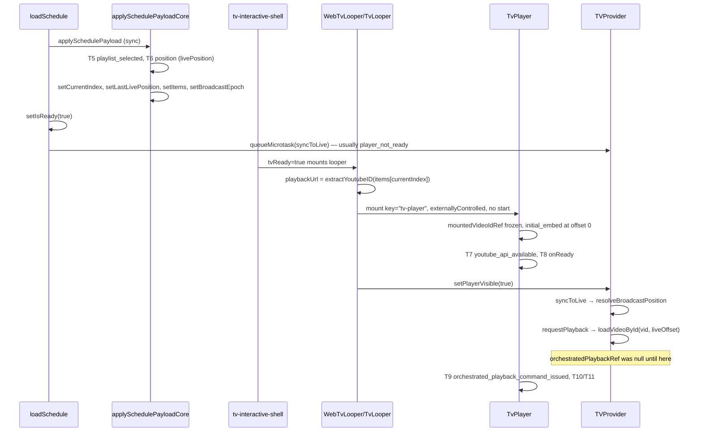

# Phase C1 — Initial Live-Offset Embed Plan

## Current-state summary (repository-backed)

Phase C0 succeeded: global median **T8→T11 ≈ 2.67s**, **1 `loadVideoById` per run**, zero errors/recoveries. Total TTFV (~15.7s median) is still dominated by **T0→T8** (schedule network + React/chunk hydration + YouTube API + iframe bootstrap). C1 targets the remaining **post-ready reload cycle**, not backend schedule latency.

---

## 1. Exact current global mount/load sequence



| Step                     | File                                                                                                                              | Timing                          | Video ID available            | Offset available                          | Player mounted |
| ------------------------ | --------------------------------------------------------------------------------------------------------------------------------- | ------------------------------- | ----------------------------- | ----------------------------------------- | -------------- |
| Schedule accepted (T4)   | [`tv-provider.tsx`](frontend/src/components/tv-provider.tsx) `loadSchedule`                                                       | sync in fetch callback          | in payload items              | in `livePosition`                         | No             |
| Playlist selected (T5)   | `applySchedulePayloadCore` L1107–1123                                                                                             | sync                            | yes                           | yes (server)                              | No             |
| Position resolved (T6)   | `applySchedulePayloadCore` L1136–1188                                                                                             | sync                            | hashed in trace               | `live.offsetSeconds` → `lastLivePosition` | No             |
| Index seeded             | same L1156–1159                                                                                                                   | sync                            | yes                           | yes                                       | No             |
| `isReady=true`           | `loadSchedule` L1286/1372                                                                                                         | sync after apply                | yes                           | yes                                       | No             |
| Looper mount             | [`tv-interactive-shell.tsx`](frontend/src/components/tv/tv-interactive-shell.tsx) L442–465                                        | render after commit             | yes via `items[currentIndex]` | in context, **not passed to player**      | No             |
| TvPlayer mount           | [`tv-looper.tsx`](frontend/src/components/tv/tv-looper.tsx) / [`web-tv-looper.tsx`](frontend/src/components/tv/web-tv-looper.tsx) | render                          | yes (`playbackUrl`)           | **not used**                              | Yes            |
| Initial iframe           | [`tv-player.tsx`](frontend/src/components/tv/tv-player.tsx) L134–147, L293–305                                                    | mount effect + render           | `mountedVideoIdRef` frozen    | hardcoded **0** in trace                  | Yes            |
| First syncToLive w/ load | [`tv-provider.tsx`](frontend/src/components/tv-provider.tsx) `syncToLive` + `requestPlayback`                                     | after T8 via `setPlayerVisible` | yes                           | client `resolveBroadcastPosition`         | Yes            |

**TvPlayer mounts after `applySchedulePayloadCore`:** looper is gated on `isReady` ([`tv-interactive-shell.tsx`](frontend/src/components/tv/tv-interactive-shell.tsx)); schedule core runs synchronously before `setIsReady(true)`.

**Why `playerVars.start` is absent:** [`getYoutubePlayerVarsChromeless`](frontend/src/lib/youtubePlayerConfig.ts) never sets `start`; design intentionally embeds at t=0 and applies offset via imperative `loadVideoById` ([`tv-player.tsx`](frontend/src/components/tv/tv-player.tsx) L145, [`tv-provider.tsx`](frontend/src/components/tv-provider.tsx) L722).

**Why one global `loadVideoById` remains after C0:** `orchestratedPlaybackRef` is **not seeded** at T6 ([`applySchedulePayloadCore`](frontend/src/components/tv-provider.tsx) sets `lastLivePosition` only). First successful post-T8 `syncToLive` always issues `requestPlayback` because `isSameOrchestratedPlayback(null, req)` is false ([`tv-playback-request.ts`](frontend/src/lib/tv-playback-request.ts) L17–24).

---

## 2. Exact current community mount/load sequence

Community uses the **same route** (`/tv`), **same loopers**, **same TvPlayer props** (`key="tv-player"`, `externallyControlled`). Difference is only:

- `scheduleSourceCommunityId` → `/communities/:id/tv/schedule` ([`tv-schedule-client-fetch.ts`](frontend/src/lib/tv-schedule-client-fetch.ts))
- Separate session cache key (`tipmanna-tv-schedule-v2-c/${id}`)
- Cold community cache miss → longer T3/T6→T8

**No preliminary global player mount** when community ID is known at init ([`readTvSourceCommunityIdFromLocation`](frontend/src/lib/tv-source-navigation.ts) in `useState` initializer + Phase A `resolveScheduleSourceChange` skips first establishment).

**Post-mount community ID transition** can occur via [`tv-source-picker-provider.tsx`](frontend/src/components/tv/tv-source-picker-provider.tsx) L85–107 (sideChick redirect) or L168–175 (localStorage → `router.replace`), triggering [`resetPlaybackForScheduleSourceChange`](frontend/src/components/tv-provider.tsx) L527–567 → `isReady=false` → looper unmount → second embed.

---

## 3. Community run 1 — two initial embeds (explanation)

Most likely cause in a **single trace**: **`source_reset` playback wipe** without leaving `/tv`.

Evidence chain:

1. `resetPlaybackForScheduleSourceChange` sets `isReady=false`, `items=[]` → [`tv-interactive-shell`](frontend/src/components/tv/tv-interactive-shell.tsx) unmounts looper
2. `playbackUrl=""` also unmounts TvPlayer inside looper (`{playbackUrl ? <TvPlayer> : null}`)
3. After schedule reload, `isReady=true` → **new TvPlayer instance** → second `initial_embed_created` ([`tv-player.tsx`](frontend/src/components/tv/tv-player.tsx) L139–147; counter per instance)

Ranked causes (verify via trace event sequence):

1. **`scheduleSourceCommunityId` transition** (`null→community` or `A→B`) after first schedule applied — **most likely** if trace shows `source_reset` between embeds
2. **`tvReady` double-toggle** from error/retry resetting `isReady` (less common with Phase A)
3. **Desktop↔mobile looper swap** during startup ([`tv-page-client-wrapper.tsx`](frontend/src/components/tv/tv-page-client-wrapper.tsx)) — separate looper component, new TvPlayer
4. **NOT** instrumentation double-count (guarded by `initialEmbedTracedRef` per instance)
5. **NOT** two simultaneous player surfaces (PiP commented out; only `?videoId=` adds `TVFullscreen`)

**Staging validation must capture:** presence/absence of `source_reset`, `schedule_source_change`, and `player_component_mounted` count between embeds.

---

## 4. Community run 2 — zero imperative commands (explanation)

Observed: `loadVideoByIdCount=0`, no T9/T10, but PLAYING + stable.

Repository-backed explanation:

1. Initial embed plays from **offset 0** (no `playerVars.start`)
2. Phase C0 **pre-play drift seek suppression** ([`shouldSuppressPrePlayDriftSeek`](frontend/src/lib/tv-startup-playback-guard.ts)) blocks `seekTo` when `getCurrentTime()` is 0 and live offset > 3s
3. **`orchestratedPlaybackRef` unseeded** — first `syncToLive` may still attempt `requestPlayback`, but if:
   - player-not-ready sync ticks exhaust without issuing load, OR
   - live offset within `DRIFT_THRESHOLD_S` (3s) at first successful sync, OR
   - duplicate-load path matches in-flight embed video
     then no `loadVideoById` fires
4. YouTube autoplay from t=0 reaches **PLAYING without imperative command** → no `orchestrated_playback_command_issued` (T9), possibly no traced T10 (fast path skipping state 3)
5. Community does **not** mount closer to correct offset today — it accidentally succeeded via **embed-at-zero + C0 seek suppression**, not correct live sync

**Implication for C1:** community must not rely on this accidental path; C1 must **explicitly embed at resolved offset** and seed orchestration state so first sync confirms match (not skip sync incorrectly).

---

## 5. Recommended initial-target architecture

Introduce an explicit, immutable-for-mount **initial playback target** owned by `TVProvider`:

```typescript
type InitialTvPlaybackTarget = {
  targetIdentity: string; // e.g. `${source}:${scheduleRevision}:${index}:${videoIdHash}`
  source: "global" | "community";
  scheduleRevision: string | number | null;
  selectedIndex: number;
  videoId: string;
  startOffsetSeconds: number;
  resolvedAtMs: number; // performance.now() at commit
  segmentKind: "regular"; // only regular video rows
};
```

| Concern              | Design                                                                                                                                               |
| -------------------- | ---------------------------------------------------------------------------------------------------------------------------------------------------- |
| **Created**          | In `applySchedulePayloadCore` when T6 preconditions met: GLOBAL mode, regular item, valid `extractYoutubeID`, offset known                           |
| **Immutable**        | Frozen in `initialPlaybackTargetRef` on first valid commit; looper reads once at TvPlayer mount                                                      |
| **Looper receives**  | New context field `initialPlaybackTarget: InitialTvPlaybackTarget \| null` (not continuously updated live position)                                  |
| **Stale rejection**  | Compare `targetIdentity` at mount vs at `onReady`; if schedule revision/index/video changed → discard embed assumption, fall back to imperative load |
| **Reset**            | `resetPlaybackForScheduleSourceChange`, schedule ID change (L1100–1104), payment override, LOCAL mode entry, guard `resetStartupPlaybackGuardState`  |
| **vs live position** | `lastLivePosition` / `resolveBroadcastPosition` continue for ongoing sync; initial target is **one-shot mount contract**                             |
| **Notices**          | `initialPlaybackTarget = null`; existing notice path (no TvPlayer or frozen `lastPlayableUrlRef`) unchanged                                          |

**Avoid duplicate authority:** Provider remains sole orchestrator; looper only passes target into TvPlayer props; no second offset store in looper.

**TvPlayer key strategy:** Change from static `key="tv-player"` to `key={initialTarget?.targetIdentity ?? "tv-player"}` **only when C1 flag on AND target identity changes** (source rollover, schedule revision). Do not key on every index tick.

---

## 6. Correct initial-offset calculation

**At iframe creation time** (not raw T6 snapshot):

```typescript
function computeInitialEmbedOffset(
  items,
  broadcastEpoch,
  totalDuration,
  getNow,
  targetIndex,
  t6OffsetSeconds,
  t6ResolvedAtMs
): number {
  const fresh = resolveBroadcastPosition(
    items,
    broadcastEpoch,
    totalDuration,
    getNow()
  );
  if (fresh.scheduleIndex !== targetIndex) {
    // segment rollover during startup — use fresh index/offset or defer embed
    return fresh.offsetSeconds;
  }
  const elapsedSec = (performance.now() - t6ResolvedAtMs) / 1000;
  const adjusted = t6OffsetSeconds + elapsedSec;
  const item = items[targetIndex];
  const maxDuration = item?.duration ?? Infinity;
  return clamp(
    Math.floor(adjusted),
    item?.seekBaseSeconds ?? 0,
    maxDuration - 1
  );
}
```

| Rule                        | Value                                                                                                                                                                 |
| --------------------------- | --------------------------------------------------------------------------------------------------------------------------------------------------------------------- |
| Rounding                    | `Math.floor(seconds)` — matches YouTube `playerVars.start` integer semantics ([`@types/youtube`](frontend/node_modules/@types/youtube/index.d.ts) `PlayerVars.start`) |
| Match tolerance             | Reuse [`isSameOrchestratedPlayback`](frontend/src/lib/tv-playback-request.ts) **±1s** for first-sync dedup                                                            |
| Clock progression allowance | Add elapsed T6→mount time to offset; also accept fresh `resolveBroadcastPosition` if same index                                                                       |
| Max initial error           | Target ≤2s drift at first post-ready sync (within existing `DRIFT_THRESHOLD_S=3`)                                                                                     |
| Duration bound              | Clamp to `[seekBaseSeconds, seekBase + usableDuration)`; if past end → select next eligible regular item via existing navigation (respect C0 failed-target set)       |
| URL forms                   | Continue `extractYoutubeID` on channel URLs; embed uses normalized ID only                                                                                            |

**API mechanism:** Extend [`getYoutubePlayerVarsChromeless`](frontend/src/lib/youtubePlayerConfig.ts):

```typescript
{ ...BASE, autoplay: 1, mute: 1, start: Math.floor(offsetSeconds) }  // when offset > 0
```

`react-youtube@10.1.0` passes `playerVars` into IFrame API constructor on create; `videoId` + `start` are read at iframe creation ([`YouTube.js`](frontend/node_modules/react-youtube/dist/YouTube.js) create path). **Changing `start` after mount has no effect on existing iframe** — remount required via key change.

---

## 7. Preventing the first post-ready reload

On valid initial target commit (T6), **seed orchestration state**:

```typescript
orchestratedPlaybackRef.current = { videoId, startSeconds: embedOffset };
inFlightOrchestratedVideoIdRef.current = videoId;
lastSyncedIndex.current = selectedIndex;
// Phase C0: markInitialCommandIssued + phase = buffering_before_first_play
```

First post-T8 `syncToLive`:

1. `resolveBroadcastPosition` → effective pos (including C0 failed-target skip)
2. Extract `videoId`, `offsetSeconds`
3. `requestPlayback({ reason: "syncToLive", ... })` hits `isSameOrchestratedPlayback` → **return false, skip load**
4. If `|actual - target| ≤ 3s` → no drift seek (C0 may suppress pre-play anyway)
5. If genuinely different video W → `loadVideoById(W)` (rollover, stale target rejection)

**Genuinely different target examples:** half-day boundary crossed, Pusher schedule refresh changed index, source change, permanent error advance (C0).

---

## 8. Phase C0 integration (must remain intact)

| C0 mechanism                         | C1 adjustment                                                                                  |
| ------------------------------------ | ---------------------------------------------------------------------------------------------- |
| `shouldSuppressPrePlayDriftSeek`     | Unchanged; fewer false drift cases when embed offset correct                                   |
| `shouldSuppressDuplicatePrePlayLoad` | Seed `orchestrated` + `inFlightVideoId` at T6 so first sync doesn't duplicate                  |
| `markInitialCommandIssued`           | Call when initial target committed (embed is the first command), not only on `requestPlayback` |
| `startupPlaybackGuardRef.phase`      | Transition to `buffering_before_first_play` at embed commit                                    |
| Error recovery / cap                 | Unchanged; if embed fails before PLAYING, C0 paths still apply                                 |
| Post-first-play sync                 | Unchanged                                                                                      |

**Do not** add a competing guard module. Extend existing [`tv-startup-playback-guard.ts`](frontend/src/lib/tv-startup-playback-guard.ts) with pure helpers: `computeInitialEmbedOffset`, `buildInitialTargetIdentity`, `isInitialTargetStale`.

---

## 9. T9 instrumentation design

**Problem:** Today T9 = first `orchestrated_playback_command_issued` ([`tv-startup-trace.ts`](frontend/src/lib/tv-startup-trace.ts) L377–389); initial embed explicitly excluded ([`tv-startup-trace.spec.ts`](frontend/src/lib/__tests__/tv-startup-trace.spec.ts) L245–254). C1 embed becomes the orchestrated command.

**Recommended semantics (preserve T8 ≤ T9 ≤ T10 ≤ T11 ordering):**

| Event                                  | When                                                                                | Canonical mark         |
| -------------------------------------- | ----------------------------------------------------------------------------------- | ---------------------- |
| `initial_embed_created`                | TvPlayer mount effect                                                               | none (count only)      |
| `initial_live_offset_embed_issued`     | **TvPlayer `onReady` (T8)** when C1 flag on AND embed offset > 0 AND target matches | **T9**                 |
| `orchestrated_playback_command_issued` | Later imperative loads/seeks                                                        | T9 only if no prior T9 |

Rationale: iframe mounts before `onReady`; assigning T9 at mount would reorder T8/T9 ([segment guard](frontend/src/lib/tv-startup-trace.ts) L579–581 emits `reordered_T8_after_T9`). Confirming target at T8 keeps segments meaningful.

**New summary fields:**

- `initialEmbedStartOffsetSeconds`
- `initialEmbedUsedResolvedTarget: boolean`
- `initialEmbedTargetMatchedFirstSync: boolean`
- `initialReloadAvoided: boolean` (true when first post-T8 sync skips `loadVideoById`)

**Comparable segments:** T8→T9 ≈ 0ms on C1 success; T8→T11 becomes primary improvement metric; retain T6→T8 for schedule/player-bootstrap work.

---

## 10. Race and stale-target handling

| Race                                       | Behavior                                                                                                                |
| ------------------------------------------ | ----------------------------------------------------------------------------------------------------------------------- |
| Schedule replaced before T8                | Compare `targetIdentity` at `onReady`; if stale → imperative `loadVideoById` for new target (counts as legitimate load) |
| Community source after global target       | `source_reset` clears target; wait for new T6 before mounting offset embed                                              |
| Source change while mounting               | `resetPlaybackForScheduleSourceChange` aborts; no stale embed play                                                      |
| Pusher / visibility refresh during startup | If revision/index/video unchanged → keep seed; if changed → reload once                                                 |
| Half-day boundary during init              | Recalculate offset at mount; if index changed → update target or defer embed                                            |
| Item ends during init                      | Duration clamp / advance to next regular item before embed                                                              |
| Offset drift T6→mount                      | Elapsed-time adjustment + ±1s tolerance                                                                                 |
| Video becomes invalid                      | C0 error path; do not play stale source to avoid reload                                                                 |
| Flag off                                   | Full legacy path unchanged                                                                                              |

**Rule:** Never prefer stale embed over a correct imperative load.

---

## 11. Notice, enforcement, and non-video behavior

From [`tv-looper.tsx`](frontend/src/components/tv/tv-looper.tsx) L218–246, L1261:

- **Notice:** `isNotice` → UI overlay; may keep hidden player via `lastPlayableUrlRef` but must **not** create new offset embed for notice rows; `initialPlaybackTarget = null`
- **Enforcement:** existing `playEnforcementProgram` / `loadEnforcementPlayerItem` imperative path unchanged
- **Missing URL / empty schedule:** no TvPlayer mount (`playbackUrl` falsy)
- **LOCAL mode:** no initial live-offset embed (offset = 0 or N/A)
- **Restricted/fallback:** if T6 item lacks valid YouTube ID, no C1 embed; fall through to existing fallback

`playerVars.start` applies **only to regular YouTube items** with a committed initial target.

---

## 12. Preconnect recommendation — separate Phase C1b

Current: [`TvYoutubePreconnect`](frontend/src/components/tv/tv-youtube-preconnect.tsx) runs on **first client render** of TV layout ([`(tv)/layout.tsx`](<frontend/src/app/(tv)/layout.tsx>)), synchronously before T2 effect — but **after HTML download/hydration**.

| Aspect           | Assessment                                                                                                               |
| ---------------- | ------------------------------------------------------------------------------------------------------------------------ |
| Domains          | `youtube-nocookie.com`, `i.ytimg.com`, `youtube.com` (matches embed)                                                     |
| Expected benefit | **Low–medium (200–800ms)** on T6→T8; does not remove `loadVideoById`                                                     |
| Risk             | Adding global `<head>` hints affects only TV route if scoped                                                             |
| Recommendation   | **Phase C1b** flag `NEXT_PUBLIC_TV_YT_PRECONNECT_HEAD=0` — move to TV route metadata/head, independent of C1 embed logic |
| Do not combine   | Keep C1 reviewable without preconnect confound                                                                           |

---

## 13. Proposed feature flag

```
NEXT_PUBLIC_TV_INITIAL_LIVE_OFFSET_EMBED=0   # default
NEXT_PUBLIC_TV_INITIAL_LIVE_OFFSET_EMBED=1   # Phase C1
```

- Independent from [`NEXT_PUBLIC_TV_STARTUP_PLAYBACK_GUARD`](frontend/src/lib/tv-feature-flags.ts)
- Flag off → exact Phase C0 sequence (embed at 0 + one post-ready load)
- Frontend rebuild required; no backend dependency
- Add to [`tv-feature-flags.ts`](frontend/src/lib/tv-feature-flags.ts) mirroring C0 pattern

---

## 14. Ranked implementation steps

1. **Pure helpers** — `computeInitialEmbedOffset`, target identity, stale checks in [`tv-startup-playback-guard.ts`](frontend/src/lib/tv-startup-playback-guard.ts) + unit tests
2. **Feature flag** — `isTvInitialLiveOffsetEmbedEnabled()` in [`tv-feature-flags.ts`](frontend/src/lib/tv-feature-flags.ts)
3. **Provider target commit** — create/freeze `initialPlaybackTargetRef` in `applySchedulePayloadCore`; seed `orchestratedPlaybackRef` + C0 phase when flag on
4. **Context API** — expose read-only `initialPlaybackTarget` to loopers
5. **youtubePlayerConfig** — optional `start` param
6. **TvPlayer** — `initialStartSeconds` prop → `playerVars.start`; update `initial_embed_created` trace data
7. **Looper wiring** — pass target to TvPlayer; conditional remount key; gate only when flag on
8. **syncToLive dedup** — verify first sync skips load when seeded; emit `initialEmbedTargetMatchedFirstSync`
9. **Trace updates** — new event, summary fields, T9 at onReady confirmation; update [`tv-startup-trace.spec.ts`](frontend/src/lib/__tests__/tv-startup-trace.spec.ts)
10. **Community source-stability** — audit/fix unnecessary `source_reset` double-embed (may be separate hardening task if trace confirms)
11. **Docs** — `docs/tv-startup-phase-c1-report.md`; update measurement protocol §19

---

## 15. Expected savings (confidence ranges)

Based on Phase C0 traces (median T8→T11 **2.67s**, one `loadVideoById` per global run):

| Metric                 | Expected C1 delta                                                  | Confidence                                |
| ---------------------- | ------------------------------------------------------------------ | ----------------------------------------- |
| Global T8→T11          | **−1.0 to −2.0s** (median **1.0–1.7s**)                            | Medium — removes one load+buffer cycle    |
| Global TTFV            | **−1.5 to −2.5s** (median **~13–14s**)                             | Medium — aligns with user 1.5–2.0s target |
| T6→T8                  | **~0s**                                                            | High — embed mount timing unchanged       |
| Community TTFV         | **−1 to −2s** if single embed; **not** fixing 8–11s schedule fetch | Low–medium                                |
| Community double-embed | **−3 to −8s** if source-reset fixed                                | Medium — separate from embed offset       |

Do **not** claim improvement to community schedule network time (backend, out of scope).

---

## 16. Required automated tests

| Area               | File (proposed)                        | Assertions                                                         |
| ------------------ | -------------------------------------- | ------------------------------------------------------------------ |
| Offset math        | `tv-startup-playback-guard.spec.ts`    | elapsed adjustment, clamp, rollover                                |
| Clean global       | `tv-initial-live-offset-embed.spec.ts` | embed offset, seed ref, skip first load                            |
| Clean community    | same                                   | no preliminary embed; single mount                                 |
| Stale target       | same                                   | A→B single imperative load                                         |
| C0 preserved       | extend guard specs                     | error cap, pre-play seek suppress                                  |
| Notice/enforcement | same                                   | no target for notice; enforcement loads                            |
| Post-play rollover | integration/unit                       | loadVideoById after first PLAYING                                  |
| Feature flag off   | same                                   | loadVideoByIdCount=1 legacy                                        |
| Trace              | `tv-startup-trace.spec.ts`             | T9 at onReady confirm; no negative T8_T9; summary fields immutable |

---

## 17. Staging validation protocol

**Flags:** Phase A + C0 + trace enabled; C1 enabled; B1 off (current staging profile + `NEXT_PUBLIC_TV_INITIAL_LIVE_OFFSET_EMBED=1`).

| Suite                     | Runs   | Key checks                                                                                   |
| ------------------------- | ------ | -------------------------------------------------------------------------------------------- |
| Global cold regular-video | 5      | `initialEmbedCount=1`, `loadVideoByIdCount=0`, `initialReloadAvoided=true`, no pre-play seek |
| Community cold            | 5      | no double embed; same clean-start fields                                                     |
| Warm                      | 2      | no regression; cache bootstrap still valid                                                   |
| Notice/enforcement smoke  | 1 each | semantics unchanged                                                                          |
| Source switch             | 1      | global↔community — no stale embed                                                           |
| Boundary/rollover         | 1      | if safely triggerable near half-day                                                          |
| Mobile Chrome + Safari    | 1 each | autoplay+muted+start behavior                                                                |

Record per run: `totalTtfvMs`, `stableTtfvMs`, `T6_T8`, `T8_T11`, all C1 summary fields, C0 counters, `scheduleNetworkAttemptCount`, `finalState`.

**Acceptance targets:**

- Clean global/community: `initialEmbedCount===1`, `initialEmbedUsedResolvedTarget===true`, `initialReloadAvoided===true`, `loadVideoByIdCount===0`, pre-play executed `seekToCount===0`
- Global median T8→T11 **< 2.67s**; median TTFV **−1.5s minimum**
- No global cold run **> 15s TTFV** (controlled profile)
- Community **no double embed**
- No schedule/access/enforcement/recovery regression; flag off restores C0 behavior

---

## 18. Rollback

Set `NEXT_PUBLIC_TV_INITIAL_LIVE_OFFSET_EMBED=0`, rebuild frontend, redeploy. Phase C0 remains active. No migration.

---

## Remaining latency outside C1

| Cause                                             | Phase                   | Notes                   |
| ------------------------------------------------- | ----------------------- | ----------------------- |
| Schedule network (global ~2–5s; community ~8–11s) | Backend / cache         | Not C1 scope            |
| T6→T8 player bootstrap (YouTube API + iframe)     | C1b preconnect optional | ~10–13s of global TTFV  |
| Chunk/hydration                                   | Phase D / bundle        | Out of scope            |
| Overlay vs TTFV measurement                       | Phase D                 | Out of scope            |
| B1 existence probe                                | Disabled                | No benefit demonstrated |
