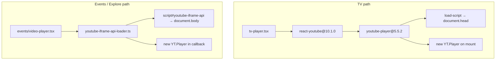
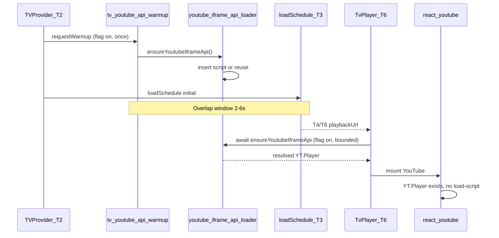

# Phase C2.2 — Controlled Early YouTube API Warm-Up Plan

## 1. Existing loader ownership map

Two **independent** loader paths exist today. They share the same URL but differ in DOM placement, deduplication, and coupling to player creation.



| Property                                        | App loader ([`youtube-iframe-api-loader.ts`](frontend/src/lib/youtube-iframe-api-loader.ts)) | youtube-player chain (via [`tv-player.tsx`](frontend/src/components/tv/tv-player.tsx)) |
| ----------------------------------------------- | -------------------------------------------------------------------------------------------- | -------------------------------------------------------------------------------------- |
| **Script URL**                                  | `https://www.youtube.com/iframe_api`                                                         | `https://` or `http://` + `//www.youtube.com/iframe_api`                               |
| **Script ID**                                   | `youtube-iframe-api`                                                                         | none                                                                                   |
| **Insertion**                                   | `document.body`                                                                              | `document.head`                                                                        |
| **Promise owner**                               | Module `loadPromise`                                                                         | Module `youtubeIframeAPI` in `youtube-player/dist/index.js`                            |
| **DOM dedup**                                   | `getElementById("youtube-iframe-api")` only                                                  | none                                                                                   |
| **`YT.Player` already exists**                  | Immediate resolve                                                                            | Immediate resolve                                                                      |
| **Other loader's script in DOM, API not ready** | **Does not see** head script → may insert duplicate                                          | **Does not see** body script → **inserts duplicate**                                   |
| **`onYouTubeIframeAPIReady`**                   | Chains `prior?.()` + ready queue                                                             | Chains `previous()` + single promise resolve                                           |
| **Error / timeout**                             | None (promise can hang)                                                                      | Script `onerror` → emitter event; promise never rejects                                |
| **Cleanup**                                     | Callback unsubscribe only                                                                    | Player `destroy()` only; no script removal                                             |
| **Load without player**                         | **Yes** — `ensureYoutubeIframeApi()`                                                         | **No** — mount always creates player                                                   |
| **Consumers**                                   | `events/video-player.tsx` only                                                               | TV surfaces only                                                                       |

**Definitive ownership:** TV bootstrap is owned by **youtube-player** (triggered at react-youtube `componentDidMount`). Events/explore uses the **app loader**. There is **no shared canonical loader** today. Cross-navigation (Explore/Event Room → TV) may leave `window.YT.Player` warm; concurrent mounts before API ready can produce **two `iframe_api` script tags** (C2.0 `duplicate_api_resource` diagnostic).

---

## 2. Current API-request timing (why `playerCommitToApiResourceStartMs` is null)

**Do not interpret null as “request timing unavailable.”**

### Actual order on cold TV mount

1. Looper renders `TvPlayer` when `playbackUrl` exists (post-T6).
2. React commits `<YouTube>` child **before** parent `useLayoutEffect`.
3. react-youtube `componentDidMount` → `createPlayer()` → youtube-player → **`load-script` inserts `iframe_api`** (Resource Timing `startTime` recorded).
4. Parent `useLayoutEffect` runs → `recordPlayerCommitted()` → `playerCommitMs = performance.now()`.

Because child `componentDidMount` precedes parent layout effects, **`apiResourceStartMs` is typically ≤ `playerCommitMs`**.

### Why the summary field is null

[`segment()`](frontend/src/lib/tv-youtube-bootstrap-trace.ts) returns `null` when `delta < 0`:

```875:879:frontend/src/lib/tv-youtube-bootstrap-trace.ts
function segment(a: number | null, b: number | null): number | null {
  if (a == null || b == null) return null;
  const delta = b - a;
  return delta >= 0 ? delta : null;
}
```

`playerCommitToApiResourceStartMs = segment(playerCommit, apiStart)` → **null when fetch started at or before commit**. This is **silent** (no `negative_segment_*` diagnostic because `segment()` never returns a negative number).

### Additional null sources

- **Stale buffered resource:** C2.0 `scanExistingResources()` at T2 can ingest a prior-navigation `iframe_api` entry with `startTime` ≪ `playerCommitMs`.
- **API already present:** `youtubeApiPresentAtPlayerCommit: true` — no new fetch, but old resource entry may still exist.

### C2.2 trace implication

Add explicit diagnostics: `api_resource_started_before_player_commit` and `playerCommitToApiResourceStartMs` should be documented as **“delay from commit to fetch; null = fetch already started or API reused.”** New warm-up fields (`youtubeApiWarmupLeadBeforePlayerCommitMs`) will measure the intended overlap directly.

---

## 3. Selected warm-up trigger: **T2 — TVProvider mount**

**Exactly one trigger:** fire warm-up at end of TVProvider mount effect, immediately after `tv_provider_mounted` (T2), **before** the adjacent effect invokes `loadSchedule({ trigger: "initial" })`.

```2307:2337:frontend/src/components/tv-provider.tsx
  useEffect(() => {
    // T2 marks + context
    tvStartupEvent("tv_provider_mounted", { canonicalMark: "T2", ... });
    // → request warm-up here (C2.2, flag-gated)
  }, []);

  useEffect(() => {
    // initial loadSchedule({ trigger: "initial" }) — T3 follows
    void loadScheduleRef.current?.({ resetRetry: true, trigger: "initial" });
  }, []);
```

### Why T2 (not later triggers)

| Candidate                   | Rejected / accepted                                                               |
| --------------------------- | --------------------------------------------------------------------------------- |
| TV layout client mount      | Too early vs T2; no trace correlation; same tick as provider                      |
| **T2 TVProvider mount**     | **Selected** — TV-route scoped, overlaps schedule, once-per-document module guard |
| Before T3 / after T3 starts | Same practical window as T2 (adjacent effects); T2 is clearer anchor              |
| After source validation     | SideChick redirect is rare; API script needs no schedule/source                   |
| After T4 payload acceptance | Too late — loses 2–6s overlap with schedule (measured T2→T4)                      |

### Expected overlap window

From remediation plan and C2.0 evidence:

- **T2→T4 (schedule):** ~2–6s typical (p50 ~5–6s on cold network)
- **iframe_api resource duration:** ~1.29s median
- **API response→object:** ~0.48s median
- **T6→player commit:** ~57ms

Warm-up at T2 should finish API acquisition **~1.5–2s after T2**, often **before T4/T6**, yielding **~3–5s lead** before player mount.

### Scope guards

- Runs only inside [`tv-layout-client.tsx`](<frontend/src/app/(tv)/tv-layout-client.tsx>) → `TVProvider` (not homepage preview provider).
- Module-level `warmupRequested` — once per document lifecycle.
- Same-document source switch: no-op if `window.YT.Player` exists.
- Hard navigation / Explore→TV / Event Room→TV: new document or warm `YT` → resolve or single guarded insert.
- Does **not** run on SSR.

---

## 4. Ranked loader strategies

| Rank                | Approach                                                                            | Duplicate risk                               | Callback risk                | Change size       | react-youtube compat                     | Rollback               | Testability |
| ------------------- | ----------------------------------------------------------------------------------- | -------------------------------------------- | ---------------------------- | ----------------- | ---------------------------------------- | ---------------------- | ----------- |
| **1 (recommended)** | **A+ — Reuse app loader at T2 + extend DOM detection + TvPlayer coordination gate** | Low if gate ensures `YT.Player` before mount | Low (existing chain + queue) | Small–medium      | High (no fork; optional pre-mount await) | Flag off               | High        |
| 2                   | B — Shared canonical loader refactor (both paths)                                   | Lowest long-term                             | Low                          | Large             | Medium (touch video-player)              | Flag + revert refactor | Medium      |
| 3                   | D — TV-only script insert (duplicate of app loader)                                 | Medium                                       | Medium                       | Medium            | Unknown                                  | Flag                   | Medium      |
| 4                   | C — Invoke youtube-player internal loader                                           | N/A                                          | High                         | Small but fragile | Breaks on upgrade                        | Poor                   | Low         |

**Do not patch node_modules.**

---

## 5. Recommended implementation: **A+ (extended app loader + T2 warm-up + TvPlayer gate)**

### Architecture



### Minimal changes

1. **New module** [`frontend/src/lib/tv-youtube-api-warmup.ts`](frontend/src/lib/tv-youtube-api-warmup.ts) — flag check, once-per-document guard, calls `ensureYoutubeIframeApi()`, emits C2.2 trace events, bounded timeout (e.g. 15s, no retry).
2. **Extend** [`youtube-iframe-api-loader.ts`](frontend/src/lib/youtube-iframe-api-loader.ts):
   - Before insert, detect **any** `script[src*="iframe_api"]` (not only `#youtube-iframe-api`).
   - If script exists but API not ready, return same `loadPromise` (do not insert second tag).
   - Optional: export `isYoutubeIframeApiReady()` for trace.
3. **Hook T2** in [`tv-provider.tsx`](frontend/src/components/tv-provider.tsx) — `requestTvYoutubeApiWarmup({ trigger: "tv_provider_mounted" })` after T2 event.
4. **TvPlayer coordination** (flag on only) in [`tv-player.tsx`](frontend/src/components/tv/tv-player.tsx):
   - Before rendering `<YouTube>`, `await ensureYoutubeIframeApi()` with **hard cap** (e.g. 100ms blocking max at render boundary, or render YouTube only after microtask if already resolved).
   - If warm-up still pending at mount: await up to 10s; on timeout → mount anyway (failure containment).
   - **Never** create iframe/player in warm-up module.

This avoids youtube-player calling `load-script` when `YT.Player` is already present — the primary duplicate-script scenario.

---

## 6. Duplicate-script prevention and callback ownership

### Authoritative rules

| Rule                                  | Owner                                                                                                                  |
| ------------------------------------- | ---------------------------------------------------------------------------------------------------------------------- |
| Single script tag per document        | `youtube-iframe-api-loader.ts` — prefer `#youtube-iframe-api`; detect any `iframe_api` src before insert               |
| Single in-flight promise              | Module `loadPromise` (app loader); youtube-player retains its own singleton but short-circuits when `YT.Player` exists |
| `onYouTubeIframeAPIReady`             | Always chain: `prior?.()` before new handler ([app loader L40-44](frontend/src/lib/youtube-iframe-api-loader.ts))      |
| No stale rejected promises            | App loader promise never rejects today; C2.2 warm-up must not add rejection that blocks player path                    |
| No duplicate ready events             | App loader `flushReadyQueue()` once; trace counts API resource entries                                                 |
| Player only after API ready (flag on) | TvPlayer gate ensures youtube-player never inserts when warm-up succeeded                                              |

### Navigation matrix

| Navigation                                         | Warm-up behavior                                                                     |
| -------------------------------------------------- | ------------------------------------------------------------------------------------ |
| Explore → TV (cold API)                            | T2 warm-up inserts script; player reuses                                             |
| Event Room → TV (app loader warmed)                | `YT.Player` exists → immediate `reused_existing_object`                              |
| TV hard navigation                                 | New document → warm-up runs once at T2                                               |
| Global → community (soft)                          | `YT.Player` exists → no-op                                                           |
| Global → community (hard via `navigateToTvSource`) | New document → warm-up runs at T2                                                    |
| `/tv?videoId=` fullscreen path                     | Still under TVProvider → warm-up runs; playback path differs but API warm-up is safe |

---

## 7. Feature flag

```env
NEXT_PUBLIC_TV_EARLY_YOUTUBE_API_WARMUP=0   # default off
```

- Active only for `1` or `true`
- TV-route scoped (invoked only from TVProvider)
- Independent from C2.0 bootstrap trace and C2.1 preconnect (remains `0`)
- Flag off: zero calls, zero trace fields, TvPlayer gate disabled, legacy youtube-player load at mount
- Rollback: set `0` + rebuild

Also add to [`tv-feature-flags.ts`](frontend/src/lib/tv-feature-flags.ts) mirroring other TV flags.

---

## 8. Privacy and product behaviour

### Confirmed safe

- Requests **only** `https://www.youtube.com/iframe_api` (same as today, just earlier)
- **No iframe**, no embed document, no `googlevideo.com`, no video ID in warm-up code
- **No playback** until existing schedule resolution + `TvPlayer` path unchanged
- Does not bypass notice/enforcement (backend schedule filtering unchanged)
- Does not alter global/community source selection
- TV-route only (not root layout, not Explore)

### Privacy implications

- Contacts YouTube/Google **~2–6s earlier** on TV cold load (during schedule fetch)
- Same third-party script that would load anyway at player mount; earlier load may affect cookie/consent timing relative to first party render — document for privacy review
- No new PII in requests; trace stores no URLs/video IDs

---

## 9. C2.0 instrumentation additions

New events (via bootstrap trace event sink, gated by C2.0 + warm-up flag):

| Event                                       | When                                   |
| ------------------------------------------- | -------------------------------------- |
| `youtube_api_warmup_requested`              | T2 warm-up invoked                     |
| `youtube_api_warmup_reused_existing_object` | `YT.Player` already present            |
| `youtube_api_warmup_reused_existing_script` | Script in DOM, awaiting ready          |
| `youtube_api_warmup_script_inserted`        | New `#youtube-iframe-api` tag appended |
| `youtube_api_warmup_resolved`               | Promise resolved, API usable           |
| `youtube_api_warmup_failed`                 | Timeout or script error (non-blocking) |

Summary fields (in [`TvStartupSummary`](frontend/src/lib/tv-startup-trace.ts)):

- `earlyYoutubeApiWarmupEnabled: boolean`
- `earlyYoutubeApiWarmupTrigger: "tv_provider_mounted" | null`
- `earlyYoutubeApiWarmupRequestedAtMs: number | null`
- `earlyYoutubeApiWarmupResolvedAtMs: number | null`
- `earlyYoutubeApiWarmupDurationMs: number | null`
- `earlyYoutubeApiWarmupOutcome: "resolved_by_warmup" | "reused_existing_object" | "reused_existing_script" | "failed_player_recovered" | "disabled" | null`
- `youtubeApiPresentAtT6: boolean | null`
- `youtubeApiWarmupResolvedBeforeT6: boolean | null`
- `youtubeApiWarmupLeadBeforePlayerCommitMs: number | null`

Distinction logic:

- API before warm-up → `reused_existing_object`
- Warm-up inserted script → `resolved_by_warmup`
- Player path loaded after warm-up failure → `failed_player_recovered`
- `youtubeApiResourceCount` + loader origin in diagnostics

Fix C2.0 segment semantics: document null `playerCommitToApiResourceStartMs`; optionally add `apiResourceStartedBeforePlayerCommit: boolean`.

---

## 10. Failure containment

| Failure                          | Behaviour                                                                                                        |
| -------------------------------- | ---------------------------------------------------------------------------------------------------------------- |
| Warm-up promise slow             | TvPlayer awaits up to bounded timeout, then mounts YouTube normally                                              |
| Script `onerror`                 | Log + `youtube_api_warmup_failed`; do not reject blocking promise OR reject with immediate catch in warm-up only |
| Privacy blocker / CSP            | Same as today — player path retries via youtube-player                                                           |
| Timeout (15s warm-up)            | Mark failed; no retry in same document                                                                           |
| Component unmount during warm-up | Warm-up continues (module singleton); trace attributes to traceId/generation                                     |

**Must never block:** schedule acquisition, player shell render, react-youtube init (after bounded wait), C0/C0.1 recovery, T13.

**No retry storms:** one warm-up request per document; no interval polling.

---

## 11. Expected benefit (realistic)

### Can improve (median baselines from C2.0)

- `playerCommitToApiObjectDetectedMs` (~3.4s) → **target near 0–500ms** if API ready at commit
- `playerCommitToIframeInsertedMs` (~3.3s) → **partial** (~1–2s), iframe creation still at react-youtube mount
- `playerCommitToT8Ms` (~11.1s) → **partial** (~1.5–3s realistic median)

### Cannot improve directly

- `iframeInsertedToT8Ms` (~7.6s, ~69% of commit→T8) — embed init / YouTube internal work
- Schedule T2→T4 latency
- Will **not alone** reach 6s TTFV target

### Scenarios with no benefit

- Same-document revisit with warm `YT.Player`
- Warm-up completes but iframe→T8 dominates (expect flat TTFV improvement)
- Duplicate scripts from gate failure (trace must catch via `youtubeApiResourceCount > 1`)
- Very fast T4 cache path where player mounts before warm-up completes (rare on true cold)

---

## 12. Files likely affected

| File                                                                                                                           | Change                                            |
| ------------------------------------------------------------------------------------------------------------------------------ | ------------------------------------------------- |
| [`frontend/src/lib/tv-youtube-api-warmup.ts`](frontend/src/lib/tv-youtube-api-warmup.ts)                                       | **New** — warm-up orchestration                   |
| [`frontend/src/lib/youtube-iframe-api-loader.ts`](frontend/src/lib/youtube-iframe-api-loader.ts)                               | Extended DOM detection, optional readiness helper |
| [`frontend/src/lib/tv-feature-flags.ts`](frontend/src/lib/tv-feature-flags.ts)                                                 | Flag                                              |
| [`frontend/src/components/tv-provider.tsx`](frontend/src/components/tv-provider.tsx)                                           | T2 trigger                                        |
| [`frontend/src/components/tv/tv-player.tsx`](frontend/src/components/tv/tv-player.tsx)                                         | Flag-gated pre-mount coordination                 |
| [`frontend/src/lib/tv-youtube-bootstrap-trace.ts`](frontend/src/lib/tv-youtube-bootstrap-trace.ts)                             | Warm-up events + summary fields                   |
| [`frontend/src/lib/tv-startup-trace.ts`](frontend/src/lib/tv-startup-trace.ts)                                                 | Summary merge at finalize                         |
| [`frontend/src/lib/__tests__/tv-youtube-api-warmup.spec.ts`](frontend/src/lib/__tests__/tv-youtube-api-warmup.spec.ts)         | **New**                                           |
| [`frontend/src/lib/__tests__/youtube-iframe-api-loader.spec.ts`](frontend/src/lib/__tests__/youtube-iframe-api-loader.spec.ts) | **New** or extend                                 |
| [`docs/tv-startup-phase-c2-api-warmup.md`](docs/tv-startup-phase-c2-api-warmup.md)                                             | **New**                                           |
| [`docs/tv-startup-phase-c2-bootstrap-trace.md`](docs/tv-startup-phase-c2-bootstrap-trace.md)                                   | Warm-up fields                                    |
| [`docs/tv-startup-latency-measurement-protocol.md`](docs/tv-startup-latency-measurement-protocol.md)                           | §24                                               |
| [`frontend/.env`](frontend/.env)                                                                                               | Flag default `0`                                  |

**Not modified:** react-youtube, youtube-player (node_modules), schedule orchestration, C2.1 preconnect (stays off).

---

## 13. Required tests

| Category                      | Cases                                                         |
| ----------------------------- | ------------------------------------------------------------- |
| Flag off                      | No warm-up call; legacy load at mount; summary `disabled`     |
| API already present           | Immediate resolve; `reused_existing_object`; no script insert |
| No API/script                 | Script inserted once; promise resolves                        |
| Script loading                | Second caller shares promise; no duplicate tag                |
| Competing app loader          | Event-room loader + TV warm-up → one script                   |
| Callback chaining             | Prior `onYouTubeIframeAPIReady` preserved                     |
| One script                    | DOM query count = 1                                           |
| Warm-up before T6             | `youtubeApiWarmupResolvedBeforeT6: true`                      |
| Warm-up after T6              | Player gate waits or recovers                                 |
| Warm-up failure               | Player still mounts; `failed_player_recovered`                |
| Timeout                       | No retry; player path proceeds                                |
| Source switch                 | Reuse on soft; fresh on hard nav                              |
| Unmount                       | No double-insert on remount same doc                          |
| Hard navigation               | New warm-up at T2                                             |
| No iframe/player from warm-up | DOM iframe count 0 until react-youtube                        |
| C0/C0.1                       | Existing suites unchanged                                     |
| Regression                    | Phase A, C0, C0.1, C0.1a, C1/C1.1, C2.0, C2.1 (flag off)      |

---

## 14. Typecheck and build

- `npm run typecheck` — must pass
- `npm run build` — must pass
- All 157+ existing TV tests + new warm-up tests

---

## 15. Staging validation

### Environment (C2.1 remains off)

```env
NEXT_PUBLIC_TV_SINGLE_STARTUP_SCHEDULE=1
NEXT_PUBLIC_TV_STARTUP_TRACE_ENABLED=1
NEXT_PUBLIC_TV_STARTUP_PLAYBACK_GUARD=1
NEXT_PUBLIC_TV_STARTUP_STABILITY_GUARD=1
NEXT_PUBLIC_TV_INITIAL_LIVE_OFFSET_EMBED=0
NEXT_PUBLIC_TV_YOUTUBE_BOOTSTRAP_TRACE=1
NEXT_PUBLIC_TV_SSR_YOUTUBE_PRECONNECT=0
NEXT_PUBLIC_TV_EARLY_YOUTUBE_API_WARMUP=1
```

### Procedure

1. **One cold sanity run** — verify warm-up events, `youtubeApiResourceCount: 1`, page plays to T13.
2. **Five fresh-browser global cold runs** (warm-up on) — export summaries.
3. **Five control runs** (warm-up off, same deployment) — A/B compare.
4. **One same-document source switch** — reuse path, no duplicate scripts.
5. **One error-150 recovery smoke** — warm-up failure must not block recovery.

### Record per run

T3→T4, warm-up request→resolve, resolve vs T6, `youtubeApiPresentAtPlayerCommit`, `playerCommitToApiObjectDetectedMs`, `playerCommitToIframeInsertedMs`, `iframeInsertedToT8Ms`, `playerCommitToT8Ms`, T8→T11, TTFV, stable TTFV, API resource count, iframe count, player errors, recovery count.

---

## 16. Acceptance thresholds

| Criterion                               | Threshold                                   |
| --------------------------------------- | ------------------------------------------- |
| `youtubeApiWarmupResolvedBeforeT6`      | true in **≥4/5** clean cold runs            |
| `youtubeApiPresentAtPlayerCommit`       | true in **≥4/5** clean cold runs            |
| `youtubeApiResourceCount`               | **≤1** all runs                             |
| Iframe count                            | **1** at T8                                 |
| `tvPlayerCommitCount`                   | **1**                                       |
| Errors / recovery                       | **No increase** vs C2.0 baseline            |
| Median `playerCommitToIframeInsertedMs` | **≥1.5s improvement** vs control            |
| Median `playerCommitToT8Ms`             | **≥1.5s improvement** vs control            |
| Median `iframeInsertedToT8Ms`           | **No worsening >10%**                       |
| Schedule / stability                    | T3→T4 and T13 stable rate **no regression** |

If iframe→T8 unchanged but commit→T8 improves, accept as partial success and plan C2.3 (embed/init) separately.

---

## 17. Rollback

Set `NEXT_PUBLIC_TV_EARLY_YOUTUBE_API_WARMUP=0`, rebuild, redeploy. No schema migration. Player returns to mount-time API load via youtube-player.

---

## 18. Scope confirmation

**In scope:** T2 API script warm-up, app loader extension, TvPlayer coordination gate (flag-gated), C2.0 trace additions, tests, docs.

**Out of scope:** SSR preconnect (C2.1 rejected), script preload in HTML head, iframe prefetch, googlevideo hints, react-youtube/youtube-player forks, service-worker changes, schedule ownership changes, C1 live-offset embed, API loader unification across events/TV (full refactor deferred).
