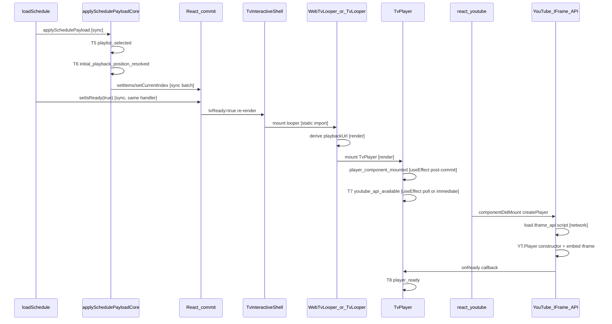

# Phase C2 — YouTube Bootstrap Investigation Plan

## Executive conclusion

Measured **T6→T8 (median ~7–9s cold, max ~14–22s)** is dominated by **third-party YouTube IFrame API + embed initialization**, not by schedule apply or React gating after T6. The hard gate between T6 and player mount is a single **`setIsReady(true)` → looper → TvPlayer** React commit (typically milliseconds unless main-thread long tasks). The bulk of T6→T8 sits in **T7→T8** (iframe construction → `onReady`), with **iframe_api script fetch/parse** starting only after TvPlayer mounts.

**Source-switch/session-cache runs (~1–2s T6→T8)** reuse **`window.YT` + warm HTTP/TLS connections** in the same document. **Warm hard navigation (~9–12s T6→T8 despite `scheduleCacheBootstrapCount: 1`)** proves schedule session cache does **not** accelerate player bootstrap; full page load clears JS API state.

**Smallest evidence-backed optimization experiment (Phase C2.1):** move YouTube **connection hints into SSR HTML for `/tv` only**, because today hints fire **after hydration (T2+)** via client-only [`TvYoutubePreconnect`](frontend/src/components/tv/tv-youtube-preconnect.tsx), missing the T1→T6 window when connections could start in parallel with app boot.

**Prerequisite (Phase C2.0):** add trace-only sub-marks + Resource Timing diagnostic to prove how much T6→T8 is script load vs iframe vs main-thread delay—before any behavioral change.

---

## 1. Exact T6→T8 sequence (repository-backed)

| Step | File | Mechanism | Runs once? | Waits on | Network? |
|------|------|-----------|------------|----------|------------|
| **T6** | [`tv-provider.tsx`](frontend/src/components/tv-provider.tsx) `applySchedulePayloadCore` ~L1725 | Sync during schedule apply | First-wins mark | Valid `livePosition` only | No |
| **setIsReady(true)** | [`tv-provider.tsx`](frontend/src/components/tv-provider.tsx) ~L1870 / L1956 / L2159 | Sync after `applySchedulePayload` | Per successful load | Schedule payload | No |
| **Looper gate** | [`tv-interactive-shell.tsx`](frontend/src/components/tv/tv-interactive-shell.tsx) ~L442–465 / L748 | Conditional render on `tvReady` | Per ready cycle | `isReady` | No |
| **Looper mount** | [`web-tv-looper.tsx`](frontend/src/components/tv/web-tv-looper.tsx) or [`tv-looper.tsx`](frontend/src/components/tv/tv-looper.tsx) | Static import, render | Per looper instance | `playbackUrl` valid | No |
| **TvPlayer mount** | [`tv-looper.tsx`](frontend/src/components/tv/tv-looper.tsx) ~L1341 | Render when `playbackUrl` | C1-off: key `"tv-player"` | `items[currentIndex]` | No |
| **player_component_mounted** | [`tv-player.tsx`](frontend/src/components/tv/tv-player.tsx) ~L168 | `useEffect` | Per TvPlayer mount | React commit | No |
| **T7** | [`tv-player.tsx`](frontend/src/components/tv/tv-player.tsx) ~L205–237 | Same effect; 200ms poll | First-wins mark | `window.YT.Player` | Indirect (poll after script) |
| **react-youtube init** | `react-youtube@10.1.0` → `youtube-player@5.5.2` | `componentDidMount` → `createPlayer()` | Per mount | Container ref | **Yes** — injects `iframe_api` |
| **T8** | [`tv-player.tsx`](frontend/src/components/tv/tv-player.tsx) ~L448 | `<YouTube onReady>` | First-wins mark | YouTube iframe ready | **Yes** — embed + player assets |

**T6 vs player mount timing:** T6 fires **inside** `applySchedulePayloadCore` **before** `setIsReady(true)`. Looper/TvPlayer cannot mount until the subsequent React commit from `setIsReady`. With C1-off, there is no additional embed-target state between T6 and mount beyond `items` + `currentIndex`.

**`player_component_mounted` vs T6:** Occurs in TvPlayer mount `useEffect` — always **after** T6 and **before or concurrent with** T7/T8 depending on poll timing.

---

## 2. T7 accuracy audit

**Current mechanism** ([`tv-player.tsx`](frontend/src/components/tv/tv-player.tsx) L205–237):
- On mount: if `window.YT && window.YT.Player` → emit T7 immediately (`reason: yt_object_present_at_mount`)
- Else: **200ms interval poll** until YT appears or 20s timeout (`reason: yt_object_detected`)
- Always sets `data.approximate: true`

| Question | Answer |
|----------|--------|
| Can T7 fire before iframe_api completes? | **Yes** — if `window.YT` inherited from prior navigation or prior player in same document |
| Can T7 fire long after API usable? | **Yes** — poll granularity up to 200ms; poll starts only after mount effect runs |
| Inherited from previous navigation? | **Yes on SPA/source-switch** — `window.YT` persists; T7 can be instant |
| Cached `window.YT` shrink T6→T7? | **Yes** — explains 1–2s source-switch runs |
| Poll begin late? | **Yes** — queued behind other effects + main-thread work |
| Distinguishes script vs iframe vs onReady? | **No** — T7 ≈ "YT namespace exists"; T8 = iframe `onReady` |

**Recommended non-invasive marks (C2.0, do not implement now):**

| Proposed event | What it measures | Reliable from repo? |
|----------------|------------------|---------------------|
| `youtube_api_script_request_started` | First `iframe_api` fetch | Resource Timing / hook `load-script` in `youtube-player` |
| `youtube_api_script_loaded` | Script response complete | Resource Timing (`www.youtube.com/iframe_api`, `www-widgetapi.js`) |
| `youtube_player_constructor_started` | `youTubePlayer(container, opts)` call | Wrapper in TvPlayer around react-youtube mount |
| `youtube_iframe_inserted` | iframe in DOM | `MutationObserver` on player container or `getIframe()` promise |
| `youtube_ready_callback` | Same instant as T8 today | Already T8 — keep alias for ordering proofs |

Remove "approximate" ambiguity by splitting **API script ready** vs **player instance ready**.

---

## 3. YouTube-related resources

| Resource | Requested by | Host | Earliest time | Cache reuse |
|----------|--------------|------|---------------|-------------|
| `iframe_api` | `youtube-player` `load-script` on first `<YouTube>` mount | `www.youtube.com` | After TvPlayer mount | HTTP cache + SW cross-origin bucket |
| `www-widgetapi.js` | Loaded by iframe_api bootstrap | `www.youtube.com` | After iframe_api | Same |
| Embed document | `YT.Player` with `host: youtube-nocookie.com` ([`youtubePlayerConfig.ts`](frontend/src/lib/youtubePlayerConfig.ts)) | `www.youtube-nocookie.com` | After API ready | Limited |
| Thumbnails | `ThumbnailPlayer` static img; looper uses ytimg for banner | `i.ytimg.com`, `img.youtube.com` | Panels lazy; not on critical T6→T8 path unless user expanded preview | Strong |
| Media segments | Autoplay after T8 | `*.googlevideo.com` | Post-T8 | Separate from T6→T8 |
| App TV bundle | Next.js route | same-origin | T1→T2 | SW precache |

**Packages (installed):** `react-youtube@10.1.0` → `youtube-player@5.5.2` (transitive). Script URL: `https://www.youtube.com/iframe_api` (protocol-relative in library).

**CSP/consent:** No app-level YouTube CSP overrides found; third-party blocked by browser/consent would delay T7/T8 (diagnostic candidate for 14–22s outliers).

**Duplicate requests:** Two loader paths exist app-wide ([`youtube-iframe-api-loader.ts`](frontend/src/lib/youtube-iframe-api-loader.ts) for `VideoPlayer`, `youtube-player` for `TvPlayer`). On pure `/tv` cold start, only **Path B** runs unless user navigated from Explore/events without full reload.

---

## 4. Loader ownership map (definitive)

| Owner | Components | Dedup | DOM target |
|-------|------------|-------|------------|
| App loader | `events/video-player.tsx`, Explore, channel/content clients | `getElementById("youtube-iframe-api")` | `document.body` |
| `youtube-player` singleton | `TvPlayer`, `ThumbnailPlayer` (on user click), `tv-fullscreen` | Module promise only; **no script id check** | `document.head` |

**TV route at cold start:** single `TvPlayer` in active looper → one `youtube-player` script injection.

**Source switch:** [`resetPlaybackForScheduleSourceChange`](frontend/src/components/tv-provider.tsx) ~L590 sets `setIsReady(false)`, clears items, remounts player after new schedule — **`window.YT` typically persists** → fast T6→T8.

**Competition on `onYouTubeIframeAPIReady`:** Both loaders chain prior callback — safe if single script load; duplicate script tags possible cross-path (Explore→TV SPA).

---

## 5. Player mount timing — proposed trace split

| Mark | Placement | Measurement method |
|------|-----------|-------------------|
| `looper_render_requested` | Looper render when `tvReady && playbackUrl` | Sync in render (trace-only guard) |
| `tv_player_render_started` | Top of `TvPlayer` render | Sync |
| `tv_player_committed` | `useLayoutEffect` empty-deps on TvPlayer | **useLayoutEffect** — before paint |
| `youtube_api_request_started` | Resource Timing observer filtering `iframe_api` | **PerformanceObserver `resource`** |
| `youtube_player_constructor_started` | Thin wrapper/logging before react-youtube mount completes | Library boundary |
| `youtube_iframe_inserted` | Observer on player container | **MutationObserver** |
| `youtube_ready_callback` | Existing T8 | Already present |

Avoid marking `looper_committed` from looper itself without layout effect — render ≠ commit.

---

## 6. Resource Timing diagnostic (trace-only design)

**Safe fields to record per entry:**
- `resourceType` (from initiatorType)
- `host` (parsed origin only)
- `pathCategory`: `iframe_api` | `widgetapi` | `nocookie_embed` | `ytimg` | `googlevideo` | `other`
- `startTime`, `responseStart`, `responseEnd` (relative to navigation)
- `transferSize`, `encodedBodySize`
- Cache inference: `transferSize === 0 && encodedBodySize > 0` → likely cache

**Do not record:** full URLs, query strings, video IDs.

**Cross-origin limits:** YouTube scripts/iframes typically **omit Timing-Allow-Origin** → many entries may expose **startTime only** (no `responseStart`/`transferSize`). Diagnostic must tolerate **partial entries** and report `timingDetailLevel: "limited" | "full"`.

**Implementation home:** extend [`tv-startup-trace.ts`](frontend/src/lib/tv-startup-trace.ts) with optional `PerformanceObserver` registered at T2, flushed at T8/finalize — purely observational.

---

## 7. React / main-thread candidates (T6→player mount)

**High-confidence rerender pressure:**
- [`TVContext.Provider`](frontend/src/components/tv-provider.tsx) ~L3264 — **new object every render, not memoized** → all `useTV()` consumers rerender on any provider state change
- Schedule apply sets ~10+ state fields synchronously before `setIsReady`

**Unlikely to explain 7–12s alone:** React commit from T6→TvPlayer mount (expected low hundreds of ms).

**Possible outlier contributor (14–22s max):** main-thread long tasks during concurrent hydration of TV shell (dynamic panels, Redux, Pusher tracking in [`(tv)/layout.tsx`](frontend/src/app/(tv)/layout.tsx)), delaying mount effect + script injection start.

**C2.0 diagnostic:** `PerformanceObserver({ entryTypes: ["longtask"] })` from T2→T8, record count + max duration (no attribution URLs).

**Development vs staging:** No dev-only gates found on player path; staging uses production build + Serwist SW (see §11).

---

## 8. Desktop / mobile looper selection

| Aspect | Finding |
|--------|---------|
| Selection | [`tv-page-client-wrapper.tsx`](frontend/src/components/tv/tv-page-client-wrapper.tsx) L124: `useMediaQuery({ maxWidth: "500px" })` — **mutually exclusive** branches |
| Desktop | `TvWebExperience` → `variant="desktop"` → **`WebTvLooper`** (lg grid) |
| Mobile | `TvInteractiveShell variant="mobile"` → **`TvLooper`** |
| Eager import | Both loopers statically imported in shell — **same JS bundle** |
| Hydration risk | `react-responsive` defaults **`isMobile=false` on SSR/first paint** → mobile devices may **briefly mount desktop looper**, then switch — potential **double TvPlayer init on mobile cold only** |
| Community double-embed | Unlikely from looper flip on desktop; mobile hydration flip is a **separate mobile candidate** (needs C2.0 mobile-specific trace) |

**Verdict for measured desktop cold runs:** looper switching **ruled out** as primary cause. Mobile hydration flip remains **uncertain** — test with sub-marks.

---

## 9. Preconnect audit

| Source | When | Domains | SSR? |
|--------|------|---------|------|
| [`app/layout.tsx`](frontend/src/app/layout.tsx) L82–97 | Root head | nocookie, ytimg, youtube.com | Only if `NEXT_PUBLIC_EXPLORE_YT_PRELOAD=1` (**off** in accepted config) |
| [`TvYoutubePreconnect`](frontend/src/components/tv/tv-youtube-preconnect.tsx) | First client render of TV layout | Same 3 + dns-prefetch | **No — post hydration (~T2)** |
| Missing | — | `googlevideo.com`, explicit `iframe_api` path | — |

**Impact on cold T6→T8:** Preconnect currently fires **after T2**, often **after or near T6** — too late to overlap iframe_api fetch with early app boot. This is the strongest **non-C1** optimization lever.

---

## 10. Connection / cache reuse explanation

| Scenario | Schedule cache | `window.YT` | Typical T6→T8 | Mechanism |
|----------|----------------|-------------|---------------|-----------|
| **Global cold hard nav** | Miss | Absent | 7–12s (max 22s) | Full iframe_api + embed cold path |
| **Warm hard nav** | Hit (`scheduleCacheBootstrapCount: 1`) | **Absent** (new document) | 9–12s | Schedule instant; **player still cold** |
| **Same-doc source switch** | May refresh | **Present** | 1–2s | API + connections reused; new player instance only |
| **SPA from Explore** | N/A | May exist | Faster T7 | Prior Path A loader may have warmed YT |

**Do not conflate** warm schedule cache with warm YouTube bootstrap — measured data already separates them.

---

## 11. Service worker (Serwist) — read-only

- Production SW: [`src/app/sw.ts`](frontend/src/app/sw.ts) + `@serwist/next` `defaultCache`
- **Precache:** same-origin build assets only
- **YouTube:** matches generic **`!sameOrigin` NetworkFirst** (1h TTL, 32 entries) — can cache cross-origin GETs including `iframe_api`
- **Does not** intercept same-origin TV HTML differently from other routes
- **Can explain** run-to-run variance if stale `iframe_api` served from SW cache vs network
- **Cannot explain** source-switch speedup (same document, no navigation)

SW may affect **T1→T2** (cached chunks) more than T6→T8; YouTube resources remain **outside app control** but inside SW cross-origin policy.

---

## 12. T1→T2 and pre-T6 variability (separate phase)

| Segment | Median evidence | Likely components |
|---------|-----------------|-------------------|
| **T0→T1 outlier >20s** | Occasional | Network/HTML TTFB, CDN, cold TLS — **not C2** |
| **T1→T2 ~2–5.5s** | Frequent | Next.js route JS download/parse, React hydration, [`TVProvider`](frontend/src/components/tv-provider.tsx) mount (T2), Redux, [`TvSourcePickerProvider`](frontend/src/components/tv/tv-source-picker-provider.tsx), Pusher hook, Serwist registration |
| **T3→T4 ~8–9s** | Dominant schedule cost | Backend schedule (Phase A scope — **not C2**) |

**T1 note:** Canonical T1 from [`markTvStartupNavigation`](frontend/src/lib/tv-startup-trace.ts) uses `PerformanceNavigationTiming.responseStart`. Separate `tvLoadMark("T1")` in [`TvPageSuspenseFallback`](frontend/src/components/tv/tv-page-suspense-fallback.tsx) is **tvDebugLog only** — do not merge in analysis.

**Recommendation:** name follow-on **Phase E — App Shell / Hydration Bootstrap** for T1→T2 work. C2 should only address T1→T2 if trace proves player mount is blocked waiting for hydration (unlikely given `setIsReady` occurs after async schedule fetch completes post-T2).

---

## Recommended phase split

### Phase C2.0 — Trace instrumentation (no behavior change)
1. Sub-marks: `tv_player_committed`, Resource Timing observer, longtask observer
2. T7 split: `youtube_api_script_loaded` vs `youtube_api_object_detected`
3. Run 5× global cold + 5× source-switch with accepted flag stack
4. **Exit gate:** ≥80% of T6→T8 explained by attributed sub-segments

### Phase C2.1 — Smallest optimization experiment (single variable)
**Hypothesis:** Late connection hints delay iframe_api TCP/TLS/DNS overlap.

**Change:** Add TV-route SSR `<link rel="preconnect">` + `dns-prefetch` for `www.youtube.com`, `www.youtube-nocookie.com`, `i.ytimg.com` via server [`(tv)/tv/page.tsx`](frontend/src/app/(tv)/tv/page.tsx) metadata or a **server** layout wrapper — **not** client `TvYoutubePreconnect` alone.

**Optional second arm (only if C2.0 shows script load dominates):** `<link rel="preload" as="script" href="https://www.youtube.com/iframe_api" crossorigin>` — must validate no duplicate-script regression with `youtube-player`.

**Explicitly out of scope:** C1 embed, `playerVars.start`, recovery/seek/overlay changes.

**Success metrics (same 5-run protocol):**
- Median T6→T8 ↓ ≥2s **or** max T6→T8 ↓ ≥5s
- No regression: T13 stable, C0/C0.1 invariants, single schedule request, no command storm

### Phase C2.2 — Contingency (only if C2.1 insufficient)
- Mobile hydration looper flip test/fix (separate mobile trace)
- Unified deduplicated iframe_api loader for TV path
- Investigate SW cross-origin caching policy for `iframe_api`

---

## Hard scope confirmation

This plan is **investigation + experiment design only**. No changes to Phase A, C0, C0.1, C0.1a, C1, recovery, seek, overlay, schedule ordering, SW behavior, or backend.
