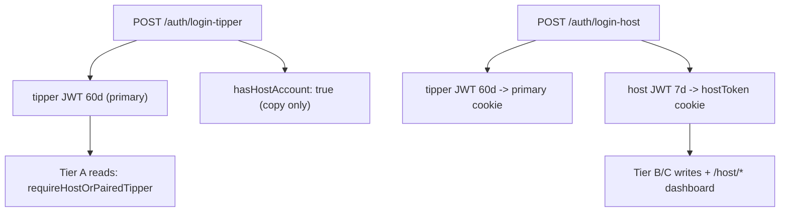

# Restore tipper-primary identity across the product

## The defect in one line

The helper layer (tiers, `enforce()`, host cookie pair, `useHostCapability`) is correct. The **identity-issuing layer was never changed**: tipper login endpoints check the Host table first and return a host identity plus a host-role 7d JWT. Every downstream gate then correctly concludes "this is a host".

Your evidence payload (`role: "HOST"` with `eventCode`/`eventSlug`/`numOfEvents`) is a Host row returned by `/auth/login-tipper`.

## Target model (decisions confirmed)

- Primary session (`token` cookie + Redux `auth.user`) is **always** tipper or visitor. Role is never `HOST`.
- Host identity lives **only** in the `hostToken` (HttpOnly) + `hostUser` cookie pair.
- Host sign-in mints **both**: a tipper 60d JWT as primary, and a host 7d JWT for the host cookie.
- All existing JWTs are invalidated once at deploy via an `iat` cutoff.



## Phase 1 - Backend identity minting (closes the reported hole)

All in [backend/src/controllers/auth.controller.ts](backend/src/controllers/auth.controller.ts).

- `loginTipper` (556-689): delete the `if (existingHost)` early return at 591-632. Always resolve the linked tipper via `ensureTipperForHostEmail(email, ...)` from [backend/src/utils/push-recipient.util.ts](backend/src/utils/push-recipient.util.ts), upsert the code on `{ tipperId }`, mint `role: "tipper"` / `60d`. Return `role: "TIPPER"`, `user: tipper`, and add `hasHostAccount: true`. Keep `tag: "EXISTING_HOST"` for copy only.
- `loginOrRegisterTipper` (845-980): same. It already computes `linkedTipper` at 869 then discards it - make it the session subject.
- `verifyCode` (243-368): remove host precedence at 266-267 (`const user = host || tipper`). Accept an explicit `accountType: "TIPPER" | "HOST"` in the body, defaulting to `TIPPER`, and resolve the code row deterministically (`{ tipperId }` or `{ hostId }`) instead of the ambiguous `OR` at 274-278.
- `resendCode` (1170-1228): same explicit intent; today `const tipper = !host ? ... : null` at 1188 means a linked email never refreshes the tipper code row.
- `e2eVerificationCode` (~2282-2296): same host-precedence fix.
- `registerTipper` (390-397): the hard reject "Email already exists as a HOST" should instead ensure the linked tipper and proceed.

### Code-row ambiguity (data correctness, not cosmetic)

`Code` has both `hostId @unique` and `tipperId @unique` ([backend/prisma/schema.prisma](backend/prisma/schema.prisma) 224-234). Because `Tipper.id === Host.id` for linked accounts, two rows can coexist and `findFirst({ OR: [{ hostId }, { tipperId }] })` matches nondeterministically. Every read and upsert must be keyed by explicit account type. Add a one-off cleanup for existing duplicate pairs.

## Phase 2 - Backend host login returns dual tokens

- `loginHost` (459-553), `loginOrRegisterHost` (983-1167), and the `requestLoginCode` (1231-1297) + host-verify path: after resolving the host, call `ensureLinkedTipperForHost` (already used at 1080/1099), then mint **two** tokens and return:

```json
{ "role": "TIPPER", "primary": { "token": "<tipper 60d>", "user": { "...tipper" } },
  "host": { "token": "<host 7d>", "user": { "...safeHost" } } }
```

- Audit the host token minted at [backend/src/controllers/host.controller.ts](backend/src/controllers/host.controller.ts) 142-144 for the same treatment.

## Phase 3 - Forced re-auth at deploy

- Centralise verification in `verifyToken()` ([backend/src/utils/token.util.ts](backend/src/utils/token.util.ts)) and add an `AUTH_TOKEN_MIN_IAT` env cutoff rejecting any token with `iat` below it. `jwt.sign` already sets `iat`.
- Apply in `authMiddleware` right after `jwt.verify` (insertion point at [backend/src/middlewares/auth.middleware.ts](backend/src/middlewares/auth.middleware.ts) 49-50) **and** in `optionalAuthMiddleware` (96-113), which currently skips session assertions entirely.
- Other `jwt.verify` sites to route through the shared helper: `session-token.service.ts:29`, `content.controller.ts:123`, `community-video-access.util.ts:35`, `actor-resolve.util.ts:26`.

## Phase 4 - Frontend session plumbing

- [frontend/src/lib/auth-response.ts](frontend/src/lib/auth-response.ts): delete the `tag === "EXISTING_HOST" ? "HOST"` mapping (105-108). Add a parser for the new dual-token host response that returns primary + host separately.
- [frontend/src/features/auth-slice.ts](frontend/src/features/auth-slice.ts): narrow `AuthState.user` to `TipperUser | VisitorUser`; drop `HostUser` from the union and remove host-only fields. This makes every stale host read a compile error, which is how we find the remaining sites cheaply.
- [frontend/src/redux/store.ts](frontend/src/redux/store.ts): `persistConfig` has no `version`/`migrate`. Add `version: 1` plus a migration that nulls any persisted `auth.user` with `role: "HOST"`, so returning users don't rehydrate a host-primary session.
- [frontend/src/components/auth/signin-form.tsx](frontend/src/components/auth/signin-form.tsx): `finishHostAuth` (230-298) currently does `setCredentials({ user: { ...user, role: "HOST" } })` + `persistAuthSession`. Rewrite so primary is the tipper and the host half goes through `persistHostSession` only. Same for `signup-form.tsx:215` and `superadmin-login-handler.tsx:43,59`.
- [frontend/src/lib/session-client.ts](frontend/src/lib/session-client.ts): primary TTL is always 60d.

## Phase 5 - Host identity primitives (build before migrating call sites)

To avoid ad-hoc edits at 90 sites, introduce three primitives:

- Extend `HostUserCookie` in [frontend/src/lib/host-session-client.ts](frontend/src/lib/host-session-client.ts) with stable identity only: `id`, `username`, `eventSlug`, `eventCode`, `email`, `hostSessionExpiresAt`. Update the `/api/auth/host-session` route accordingly.
- New `useHostSession()` - stable host identity from the cookie plus `isActive`.
- New `useHostProfile()` - host-token-authenticated fetch for the **volatile** fields (`numOfEvents`, `hostSubscriptionTier`, `lockedCustomerType`, legal/org names). These must not live in a cookie or in Redux.
- New `getServerHostSession()` for SSR pages, mirroring [frontend/src/lib/server-event-auth.ts](frontend/src/lib/server-event-auth.ts).

Then harden the existing helpers:

- [frontend/src/hooks/use-host-capability.ts](frontend/src/hooks/use-host-capability.ts): remove the `isHostRole` short-circuits at 70, 78-85, and 117. `active` requires `hasActiveHostSession(link.hostId)`; `getHostAuthToken` reads the host cookie, never `getAuthToken()`.
- [frontend/src/hooks/use-notification-badge.ts](frontend/src/hooks/use-notification-badge.ts) 26, 54, 81-82: drop `isHostRole`; never use the tipper id as a hostId.
- `session-activity-pinger.tsx:75` and `host-dashboard-session-touch.tsx:36`: always touch the host session via the host route.

## Phase 6 - SSR and server actions onto host credentials

- [frontend/src/lib/getHostId.ts](frontend/src/lib/getHostId.ts) reads the primary `user` cookie as the host - switch to `hostUser`.
- Host-scoped server actions still using `serverAuthHeaders` must use `serverHostAuthHeaders`: [frontend/src/actions/host-payouts.ts](frontend/src/actions/host-payouts.ts) (84, 96, 111, 127), [frontend/src/actions/host.ts](frontend/src/actions/host.ts), [frontend/src/actions/events.ts](frontend/src/actions/events.ts) (70, 124, 156-193), and `getHostProfileAction`/`updateHostProfileAction`/`updateHostAction` in [frontend/src/actions/auth.ts](frontend/src/actions/auth.ts) (346, 360, 381).
- [frontend/src/app/(dashboard)/host/[slug]/manage-event/[eventId]/page.tsx](frontend/src/app/(dashboard)/host/[slug]/manage-event/[eventId]/page.tsx) 24-31 and `sidebar-wrapper.tsx:21` / `useHostEvents.ts:15` rely on the primary cookie falling back correctly - they will return wrong or empty data until migrated.

## Phase 7 - Dashboard migration (largest slice)

Migrate from primary Redux to `useHostSession()` / `useHostProfile()` / host token:

- Shell and nav: `app-sidebar.tsx` (65, 71, 75, 117-207, 278-297), `dashboard-footer.tsx` (51-58), `navbar-client.tsx` (58-60), [frontend/src/lib/account-nav-href.ts](frontend/src/lib/account-nav-href.ts) (8-70).
- Hooks: `useHostID.ts` (14-15), `useHostPayoutSummary.ts`, `useHostPlanCapabilities.ts`, `use-payout-profile-guard.ts`, `useReportsAndAnalytics.ts`, `useTopTippers.ts`.
- Panels and cards: `dashboard-client.tsx`, `settings-client.tsx`, `host-community-client.tsx` (651, 1106-1109), `host-subscription-panel.tsx` (39, 198), `host-subscription-pricing-panel.tsx:54` (must stop writing host tier onto the tipper via `updateTipper`), `host-youtube-channels-settings.tsx`, `manage-event-card.tsx`, `venue-event-card.tsx`, `top-tipper-card.tsx`, `video-analytics-panel.tsx`.
- Host components: `event-detail-client.tsx` (286-299, 433, 494, 538, 613), `host-banner.tsx`, `host-creator-page-client.tsx`, `host-stats.tsx`, `tipper-detail-client.tsx`, `edit-creator-profile-dialog.tsx`.

## Phase 8 - Create-event flow and event rooms

- `event-only/page.tsx`, `event-and-content/page.tsx`, `content-only/page.tsx` - each has the same `user?.role === "HOST"` cluster (~276-388). Gate on `canWriteAsHost`.
- [frontend/src/lib/sync-host-auth-after-submission.ts](frontend/src/lib/sync-host-auth-after-submission.ts) writes a host snapshot into primary Redux - retarget to the host session route.
- `event-sign-in-form.tsx` (204-207, 390, 496): the `EXISTING_HOST` branch should open host sign-in rather than set a host primary session.
- `save-video-client.ts:19` returns `{ hostId: userId }` when role is HOST - needs an explicit host id.
- `event-room-drop-message-modal.tsx:59`: drop the `user?.role === "HOST"` branch, keep `canWriteAsHost`.

## Phase 9 - Gates, dead branches, and the one real regression

- [frontend/src/components/auth/host-dashboard-gate.tsx](frontend/src/components/auth/host-dashboard-gate.tsx): stop keying on `user?.role === "TIPPER"` (34, 37, 78). Gate every `/host/*` route on `canWriteAsHost` regardless of primary role, so a stale host-primary session can never slip through.
- Mechanical cleanup of `role === "TIPPER" || role === "HOST"` signed-in checks (~20 sites: `content-client.tsx:793`, `channel-client.tsx:766`, `profile-tabs.tsx`, `tv-navbar.tsx`, `tv-express-buttons.tsx`, `tipper-wallet-entry.tsx:48`, `side-chick-provider.tsx:65`, `event-user.tsx:74`, `event-user-inline.tsx:40`, `store.ts:36`, others). These are dead branches after Phase 4, safe to remove last.
- Real regression to fix: `viewerHostsCommunity` at [backend/src/controllers/community-access-state.controller.ts](backend/src/controllers/community-access-state.controller.ts) 112-114 requires `role === "host"`. A linked owner arriving with a tipper JWT would lose owner UI - resolve via the shared id or paired-host lookup.

## Phase 10 - Verification that would have caught this

The existing [backend/src/scripts/verify-hybrid-auth-matrix.ts](backend/src/scripts/verify-hybrid-auth-matrix.ts) only asserts that enforcement is *wired* (file contents, `enforce()` chain lengths). It cannot catch a correctly-wired gate fed a wrong identity. Add:

- Integration tests under `backend/src/controllers/__tests__/` (vitest, `*.spec.ts` per [backend/vitest.config.ts](backend/vitest.config.ts)) asserting the **identity contract**: for a linked email, `/auth/login-tipper`, `/auth/login-or-register-tipper`, and `/auth/verify-code` each return `role: "TIPPER"` and a JWT whose decoded `role` claim is `tipper`.
- A test that `requireActiveHostSession` rejects a tipper JWT with `HOST_SESSION_REQUIRED`, and that `requireHostOrPairedTipper` accepts it.
- A repo guard in the matrix script asserting no `role: "HOST"` is ever passed to `setCredentials`, and that `auth-response.ts` contains no `EXISTING_HOST` to `HOST` mapping.

## Rollout order

1. Ship Phases 1-3 (backend) behind the `iat` cutoff. The reported hole closes here: tippers can no longer hold host tokens, so `requireActiveHostSession` and `HostDashboardGate` become effective immediately.
2. Ship Phases 4-9 together in one frontend release. Splitting them breaks the dashboard, because host reads lose their credential in Phase 4 but do not regain it until Phase 7.
3. Set `AUTH_TOKEN_MIN_IAT` to the deploy timestamp and confirm the persisted-Redux migration purges host-primary users.
4. Re-run `npm run verify:hybrid-auth`, `npm test`, and both typechecks.

## Risks

- Phase 4's Redux narrowing will surface a large number of type errors at once. That is intentional and is the cheapest way to enumerate the remaining sites, but it means Phases 4-9 must land as a single unit.
- Session clocks change: a linked user's inactivity window moves from `Host.lastActiveAt` (7d) to `Tipper.lastActiveAt` (60d) for primary use, with the host window tracked separately. Intended, but worth watching for unexpected host-session expiries on the dashboard.
- Forced re-auth signs everyone out once.