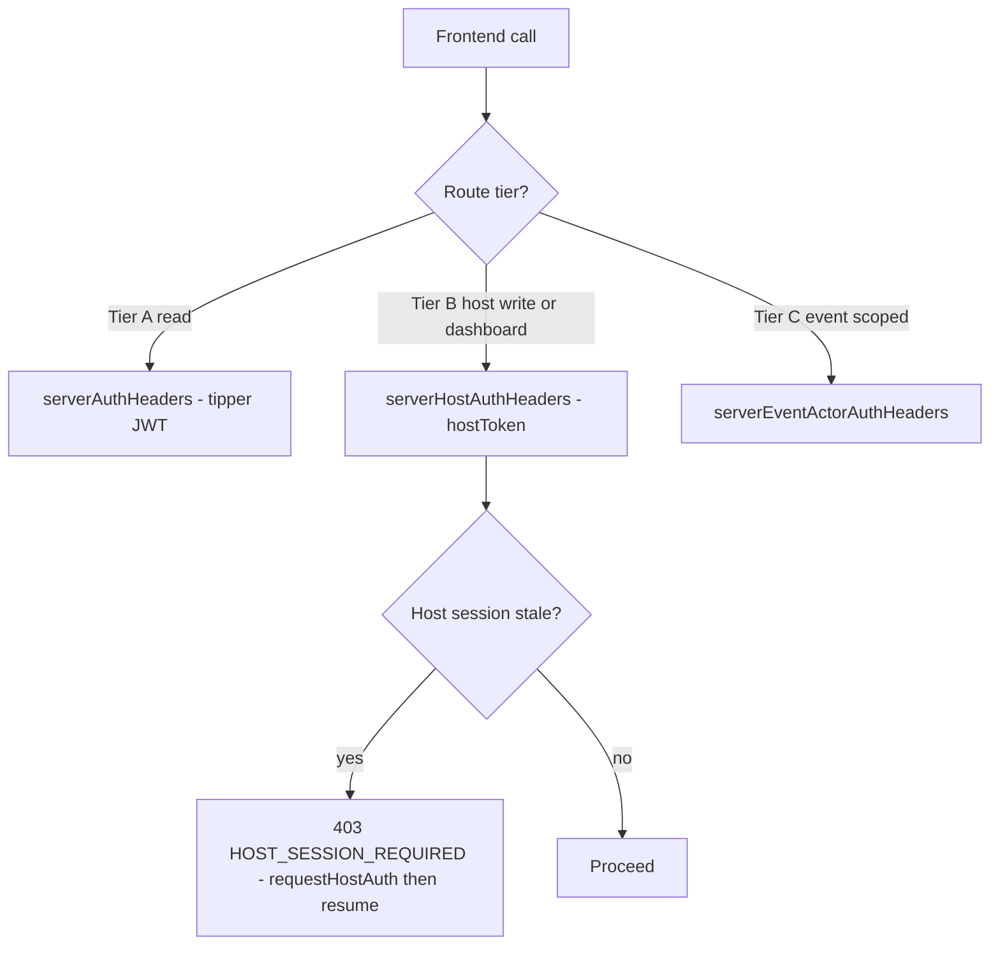

# Tipper-Primary Identity: Complete Gap Closure and Production Readiness

## Root cause, stated once

The migration moved host identity out of the primary session. The primary JWT is now always `role: "tipper"`. Every backend route guarded by `requireHost` / `requireRole("host")` / `requireActiveHostSession` therefore rejects it:

```ts
// backend/src/middlewares/role.middleware.ts:10-18
export const requireRole = (...allowedRoles: string[]) => {
  return (req, res, next) => {
    const role = (req as any).user?.role;
    if (!role || !allowedRoles.includes(role)) {
      return next(createHttpError(403, "Forbidden: insufficient permissions"));
    }
```

Any frontend caller still using `serverAuthHeaders()` or a raw fetch with the Redux `token` against those routes now fails. That single mechanism explains the failing QA test and roughly 60 further endpoints.

The correct call-side rule, per [.cursor/rules/authorization-policy.md](.cursor/rules/authorization-policy.md):



## Confirmation on Batch 4 (Tier B)

Batch 4 keeps Tier B semantics exactly as documented: no backend middleware is relaxed, and no route is reclassified to Tier A. Frontend callers move to `serverHostAuthHeaders()`, and each migrated surface gains host-auth recovery via `useHostCapabilityWithAuth().handleAuthRequiredError` so a stale session opens the host login modal and resumes instead of failing silently.

This adds no new user friction: [frontend/src/components/auth/host-dashboard-gate.tsx](frontend/src/components/auth/host-dashboard-gate.tsx) already gates every `/host/*` route on `canWriteAsHost`, so reaching any of these dashboard reads already requires an active host session. Using the host token for them makes the transport consistent with the gate that is already enforced.

---

## Phase 1 - Restore broken writes (severity: blocking)

- [frontend/src/actions/events.ts](frontend/src/actions/events.ts) `newCreateEventAction` (line 35): switch to `serverHostAuthHeaders()`. `POST /events/new` is `authMiddleware, requireHost` ([backend/src/routes/event.route.ts](backend/src/routes/event.route.ts):80-86), so **all event creation is currently failing**. Wire `handleAuthRequiredError` into the three wizards so a stale host session re-prompts instead of losing the filled form.
- [frontend/src/actions/communities.ts](frontend/src/actions/communities.ts) `submitCommunityStartInterestAction` (line 978): switch to `serverHostAuthHeaders()`, drop the now-unused `token` parameter. **This is the failing QA test.**
- [frontend/src/components/community/start-community-request-dialog.tsx](frontend/src/components/community/start-community-request-dialog.tsx): replace the `!userId || !authToken` guard with `canWriteAsHost` plus `requestHostAuth`, and derive `eventSlug` from host capability/session only. The current `user?.role === "HOST"` branch at lines 50-51 is dead, so the post-submit handoff to `/host/{eventSlug}/host-community` can silently skip even once the 403 is fixed.
- [frontend/src/components/host/host-community-client.tsx](frontend/src/components/host/host-community-client.tsx):1186-1190: pass `{ useHostSession: true }` to `addCommunityVideoAction` and add host-auth recovery.
- [frontend/src/components/host/tip-customization-client.tsx](frontend/src/components/host/tip-customization-client.tsx): replace the seven raw fetches (lines 57, 83, 100, 119, 142, 163, 195) and the Redux-token `authHeaders` (lines 46-51) with new server actions using `serverHostAuthHeaders()`.

Exit check: create an event through each of the three wizards; submit start-community end to end including the countdown handoff; add a community video from the host dashboard; save and publish a tip config.

## Phase 2 - Sign-in modal journeys

- [frontend/src/components/auth/signin-form.tsx](frontend/src/components/auth/signin-form.tsx):1080-1096 already supports inline host sign-up; the bug is three call sites omitting the prop. Pass `allowInlineSignUp` in [community-hub-client.tsx](frontend/src/components/community/community-hub-client.tsx):547-557, the shared `HostAuthModal` in [use-host-capability-with-auth.tsx](frontend/src/hooks/use-host-capability-with-auth.tsx):120-127, and [comment-drawer.tsx](frontend/src/components/messages/comment-drawer.tsx):830-837. Copy the working pattern from [create-dialog.tsx](frontend/src/components/home/create-dialog.tsx):495.
- Remove the remaining primary-session HOST writes, which violate the golden rule: [event-sign-in-form.tsx](frontend/src/components/events/event-sign-in-form.tsx) lines 137, 157, 290, 310 and [signup-form.tsx](frontend/src/components/auth/signup-form.tsx):211-219. Route both through `applyPrimaryAndHostSessions`.
- Fix non-resuming intents: comment-like (opens modal with no `onSuccess`), explore-feed save toggle, [invite-modal.tsx](frontend/src/components/events/invite-modal.tsx):39,154 ignoring its own `open` prop, [set-reminder-button.tsx](frontend/src/components/program/set-reminder-button.tsx):291-295 rendering a dialog that is never opened, and [host-creator-page-client.tsx](frontend/src/components/host/host-creator-page-client.tsx):233-254 where an unconditional `router.push` pre-empts the start-community resume.
- Give `HostUpgradeDialog` an inline path or an explicit return-to so it stops discarding intent at line 50.

## Phase 3 - Notifications

- [frontend/src/components/notifications/notifications-tab.tsx](frontend/src/components/notifications/notifications-tab.tsx): the host sub-tab loads correctly with the host token but mark-read (146), mark-all (163) and delete (173) use tipper-scoped actions, so host rows cannot be acted on. Add host-scoped variants in [frontend/src/actions/notifications.ts](frontend/src/actions/notifications.ts) using `serverHostAuthHeaders()` and dispatch by active sub-tab.
- [frontend/src/components/dashboard/host-notifications-client.tsx](frontend/src/components/dashboard/host-notifications-client.tsx):31,47,57: swap to the host-scoped list and mark actions.
- [frontend/src/hooks/use-notification-badge.ts](frontend/src/hooks/use-notification-badge.ts):49-53: currently suppresses the tipper unread count whenever a host session is active, so the personal badge vanishes after host login. Return both counts independently.
- Confirm the host sub-tab remains present on the tipper profile and drawer under `canReadAsHost || stale` with the existing re-login prompt.

## Phase 4 - Dashboard reads and host actions, under Tier B

Migrate to `serverHostAuthHeaders()` and add `handleAuthRequiredError` recovery on the consuming surfaces:

- [frontend/src/actions/video-requests.ts](frontend/src/actions/video-requests.ts): all twelve actions; every `/video-requests/*` route is `requireHost`.
- [frontend/src/actions/coowner-host.ts](frontend/src/actions/coowner-host.ts): all three actions.
- [frontend/src/actions/events.ts](frontend/src/actions/events.ts): `getHostEventsAction`, `getHostEventsTabsAction`, `getHostDefaultChannelsAction`, `getHostEventsForTabsByStatus`, `getHostFeesAction`, plus the YouTube and co-owner invite actions (lines 119-197). Leave `getHostEventsSummaryAction` alone: it is genuinely Tier A via `requireHostOrPairedTipper`.
- [frontend/src/actions/host.ts](frontend/src/actions/host.ts): `getHostEventSummaries`, `getHostTransactionsAction`, `getHostVideoAnalyticsAction`, `getHostStatsAction`, `updateHostEventDetailsAction` (lines 102-327).
- [frontend/src/actions/communities.ts](frontend/src/actions/communities.ts):307-470: the `community.host.*` owner-admin actions (join form, members, terminate, extend, access codes, invites, requests) consumed by `community-membership-owner-panel.tsx`.
- [frontend/src/actions/program-actions.ts](frontend/src/actions/program-actions.ts):79-94 `patchCommunityProgramLandingBannerAction`, whose controller resolves `getHostId(req)` and returns null for a tipper JWT.
- [frontend/src/actions/reminder-bucket.ts](frontend/src/actions/reminder-bucket.ts):115-128 `createCommunityReminderPostAction`: no 403, but the controller hardcodes `authorRole: "host"` while the JWT is a tipper. Move to the host token so the recorded author matches the actor.

## Phase 5 - Dead-branch feature restoration

These fail silently rather than erroring, so they will not surface in QA as failures:

- YouTube slots: [add-video-form.tsx](frontend/src/components/events/add-video-form.tsx):91-93,177,220 gates on `role === "HOST"`, so `showHostYoutubeSlot` never resolves and slots never load, even with an active host session.
- Co-owner tier: [add-video-policy-fields.tsx](frontend/src/components/events/add-video-policy-fields.tsx):60-65.
- Privacy step: [event-content-privacy-step.tsx](frontend/src/components/events/event-content-privacy-step.tsx):75-83.
- [frontend/src/lib/validate-privacy-video-links.ts](frontend/src/lib/validate-privacy-video-links.ts):24-27 reads `hostSubscriptionTier` off the primary Redux user, which is now always `undefined`, so premium linked hosts get a false "Upgrade to Host Premium" on co-owned video submit.

Fix by replacing the role checks with `canWriteAsHost` / `canReadAsHost` and sourcing `hostSubscriptionTier` from the host profile via the existing `useHostProfile()` hook rather than the primary session.

## Phase 6 - Cleanup and guardrail

- Simplify the wallet eligibility checks in [use-tipper-wallet-status.ts](frontend/src/hooks/use-tipper-wallet-status.ts):12 and [tipper-wallet-entry.tsx](frontend/src/components/payments/tipper-wallet-entry.tsx):48 to `TIPPER` only, and correct the "tipper or host account" copy at lines 591-593. This is dead code, not a hole: authorization is server-side via `requireTipperForWallet`.
- Sync [frontend/src/lib/authorization-policy.ts](frontend/src/lib/authorization-policy.ts), currently missing `community.contentBank.read/manage`, `community.host.read/write`, and `events.messages.read/write`.
- Remove the legacy `localStorage.removeItem("walletPendingTipAfterTopup")` key and the dead `role === "HOST"` branch in [save-video-client.ts](frontend/src/lib/save-video-client.ts):19.
- Add a structural guardrail to [backend/src/scripts/verify-hybrid-auth-matrix.ts](backend/src/scripts/verify-hybrid-auth-matrix.ts), which already has `readBackend` / `readFrontend` helpers. New check group: parse every route file for handlers guarded by `requireHost`, `requireRole("host")` or `requireActiveHostSession`, extract the endpoint path, locate the frontend action referencing that path, and fail if the enclosing function uses `serverAuthHeaders` or a raw `Authorization: Bearer ${token}`. This turns the entire regression class into a build failure.

---

## Wallet top-up settle: recommended approach (design only, not implemented)

Findings. A client-side resume already exists and works on the happy path: [tipper-wallet-entry.tsx](frontend/src/components/payments/tipper-wallet-entry.tsx):535 writes `writeTipResumeCtx` plus `writeWalletTopupReturnIntent` before the Stripe redirect, [use-wallet-topup-tip-resume.ts](frontend/src/hooks/use-wallet-topup-tip-resume.ts) reopens the drawer and wallet modal on return, and [tip-drawer.tsx](frontend/src/components/events/tip-drawer.tsx):333 restores the wallet lines. The `WalletTopupSettle` model ([backend/prisma/schema.prisma](backend/prisma/schema.prisma):2048-2073) is the never-built server-side equivalent.

The decisive constraint: `debitTipperWalletForTip` requires the wallet PIN via bcrypt compare ([backend/src/services/tip-payment-side-effects.service.ts](backend/src/services/tip-payment-side-effects.service.ts):831-852). A fully automatic server-side debit on top-up credit would require storing or bypassing the PIN, which is a security regression. So auto-debit is rejected.

Money is never at risk today: the top-up credit is idempotent across webhook, reconcile and cron ([wallet-topup-credit.service.ts](backend/src/services/wallet-topup-credit.service.ts)). What breaks is the journey, because the tip context lives only in `localStorage`, whose write silently swallows failures ("quota / private mode"). It is lost when storage is unavailable, when the user returns on a different device or browser, when the tab is closed before return, or when the context TTL expires. The balance is credited but the user must rebuild the tip by hand.

Recommended approach: make `WalletTopupSettle` the durable server-side mirror of the client context, keeping the PIN.

- On `createWalletTopupIntent` with a tip context present, write a `WalletTopupSettle` row keyed by `topupTransactionId` (already `@unique`), carrying `tipAmount`, `charactersJson`, `selectedTipsJson`, `secondaryText`, `paymentSurface`, `paymentContentId` and the analytics fields the model already defines.
- Add `GET /wallet/topup/pending-settle`: returns the tipper's unused row (`usedAt: null`, joined to a succeeded top-up transaction, within a TTL). The client prefers fast `localStorage` when present and falls back to this, which makes resume work cross-device.
- Add `POST /wallet/topup/:settleId/settle`, taking only the PIN. The server rebuilds the debit from the persisted row, calls `debitTipperWalletForTip`, and sets `usedAt` in the same transaction. `topupTransactionId @unique` plus `usedAt` give idempotency and one-shot semantics.
- Reuse the existing `wallet-topup` Pusher event to prompt resume when the user is still on the page.

This is additive, leaves the happy path untouched, keeps the PIN control intact, and removes the single point of failure. Implementation is deliberately excluded from this plan pending your approval.

---

## Completeness and production readiness

Definition of done, verified per phase and again at the end:

- `npm run verify:hybrid-auth` passes, including the new guardrail checks (currently 51 checks; the guardrail adds one per host-only route group).
- Backend `npm test` stays green (currently 416 tests).
- `npm run typecheck` passes in both packages.
- Zero remaining occurrences of `serverAuthHeaders` or raw Redux-token fetches against `requireHost` routes, asserted mechanically by the guardrail rather than by inspection.
- Manual QA: your eight passing scenarios re-run unchanged, plus the previously untested paths that this work fixes: event creation via all three wizards, start-community end to end, host dashboard tabs and analytics, video requests, tip config publish, YouTube slot add, co-owned video submit as a premium host, and host notification mark-read and delete.

Explicitly in scope and closed by this plan: the failing start-community test, the modal sign-up journey break, the host notification sub-tab, the reminder and save and engagement audits (verified already correct, with dead code removed), the wallet scoping question, and every add-video flow.

Explicitly out of scope and therefore a residual known limitation: wallet top-up settle keeps its `localStorage`-dependent resume until the design above is approved and built. Money is never lost; the tip context can be, in the edge cases listed.

## Deploy checklist (unchanged, still outstanding)

- `AUTH_TOKEN_MIN_IAT` is referenced by [backend/src/utils/token.util.ts](backend/src/utils/token.util.ts):18 but is not set in `.env` or `.env.production`. Set it to the deploy unix timestamp to force one round of re-auth.
- Run `npx ts-node src/scripts/cleanup-duplicate-auth-codes.ts` against production.
- Ship backend and frontend together as one release unit, since the auth header contract changes on both sides.
- Re-run the full verification set post-deploy.

## Correction to my earlier report

My previous readiness report classified these as "non-blocking display/copy" items. That was wrong in kind: about 30 of them are hard 403 breakages including all event creation, and about 6 are silent feature loss. The error was judging files by whether they looked like UI copy instead of tracing each caller to the middleware on its route. The guardrail in Phase 6 exists so that judgement is never needed again.