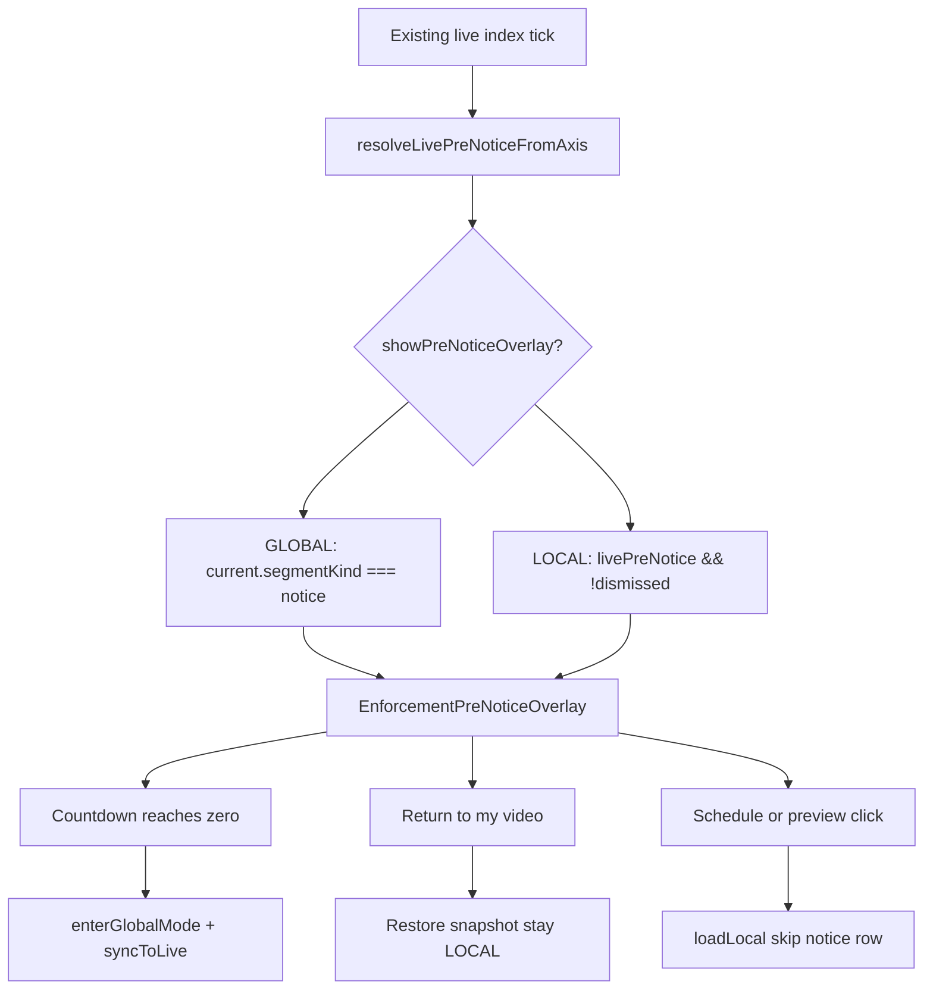

# TV crash, tablet layout, PiP removal, extend pre-notice slate

## Out of scope

**TVFullscreen (`/tv?videoId=...`)** — no implementation in this work. Investigate separately later.

---

## P0 — Production crash: `Cannot read properties of null (reading 'src')`

This error is the YouTube IFrame API accessing `iframe.src` after the iframe is gone (or never attached). It is thrown from all three loopers because they share [`useTvPlayerControls`](frontend/src/hooks/use-tv-player-controls.ts) + [`TvPlayer`](frontend/src/components/tv/tv-player.tsx) / [`HomeTvPlayer`](frontend/src/components/tv/home-tv-player.tsx).

The 500ms reconcile poll and mute/play effects call `getPlayerState()`, `isMuted()`, `mute()`, `play()`, `pause()` whenever `isReady()` is true. `isReady()` today only checks that the YT object exists and has `getCurrentTime` — **not** that `getIframe()` is in the DOM:

```398:403:frontend/src/components/tv/tv-player.tsx
    const getReady = useCallback(
      () =>
        readyRef.current &&
        !!playerRef.current &&
        typeof playerRef.current.getCurrentTime === "function",
      []
    );
```

When `playbackUrl` is empty the player unmounts; the hook can still hold a stale `playerRef` and poll it. That matches “handled by ClientErrorBoundary in TvLooper / WebTvLooper / HomeTvLooper.”

**Fix (defense in depth):**

1. **`isReady()`** — also require `getIframe?.()` to be a live `HTMLIFrameElement` in `document`.
2. **Wrap every YT API call** in `TvPlayer` / `HomeTvPlayer` (`play`, `pause`, `stop`, `mute`, `unmute`, `isMuted`, `getPlayerState`, `getCurrentTime`, `getDuration`, `seekTo`, `load`, `setVolume`) in try/catch; return safe defaults on failure. Never assume `getIframe()` is non-null (already handled in presentation helpers).
3. **Do not mount `<YouTube>`** unless `youtubeVideoId` is a non-empty string.
4. **Hook poll / mute effects** — wrap player reads/writes in try/catch so a YT throw cannot tear down the React tree. Skip work if `!player.isReady()`.
5. **Remove live `miniPlayerActive` wiring** as part of PiP deletion (below). Today LOCAL tab-hide still sets `miniPlayerActive`, and the hook **pauses** the player. That leftover path is a crash vector and is no longer needed.

Add a unit test that `isReady` is false when `getIframe()` is null, and that hook reconcile does not throw if `getPlayerState` throws.

---

## P0 — Tablet blank screen + WebTvLooper resize

**Root cause:** tablets (>500px) already take the desktop shell (`TvWebExperience` → `WebTvLooper`), but the player grid is CSS-hidden until 1024px:

```446:447:frontend/src/components/tv/tv-interactive-shell.tsx
      {isDesktop && (
        <div className="mt-16 hidden grid-cols-12 gap-2 lg:grid">
```

Viewports **501–1023px** render neither the mobile looper nor a visible desktop grid.

**Fix:**

- When `variant === "desktop"`, show the grid always (`grid grid-cols-12`, drop `hidden lg:grid`). Tablets get `WebTvLooper` as requested.
- Drive phone vs desktop **from JS viewport width**, not a mix of `react-responsive` 500px + Tailwind `lg`. Use [`useClientViewportWidth`](frontend/src/hooks/use-client-viewport-width.ts) (already listens to `resize`) and [`SURFACE_MOBILE_MAX_PX`](frontend/src/lib/surface-breakpoints.ts) (500) in [`tv-page-client-wrapper.tsx`](frontend/src/components/tv/tv-page-client-wrapper.tsx) so resizing across 500px swaps shells and resizing within desktop only reflows.
- Make [`web-tv-looper.tsx`](frontend/src/components/tv/web-tv-looper.tsx) fill the stage: keep `w-full`, replace brittle fixed player chrome heights (`h-[370px]` loading overlay, `h-[60vh]` only if it still clips on tablet) with `h-full min-h-0` inside the shell column so window resize and browser chrome changes reflow the player.
- Verify at ~768px and ~1024px, and by dragging the window across 500px and 1024px.

Do **not** route tablets to `TvLooper`.

---

## P1 — Delete PiP (no longer needed)

In all three loopers ([`tv-looper.tsx`](frontend/src/components/tv/tv-looper.tsx), [`web-tv-looper.tsx`](frontend/src/components/tv/web-tv-looper.tsx), [`home-tv-looper.tsx`](frontend/src/components/tv/home-tv-looper.tsx)):

- Delete the commented mini-player overlay (the `setIsPlaying(true/false)` block).
- Delete `miniPlayerActive` state, visibility/`beforeunload` effects that only served PiP, and the `miniPlayerActive` argument to `useTvPlayerControls`.
- Remove the hook’s pause-when-miniPlayer effect.

Keep `miniPlayerActive` as an optional **TvPlayer layout prop** if still used for iframe height; stop passing it from loopers.

---

## P1 — Extend existing pre-notice slate (not a new notification system)

### What already exists (keep as the system)

Enforcement pre-start is already a **virtual 60s axis segment**, not a YouTube video:

| Layer | Today |
|-------|--------|
| Backend | `segmentKind: "notice"`, `noticePhase: "pre"`, title e.g. “Program Start (Block)” — [`tv-virtual-playlist.service.ts`](backend/src/services/tv-virtual-playlist.service.ts) |
| GLOBAL playback | `syncToLive` lands on notice row, pauses player (`syncToLive_notice_pause`), then loads enforcement clip in GLOBAL — [`tv-provider.tsx`](frontend/src/components/tv-provider.tsx) ~1353–1468 |
| UI | Black overlay when `current?.segmentKind === "notice"` in all loopers — e.g. [`tv-looper.tsx`](frontend/src/components/tv/tv-looper.tsx) ~1257–1272 |

**This work extends that slate** — countdown, LOCAL visibility, opt-out actions, clearer copy. No second modal, toast, timer, or backend segment.

### Gap to close

- **GLOBAL:** overlay works but has no countdown and static copy only.
- **LOCAL:** `syncToLive` does not run (`mode !== "GLOBAL"`), so `currentIndex` never hits the notice row and LOCAL viewers see nothing — even though `liveBroadcastIndex` already tracks the live notice row (~2403).

### Product rule (from brief)

When live axis is in **pre-notice** (`noticePhase === "pre"`):

1. **Everyone** sees the same 1-minute starter slate with an **axis-derived countdown** (“program starts on Live TV in 0:42 — no action needed”).
2. **Wait:** when countdown finishes, enforced program plays on **Live TV** (GLOBAL).
3. **“Return to what I was watching”** (LOCAL only, when snapshot exists): dismiss slate, restore exact seek + play, stay in Your TV.
4. **Schedule or preview click:** dismiss slate, play chosen row in Your TV (existing `loadLocalAtIndex` already skips notice rows).

Post-notice slates (`noticePhase === "post"`) are **unchanged**.

### Architecture — one overlay, two visibility rules



**Overlay visibility (single component):**

```ts
showPreNoticeOverlay =
  (mode === "GLOBAL" && current.segmentKind === "notice")  // existing
  || (mode === "LOCAL" && livePreNotice && !dismissedPreNoticeIds.has(enforcementId))
```

### Implementation (regression-safe)

**Critical rule:** Do **not** `enterLocalMode` or `enterGlobalMode` when the slate **appears**. Mode change only on wait-out (LOCAL → GLOBAL) or explicit user action (playlist click, Go Live).

#### 1. Pure helper — [`frontend/src/lib/tv/resolve-live-pre-notice-from-axis.ts`](frontend/src/lib/tv/resolve-live-pre-notice-from-axis.ts)

Extend the existing live tick; do not invent parallel state.

- Input: `items`, `broadcastEpoch`, `totalDuration`, `now` (via existing `resolveBroadcastPosition`).
- Output: `LivePreNotice | null`:
  - `enforcementId`, `title`, `scheduleIndex`, `remainingSec`
- `remainingSec` = axis end minus loop position (or notice duration minus offset within notice). **Never** a client-only 60s timer.
- Return `null` for off-axis, post-notice, or missing enforcement id.

Unit tests: remaining seconds at start/mid/end of notice; post-notice ignored; null off-axis.

#### 2. TVProvider — extend existing live-index interval (~2403)

On each tick (already runs in both GLOBAL and LOCAL):

- Set `livePreNotice` from helper (alongside `liveBroadcastIndex`).
- **LOCAL + first tick of new `enforcementId`:** snapshot once `{ index, seekSeconds, wasPlaying, enforcementId }`. Pause local player under slate (matches GLOBAL pause). Do **not** change `currentIndex` to notice row (would unload video).
- **Wait-out:** when `livePreNotice` transitions from active → inactive for an `enforcementId` and user did **not** dismiss:
  - If mode is LOCAL → `enterGlobalMode()` then existing `syncToLive` loads enforcement program.
  - If mode is GLOBAL → existing handoff only (no extra mode change).
- **Restore button:** `dismissPreNotice(enforcementId)`, restore snapshot (seek + play if was playing), stay LOCAL.
- **Playlist/schedule click while slate visible:** call `dismissPreNotice(enforcementId)` inside `loadLocalAtIndex` / `playLocalFromSchedule` before play (rows already skip notice).
- Session `dismissedPreNoticeIds: Set<string>` — cleared when axis leaves that enforcement’s pre-notice window (or persist for window only).

Expose on context: `livePreNotice`, `localPreNoticeSnapshot`, `dismissPreNotice`, `restorePreNoticeLocal`.

**Do not change:** `playEnforcementProgram` live-first resolver, GLOBAL `syncToLive_notice_pause` path, `loadLocalAtIndex` notice skip.

#### 3. Shared overlay — [`frontend/src/components/tv/enforcement-pre-notice-overlay.tsx`](frontend/src/components/tv/enforcement-pre-notice-overlay.tsx)

Replace triplicated `{isNotice && (...)}` in [`tv-looper.tsx`](frontend/src/components/tv/tv-looper.tsx), [`web-tv-looper.tsx`](frontend/src/components/tv/web-tv-looper.tsx), [`home-tv-looper.tsx`](frontend/src/components/tv/home-tv-looper.tsx).

Props: `title`, `remainingSec`, `onReturnToLocal?` (shown only when snapshot exists).

Copy:

- Title from notice row (`current.channel?.title` or `livePreNotice.title`).
- Countdown: `Program starts on Live TV in m:ss`.
- Subtext: no action required; playback continues automatically.
- Button: “Return to what I was watching” (LOCAL opt-out only).

Keep player mounted under overlay (existing notice pattern: `lastPlayableUrlRef` / frozen frame in GLOBAL; local video stays loaded in LOCAL).

#### 4. Loopers

- Replace inline notice div with `<EnforcementPreNoticeOverlay />`.
- Compute `showPreNoticeOverlay` from rules above.
- Pass `remainingSec` from `livePreNotice.remainingSec` (GLOBAL on notice row can use same field for consistency).

### User journeys

| Viewer | Slate appears | Wait | Return button | Playlist click |
|--------|---------------|------|---------------|----------------|
| GLOBAL | Existing sync → notice row + pause | Enforcement on Live TV via syncToLive | N/A (no snapshot) | Dismiss + LOCAL + chosen row |
| LOCAL | Overlay on axis; local video paused under slate | enterGlobalMode → Live TV program | Restore seek, stay LOCAL | Dismiss + play row (existing skip notice) |

### Regression checklist

1. GLOBAL notice → program handoff unchanged (live-first).
2. LOCAL `currentIndex` never jumps to notice row during slate.
3. `loadLocalAtIndex` still skips notice segments.
4. `playEnforcementProgram` live-first tests unchanged.
5. Countdown survives tab refresh (axis-derived).
6. Restore is exact (index + seek + play state).
7. Post-notice slates untouched.
8. No mode flip when slate **starts** (only on wait-out or user action).

### Product doc

Update [`product-behaviors/tv-system-product-behavior.md`](product-behaviors/tv-system-product-behavior.md) under **Program / video enforcement → Pre-notice slate** (extend existing section, do not add a “second notification system”):

- Same 60s virtual axis segment for all viewers.
- GLOBAL: synced to slate; player paused; countdown until Live TV program.
- LOCAL: same slate when live axis enters pre-notice; local playback paused under slate; opt-out via return button or playlist click.
- Wait-out → Live TV enforcement program; no action required.
- Explicitly: slate does **not** force mode change on appear.

---

## Suggested order of work

1. **P0:** Crash hardening + PiP/miniPlayerActive removal (unblocks production TV).
2. **P0:** Tablet grid visible + WebTvLooper resize/reflow.
3. **P1:** `resolveLivePreNoticeFromAxis` + TVProvider snapshot/dismiss/wait-out.
4. **P1:** `EnforcementPreNoticeOverlay` + wire all three loopers.
5. **P1:** Product doc + unit tests.
6. Run frontend TV tests (`enforcement-playback-mode`, `use-tv-player-controls`, new pre-notice helper) and targeted typecheck on changed files.
