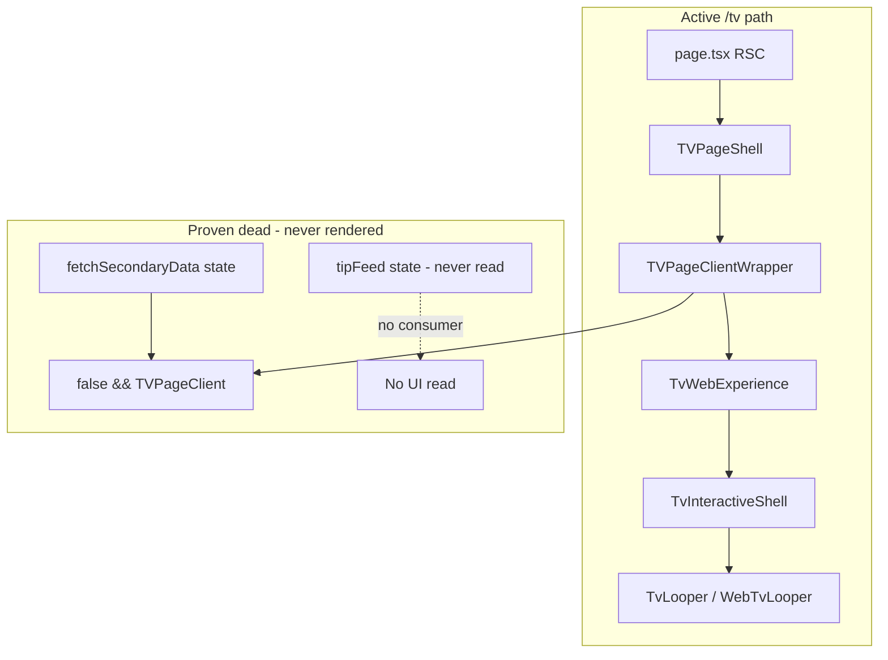
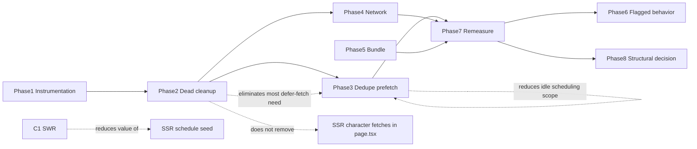

# TV Performance Optimization — Production Implementation Plan

## Executive summary

The investigation identified **proven dead work on `/tv`** that competes with schedule load and YouTube init, plus **duplicate catalog prefetch** and **missing YouTube preconnect**. These are safe to ship before any change to playback orchestration.

**Phase 6 playback architecture must not be modified** in Phases 1–5:

- `requestPlayback`, `externallyControlled`, mute-before-load, payment resume, `key="mobile-tv-looper"`, `unregisterTvPlayer`, cold-start index seed, GLOBAL/LOCAL, enforcement paths in [`tv-provider.tsx`](frontend/src/components/tv-provider.tsx) and loopers.

**Recommended first ships (after Phase 1 instrumentation):**

1. Remove proven-dead fetches/Pusher/state in [`tv-page-client-wrapper.tsx`](frontend/src/components/tv/tv-page-client-wrapper.tsx)
2. Remove explore prefetch on TV route
3. Deduplicate + idle-defer catalog prefetch
4. Add YouTube preconnect on TV route

**Defer:** early YouTube bootstrap, mount-order changes, SSR schedule seeding, context restructure until Phase 7 re-measure proves need.

**Estimated cumulative TTFV impact (desktop p95, directional):**
| After phase | Repeat visit | Cold visit |
|-------------|--------------|------------|
| Baseline (measure) | TBD | TBD |
| Phase 2 (dead cleanup) | −300–800 ms | −500–1500 ms (Fast 3G: −1–2 s) |
| Phase 3 (dedupe/defer prefetch) | −200–600 ms | −200–600 ms |
| Phase 4 (preconnect + oEmbed defer) | −200–500 ms | −200–500 ms |
| Phase 5 (bundle split) | −100–400 ms parse | −100–400 ms parse |
| Phase 6 (SWR flag only) | −800–2500 ms | ~0 ms |

---

## 1. Optimization classification (all items)

### Category A — Safe cleanup (no observable behavior change)

| ID  | Optimization                                                         | Classification             | Why safe                                                                                                                                            | User-visible change |
| --- | -------------------------------------------------------------------- | -------------------------- | --------------------------------------------------------------------------------------------------------------------------------------------------- | ------------------- |
| A1  | Remove `fetchSecondaryData` + related state                          | Dead code removal          | Data only consumed by `{false && <TVPageClient />}` ([`tv-page-client-wrapper.tsx:589-604`](frontend/src/components/tv/tv-page-client-wrapper.tsx)) | None                |
| A2  | Remove unused `tipFeed` state + all writers                          | Dead code removal          | `const [, setTipFeed]` — value never read ([`:311`](frontend/src/components/tv/tv-page-client-wrapper.tsx))                                         | None                |
| A3  | Remove global/community Pusher bindings that only `setTipFeed`       | Dead code removal          | Handlers at `:414-484` only update unread state; `TipsFeedPanel` uses `useTipsDrawerData`                                                           | None                |
| A4  | Remove duplicate `getTipFeed` effects                                | Redundant work elimination | Three tip-feed fetch paths (`:320-365`, `:388-402`, community `:373-386`) all write dead state                                                      | None                |
| A5  | Remove `tagFilteredContents` / dead `selectedTag` usage in wrapper   | Dead code removal          | Only passed to disabled `TVPageClient` (`:447-452`, `:601-602`)                                                                                     | None                |
| A6  | Remove unused `channels` prop wiring (keep prop optional for legacy) | Dead code removal          | `channels` only passed to disabled block (`:592`)                                                                                                   | None                |

### Category B — Behavior-preserving optimizations (timing only)

| ID  | Optimization                                                       | Classification             | Why safe                                                                                                                                                                                                                                         | User-visible change                                          |
| --- | ------------------------------------------------------------------ | -------------------------- | ------------------------------------------------------------------------------------------------------------------------------------------------------------------------------------------------------------------------------------------------ | ------------------------------------------------------------ |
| B1  | Remove `scheduleExploreFeedPrefetchIdle()` on `/tv`                | Redundant work elimination | Explore page still calls it ([`explore-page-client.tsx:455`](frontend/src/components/explore/explore-page-client.tsx)); TV mount at [`tv-page-client-wrapper.tsx:166-168`](frontend/src/components/tv/tv-page-client-wrapper.tsx) is wrong route | None                                                         |
| B2  | Remove duplicate `prefetchTvEventCatalogs` in wrapper              | Redundant work elimination | Provider already prefetches in `applySchedulePayloadCore` ([`tv-provider.tsx:829-831`](frontend/src/components/tv-provider.tsx)); wrapper duplicates at `:278-281`                                                                               | None (drawer still loads via `loadTvEventCatalog` on open)   |
| B3  | Idle-defer provider catalog prefetch until after first `onPlay`    | Network optimization       | Same catalog API, later timing; `loadTvEventCatalog` on drawer open remains                                                                                                                                                                      | Tip drawer catalog may load ~100–300 ms slower on first open |
| B4  | YouTube `preconnect` on TV route                                   | Network optimization       | Root layout only preconnects when `NEXT_PUBLIC_EXPLORE_YT_PRELOAD` ([`layout.tsx:82-98`](frontend/src/app/layout.tsx)); TV player uses nocookie host ([`tv-player.tsx`](frontend/src/components/tv/tv-player.tsx))                               | None                                                         |
| B5  | Defer `fetchYoutubeAspectInfo` (oEmbed) until after first `onPlay` | Network optimization       | Cached after first call ([`youtube-immersive-meta.ts:326-337`](frontend/src/lib/youtube-immersive-meta.ts)); layout may use default briefly                                                                                                      | Possible brief default aspect before correction              |
| B6  | Dynamic import browse panels in shell                              | Bundle optimization        | Panels already mount conditionally by `rightPanelView`; only chunk load timing changes                                                                                                                                                           | Brief delay first time user opens a panel                    |
| B7  | Dynamic import `CommentDrawer`/`TipsDrawer` in looper              | Bundle optimization        | Drawers open on user action                                                                                                                                                                                                                      | Brief delay first open                                       |
| B8  | Idle-defer `prefetchTvScheduleTips`                                | Network optimization       | Tips still load when drawer opens via `useTipsDrawerData`                                                                                                                                                                                        | Tips tab may populate slightly slower                        |

### Category C — Behavior-changing (feature flags required)

| ID  | Optimization                                      | Classification             | Risk                                                     | User-visible change                                    |
| --- | ------------------------------------------------- | -------------------------- | -------------------------------------------------------- | ------------------------------------------------------ |
| C1  | SWR schedule bootstrap from `sessionStorage`      | Architectural optimization | Medium — stale row at batch boundary                     | Stale banner; possible brief wrong row until refresh   |
| C2  | Remove/lazy `getAllCharacterSets()` SSR           | Architectural optimization | Medium — prop proven unused in active path               | None unless something relied on SSR prop (it does not) |
| C3  | Lazy `getCharactersForTipping()` SSR              | Architectural optimization | Medium — payment `characterMap` empty until client fetch | Early tip may miss payment animation                   |
| C4  | SSR schedule snippet in RSC `page.tsx`            | Architectural optimization | Medium–High — hydration/sync                             | Possible row jump after hydrate                        |
| C5  | Direct client schedule fetch (skip server action) | Network optimization       | Low–Medium — auth pattern                                | None if auth equivalent                                |
| C6  | Split/memoize `TVContext` value                   | Rendering optimization     | Medium — stale closure bugs                              | None if done correctly                                 |

### Category D — Deferred / rejected

| ID  | Item                                                         | Why deferred                                                                                                                   |
| --- | ------------------------------------------------------------ | ------------------------------------------------------------------------------------------------------------------------------ |
| D1  | Early YouTube bootstrap before `tvReady`                     | Touches mount order, `requestPlayback`, mute-first autoplay, payment layer — highest regression risk                           |
| D2  | Playback mount order changes                                 | Same as D1; overlaps SWR benefit                                                                                               |
| D3  | Suspense-only `/tv` change without moving SSR awaits         | [`page.tsx:80-85`](<frontend/src/app/(tv)/tv/page.tsx>) blocks before Suspense; fallback rarely helps                          |
| D4  | Remove `preloadVideos` link hints without measurement        | [`preloadManager.ts`](frontend/src/lib/preloadManager.ts) may help or hurt next-video; needs Network A/B                       |
| D5  | ResizeObserver / payment layer changes for load              | Stability concern, not TTFV                                                                                                    |
| D6  | Delete `TVPageClient` file / `{false && ...}` block entirely | Keep disabled reference block until product confirms legacy browse won't return — remove **runtime** dead work only in Phase 2 |

---

## 2. Dead code validation (proven vs needs verification)

### Proven dead (safe to remove runtime work)

| Removal target                                                                                                                  | Evidence                                                                                                               | Classification                                                              |
| ------------------------------------------------------------------------------------------------------------------------------- | ---------------------------------------------------------------------------------------------------------------------- | --------------------------------------------------------------------------- |
| `fetchSecondaryData` + `tippers`, `tipperEvents`, `iTipped`, `causes`, `contents`, `latestContents`, `mostTippedContents` state | Only consumer: `{false && <TVPageClient .../>}` `:589-604`                                                             | **Proven dead**                                                             |
| `tipFeed` state + Pusher handlers                                                                                               | `const [, setTipFeed]` `:311`; no read in file; `TipsFeedPanel` self-fetches                                           | **Proven dead**                                                             |
| Duplicate `getTipFeed` / `getCommunityTipFeedAction` effects                                                                    | All write `setTipFeed` only                                                                                            | **Proven dead**                                                             |
| `tagFilteredContents`                                                                                                           | Only passed to disabled `TVPageClient`                                                                                 | **Proven dead**                                                             |
| `channels` in wrapper active tree                                                                                               | Only passed to disabled `TVPageClient` `:592`                                                                          | **Proven dead**                                                             |
| Wrapper `prefetchTvEventCatalogs`                                                                                               | Duplicate of provider `:829` + wrapper `:280`                                                                          | **Proven redundant** (remove wrapper copy)                                  |
| `scheduleExploreFeedPrefetchIdle()` on TV                                                                                       | No `/tv` consumer of explore prefetch cache                                                                            | **Proven redundant** on this route                                          |
| SSR `characterSets` prop chain                                                                                                  | Passed `page → shell → wrapper` but wrapper never destructures; drawer uses `videoTipCatalog.characterSets` `:288-293` | **Proven dead** in active UI (SSR fetch still runs — address in Phase 6 C2) |

### Probably dead (do NOT delete file; remove runtime only)

| Target                                                                    | Notes                                                                                                              |
| ------------------------------------------------------------------------- | ------------------------------------------------------------------------------------------------------------------ |
| [`tv-page-client.tsx`](frontend/src/components/tv/tv-page-client.tsx)     | File kept; `{false && ...}` block kept for reference per comment `:588`                                            |
| [`tv-right-section.tsx`](frontend/src/components/tv/tv-right-section.tsx) | No imports anywhere in repo — **Probably dead file**; do not delete in performance phases without product sign-off |
| [`tv-sidebar.tsx`](frontend/src/components/tv/tv-sidebar.tsx)             | No imports — **Probably dead file**; same                                                                          |

### Needs manual verification (before any deletion beyond wrapper)

| Target                                            | Verification                                                                                                                                            |
| ------------------------------------------------- | ------------------------------------------------------------------------------------------------------------------------------------------------------- |
| Community Pusher `tv-schedule-updated` in wrapper | Confirm provider channel at [`tv-provider.tsx:1087-1102`](frontend/src/components/tv-provider.tsx) is sole schedule listener needed — **expected safe** |
| `prefetchTvScheduleTips` deferral                 | Confirm tip drawer UX acceptable on slow 3G — manual QA                                                                                                 |

---

## 3. Dependency graph

**Overlap rules:**

- Phase 2 removes ~6 server actions + Pusher re-renders — **do not also add generic “defer fetches”** for the same code.
- Phase 3 removes wrapper catalog duplicate; idle-defer applies **only to provider** call.
- C1 SWR makes C4 SSR schedule seed lower priority — implement SWR first, re-measure before C4.
- C2 (`getAllCharacterSets` removal) is independent of C3 (`getCharactersForTipping` lazy) but can ship together behind one SSR flag.

---

## 4. Risk matrix

| Phase                         | Primary risk                                | Severity    | Mitigation                                             |
| ----------------------------- | ------------------------------------------- | ----------- | ------------------------------------------------------ |
| 1 Instrumentation             | Log noise                                   | Very Low    | `?tvDebug=1` gate only                                 |
| 2 Dead cleanup                | Accidental removal of live path             | Low         | Grep + QA matrix; keep `{false && TVPageClient}` block |
| 3 Prefetch dedupe/defer       | Slower first tip drawer catalog             | Low         | `loadTvEventCatalog` on open; QA tip drawer            |
| 4 Preconnect / oEmbed         | Wrong aspect briefly                        | Very Low    | Rollback env/layout link                               |
| 5 Dynamic imports             | Chunk load delay on first drawer/panel open | Low         | Prefetch on hover optional later                       |
| 6 SWR                         | Stale schedule row                          | Medium      | Feature flag + stale banner + rollback env             |
| 6 Lazy SSR characters         | Missing payment animation                   | Medium      | Client fetch + idle preload animation assets           |
| 6 SSR schedule / direct fetch | Sync/auth mismatch                          | Medium–High | Flags + staging soak                                   |
| D1 Early YT bootstrap         | Playback/payment regression                 | **High**    | **Do not implement**                                   |

---

## 5. Phase-by-phase rollout

### Phase 1 — Instrumentation only

**Goal:** Establish T0–T6 baseline before/after each subsequent phase.

**Files:**

- [`frontend/src/lib/tvDebugLog.ts`](frontend/src/lib/tvDebugLog.ts) — add `tvLoadMark(milestone, payload)` using `performance.mark` + ms since navigation
- [`frontend/src/components/tv/tv-page-suspense-fallback.tsx`](frontend/src/components/tv/tv-page-suspense-fallback.tsx) — T1
- [`frontend/src/components/tv-provider.tsx`](frontend/src/components/tv-provider.tsx) — T2 mount, T3 cache hit/miss, T4 `setIsReady(true)`
- [`frontend/src/components/tv/tv-player.tsx`](frontend/src/components/tv/tv-player.tsx) — T5/T6 (extend existing `onReady`/`onPlay` traces)

**Expected gain:** 0 ms (measurement only)

**User-visible change:** None

**Risk:** Very Low

**Rollback:** Revert log-only commits

**QA:** Enable `?tvDebug=1`; cold load produces ordered T0→T6 logs

**Success criteria:** 20 cold loads per device/throttle cell documented; baseline p50/p95 TTFV table filled

---

### Phase 2 — Dead code removal (Category A)

**Goal:** Stop proven-unused network work and re-renders on `/tv` critical path.

**Files:** [`frontend/src/components/tv/tv-page-client-wrapper.tsx`](frontend/src/components/tv/tv-page-client-wrapper.tsx) primary; remove unused imports/actions.

**Changes:**

- Delete `fetchSecondaryData` effect and unused state (`tippers`, `tipperEvents`, `iTipped`, `causes`, `contents`, `latestContents`, `mostTippedContents`)
- Delete `tipFeed` state and all effects/Pusher bindings that only call `setTipFeed`
- Delete `tagFilteredContents` computation
- Remove `scheduleExploreFeedPrefetchIdle()` mount effect (B1 bundled here — zero product impact)
- Remove unused imports: `getAllTopTippers`, `getLatestContents`, `getMostTippedContents`, `getAllCausesAction`, tip-feed merge helpers if unused, etc.
- **Do not** remove `{false && <TVPageClient />}` block or `TVPageClient` file

**Expected gain:** −500–1500 ms cold on Fast 3G; −6–8 server actions; fewer wrapper re-renders on live tips

**User-visible change:** None on active UI

**Risk:** Low

**Rollback:** Single-file revert

**QA checklist:** Full functional matrix (Section 6); Network tab shows removed actions gone

**Success criteria:** Duplicate server actions absent on load; TTFV p95 improves vs Phase 1 baseline; zero playback regressions

---

### Phase 3 — Duplicate work elimination (Category A + B)

**Goal:** One catalog prefetch path, deferred off critical path.

**Files:**

- [`frontend/src/components/tv/tv-page-client-wrapper.tsx`](frontend/src/components/tv/tv-page-client-wrapper.tsx) — remove `prefetchTvEventCatalogs` effect (`:278-281`) and imports
- [`frontend/src/components/tv-provider.tsx`](frontend/src/components/tv-provider.tsx) — wrap `prefetchTvEventCatalogs` in `schedulePostTtfvIdle()` helper ( `requestIdleCallback` with 4s timeout, or fire on first `onPlay` event via provider listener)

**Optional (same phase, low risk):** idle-defer `prefetchTvScheduleTips` in wrapper (B8)

**Expected gain:** −200–600 ms; up to 24 fewer concurrent server actions at `isReady`

**User-visible change:** Possible slightly slower first tip-drawer catalog/tips prefetch

**Risk:** Low

**Rollback:** Restore synchronous prefetch in provider

**Success criteria:** Network waterfall shows catalog prefetch after first play; tip drawer still functional

---

### Phase 4 — Network optimizations (Category B)

**Goal:** Faster YouTube iframe init; less contention at player ready.

**Files:**

- New small component e.g. `frontend/src/components/tv/tv-youtube-preconnect.tsx` included from [`frontend/src/app/(tv)/layout.tsx`](<frontend/src/app/(tv)/layout.tsx>) — preconnect to `youtube-nocookie.com`, `i.ytimg.com`, `www.youtube.com` (mirror [`layout.tsx:82-98`](frontend/src/app/layout.tsx))
- [`frontend/src/components/tv/tv-player.tsx`](frontend/src/components/tv/tv-player.tsx) — defer `notifyVideoAspect()` / oEmbed until after first `onPlay` (B5)

**Expected gain:** −200–500 ms T5→T6

**User-visible change:** None (minor aspect default possible)

**Risk:** Very Low

**Rollback:** Remove preconnect component; restore immediate oEmbed

**Success criteria:** T5→T6 interval shrinks; no autoplay/payment regressions

---

### Phase 5 — Bundle optimizations (Category B)

**Goal:** Reduce initial JS parse/hydrate on `/tv`.

**Files:**

- [`frontend/src/components/tv/tv-interactive-shell.tsx`](frontend/src/components/tv/tv-interactive-shell.tsx) — `dynamic()` for `TopContentsPanel`, `LatestContentsPanel`, `SpotlightPanel`, `MostTippedContentsPanel`, `SavedContentsPanel`, `EventVideoTypeContentsPanel`, `UpcomingProgramsPanel` (TipDrawer already dynamic `:16-22`)
- [`frontend/src/components/tv/tv-looper.tsx`](frontend/src/components/tv/tv-looper.tsx) — dynamic `CommentDrawer`, `TipsDrawer`

**Expected gain:** −100–400 ms hydration/parse (device-dependent)

**User-visible change:** First open of panel/drawer may show brief chunk load

**Risk:** Low

**Rollback:** Restore static imports

**Success criteria:** Smaller initial TV chunk in bundle analyzer; functional matrix pass

---

### Phase 6 — Feature-flagged behavioral optimizations (Category C)

**Ship independently; one flag per item.**

| Flag                                        | Item             | Files                                                                                                                                                               |
| ------------------------------------------- | ---------------- | ------------------------------------------------------------------------------------------------------------------------------------------------------------------- |
| `NEXT_PUBLIC_TV_SCHEDULE_SWR=true`          | C1 SWR bootstrap | [`tv-provider.tsx`](frontend/src/components/tv-provider.tsx) — sync `readTvScheduleCache` before first `loadSchedule`; `setScheduleStale(true)`; background refresh |
| `NEXT_PUBLIC_TV_LAZY_SSR_CHARACTERS=true`   | C2 + C3          | [`page.tsx`](<frontend/src/app/(tv)/tv/page.tsx>), client fetch for characters/sets, keep payment player fed                                                        |
| `NEXT_PUBLIC_TV_DIRECT_SCHEDULE_FETCH=true` | C5               | New client fetch helper mirroring [`tv-schedule.ts`](frontend/src/actions/tv-schedule.ts) auth                                                                      |
| `NEXT_PUBLIC_TV_SSR_SCHEDULE=true`          | C4               | RSC schedule seed — **only if Phase 7 shows cold schedule RTT still dominates**                                                                                     |

**Do not touch:** `requestPlayback`, `externallyControlled`, looper mount gates, payment hooks.

**Expected gain:** SWR repeat visit −800–2500 ms; lazy SSR −300–1200 ms TTFB; direct fetch −50–200 ms per schedule call

**Risk:** Medium (SWR highest)

**Rollback:** Env flag off

**Success criteria:** Staging soak 48h; stale banner works; payment animation matrix pass

---

### Phase 7 — Re-measure performance

**Goal:** Compare Phase 1 baseline to post-Phase 5 (+ any Phase 6 flags enabled).

**Metrics:** TTFV T0→T6, schedule load, player ready, first play, request count on load, wrapper re-render count (React Profiler), bundle size.

**Deliverable:** Updated measurement table + go/no-go for Phase 8 items.

---

### Phase 8 — Structural decision gate

**Implement only if Phase 7 misses targets:**

| If gap is...                      | Then consider...                          |
| --------------------------------- | ----------------------------------------- |
| Repeat-visit schedule wait        | C1 SWR (if not already on)                |
| Cold TTFB / SSR                   | C2/C3 lazy characters                     |
| Cold schedule RTT                 | C4 SSR schedule (not before SWR measured) |
| Runtime jank / 3s tick re-renders | C6 context split                          |
| Still duplicate schedule hop      | C5 direct fetch                           |

**Do not consider:** D1 early YouTube bootstrap unless traces prove iframe init dominates **after** Phases 2–5 and schedule is already instant.

---

## 6. Validation checklist (every phase)

### Functional (must pass before merge)

- [ ] GLOBAL cold load — correct live row/offset (`cold_start_seeded_index` trace)
- [ ] LOCAL playlist click — mobile gesture play
- [ ] Community TV source switch
- [ ] Enforcement deep-link — single load
- [ ] Tip drawer open → pay → `resumeAfterPayment`
- [ ] Payment animation inline mobile + full-view mount targets
- [ ] Full-view enter/exit; orientation — single `mobile-tv-looper`
- [ ] Playlist / schedule drawer
- [ ] Browse panels (after Phase 5 dynamic import)
- [ ] Stale schedule banner (Phase 6 SWR only)

### Performance (compare to Phase 1 baseline)

- [ ] TTFV (T6 − T0) p50/p95
- [ ] T3 schedule (`loadSchedule_start` → `loadSchedule_success`)
- [ ] T4 looper visible (`isReady`)
- [ ] T5 `onReady` → T6 `onPlay`
- [ ] Hydration / main chunk size
- [ ] Network: server action count first 5s
- [ ] No duplicate `prefetchTvEventCatalogs` burst
- [ ] Wrapper re-renders on `live-tip` (should drop after Phase 2)

---

## 7. Rollback plan

| Phase | Rollback mechanism             | Time                                   |
| ----- | ------------------------------ | -------------------------------------- |
| 1     | Revert instrumentation commit  | Minutes                                |
| 2     | Revert wrapper single PR       | Minutes                                |
| 3     | Revert provider prefetch defer | Minutes                                |
| 4     | Remove TV preconnect component | Minutes                                |
| 5     | Restore static imports         | Minutes                                |
| 6     | Set env flags `false`          | Immediate without redeploy if env-only |

**Production rule:** One phase = one PR = independently revertible.

---

## 8. Final recommendation — implement first

**Immediate after approval:**

1. **Phase 1** — baseline (mandatory)
2. **Phase 2** — dead cleanup (highest ROI, proven dead, no playback touch)
3. **Phase 3** — catalog dedupe/defer
4. **Phase 4** — YouTube preconnect

**Next batch (after Phase 7):** 5. **Phase 5** — bundle splits 6. **Phase 6** — C1 SWR behind flag only; then decide C2/C3/C5/C4 from data

**Intentionally postpone:**

- C4 SSR schedule, C6 context split, D1 early bootstrap, D4 preloadVideos removal

**Not worth doing now:**

- D1/D2 playback mount changes
- D3 Suspense-only
- D5 payment layer for load
- Deleting legacy TV component files (keep reference block)

**Best improvement / least risk:** Phase 2 dead code removal in [`tv-page-client-wrapper.tsx`](frontend/src/components/tv/tv-page-client-wrapper.tsx)

**Highest production risk if attempted:** D1 early YouTube bootstrap; unflagged C1 SWR at batch boundaries
