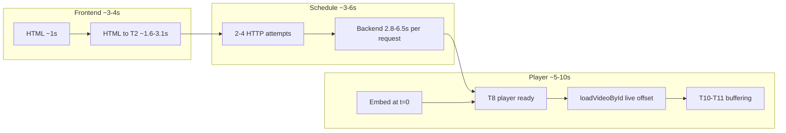
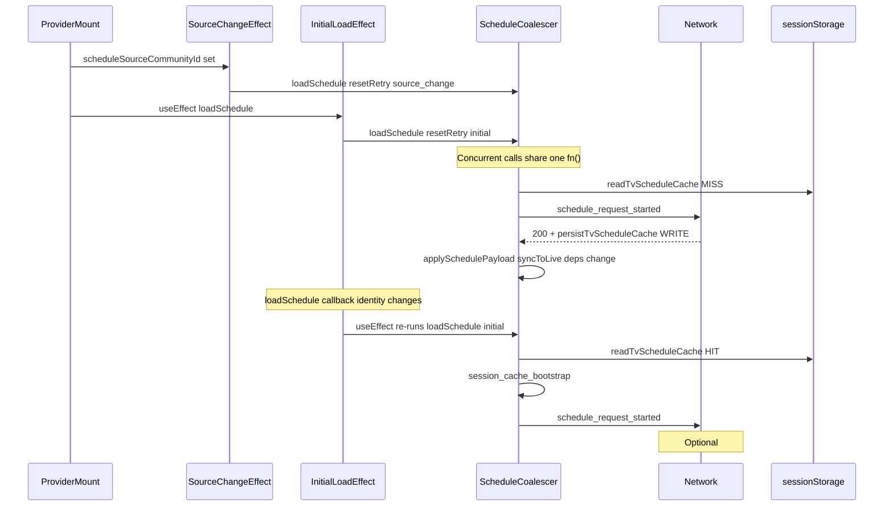

# TV Startup Latency — Root-Cause Synthesis and Phased Remediation Plan

**Scope:** Plan only — no code changes. Based on five corrected trace summaries, backend `[TV_STARTUP_BACKEND_TRACE]` logs, and repository inspection.

---

## 1. Executive root-cause synthesis

The five measured runs **do not** match the earlier 48s anomaly (9 loads, 47 syncs, inflated counters). With corrected instrumentation, each run shows a **normal, single-orchestration pipeline**:

- 1 initial embed + 1 `loadVideoById` at live offset
- 0–1 seek, 2 index changes
- No retries, no rebuilding, no player errors
- Overlay removed before PLAYING (by design)

**Median TTFV ~11.6s** misses the production target (p50 ≤ 6s) because cost is **spread across four layers**, not one bottleneck:

| Layer | Evidence | Approx. share of median TTFV |
|-------|----------|------------------------------|
| Frontend bootstrap (T1→T2) | Measured 1.6–3.1s | ~15–25% |
| Schedule delivery (T2→T4) | 2–4 network attempts; backend 2.8–3.0s typical | ~25–35% |
| YouTube init (T6→T8) | ~2.5s API→ready | ~15–20% |
| Post-ready playback (T8→T11) | Position→PLAYING 4.8–9.7s incl. one reload + buffer | ~35–45% |

**Conclusion:** Repeated player loads are **not** the consistent cause in these five runs. The structural **embed-at-zero then live-offset load** plus **duplicate schedule HTTP passes** and **backend read-path cost** are the highest-confidence levers.

---

## 2. Exact startup schedule request sequence

On cold `/tv` navigation ([`tv-provider.tsx`](frontend/src/components/tv-provider.tsx)):

**Effect order (same commit):**
1. `[scheduleSourceCommunityId]` → `resetPlaybackForScheduleSourceChange()` + `loadSchedule({ resetRetry, trigger: "source_change" })`
2. `[loadSchedule]` → `loadSchedule({ resetRetry, trigger: "initial" })` — **coalesced** with (1)
3. After first response: `syncToLive` deps change → **`loadSchedule` recreated** → effect (2) **re-runs** → guaranteed second sequential fetch

**Coalescer** ([`tv-schedule-load-coalesce.ts`](frontend/src/lib/tv-schedule-load-coalesce.ts)) dedupes **concurrent** calls only; sequential calls after promise settle each emit `schedule_request_started`.

---

## 3. Session-cache bootstrap on cleared runs

**Root cause (confirmed): write-then-read on the same navigation — not stale site data.**

With `NEXT_PUBLIC_TV_SCHEDULE_SWR=1` ([`tv-feature-flags.ts`](frontend/src/lib/tv-feature-flags.ts)):

1. First pass: cache **miss** → network 200 → [`persistTvScheduleCache`](frontend/src/components/tv-provider.tsx) **writes** `tipmanna-tv-schedule-v2`
2. `scheduleSwrBootstrappedRef` stays **false** (only set on cache **read**, not network success)
3. Second pass (from `[loadSchedule]` effect re-run): `resetRetry: true` → cache **hit** → `session_cache_bootstrap` → `scheduleCacheBootstrapCount: 1`
4. Network still runs (stale-while-revalidate) → often **304** with etag

**Also possible but secondary:** homepage [`TVProvider`](frontend/src/components/home/tv-home-preview-section.tsx) prefetch writing same keys before navigating to `/tv`; explore prefetch uses in-memory only.

**Not the cause:** service worker supplying schedule body (SW uses NetworkFirst; sessionStorage is separate); counting cache write as bootstrap (instrumentation is correct — it counts read-hit bootstrap).

---

## 4. Two to four network attempts

| # | Cause | Real HTTP? | Blocks isReady? |
|---|--------|------------|-----------------|
| 1 | Mount coalesced `source_change` | Yes (200) | Yes (first payload) |
| 2 | **`useEffect([loadSchedule])` re-run** after `syncToLive` deps change | Yes (304 typical) | Re-applies cache; may re-trigger sync |
| 3 | `TvSourcePickerProvider` late `setScheduleSourceCommunityId` | Sometimes | Yes if source changes |
| 4 | React Strict Mode dev remount | Dev only | Yes |

**Classification:** **Combination** — ~1 intentional + ~1 **structural duplicate** (effect dependency churn) + optional refresh (`scheduleRefreshCountDuringStartup: 1` = one non-initial trigger, often the second pass counted as refresh or a visibility/source event).

**Not primarily instrumentation inflation** (after sanity-gate fixes). ETag 304 responses still count as network attempts (correct).

---

## 5. Interleaved backend timings under one trace ID

**Confirmed:** [`getTvStartupTraceId()`](frontend/src/lib/tv-startup-trace.ts) generates **one ID per page load**; every [`loadSchedule`](frontend/src/components/tv-provider.tsx) passes it via `X-TV-Startup-Trace-Id`.

Each HTTP request creates a **fresh** backend timer in [`createTvStartupBackendTracer`](backend/src/utils/tv-startup-backend-trace.util.ts) starting at `request_received`. Multiple requests log under the same `traceId` with independent `totalElapsedMs` sequences — **logs interleave** when requests overlap or when reading stdout chronologically.

**Recommended correlation format (instrumentation-only, Phase A):**
- Keep `X-TV-Startup-Trace-Id` (page session)
- Add `X-TV-Schedule-Attempt-Id: <uuid>` per `schedule_request_started` (frontend-generated, monotonic attempt number in trace summary)
- Backend logs both IDs on every `[TV_STARTUP_BACKEND_TRACE]` line and in `Server-Timing` comment

This makes each HTTP attempt independently reconstructable without changing response bodies or cache semantics.

---

## 6. `ensureTvSchedules` slow-path analysis

**Location:** [`schedule.controller.ts`](backend/src/controllers/schedule.controller.ts) lines 49–56; implementation via [`withCronLock`](backend/src/lib/distributed-lock) + [`generateSchedule()`](backend/src/jobs/generateTvSchedule.ts).

| Outcome | Stage time | What happens |
|---------|------------|--------------|
| Lock **loser** | ~0–5 ms | `pg_try_advisory_lock` fails → immediate return |
| Lock **winner**, warm | ~200–500 ms | Window probes all populated → skip generation |
| Lock **winner**, cold | **~2–6 s** | Full batch generation for missing half-day windows |

**Why 4.1s sometimes:** This request **won** `cron:tv-schedule:global` and ran cold generation (channel scan + batch build + transactions). Cron runs every 30 min ([`cron-schedule.config.ts`](backend/src/configs/cron-schedule.config.ts)) to pre-warm; concurrent cold starts race.

**Safety guarantees (cannot remove blindly):**
- Ensures half-day schedule rows exist for current + next windows
- Without it: 404/503 on read if cron hasn't materialized rows
- Lock is **non-blocking** — losers don't wait for winner (correctness gap under cold start if loser reads before winner commits)

**Called up to 3× per request:** entry, missing alternate playlist, REBUILDING branch.

**Remediation direction (Phase B):** Separate **existence check** (fast read-only probe) from **generation** (async/cron-only); block read only when rows provably missing, not on every request.

---

## 7. Persistent backend-stage analysis

| Stage | ~Measured | Repository source | Reduction potential |
|-------|-----------|-------------------|---------------------|
| `broadcast_context_loaded` | ~350 ms | 1× `tvGlobalSettings.findUnique` — no cache | Low (~100–200 ms with edge cache) |
| `playlist_loaded` | **~1,050 ms** | 2× parallel deep Prisma loads, up to 2000 items each, nested channel/event/host ([`loadGlobalTvPlaylists`](backend/src/services/tv-schedule-read.service.ts)) | **High** — slimmer include for TV serve, read replica, or playlist summary cache |
| `ongoing_composed` | ~350 ms | [`composeClientItemsForPlaylist`](backend/src/services/tv-schedule-read.service.ts) — L1+Redis cache 5 min TTL keyed by revision | Medium on cache hit; already optimized |
| `alternate_composed` | ~0–1 ms | Cache hit (same revision path) | Already fast |
| `access_safety_resolved` | **~700 ms** | [`resolveSafeFilteredSchedule`](backend/src/utils/tv-schedule-serve.util.ts): 3 parallel DB queries on union channel IDs + 2 filter passes + badge attachment — **no cache** | **High** — cache filter maps per schedule revision; batch size limits |

**Constraints preserved:** ETag/checksum includes filtered counts; access/safety/enforcement semantics must not change without explicit review.

---

## 8. Frontend bootstrap analysis

**T1→T2 gap (~1.6–3.1s)** sources ([`(tv)/layout.tsx`](frontend/src/app/(tv)/layout.tsx), [`layout.tsx`](frontend/src/app/layout.tsx), [`providers.tsx`](frontend/src/app/providers.tsx)):

| Source | Blocking? | Deferrable? |
|--------|-----------|-------------|
| JS bundle parse (root + TV client layout) | Yes | Partial (code split) |
| 4 Google fonts (Open Sans preloaded) | Partial | Yes — subset for TV |
| Redux PersistGate rehydration | Async, non-blocking UI | Yes for TV route |
| Global providers (SideChick, PWA, analytics bridges) | Hydration cost | Partial — TV-specific layout could slim tree |
| SSR `getCharactersForTipping()` | Server time before HTML | **Yes** — `NEXT_PUBLIC_TV_LAZY_SSR_CHARACTERS=1` already exists, unwired in prod |
| `TVProvider` mount + immediate `loadSchedule` | Client | Schedule is on critical path |

**`NEXT_PUBLIC_TV_LAZY_SSR_CHARACTERS`:** Relevant — skips SSR character fetch when enabled ([`tv/page.tsx`](frontend/src/app/(tv)/tv/page.tsx)). Estimated saving **0.3–1.0s** server/HTML phase if currently off in staging.

**Payment-animation / Pusher:** [`usePusherTrackingGlobalTV`](frontend/src/components/tv-provider.tsx) and analytics init run at provider mount — deferrable until post-T13 stable playback.

---

## 9. YouTube double-load analysis

**Current path** ([`tv-player.tsx`](frontend/src/components/tv/tv-player.tsx), [`youtubePlayerConfig.ts`](frontend/src/lib/youtubePlayerConfig.ts)):

1. `externallyControlled` freezes `videoId` at mount; **no `start` in playerVars**
2. Initial iframe embeds at **t=0** (`initial_embed_created`)
3. Schedule payload seeds `currentIndex` + `lastLivePosition` **before** looper mounts ([`applySchedulePayloadCore`](frontend/src/components/tv-provider.tsx))
4. After T8 `onReady`, `syncToLive` → `requestPlayback` → **`loadVideoById(videoId, liveOffset)`** because `orchestratedPlaybackRef` is null on cold start
5. Player re-enters BUFFERING → PLAYING (T10→T11: **4.8–9.7s** measured)

**Avoidable?** Yes, with code changes — not with current wiring:
- Thread `livePosition.offsetSeconds` into initial `playerVars.start` (YouTube IFrame API supports `start`)
- Seed `orchestratedPlaybackRef` on cold start so `isSameOrchestratedPlayback` skips redundant load ([`tv-playback-request.ts`](frontend/src/lib/tv-playback-request.ts))
- Preserve: mute-first autoplay, 3s drift `seekTo`, index changes on rollover, notice/enforcement segments

**Preconnect:** [`TvYoutubePreconnect`](frontend/src/components/tv/tv-youtube-preconnect.tsx) runs **after** provider mount (client-side). Moving nocookie/ytimg preconnect to root `<head>` for `/tv` only could save **200–800 ms** on YT script/TLS (range estimate).

---

## 10. Ranked remediation table

| Rank | Change | Current segment | Expected saving | Confidence | Risk | Rollback |
|------|--------|-----------------|-----------------|------------|------|----------|
| 1 | Fix duplicate `loadSchedule` effect re-run | +1 HTTP ~0.3–1.5s | **0.5–1.5s TTFV** | High | Low | Revert effect deps |
| 2 | Stabilize mount to single initial schedule path | 2 coalesced triggers | **0.2–0.5s** + cleaner traces | High | Low | Flag |
| 3 | Per-request schedule attempt ID (instrumentation) | N/A | 0ms product; enables Phase B measurement | High | None | N/A |
| 4 | Backend read fast path (skip ensure when rows exist) | ensure 0–4.1s | **0–3s** on cold winner | Medium | Medium | Env flag |
| 5 | Slim playlist include / cache playlist load | playlist ~1s | **0.3–0.7s** | Medium | Medium | Feature flag |
| 6 | Cache access/safety filter maps | access ~700ms | **0.3–0.5s** | Medium | Medium-High | Revision-keyed cache |
| 7 | Initial embed at live offset + seed orchestrated ref | T8→T11 ~5–10s | **2–5s** | Medium | **High** | Flag revert |
| 8 | Head preconnect for YouTube on TV route | YT init ~2.5s | **0.2–0.8s** | Medium | Low | Remove link tags |
| 9 | Lazy SSR characters on TV | HTML phase | **0.3–1.0s** | Medium | Low | Env flag |
| 10 | Defer non-critical providers post-T13 | T1→T2 ~2s | **0.3–1.0s** | Low-Medium | Medium | Provider split |
| 11 | Overlay until PLAYING (Phase D) | Perception only | **0s TTFV**; fixes false-ready UX | High | Low | Revert overlay gates |

---

## 11. Phased implementation plan

### Phase A — Startup schedule correctness (recommended first)

**Goal:** Exactly one intentional initial network schedule fetch; correct SWR semantics; reconstructable backend correlation.

**Changes:**
- Remove `loadSchedule` from `[loadSchedule]` effect dependency churn — use stable ref for initial-only mount effect
- Merge redundant mount triggers (`source_change` + `initial`) into one explicit `startup` trigger
- Set `scheduleSwrBootstrappedRef = true` after first successful network write OR first bootstrap read (prevent misleading bootstrap metric)
- Add `X-TV-Schedule-Attempt-Id` header per fetch ([`tv-schedule-client-fetch.ts`](frontend/src/lib/tv-schedule-client-fetch.ts), [`tv-schedule.ts` action](frontend/src/actions/tv-schedule.ts))
- Log attempt ID in frontend trace + backend tracer

**Why first:** Low regression risk; removes ~1 redundant HTTP round-trip; makes all subsequent backend/player work measurable on a clean baseline. Does not change schedule semantics.

### Phase B — Backend schedule fast path

**Goal:** Reduce p50 backend response from ~2.8s toward ~1.5–2.0s without changing ETag, access, or safety.

**Changes:**
- Replace unconditional `await ensureTvSchedules()` with fast existence probe; only invoke generation when windows missing (async queue or rely on cron + 503 retry)
- Evaluate slimmer Prisma include for TV serve (defer host/event fields not needed for playback)
- Add revision-keyed cache for `loadSharedTvFilterMaps` in `resolveSafeFilteredSchedule`
- Optional: playlist metadata cache between requests (checksum already detects staleness)

**Why second:** Depends on Phase A's single-request baseline for accurate A/B. Medium risk — requires load tests on cold start and REBUILDING paths.

### Phase C — Player first-load architecture

**Goal:** Eliminate embed-at-zero → live-reload cycle where offset is known before mount.

**Changes:**
- Pass `lastLivePosition.offsetSeconds` from provider → looper → `TvPlayer` as initial `playerVars.start`
- Seed `orchestratedPlaybackRef` in `applySchedulePayloadCore` when live position resolved
- Gate first `syncToLive` load: skip `requestPlayback` if embed already at correct video+offset
- Move `TvYoutubePreconnect` to root head for TV routes (or earlier in layout)
- Keep: mute-first, drift seek, index rollover, notice segments, enforcement

**Why third:** Highest TTFV potential (**2–5s**) but highest regression risk for live sync, community mode, notice/fallback URLs, and schedule rollover. Requires Phase A+B stable metrics to isolate player gains.

### Phase D — Loading-state accuracy (perception)

**Goal:** Overlay reflects actual playback state, not iframe API ready.

**Changes:**
- Default overlay clear on first `PLAYING` (T11), not `onReady` (T8)
- Optional intermediate "Buffering…" state between ready and playing
- Do **not** conflate with latency reduction in acceptance criteria

**Why last:** Zero TTFV impact; purely UX trust. Low risk but separate from performance sign-off.

**Recommended order:** **A → B → C → D** (not B before A — duplicate fetches pollute backend measurements; not D before C — overlay change would mask player buffering improvements).

---

## 12. Expected timing gains by phase

Assuming median baseline **~11.6s TTFV**:

| Phase | p50 TTFV target | Estimated reduction | p50 after phase |
|-------|-----------------|---------------------|-----------------|
| Baseline | — | — | ~11.6s |
| **A** | — | **0.7–2.0s** | ~9.6–10.9s |
| **B** | — | **0.5–1.5s** | ~8.1–10.4s |
| **C** | — | **2.0–4.0s** | ~4.1–8.4s |
| **D** | — | ~0s (perception) | unchanged TTFV |
| **Combined (range)** | **≤6s p50** | **3.2–7.5s** | **4.1–8.4s** achievable; **≤6s** requires most of A+B+C landing at high end |

**p95 target (≤12s):** Phase B specifically addresses the ~6.5s ensureTvSchedules outlier; without it, one cold-generation request per session keeps tail elevated.

---

## 13. Tests and rollback strategy

### Phase A tests
- Unit: coalescer still dedupes concurrent; mount effect fires **once**; `scheduleNetworkAttemptCount === 1` on cold global run
- Unit: SWR bootstrap only when cache pre-existed OR after explicit write in same session (document write-then-read)
- Integration: direct fetch + server action paths; global + community
- Manual: cleared site data → exactly 1 network schedule request before `isReady`; backend logs show distinct attempt IDs

**Rollback:** Feature flag `NEXT_PUBLIC_TV_SINGLE_STARTUP_SCHEDULE=1`; revert effect dependency change.

### Phase B tests
- Backend: ensure fast path when rows exist; generation only when missing; lock loser doesn't block >10ms
- Load: playlist_loaded p50 regression; access/safety golden fixtures (restricted, enforced, notice rows)
- ETag: 304 unchanged after filter cache
- Manual: cold DB vs warm DB timing comparison

**Rollback:** `TV_ENSURE_SCHEDULES_MODE=blocking|probe` env flag.

### Phase C tests
- Player: initial embed includes `start` param; no second `loadVideoById` when offset unchanged
- Live sync: drift seek after 3s; index change on rollover; notice segment behavior
- Autoplay mute-first preserved
- Global + community; enforcement/restricted channels
- Manual: trace shows `loadVideoByIdCount: 0` on cold success path (or 1 if offset unavailable)

**Rollback:** `NEXT_PUBLIC_TV_EMBED_LIVE_OFFSET=0` disables start param seeding.

### Phase D tests
- Overlay remains until PLAYING; T12 ≥ T11 in traces
- No regression on error/notice overlays

**Rollback:** Revert looper `onReady` overlay clear.

### Cross-cutting manual matrix (all phases)
Service worker on/off; Pusher schedule update during startup; visibility tab switch; half-day boundary; payment return snapshot.

---

## 14. Acceptance criteria (production readiness)

| Metric | Current (5-run) | Target |
|--------|-----------------|--------|
| TTFV p50 | ~11.6s | **≤ 6s** |
| TTFV p95 | ~17.5s | **≤ 12s** |
| Stable TTFV p50 | ~13.6s | **≤ 8s** |
| Backend schedule p50 | ~2.8s | **≤ 2.0s** |
| Backend schedule p95 | ~6.5s | **≤ 3.5s** |
| Provider mount (T1→T2) p50 | ~2s | **≤ 1.5s** |
| Schedule accepted (T2→T4) p50 | ~5–6s | **≤ 3.5s** |
| Position→player-ready (T6→T8) p50 | ~2.5s | **≤ 2.0s** |
| Player-ready→playing (T8→T11) p50 | ~5–7s | **≤ 3.5s** |
| `scheduleNetworkAttemptCount` | 2–4 | **1** (cold), **≤2** (warm revalidate) |
| `loadVideoByIdCount` | 1 | **0–1** |
| Startup failure rate | 0/5 | **< 2%** |
| No routine load >15s | 0/5 over 15s | **0%** over 15s |

---

## 15. Recommended first implementation phase

**Implement Phase A only** as the first PR series:
- Fixes the proven structural duplicate fetch ([`useEffect([loadSchedule])`](frontend/src/components/tv-provider.tsx) line 1476)
- Adds per-request attempt correlation
- Corrects SWR bootstrap semantics for measurement
- Expected **0.7–2.0s** median improvement with **lowest regression risk**
- Re-run **5 corrected traces** before committing to Phase B/C investment

**Do not run the full 80-run matrix yet.** Five post-Phase-A traces are sufficient to validate schedule-request correctness; expand to 20-run matrix after Phase B, 80-run after Phase C if approaching targets.

---

## What remains unproven

- Exact segment breakdown per run (need exported trace JSON with all T0–T13 marks for each of the 5 runs)
- Whether run #5 (17.5s) hit cold `ensureTvSchedules` winner path or frontend-only variance
- Community TV parity (all five runs were global)
- Service-worker impact on schedule timing (not isolated in current runs)
- Whether `playerVars.start` eliminates buffering entirely or only removes reload overhead (requires Phase C prototype)
- CDN/edge latency to YouTube from production geography
- Main-thread long tasks during hydration (needs Performance panel, not trace alone)
