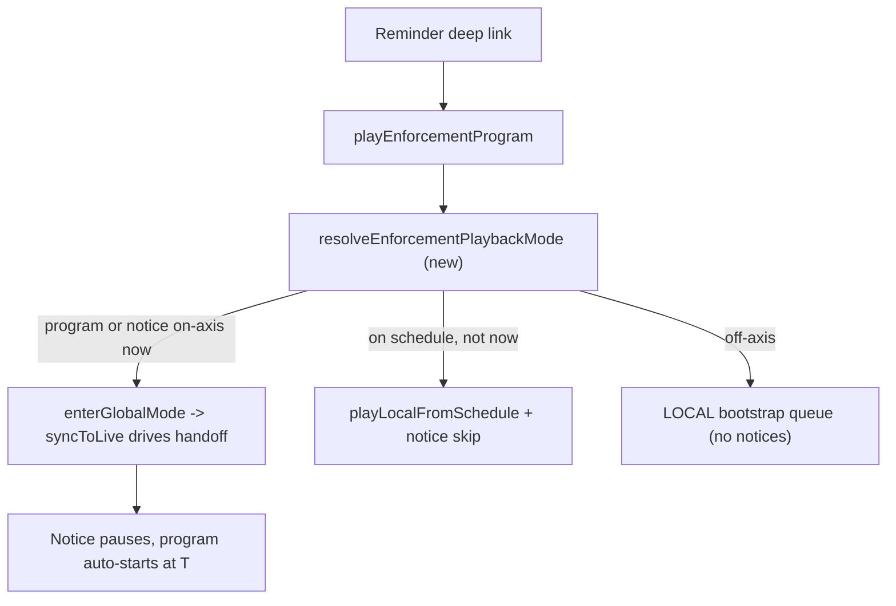

# TV System Production Fixes

## Root causes

Five defects explain every symptom reported. All are in shared code, so both Tipmanna TV and Community TV are affected identically.

1. `playEnforcementProgram` forces LOCAL, and LOCAL disables the only clock that advances the 60s notice slate.
2. `isSameOrchestratedPlayback` returns `false` with no retry path, so re-clicking a row is a permanent no-op.
3. `prepareMutedLoadForAutoplay` derives unmute intent from the player's transient state, so rapid loads clobber it.
4. Looper `isPlaying` is optimistic and ignores BUFFERING/CUED, so the icon desyncs.
5. `playLocalFromSchedule` re-pins the preview list it was supposed to leave alone, and `schedulePlayingSlot.source` is written but never read.



---

## Workstream 1: Enforcement runs live-first

Add a pure, unit-testable resolver in a new file `frontend/src/lib/tv/enforcement-playback-mode.ts`:

```ts
export type EnforcementPlaybackMode =
  | { kind: "live"; scheduleIndex: number }
  | { kind: "local_schedule"; scheduleIndex: number }
  | { kind: "bootstrap" };
```

It resolves the current broadcast position and returns `live` when the axis row at `now` belongs to this enforcement. Critical: the match must include `segmentKind === "notice"` rows carrying the same `enforcementId`, not just `"enforcement"` rows. `isEnforcementScheduleItem` in [frontend/src/components/tv-provider.tsx](frontend/src/components/tv-provider.tsx) must be audited for this and widened if it only matches enforcement clips.

Then rewrite `playEnforcementProgram` (lines 2866-2956):

- `live` -> call `enterGlobalMode()` and return. Do not manually load; `syncToLive` already pauses on notice and loads the program at `T`. This is the actual bug fix.
- `local_schedule` -> `playLocalFromSchedule(idx)`, where `idx` is advanced past any notice rows to the first real clip.
- `bootstrap` -> keep the existing LOCAL queue path unchanged (the bootstrap queue contains no notice rows, so it cannot strand).

Remove the now-unused `enterLocalMode("enforcement_live", ...)` call at line 2893.

### Safety net (belt and braces)

Independently of the above, add a guard so a stranded slate can never recur through any path: in `loadLocalAtIndex`, if the resolved item has `segmentKind === "notice"`, advance to the next non-notice index before loading. This covers pause/seek/tip-drawer entering LOCAL mid-notice.

---

## Workstream 2: Click-to-play reliability

In `requestPlayback` ([tv-provider.tsx](frontend/src/components/tv-provider.tsx) lines 937-944), make the identity guard reason-aware instead of an unconditional bail:

```ts
if (isSameOrchestratedPlayback(orchestratedPlaybackRef.current, req)) {
  if (isUserIntentReason(req.reason) && player?.isReady()) {
    player.seekTo(req.startSeconds, true);
    playWithUserGesture(
      player,
      pendingAudioRestoreRef.current,
      "requestPlayback.replay"
    );
    return true;
  }
  return false;
}
```

`isUserIntentReason` covers `loadLocal` and `enforcement`; `syncToLive` keeps the existing suppression so drift correction is unchanged.

Also in `loadLocalAtIndex` (lines 2712-2755): move `enterLocalMode("playlist", index)` to **after** the `if (!item) return` and the `extractYoutubeID` null check, so a bad index can no longer switch the user to LOCAL with nothing playing.

In `playLocalScheduleItem` (lines 2798-2810), the two silent `return`s on `findIndex === -1` should log via `tvTrace` so a stale-batch failure is diagnosable in production rather than invisible.7

---

## Workstream 3: Audio preservation

Root fix in [frontend/src/lib/tv-autoplay.ts](frontend/src/lib/tv-autoplay.ts). Derive restore intent from the durable user preference rather than the player's transient mute state:

```ts
export function prepareMutedLoadForAutoplay(
  player,
  shouldPlay = true
): PendingAudioRestore {
  const wantsAudio = !readTvMutePref() && hasTvAudioUnlockedThisSession();
  if (player.isReady() && !player.isMuted()) player.mute();
  return { restoreUnmuted: wantsAudio, shouldPlay };
}
```

This is idempotent, so the back-to-back-load clobbering disappears, and it no longer returns `false` merely because the player was not ready. `applyPendingAudioRestore` keeps its existing session-unlock check, which now agrees with the intent it was given.

Confirmed correct already and left alone: mute survives live/local switches (neither `enterLocalMode` nor `enterGlobalMode` touches it), and `applyPaymentPlaybackRestore` deliberately never programmatically unmutes after payment. Both are product behavior and will be documented as such.

---

## Workstream 4: Control state truth

Port the pattern already proven in [frontend/src/components/tv/tv-fullscreen.tsx](frontend/src/components/tv/tv-fullscreen.tsx) (lines 45-53) into the shared controls hook from Workstream 5: a 500ms reconcile loop reading `getPlayerState()` and `isMuted()`.

To avoid flicker fighting the optimistic toggles, gate reconciliation behind a short intent grace window: after a user presses play/pause/mute, ignore polled values for ~1s, then let the player become authoritative. This fixes "paused but showing playing" without making the buttons feel laggy.

Also add `onReady` replay for `isPlaying` (mute already has this at [tv-looper.tsx](frontend/src/components/tv/tv-looper.tsx) lines 1420-1427), since the `[isPlaying, playerRef]` effect never re-fires when the player transitions not-ready to ready.

---

## Workstream 5: Deduplicate the loopers (regression prevention)

This is the single most important step for "regressions are not introduced". The control code exists three times and all three are live:

- [tv-looper.tsx](frontend/src/components/tv/tv-looper.tsx) (mobile `/tv`) lines 848-880
- [web-tv-looper.tsx](frontend/src/components/tv/web-tv-looper.tsx) (desktop `/tv`) lines 831-863
- [home-tv-looper.tsx](frontend/src/components/tv/home-tv-looper.tsx) lines 848-880 - still reachable via `/partner` through `tv-home-preview-section.tsx`

Extract `frontend/src/hooks/use-tv-player-controls.ts` owning `isPlaying`, `isMuted`, `togglePlayPause`, `toggleMute`, `stopPlayer`, the reconcile poll, and the `onReady`/`onPlay` restore calls. All three loopers consume it. Workstreams 3 and 4 then land once instead of three times.

Keep this a pure lift-and-shift of existing behavior plus the two fixes above. Do not restructure the loopers' JSX in the same change.

---

## Workstream 6: Preview and schedule interaction

In `playLocalFromSchedule` (lines 2782-2794), delete the `setPreviewPinIndex(index)` line that contradicts the `updatePreviewPin: false` it passes one line later.

Consume the `source` field that is currently written and never read. In [tv-playlist-preview.tsx](frontend/src/components/tv/tv-playlist-preview.tsx), add an effect that scrolls the list container to top only when `schedulePlayingSlot?.source === "preview"`. The scroll container ref lives in [tv-interactive-shell.tsx](frontend/src/components/tv/tv-interactive-shell.tsx) (`scrollRef`, ~line 627) and must be threaded down or the effect hoisted to the shell.

Net result matches the specified behavior: preview click auto-scrolls to the pinned playing row; schedule-drawer click plays, closes the drawer, and leaves the preview scroll position alone.

### Dual highlight in the schedule

`liveBroadcastIndex` currently stops updating in LOCAL (lines 2397-2410), so the schedule loses the "what is live right now" marker while watching locally. Let the live-index resolver tick in both modes (it is a pure position calculation and drives no playback), so `PlaylistTable` can show the local-playing ring and the live marker simultaneously.

---

## Workstream 7: Section and enforcement visual metadata

### Backend (compose layer only, no migration)

Extend `TvPlaylistRow` in [backend/src/services/tv-virtual-playlist.service.ts](backend/src/services/tv-virtual-playlist.service.ts) (lines 6-41) with `sectionTitle?`, `sectionHalf?: "FIRST_HALF" | "SECOND_HALF"`, and `isSectionStart?: boolean`.

Stamp them in `mapPlaylistRowToClientPayload` (line 426), which takes the adjustment snapshot as a new argument. `sectionHalf` derives from `axisStartSec` against the 6h midpoint (`HALF_DAY_SEC / 2`); `isSectionStart` is true for position 0 and for the first row crossing the midpoint. The snapshot is already loaded by both callers.

Update all three call sites: [tv-schedule-read.service.ts](backend/src/services/tv-schedule-read.service.ts) line 160, [community-tv-enforcement-compose.service.ts](backend/src/services/community-tv-enforcement-compose.service.ts) line 146, and [tvScheduleAdmin.controller.ts](backend/src/controllers/tvScheduleAdmin.controller.ts) line 18.

Known limitation to accept for now: `TvAdjustmentSubsection` has no `title` column, only the `FIRST_HALF`/`SECOND_HALF` enum plus taxonomy chips. Labels will therefore read as the collection title plus a half qualifier. Per-half custom names would need a migration and both config UIs updated - flagged as a follow-up, not in this plan.

### Frontend

Add the three fields to `ScheduleItem` in [frontend/src/lib/tv/broadcastResolver.ts](frontend/src/lib/tv/broadcastResolver.ts).

Render section divider rows where `isSectionStart` is true, in both [tv-playlist-preview.tsx](frontend/src/components/tv/tv-playlist-preview.tsx) and [playlist-table.tsx](frontend/src/components/tv/playlist-table.tsx).

Replace the title-prefix hack in [playlist-table.tsx](frontend/src/components/tv/playlist-table.tsx) lines 315-318:

```ts
const isNoticeItem =
  item?.channel?.title?.startsWith("Program Start") ||
  item?.channel?.title?.startsWith("Program End");
```

with a `segmentKind` check, and add distinct styling for `segmentKind === "enforcement"` in both the preview playlist (which has none today) and the drawer.

---

## Workstream 8: Product behavior document

New file `product-behaviors/tv-system-product-behavior.md`, matching the existing convention in that folder (`payment-animation-product-behavior.md`, `authorization-policy.md`).

Contents:

- Ideal system model: the two modes, what each guarantees, and every transition trigger with its `reason` string
- Architecture: the single shared stack across Tipmanna TV and Community TV, the three loopers, the broadcast axis and `broadcastEpoch`, and the 3s sync loop
- Enforcement: virtual segment composition, the 60s notice slates as overlays rather than videos, the live-first playback rule from Workstream 1, the three resolver outcomes, and the lifecycle states
- Adjustment model: collections, halves, taxonomy weighting at generation time, the per-window rotation, and how sections surface in the UI
- Audio contract: mute-first for autoplay policy, durable preference in sessionStorage, persistence across transitions and mode switches, and the deliberate never-auto-unmute-after-payment rule
- Playlist contract: pinning, the preview-versus-schedule scroll distinction, and the dual highlight
- Known limitations and deferred items

---

## Verification

Unit tests (vitest) for the new pure logic, matching the existing `src/lib/__tests__` convention:

- `enforcement-playback-mode.spec.ts` - live / local_schedule / bootstrap resolution, including notice rows resolving to `live`
- `tv-autoplay.spec.ts` - restore intent survives back-to-back prepares and a not-ready player
- `tv-playback-request.spec.ts` - user-intent reasons replay, `syncToLive` still suppresses
- Backend spec extending `community-tv-enforcement-compose.spec.ts` for section stamping and midpoint boundary

Then `npm run typecheck`, `npm run lint`, `npm run test`, and a production build.

Manual matrix, run on both Tipmanna TV and a Community TV:

1. Enter live, wait for a notice to begin, confirm handoff to the program at 60s without leaving live
2. Open a reminder deep link during the notice window - confirm it stays live and hands off
3. Open a reminder deep link outside the window - confirm local playback starts on a real clip, not a slate
4. Unmute, let three videos auto-advance, confirm audio persists on every one
5. Toggle live/local repeatedly, confirm mute state and play icon stay accurate
6. Click the same playlist row twice, confirm it replays rather than dying
7. Click from preview (list scrolls to top) versus from schedule drawer (drawer closes, scroll preserved)
8. Confirm section dividers and enforcement colour appear in both the preview and the drawer
