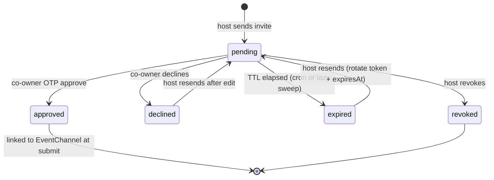

# Video Form Audit — Complete Fix Plan

## Root causes behind the reported symptoms

Most of the eleven observations trace back to four defects, not eleven:

- **A stuck hydration counter** in [frontend/src/hooks/use-coowner-draft-fields.ts](frontend/src/hooks/use-coowner-draft-fields.ts). The effect cleanup bumps `hydrationRequestRef` (line 162), so a stale response early-returns at line 138 *before* `setCoOwnerHydrating(false)` on line 139. The counter in [co-owner-draft-lifecycle-provider.tsx](frontend/src/providers/co-owner-draft-lifecycle-provider.tsx) never decrements, `lifecycleReady` stays `false` forever, and autosave (gated on it in [wizard-draft-autosave-provider.tsx](frontend/src/providers/wizard-draft-autosave-provider.tsx) line 49) never runs. This is "some drafts never get created".
- **Unstable callbacks feeding an effect dependency array.** [add-video-policy-fields.tsx](frontend/src/components/events/add-video-policy-fields.tsx) lines 87-90 pass fresh inline arrows for `setCoOwner`/`setDraftKey` every render, and `setCoOwner` is a dependency of the hydration effect (`use-coowner-draft-fields.ts` line 168). The effect refetches on every render, and line 153 writes back into the form, which re-renders. This is "form updates/clears while I'm filling it" plus a request storm. [event-content-privacy-step.tsx](frontend/src/components/events/event-content-privacy-step.tsx) lines 505-507 have the same shape.
- **A 5-second poller that reports `checking` on every tick.** In [use-coowner-draft-submit-blocked.ts](frontend/src/hooks/use-coowner-draft-submit-blocked.ts), `refresh` sets `setChecking(true)` (line 62) each tick and the effect re-asserts `setBlocked(true)` (line 103). Since submit disabled is `blocked || checking` ([add-video-form.tsx](frontend/src/components/events/add-video-form.tsx) line 292, [content-only/page.tsx](frontend/src/app/(event)/content-only/page.tsx) line 439), the button oscillates between "Submit" and "Awaiting co-owner approval" forever. Separately, `refreshRequestIdRef` is never bumped on cleanup, and the `!watchKey` branch (lines 54-57) returns *without* bumping it, so an in-flight request from the old key still passes the guard on line 91 and re-asserts `setBlocked(true)`. That is exactly why "awaiting co-owner refuses to go away" after switching to "Yes".
- **No expiry lifecycle for invites.** Only [videoCoOwnerInvite.controller.ts](backend/src/controllers/videoCoOwnerInvite.controller.ts) `getVideoCoOwnerInvitePublic` flips `pending` to `expired` (lines 281-289), and only when the *co-owner* opens the link. The host-facing status endpoint (lines 251-261) returns no `expiresAt` and never sweeps, there is no resend route, and the duplicate guard (lines 110-132) only considers `pending`/`approved` — so re-inviting the same email after expiry bypasses the 409 and crashes into the `@@unique([draftKey, coOwnerEmail])` constraint as a raw Prisma P2002.

Two observations are *not* bugs and need no state changes: co-owner data already survives an ownership toggle (nothing clears `coOwnerDraftKey`, and flipping back to "No" re-hydrates from the server), and the modal already re-verifies YouTube on the server at submit. Those only need the race fix above plus the gating and orphan cleanup below.

## Invite state machine (target)



Submit stays blocked in `pending`, `declined`, `expired`, and `revoked`; only `approved` unblocks. Each blocked state gets its own message and call to action.

## 1. Schema migration

In [backend/prisma/schema.prisma](backend/prisma/schema.prisma) `VideoCoOwnerInvite` (lines 524-555), add three columns and keep `@@unique([draftKey, coOwnerEmail])` intact so resend rotates in place:

```prisma
youtubeLink   String?
resentAt      DateTime?
resendCount   Int       @default(0)
```

`youtubeLink` is the consent binding: the URL the co-owner actually agreed to. Nullable so existing rows migrate cleanly; treated as unbound (legacy) when null.

## 2. Backend: expiry, resend, and consent binding

All in [videoCoOwnerInvite.controller.ts](backend/src/controllers/videoCoOwnerInvite.controller.ts) unless noted.

- **Require the URL before inviting.** `createVideoCoOwnerInvite` already accepts `youtubeLink` in the body (line 79) but only uses it for the email (line 211). Reject with 400 `"Add the YouTube video link before inviting a co-owner"` when neither the body nor `resolveCoOwnerVideoDetails` yields a link, and persist the resolved link to the new `youtubeLink` column. This closes "invite was sent with no YouTube link".
- **Expiry-aware duplicate guard.** Widen the `siblings` query (lines 110-122) to all statuses. On a match in `expired`/`declined`/`revoked`, return a 409 with a distinct `code: "invite_resendable"` plus the invite id so the UI can offer Resend instead of dying on P2002. Keep the existing 409s for `pending`/`approved`.
- **New resend endpoint.** `POST /host/video-co-owner-invites/:id/resend` in [coowner.route.ts](backend/src/routes/coowner.route.ts), host-scoped by `invitedByHostId`. Allowed from `pending` (throttled), `expired`, `declined`. It rotates `token` via `generateInviteToken()`, resets `expiresAt` to `hoursFromNow(COOWNER_CONFIG.INVITE_TOKEN_TTL_HOURS)`, sets `status: pending`, clears `declinedAt`, bumps `resendCount`, stamps `resentAt`, re-binds `youtubeLink`, writes an `invite_resent` entry via `appendApprovalLog`, and re-sends the email. Throttle to one resend per `COOWNER_CONFIG.RESEND_MIN_INTERVAL_MINUTES` (new constant, 10) and cap `resendCount` at 5.
- **Host status endpoint tells the truth.** In `getVideoCoOwnerInviteStatusByDraft`, lazily flip `pending` rows whose `expiresAt` has passed to `expired` before responding, and add `expiresAt`, `id`, `resentAt`, `resendCount`, `youtubeLink` to the `select`. Without `expiresAt` the form can never say "this link expired".
- **Cron sweep.** Add `runCoOwnerInviteExpirySweep()` to [backend/src/jobs/coOwnerReminders.ts](backend/src/jobs/coOwnerReminders.ts) and call it from the existing daily co-owner task in [backend/src/jobs/cron.ts](backend/src/jobs/cron.ts) (lines 217-232) — a single `updateMany` flipping `pending` rows past `expiresAt` to `expired`. The lazy sweep handles interactive reads; this one keeps the table honest for hosts who never reopen the form.
- **P2002 mapping.** Add a Prisma known-error branch to [coowner-form-error.util.ts](backend/src/utils/coowner-form-error.util.ts) so a unique violation on `(draftKey, coOwnerEmail)` surfaces as the resendable 409 rather than a 500.

## 3. Backend: submit-time validation

In [event-create-coowner.util.ts](backend/src/services/coOwner/event-create-coowner.util.ts) `assertVideoLinksCoOwnerForCreate`:

- Split the current catch-all (lines 115-121) into distinct messages for `expired` and `declined` invites so the form can render the right call to action: `"Co-owner invite expired — resend it before submitting"` and `"Co-owner declined — invite a different co-owner"`. Add both to `CO_OWNER_FIELD_MESSAGES` in [coowner-form-error.util.ts](backend/src/utils/coowner-form-error.util.ts) mapped to `ownershipAnswer`, and refresh the inline snapshot in [coowner-form-error-messages.spec.ts](backend/src/utils/__tests__/coowner-form-error-messages.spec.ts).
- **Enforce the consent binding.** For each co-owned link, compare `extractYoutubeId(invite.youtubeLink)` (from [extractYoutubeId.util.ts](backend/src/utils/extractYoutubeId.util.ts)) against `extractYoutubeId(link.url)`. On mismatch, throw `"Co-owner approved a different video — resend the invite for this link"`. Skip when `invite.youtubeLink` is null so pre-migration invites still submit.
- **Clean up orphans.** When `ownershipAnswer === "yes"` but the link still carries a `coOwnerDraftKey` with invites, mark those invites `revoked` inside the same transaction as channel creation. This is what makes "keep the approval until submit" safe: the approval survives every toggle while the form is open, and is only discarded once the host commits to full ownership.

## 4. Frontend: co-owner state machine

- **[use-coowner-draft-fields.ts](frontend/src/hooks/use-coowner-draft-fields.ts)** — move `setCoOwnerHydrating(false)` above the staleness guard (currently line 138 precedes line 139) and also call it from the effect cleanup, so the counter is balanced on every path. Hold `setCoOwner`/`setDraftKey`/`onDraftSaveNow` in refs and drop them from the dependency array (line 168), leaving `[draftKey, lifecycleReady, ownershipAnswer, refreshToken]`. Extend `CoOwnerInvitePhase` with `"expired"` and `"revoked"`, teach `invitePhaseFromRows` to return them, and surface `expiresAt`, `inviteId`, `canResend`, and a `resendInvite()` callback. Guard `sendInvite` on a non-empty `youtubeLink` with a clear toast, mirroring the new server rule.
- **[use-coowner-draft-submit-blocked.ts](frontend/src/hooks/use-coowner-draft-submit-blocked.ts)** — return `{ blocked, checking, revalidating, reason, refresh }`, where `checking` is true only for the first load after a `watchKey` change and background ticks set `revalidating` instead. Stop re-asserting `setBlocked(true)` on every effect run (line 103); only reset on an actual `watchKey` change. Bump `refreshRequestIdRef` in the effect cleanup *and* in the `!watchKey` early return so a stale in-flight response can never resurrect `blocked`. Stop the interval once every link is in a terminal state, since Pusher covers the transition; back the interval off to 15s otherwise.
- **[coowner-submit-readiness.util.ts](frontend/src/lib/coowner-submit-readiness.util.ts)** — add `"has_expired"`, `"has_declined"`, `"has_revoked"` to `CoOwnerBlockReason`, evaluate in the order pending, expired, declined, revoked, missing-approved, and give each a message in `coOwnerBlockReasonMessage` that names the fix rather than the generic "Co-owner must approve the email invite".
- **[use-coowner-pusher-approval-refresh.ts](frontend/src/hooks/use-coowner-pusher-approval-refresh.ts)** — move `successMessage` into a ref and drop it plus the raw `extraInviteIds` array from the dependency list (lines 104-105), keeping `extraFingerprint`. Today `successMessage` is rebuilt from `form.watch("title")` on every keystroke ([add-video-form.tsx](frontend/src/components/events/add-video-form.tsx) line 289), so every character tears down and re-subscribes the Pusher channel and refires the status fetch — a request storm that can also drop the approval event.
- Delete the unused `useCoOwnerInviteStatus` poller from [use-coowner-invite-status.ts](frontend/src/hooks/use-coowner-invite-status.ts) (nothing imports it; only `coOwnerStatusIndicatorClass` is used) rather than maintaining a third divergent status poller.

## 5. Frontend: co-owner status and resend UI

In [add-video-policy-fields.tsx](frontend/src/components/events/add-video-policy-fields.tsx) and the `CoOwnerInviteBlock` in [event-content-privacy-step.tsx](frontend/src/components/events/event-content-privacy-step.tsx), extract a shared `CoOwnerInviteStatusRow` component that renders an explicit badge for all five states — Invite sent / Awaiting approval (with "expires in N days" from the new `expiresAt`) / Approved / Declined / Expired — replacing the current three-state text at lines 214-226. Add a **Resend invitation** button visible in `expired` and `declined`, and in `pending` once the throttle window has elapsed. `readOnlyInvite` currently hides the only button once an invite exists (line 246), which is why there is no way out of an expired invite; keep name/email locked but always render the resend action. Extend `coOwnerStatusIndicatorClass` with expired/revoked styling, and add `resendVideoCoOwnerInviteAction` to [frontend/src/actions/events.ts](frontend/src/actions/events.ts) beside `createVideoCoOwnerInviteAction`.

## 6. Frontend: YouTube verification gating

- **Modal** — the check in [add-video-form.tsx](frontend/src/components/events/add-video-form.tsx) lines 334-343 is a post-click toast, so a host can click Submit mid-verification and only then learn why. Fold `verifyState` into the button's disabled expression at line 848 and label it "Verifying on YouTube…" while `verifyState === "checking"`.
- **Wizard** — `verifyStatus` is local state in [event-content-privacy-step.tsx](frontend/src/components/events/event-content-privacy-step.tsx) (line 73) and never leaves the step, so the wizard submit button has no idea verification is running. Lift it through a new `onVerifyStateChange` prop into the page-level state that already feeds `disabled={isLoading || coOwnerSubmitDisabled}` in all three wizard pages ([content-only](frontend/src/app/(event)/content-only/page.tsx) line 439, plus event-only and event-and-content), and block submit while any slot is `checking` or while a slot-1/slot-2 link is unverified.
- Also gate the **Send invite** button on a non-empty URL, so the client refuses the unbound invite before the server has to.

## 7. Frontend: draft lifecycle

- **Resume banner (chosen approach).** [use-form-draft-restore.ts](frontend/src/hooks/use-form-draft-restore.ts) only restores when `?draftId=` is present (line 31), so navigating back to `/content-only` yields a blank form *and* autosave mints a second draft. Extend the hook to also call `listFormDraftsAction()` for the current `kind` when no param is present and, on a hit, expose `{ pendingDraft, resume(), discard() }` without touching the form. Render a `DraftResumeBanner` in the three wizard pages next to `WizardDraftSaveIndicator`; Resume runs the existing `form.reset(merged)` path and adopts the id, Discard deletes server-side. Adopting the existing id is what stops duplicate draft creation.
- **Deletion actually deletes.** [form-drafts-panel.tsx](frontend/src/components/dashboard/form-drafts-panel.tsx) lines 166-168 drop the row from local state regardless of the response, so a failed delete looks like a success and the draft returns on reload. Check `res.success`, toast on failure, and keep the row. Same in `clearModalFormDraft` ([use-modal-form-draft-restore.ts](frontend/src/hooks/use-modal-form-draft-restore.ts) lines 89-91), which currently clears `sessionStorage` first and ignores the API result, orphaning the server row.
- **Surface save failures.** `DraftSaveIndicator` already accepts `saveError` (lines 10, 34-36) but neither caller passes it — add it in [wizard-draft-autosave-provider.tsx](frontend/src/providers/wizard-draft-autosave-provider.tsx) line 96 and [add-video-form.tsx](frontend/src/components/events/add-video-form.tsx) line 320. This is why "save to draft" looks ineffective: it can fail completely silently.
- **Stop drafts disappearing.** `listFormDrafts` in [form-draft.controller.ts](backend/src/controllers/form-draft.controller.ts) hard-caps at `take: 20` (line 29), so an active draft silently vanishes from the panel once 20 newer ones exist. Raise to 100 and add a `kind` query filter for the resume-banner lookup.
- **Restore failures must be loud.** [use-modal-form-draft-restore.ts](frontend/src/hooks/use-modal-form-draft-restore.ts) sets `restoredRef` before fetching (line 58) and returns silently on failure (line 62), leaving a blank form that autosave then saves over the top of. Toast the failure, leave `restoredRef` unset so a retry is possible, and hold autosave off until restore resolves.
- **Persist verification state.** `FormDraftPolicyJson.verifyStatus` is declared in [form-draft-utils.ts](frontend/src/lib/form-draft-utils.ts) (line 53) but never written by `splitDraftPayload` or read by `mergeDraftPayload`, while `isOnHostYoutube` *is* persisted — so a restored draft claims host-YouTube placement with no verification behind it. Write `verifyStatus` keyed by `${slot}:${url}` and only honour a restored `verified` when the slot and URL still match, reusing the fingerprint idea already in [youtube-verify-request.util.ts](frontend/src/lib/youtube-verify-request.util.ts).
- **Refreshed co-owner status on resume** falls out of items 2 and 4: the hydration effect refetches from the server on mount and the status endpoint now reports `expired`, so reopening a draft whose co-owner approved in the meantime shows Approved and submits cleanly.

## 8. Tests

- Backend unit: resend rotates token and expiry, respects throttle and cap, and revives `expired`/`declined`; duplicate guard returns the resendable 409 for terminal statuses; sweep flips only overdue `pending` rows; submit rejects expired, declined, and URL-mismatched consent; orphan invites are revoked when ownership flips to yes.
- Frontend unit: hydration counter is balanced across stale-response and unmount paths; a stale in-flight refresh cannot re-block after the watch key clears; `checking` stays false across background ticks; readiness returns the new reasons in priority order.
- Integration: the eleven reported scenarios as an explicit checklist, most importantly the toggle sequence no-then-yes-then-no with an approval mid-flight, and resume-after-expiry-then-resend-then-approve.

## Sequencing

Migration and backend (items 1-3) land first since the frontend depends on `expiresAt`, the new statuses, and the resend route. Then the co-owner state machine (item 4), which unblocks the UI work in items 5-6. Draft lifecycle (item 7) is independent of the co-owner work and can proceed in parallel.