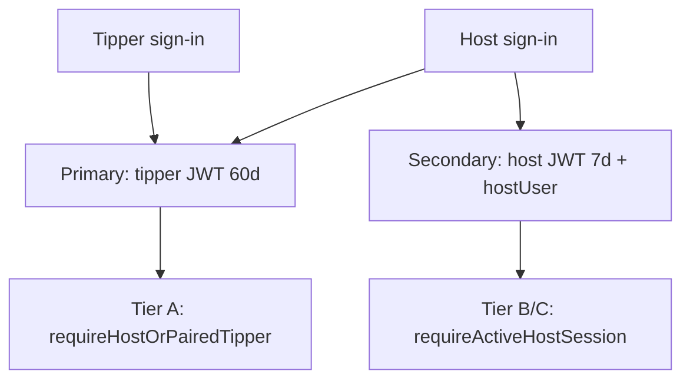

# Authorization Policy — Tipper / Host / Cohost / Visitor

**Last aligned:** 2026-08-20 (tipper-primary identity + hybrid tiers)

## Golden product rule

The **tipper account is the primary identifier** across the entire product. The primary session (`token` cookie + Redux `auth.user`) is always **tipper** or **visitor** — never host.

Host identity lives **only** in the secondary session:

| Cookie | Purpose |
|--------|---------|
| `hostToken` (HttpOnly) | Host-role JWT for Tier B/C API calls |
| `hostUser` (readable) | Stable host identity marker: `id`, `username`, `eventSlug`, `eventCode`, `email`, `hostSessionExpiresAt` |

Host sign-in mints **both**: tipper 60d JWT → primary, host 7d JWT → `hostToken`.

Never infer host authorization from `auth.user.role === "HOST"`, `tag === "EXISTING_HOST"`, or primary JWT role alone.

## Core invariant

`Tipper.id === Host.id` for every linked pair. Linkage is resolved only by `GET /auth/me/host-link` / `getHostLinkForUserId`. A linked tipper has Tier A reads; Tier B/C writes require an **active host session** (`hostToken` + unexpired `hostUser` marker where `hostUser.id === link.hostId`).

## Session lifetimes (sliding, server-enforced)

| Role | Inactivity window | Stored in | Refreshed by |
|------|-------------------|-----------|--------------|
| Tipper (primary) | 60 days | `token` + Tipper.lastActiveAt | Any product page |
| Host (secondary) | 7 days | `hostToken` + Host.lastActiveAt | Host login, dashboard visit, host-session touch |
| Cohost | 7 days | cohost JWT + EventCohost.lastActiveAt | Event-room activity |
| Visitor | 24 hours | visitor JWT + Visitor.lastActiveAt | Any visitor request |

Forced re-auth: set `AUTH_TOKEN_MIN_IAT` (unix) at deploy to invalidate pre-migration JWTs.

## Tier A — linkage detection alone (no host login)

Reads and affordances only. Uses **tipper JWT** + `requireHostOrPairedTipper`. Never mutates host-owned data; never exposes host-private data.

- `GET /auth/me/host-link`
- List owned / co-created communities (`GET /communities/me`, `/communities/sends/me`)
- List own event rooms for create dialog / TV picker (`GET /events/host/me/summary`)
- Recognize own creator profile (Edit visible; click gated Tier B)
- Owner / co-creator badges and Manage affordances
- Nav routes linked tipper to host sign-in instead of `/create-account`
- Add videos to existing owned event room **from create dialog only** (`X-Create-Surface: create_dialog`)

Frontend: `useHostCapability().canReadAsHost` (active **or** stale linkage).

## Tier B — active host session mandatory

Requires **host-role JWT** in `hostToken`. Stale ⇒ host login modal via `requestHostAuth()`, then resume.

- All `/host/*` dashboard routes (`HostDashboardGate` → `canWriteAsHost`)
- Creator profile Edit / save (`PUT /auth/creator-profile`, `PUT /auth/host-profile`)
- Event room administration from event room UI (not create-dialog surface)
- Add videos to community / co-creator community
- Start-community request form
- Community management, co-creator invites, payouts, revenue
- Host notifications fetch and host Pusher binding
- Event creation wizards (`/event-only`, etc.) — require `canWriteAsHost`

Frontend: `useHostCapability().canWriteAsHost` + `serverHostAuthHeaders()` for server actions.

## Tier C — cohost session (7 days, invited event only)

Full parity with owner for event-scoped routes in the invited event. Never dashboard, creator profile, or other rooms.

Frontend: `canManageRoomContent` (host session **or** cohost session for that event).

## Identity issuance (backend)

| Endpoint | Primary JWT | Host JWT | Notes |
|----------|-------------|----------|-------|
| `POST /auth/login-tipper` | tipper 60d | — | Linked host email → tipper + `hasHostAccount` + `tag: EXISTING_HOST` (copy only) |
| `POST /auth/login-or-register-tipper` | tipper 60d | — | Same |
| `POST /auth/verify-code` (accountType TIPPER) | tipper 60d | — | Default |
| `POST /auth/verify-code` (accountType HOST) | tipper 60d | host 7d | Dual response |
| `POST /auth/login-host` | tipper 60d | host 7d | Dual response |
| `POST /auth/login-or-register-host` | tipper 60d | host 7d | Dual response |

## Frontend helpers

| Helper | Use for |
|--------|---------|
| `useHostCapability()` | Tier A/B gating: `canReadAsHost`, `canWriteAsHost`, `requestHostAuth` |
| `useHostSession()` | Stable host id/slug from `hostUser` cookie |
| `useHostProfile()` | Volatile host fields via host token (subscription, legal names, numOfEvents) |
| `serverHostAuthHeaders()` | Server actions for Tier B host APIs |
| `serverEventActorAuthHeaders()` | Event-room mutations (prefers host session) |
| `applyPrimaryAndHostSessions()` | After host sign-in: tipper primary + host cookie |

## Adding a new host feature

1. Pick tier in `backend/src/configs/authorization-policy.ts` and `frontend/src/lib/authorization-policy.ts`.
2. Register route via `enforce(capability)`.
3. Gate UI with matching tier from `useHostCapabilityWithAuth`.
4. Event-scoped: default Tier C (cohost parity) unless dashboard-only.
5. **Never** use `user.role === "HOST"` on primary Redux for authorization.

## Error codes

- `403 { code: "HOST_SESSION_REQUIRED" }` — open host login modal, resume task
- `403 { code: "COHOST_SESSION_REQUIRED" }` — open cohost login modal, resume task

## Machine-readable sources

- Backend: `backend/src/configs/authorization-policy.ts` (`enforce()` factory)
- Frontend mirror: `frontend/src/lib/authorization-policy.ts`
- Verification: `npm run verify:hybrid-auth` (51+ checks including identity contract)
