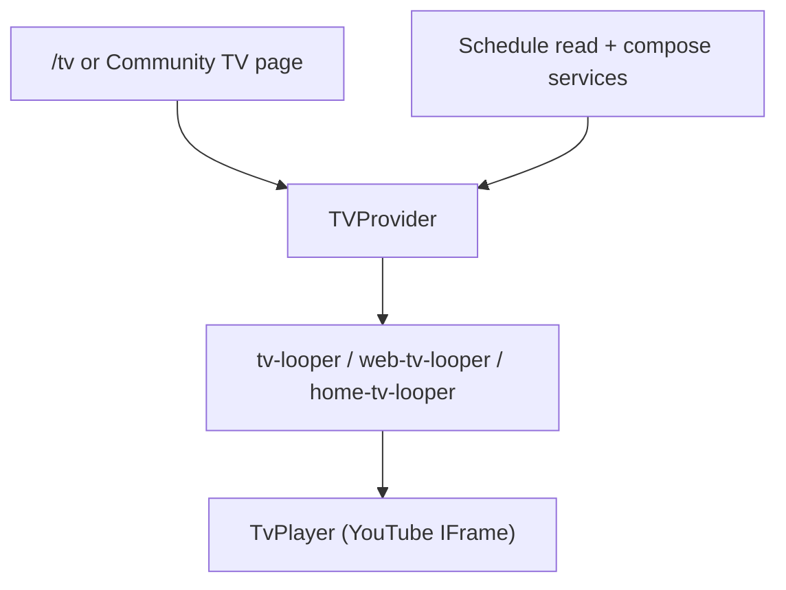

# TV System — Product Behavior Guide

This document describes how Tipmanna TV and Community TV work as a product: playback modes, the adjustment model, program enforcement, playlist interaction, and the shared architecture both surfaces use.

**Audience:** Product, design, and engineering teams planning TV features or diagnosing viewer experience issues.

**Scope:** Applies identically to **Tipmanna system TV** (`/tv`) and **Community TV** (same stack with a community schedule source). There is one playback engine — not separate players per surface.

---

## Product promise

1. **Live TV** behaves like broadcast television: the schedule advances on wall-clock time, and viewers stay synchronized with the global axis unless they explicitly choose local playback.
2. **Your TV (local mode)** lets a viewer pause, rewind, or pick any schedule row without affecting other viewers.
3. **Enforcement programs** insert authorized content onto the broadcast axis with pre/post notice slates; when a program is **on-axis**, it plays in **Live TV**, not local mode.
4. **Playlist clicks** always start playback reliably; clicking the same row again replays from the intended seek point.
5. **Audio state persists** across programmatic video transitions when the viewer has unlocked audio in the session.
6. **Transport controls** (play/pause/mute) reflect the YouTube player truth, including across segment transitions.

---

## Architecture (single stack)

| Layer               | Responsibility                                                                                            |
| ------------------- | --------------------------------------------------------------------------------------------------------- |
| **Backend compose** | Builds the 12-hour virtual axis: regular segments, enforcement clips, 60s notice slates, section metadata |
| **TVProvider**      | Mode (`GLOBAL` / `LOCAL`), sync-to-live, playlist orchestration, enforcement entry                        |
| **Looper**          | Chrome UI, seek bar, shared `useTvPlayerControls` hook                                                    |
| **TvPlayer**        | YouTube IFrame API wrapper                                                                                |

Community TV differs only by **schedule source** (`scheduleSourceCommunityId`); playback, enforcement, and UI rules are identical.

---

## Playback modes

| Mode     | UI label | Behavior                                                                                  |
| -------- | -------- | ----------------------------------------------------------------------------------------- |
| `GLOBAL` | Live TV  | `syncToLive` runs on an interval; player seeks to resolver position on the broadcast axis |
| `LOCAL`  | Your TV  | Live sync stops; viewer controls timeline via playlist clicks or transport controls       |

### When mode switches

| Action                               | Result                                                              |
| ------------------------------------ | ------------------------------------------------------------------- |
| User clicks **Go Live**              | `GLOBAL` — rejoins wall-clock position                              |
| User clicks a schedule/preview row   | `LOCAL` — plays selected item                                       |
| User pauses during live              | Stays `GLOBAL` unless they explicitly switch to local               |
| Enforcement **on-axis**              | Stays `GLOBAL` — notice slate → program clip handoff driven by sync |
| Enforcement **off-axis** (bootstrap) | `LOCAL` queue for notice + program until live catches up            |

**Critical rule:** Enforcement must **not** force `LOCAL` when the program or its notice slate is currently on the broadcast axis. Forcing local during on-axis enforcement was the root cause of the “starter notice stuck in Your TV” bug.

---

## The 12-hour broadcast axis

Each half-day batch (`A` or `B`) is a fixed **43,200-second** loop anchored to a **broadcast epoch**.

- Every playlist row has optional **axis coordinates** (`axisStartSec`, `axisEndSec`).
- `resolveBroadcastPosition` maps “now” → `{ scheduleIndex, offsetSeconds, item }`.
- Filtered or composed playlists still align to the same global timeline when axis metadata is present.

Rows without axis metadata fall back to cumulative duration ordering within the batch.

---

## Adjustment model

TV schedules can be **adjusted** (curated collections, prefer-first/second-half keys, collection title). Adjustments affect **how the schedule is generated**, not runtime mode logic.

### Section metadata (compose layer)

At schedule compose time, each row is stamped with:

| Field            | Meaning                                                        |
| ---------------- | -------------------------------------------------------------- |
| `sectionHalf`    | `FIRST_HALF` (0–6h) or `SECOND_HALF` (6–12h)                   |
| `isSectionStart` | `true` at row 0 and at the 6h midpoint crossing                |
| `sectionTitle`   | e.g. `{collectionTitle} · First half` — only on section starts |

**No database migration:** section labels are derived from adjustment snapshot + axis position when the playlist is served.

### UI presentation

- Section dividers appear in the preview playlist and full schedule drawer.
- Regular rows: white background.
- Notice slates: black background, white text.
- Enforcement clips: amber accent (`segmentKind === "enforcement"`).

---

## Program / video enforcement

Enforcement inserts **virtual axis segments** for authorized programs:

| `segmentKind` | Role                                                                              |
| ------------- | --------------------------------------------------------------------------------- |
| `notice`      | 60-second pre/post slate (“Program Start/End”) — **not a separate YouTube video** |
| `enforcement` | The forced program clip                                                           |
| `regular`     | Normal scheduled content                                                          |

All enforcement-related rows share an `enforcementId`.

### On-axis playback (live-first)

When a viewer opens or is routed to an enforcement program:

1. `resolveEnforcementPlaybackMode` checks whether the current axis position is inside that program’s notice or clip window.
2. If **yes** → `{ kind: "live" }` → stay in `GLOBAL`; `syncToLive` drives notice → program transition.
3. If **no** but rows exist in the schedule → `{ kind: "local_schedule" }` → play from first enforcement row, **skipping notice slates** in local bootstrap.
4. If **no rows** → `{ kind: "bootstrap" }` → legacy LOCAL queue bootstrap.

Notice slates are **never** valid LOCAL playlist entry points (`loadLocalAtIndex` skips `segmentKind === "notice"`).

### Pre-notice slate (60s axis segment)

The **pre-start** notice (`noticePhase: "pre"`) is a virtual 60-second axis segment — not a YouTube video. It is the single notification system for upcoming enforced programs; there is no separate modal or toast.

| Viewer mode          | Overlay visibility                                                                                       | Playback                                                                                 |
| -------------------- | -------------------------------------------------------------------------------------------------------- | ---------------------------------------------------------------------------------------- |
| **Live TV (GLOBAL)** | When `currentIndex` is on the notice row                                                                 | Player pauses via `syncToLive_notice_pause`; countdown shows axis-derived remaining time |
| **Your TV (LOCAL)**  | When live axis is in pre-notice (`livePreNotice`) even though `currentIndex` stays on the viewer’s video | Player pauses once; snapshot stores index + seek + play state                            |

**Countdown:** `remainingSec` is derived from the broadcast axis (`axisEndSec − loopPosition`), not a client-only timer.

**When countdown finishes:** If the viewer has not opted out, LOCAL mode switches to Live TV (`enterGlobalMode`) and the enforcement program plays on-axis. GLOBAL viewers hand off via existing `syncToLive`.

**Opt-out actions (LOCAL only):**

| Action                            | Result                                                             |
| --------------------------------- | ------------------------------------------------------------------ |
| **Return to what I was watching** | Dismiss slate, restore snapshot seek + play state, stay in Your TV |
| **Playlist or schedule click**    | Dismiss slate, play chosen row (notice rows still skipped)         |

**Critical rule:** Mode does **not** change when the slate **appears** — only on wait-out (LOCAL → GLOBAL) or explicit user action.

Post-notice slates (`noticePhase: "post"`) keep the prior static overlay behavior and are unchanged by this flow.

### Lifecycle states

Backend enforcement status (`AUTHORIZED`, `PENDING_APPROVAL`, rolled back, etc.) controls whether virtual segments are injected at compose time. Unauthorized programs never appear on the axis.

---

## Playlist interaction

Two playlist surfaces share the same `items` array:

| Surface                   | Purpose                                  | Click behavior                                                              |
| ------------------------- | ---------------------------------------- | --------------------------------------------------------------------------- |
| **Preview playlist**      | Rotated “up next” window near the player | Plays row, **re-pins** preview to clicked index, **scrolls preview to top** |
| **Schedule drawer/table** | Full authoritative schedule              | Plays row **without** re-pinning preview; no auto-scroll                    |

### Highlighting in LOCAL mode

When in `LOCAL`, both can show activity:

- **Playing row** — ring highlight on the item currently loaded in the player.
- **Live TV badge** — still marks where live broadcast would be (`liveBroadcastIndex`), even though playback is local.

`liveBroadcastIndex` continues updating in both modes so time labels and live anchoring stay accurate.

### Click-to-play reliability

- User-intent reasons (`loadLocal`, `enforcement`) bypass the “same orchestrated target” no-op guard.
- Clicking the **same row again** seeks and replays with a user-gesture play instead of being ignored.

---

## Audio and transport controls

### Audio preservation

Programmatic loads (sync, enforcement handoff, auto-advance) call `prepareMutedLoadForAutoplay`:

- Mute during load to satisfy browser autoplay policy.
- **Restore intent** comes from `readTvMutePref()` + `hasTvAudioUnlockedThisSession()` — **not** transient player mute state.
- After `PLAYING`, `applyPendingAudioRestore` unmutes if the session has unlocked audio.

User mute/unmute writes session preference via `writeTvMutePref`.

### Control state truth

All three loopers use `useTvPlayerControls`:

- Polls `getPlayerState()` and `isMuted()` every **500ms**.
- **1s grace window** after user clicks so optimistic UI is not immediately overwritten.
- Player events (`onPlay`, `onPause`, `onReady`) call `notifyPlayerPlaying` / `notifyPlayerPaused` / `syncFromPlayer`.

---

## Segment kinds reference

| Kind          | Duration       | Plays in GLOBAL | LOCAL entry                |
| ------------- | -------------- | --------------- | -------------------------- |
| `regular`     | Variable       | Yes             | Yes                        |
| `notice`      | 60s axis slot  | Yes (on-axis)   | **No** — skipped           |
| `enforcement` | Program length | Yes (on-axis)   | Yes (bootstrap / off-axis) |

---

## Key files (for engineering)

| Area                      | Path                                                  |
| ------------------------- | ----------------------------------------------------- |
| Provider / orchestration  | `frontend/src/components/tv-provider.tsx`             |
| Enforcement mode resolver | `frontend/src/lib/tv/enforcement-playback-mode.ts`    |
| Broadcast position        | `frontend/src/lib/tv/broadcastResolver.ts`            |
| Shared controls hook      | `frontend/src/hooks/use-tv-player-controls.ts`        |
| Audio autoplay helpers    | `frontend/src/lib/tv-autoplay.ts`                     |
| Section stamping          | `backend/src/services/tv-virtual-playlist.service.ts` |
| Segment styling           | `frontend/src/lib/tv/segment-visual-style.ts`         |

---

## Regression checklist

Before shipping TV changes, verify:

1. Live enforcement notice plays ~60s in **Live TV**, then program continues in **Live TV**.
2. Off-axis enforcement bootstrap plays program in **Your TV** without getting stuck on notice.
3. Muted/unmuted state survives auto-advance and enforcement transitions after user unmutes once.
4. Play/pause/mute buttons match player state after segment switches.
5. Preview click scrolls to top; schedule click does not re-pin preview.
6. Section dividers appear at 6h boundary with correct collection title.
7. Community TV and Tipmanna TV behave identically for the above.

---

## Related docs

- `docs/tv-startup-phase-c2-ssr-preconnect.md` — startup / preconnect optimizations
- Backend enforcement specs under `backend/src/services/__tests__/community-tv-enforcement*.spec.ts`
